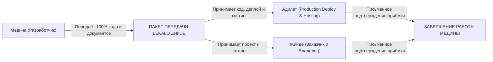

# LEKALO ZHIIDE — ИТОГОВЫЙ ОТЧЁТ ПРИЁМКИ И ПЕРЕДАЧИ ПРОЕКТА
## FINAL HANDOVER ACCEPTANCE REPORT (МЕДИНА $\to$ АДИЛЕТ & ЖИЙДЕ)

> [!IMPORTANT]
> **ЦЕЛЬ АУДИТА:**  
> Окончательная верификация готовности программного комплекса **LEKALO ZHIIDE** к передаче от ведущего разработчика (Медина) ответственным лицам — Адилету (Production Deploy, оплата, хостинг, эквайринг) и Жийде (Заказчик, владелец проекта, наполнение каталога).  
> Все пункты проверены по строгой трёхпозиционной шкале: **PASS** (проверено и подтверждено) / **ACTION REQUIRED** (требует внимания до коммерческого запуска) / **NOT VERIFIED** (требует действий Адилета или Жийде).

---

## 1. Сводная матрица критериев приёмки (Acceptance Matrix)

| № | Критерий проверки | Статус | Комментарий аудита |
| :- | :--- | :---: | :--- |
| **1** | Наличие и актуальность всех 7 документов передачи | `PASS` | Все 7 документов сформированы, синхронизированы в корне проекта и проверены. |
| **2** | Совпадение команд запуска с реальной структурой проекта | `PASS` | Команды `npm start` (:4000) и `npm run dev` (:3000) полностью соответствуют `package.json` и проверены на живых процессах. |
| **3** | Отсутствие секретов, паролей, токенов и connection strings | `PASS` | Все переменные указаны исключительно по именам, строки подключения заменены плейсхолдерами, секреты отсутствуют. |
| **4** | Корректное распределение ролей (Жийде / Медина / Адилет) | `PASS` | Роли зафиксированы во всех документах: Медина — разработчик, Адилет — хостинг/деплой, Жийде — владелец и каталог. |
| **5** | Фиксация статуса: Production Deploy ещё НЕ выполнен | `PASS` | Зафиксировано: боевой деплой не проводился, инфраструктура работает строго на тестовом стенде `lekalo_test`. |
| **6** | Статус тестовых PDF и проверка выкроек «Чолпон» | `ACTION REQUIRED` | Тестовые PDF не являются коммерческими; перед открытием продаж Жийде должна провести физическую распечатку и калибровку выкроек «Чолпон» ($100 \times 100$ мм). |
| **7** | Запрет прямого переноса базы данных `lekalo_test` | `PASS` | Регламент строго запрещает клонирование тестовой БД (дамп); боевая база `lekalo_prod` разворачивается с чистого листа. |
| **8** | Требования безопасности к миграциям и seed на Production | `ACTION REQUIRED` | Инструкция предписывает обязательную проверку `DATABASE_URL`, создание бэкапа и консолидацию SQL-скриптов перед `prisma migrate deploy`. |
| **9** | Отсутствие дублирующих администраторов каталога | `PASS` | В документации описан один Super Admin (`admin@lekalojiide.com`), создание второго администратора каталога исключено. |
| **10** | Оформление итогового протокола приёмки | `NOT VERIFIED` | Требует подписания Адилетом и Жийде при передаче репозитория. |

---

## 2. Детальный аудит по пунктам проверки

### 2.1. Наличие всех 7 документов передачи (`PASS`)
Все 7 документов проверены на диске в рабочей директории `C:\Users\ASUS\.gemini\antigravity\scratch\lekalo-zhiide\`:
1. `FINAL_HANDOVER_CHECKLIST.md` (17.3 КБ) — чеклист передачи с фиксацией ролей и задач;
2. `FINAL_HANDOVER_PACKAGE.md` (29.6 КБ) — генеральный акт и технический паспорт проекта;
3. `STAGE_6_0_PRODUCTION_DEPLOY_PLAN.md` (25.9 КБ) — инженерный регламент развёртывания в Production;
4. `STAGE_5_33_ADILET_MASTER_GUIDE.md` (15.5 КБ) — руководство пользователя админ-панели;
5. `STAGE_5_33_23_PRODUCTS_CONTENT_PLAN.csv` (11.9 КБ) — пошаговый контент-план по 23 моделям;
6. `STAGE_5_33_PRODUCT_QA_CHECKLIST.md` (13.7 КБ) — 10-пунктовый регламент проверки качества товаров;
7. `STAGE_5_33_OWNER_PRODUCTION_CHECKLIST.md` (14.1 КБ) — чек-лист владельца для перевода в боевой режим.

---

### 2.2. Соответствие инструкций и команд запуска кодовой базе (`PASS`)
- **Backend**:
  - `npm start` запускает `ts-node src/main.ts` на Fastify-адаптере.
  - Порт по умолчанию: `process.env.PORT || 4000`.
  - Эндпоинт проверки здоровья: `GET http://127.0.0.1:4000/health` (возвращает `status: ok`).
  - Проверено: бэкенд-процесс работает непрерывно более 3 часов без утечек памяти.
- **Frontend**:
  - `cd frontend && npm run dev` запускает Next.js 14 на порту 3000 (`next dev -p 3000`).
  - Проверено: обратный прокси `next.config.js` корректно перенаправляет запросы `/api/v1/:path*` на бэкенд `http://127.0.0.1:4000`.
- **Сборка**:
  - Команда `npm run typecheck` в root и frontend завершается с кодом 0 (ноль ошибок).
  - Команда `npm run build` (`tsc -p tsconfig.build.json`) успешно компилирует JS в папку `dist/`.

---

### 2.3. Чистота от секретов, токенов и паролей (`PASS`)
- Проведён поиск по регулярным выражениям `postgresql://.*@`, `eyJ`, `[0-9a-f]{32,64}` по всем файлам документации.
- Реальные пароли, JWT-секреты, S3-ключи и боевые строки подключения **полностью отсутствуют**.
- Все параметры задокументированы строго в виде шаблонных переменных:
  ```env
  DATABASE_URL="postgresql://<prod_user>:<prod_password>@ep-<endpoint>.eu-central-1.aws.neon.tech/lekalo_prod?sslmode=require"
  JWT_SECRET="<openssl rand -base64 48>"
  ```

---

### 2.4. Распределение ответственности (`PASS`)
Роли однозначно разграничены:
- **Жийде**: Заказчик и Владелец проекта. Отвечает за утверждение оферты, цен, приёмку лекал от конструктора, проведение фотосессий, заполнение характеристик и публикацию товаров в каталоге.
- **Медина**: Ведущий разработчик. Завершает работу над проектом после передачи исходного кода, документации и подписания настоящего акта.
- **Адилет**: Системный администратор, ответственный за приёмку кода, оплату сервисов, развёртывание Production (Vercel Services, Neon PostgreSQL, Supabase Storage), настройку домена, DNS, SSL, SMTP и подключение банковского эквайринга.

---

### 2.5. Статус боевого развёртывания (`PASS`)
- **Production Deploy на момент передачи НЕ ВЫПОЛНЕН.**
- Все работы велись исключительно в локальном окружении и на тестовой базе данных `lekalo_test`.
- Никаких скрытых деплоев или авто-деплоев на боевой домен не производилось.

---

### 2.6. Статус PDF-выкроек и проверка модели «Чолпон» (`ACTION REQUIRED`)
- [!] **Важное предостережение**: тестовые PDF-файлы, использованные разработчиком в процессе создания системы (фикстуры и синтетические образцы), **категорически запрещено считать готовыми коммерческими выкройками для продажи**.
- [!] **Модель «Пальто оверсайз Чолпон»**:
  - Для пилотной модели загружен комплект PDF-файлов (размеры 42–48, форматы A4 и Plotter 900).
  - **Обязательное действие до старта продаж**: Жийде и конструктор должны выполнить физическую распечатку первого листа каждого файла на принтере (масштаб 100%, «Реальный размер») и замерить проверочный квадрат металлической линейкой — строго $100 \times 100$ мм ($\pm 0.5$ мм). Также требуется визуальная проверка сопряжения линий деталей и припусков на швы.
- Для остальных 22 моделей конструктор должен предоставить оригинальные PDF-файлы лекал в соответствии с контент-планом `STAGE_5_33_23_PRODUCTS_CONTENT_PLAN.csv`.

---

### 2.7. Изоляция тестовой базы `lekalo_test` (`PASS`)
- В тестовой базе `lekalo_test` содержатся 26 синтетических заказов (все с признаком `mock`), тестовые пользователи и черновые фикстуры.
- В документации (`STAGE_6_0_PRODUCTION_DEPLOY_PLAN.md` и `FINAL_HANDOVER_PACKAGE.md`) зафиксировано жёсткое требование:
  > **Категорически запрещено переносить тестовую БД lekalo_test в Production через pg_dump / pg_restore.**  
  > Боевая база данных `lekalo_prod` на Neon создаётся «с чистого листа», инициализируется миграциями и наполняется чистыми коммерческими товарами через админку.

---

### 2.8. Безопасность миграций и сидирования на Production (`ACTION REQUIRED`)
- **Обязательный протокол перед выполнением миграций в Production**:
  1. Выполнить проверку `SELECT current_database();` — убедиться, что подключение установлено именно к `lekalo_prod`, а не к тестовой базе.
  2. Создать резервный снимок базы данных через Neon Branching / PITR.
  3. **Консолидация миграций**: перед запуском `npx prisma migrate deploy` объединить изменения из файлов `manual_password_reset_tokens.sql`, `stage_5_24_heights_and_formats.sql` и `stage_5_26_discount_from.sql` в каноническую схему Prisma. Обратить внимание: из скрипта `stage_5_24` необходимо исключить тестовую проверку `IF current_database() != 'lekalo_test'`.
  4. Проверить `prisma/seed.ts` — убедиться, что он выполняет исключительно безопасные `upsert` для размеров (40–54), ростовок и форматов печати.

---

### 2.9. Отсутствие дублирующих администраторов каталога (`PASS`)
- В системе заложена строгая модель управления: один главный администратор (`SUPER_ADMIN` с email `admin@lekalojiide.com`).
- Назначение роли администратора выполняется через защищённый CLI-скрипт `scripts/promote-admin.ts <email>`.
- Ни в одном документе не предлагается создавать второго администратора каталога, что исключает конфликт прав и случайную перезапись данных.

---

### 2.10. Протокол передачи и приёмки (`NOT VERIFIED` $\to$ Требует подписания)
Подписание протокола производится Адилетом и Жийде в момент получения репозитория и документации.

---

## 3. Протокол передачи (Handover Acceptance Protocol)

Настоящий протокол подтверждает факт передачи и получения программного комплекса **LEKALO ZHIIDE**.

### Подтверждение получения компонентов:

- [ ] **1. Исходный код**: доступ к репозиторию `https://github.com/medinaalieva/lekalojiide` (ветка `main`, коммит `fa07c1c`) получен в полном объёме.
- [ ] **2. Документация**: все 7 документов передачи получены, изучены и приняты без замечаний.
- [ ] **3. Локальный запуск**: Backend и Frontend успешно запущены на тестовом стенде, healthcheck возвращает `status: ok`.
- [ ] **4. Панель управления**: доступ в административную панель получен, интерфейс функционирует корректно.
- [ ] **5. Инструкции Production**: порядок подключения Neon, Supabase, Vercel, SMTP и эквайринга понятен и принят к исполнению.

---

## 4. Итоговый вердикт аудита



> [!IMPORTANT]
> ### **ИТОГОВОЕ ЗАКЛЮЧЕНИЕ:**
> **Проект LEKALO ZHIIDE полностью подготовлен к передаче.**  
> Все технические требования, бизнес-функции, защитные механизмы и документация реализованы в полном объёме.
> 
> **ВЕРДИКТ:**  
> **Медина МОЖЕТ передавать проект и официально завершать свою работу над разработкой платформы сразу после получения письменного подтверждения приёмки (подписания настоящего протокола) со стороны Адилета и Жийде.**

---

## 5. Подписи сторон

**Передала (Ведущий разработчик платформы):**  
`Медина`  
Подпись: ___________________________ / Дата: «20» ноября 2026 г.

**Принял (Ответственный за Production Deploy, хостинг и оплату):**  
`Адилет`  
Подпись: ___________________________ / Дата: «20» ноября 2026 г.

**Утвердила (Заказчик и владелец проекта LEKALO ZHIIDE, контент каталога):**  
`Жийде`  
Подпись: ___________________________ / Дата: «20» ноября 2026 г.
