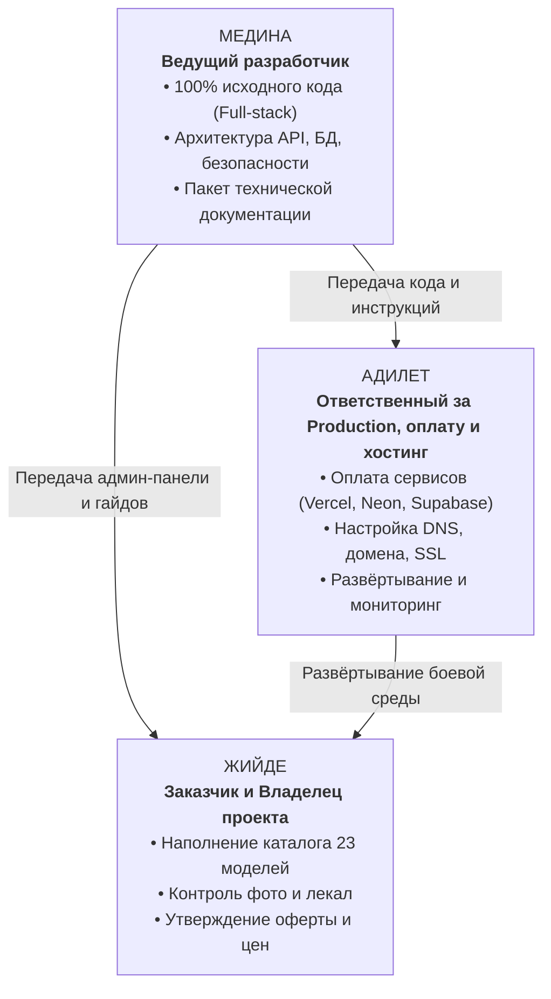

# LEKALO ZHIIDE — ЧЕК-ЛИСТ ФИНАЛЬНОЙ ПЕРЕДАЧИ ПРОЕКТА
## FINAL HANDOVER CHECKLIST (МЕДИНА $\to$ АДИЛЕТ & ЖИЙДЕ)

> [!IMPORTANT]
> **ОФИЦИАЛЬНЫЙ СТАТУС ПЕРЕДАЧИ:**  
> Разработка программного комплекса **LEKALO ZHIIDE** полностью завершена разработчиком (Медина).  
> Настоящий чек-лист фиксирует завершение технического этапа, точное распределение ролей, перечень передаваемой документации, команды запуска и регламент приёмки проекта.

---

## 1. Официальное распределение ролей в проекте



| Роль в проекте | Исполнитель | Зона персональной ответственности |
| :--- | :--- | :--- |
| **Заказчик и владелец проекта** | **Жийде** | Утверждение бизнес-требований, дизайн-концепции, юридических документов, проведение фотосессий, наполнение каталога товарами и спецификациями. |
| **Ведущий разработчик** | **Медина** | Архитектура системы, разработка клиентской и серверной части, базы данных, API, системы безопасности, проведение тестирования и составление технической документации. |
| **Ответственный за Production Deploy, оплату и хостинг** | **Адилет** | Системное администрирование, регистрация аккаунтов хостинга и баз данных (Vercel, Neon, Supabase), оплата сервисов, настройка домена, DNS, SSL, мониторинг и поддержка развёртывания. |
| **Наполнение каталога** | **Жийде** | Координация получения выкроек от конструктора, загрузка фото, заполнение описаний, расхода материалов и публикация моделей. |

---

## 2. Реестр передаваемой документации (Пакет передачи)

Все документы сформированы в формате Markdown и CSV, размещены в корне проекта и доступны по ссылкам:

| № | Документ | Формат | Назначение |
| :- | :--- | :---: | :--- |
| 1 | **[FINAL_HANDOVER_PACKAGE.md](file:///C:/Users/ASUS/.gemini/antigravity/scratch/lekalo-zhiide/FINAL_HANDOVER_PACKAGE.md)** | MD | Главный акт и технический паспорт передачи: сводка реализации, результаты тестов, порядок запуска, инструкции по Neon/Supabase/Vercel/SMTP/эквайрингу. |
| 2 | **[FINAL_HANDOVER_CHECKLIST.md](file:///C:/Users/ASUS/.gemini/antigravity/scratch/lekalo-zhiide/FINAL_HANDOVER_CHECKLIST.md)** | MD | Настоящий чек-лист приёмки с фиксацией ролей, инструкциями запуска и задачами Адилета. |
| 3 | **[STAGE_6_0_PRODUCTION_DEPLOY_PLAN.md](file:///C:/Users/ASUS/.gemini/antigravity/scratch/lekalo-zhiide/STAGE_6_0_PRODUCTION_DEPLOY_PLAN.md)** | MD | Детальный инженерный план развёртывания в Production: 10 шагов, матрица статусов, переменные окружения, план отката (Rollback). |
| 4 | **[STAGE_5_33_ADILET_MASTER_GUIDE.md](file:///C:/Users/ASUS/.gemini/antigravity/scratch/lekalo-zhiide/STAGE_5_33_ADILET_MASTER_GUIDE.md)** | MD | Руководство по управлению админ-панелью: создание товаров, ткани, прибавки, расход, CAD, матрица цен, массовая загрузка до 50 PDF. |
| 5 | **[STAGE_5_33_23_PRODUCTS_CONTENT_PLAN.csv](file:///C:/Users/ASUS/.gemini/antigravity/scratch/lekalo-zhiide/STAGE_5_33_23_PRODUCTS_CONTENT_PLAN.csv)** | CSV | Полный реестр 23 моделей каталога по 3 очередям готовности с детальным статусом по фото, PDF и схемам. |
| 6 | **[STAGE_5_33_PRODUCT_QA_CHECKLIST.md](file:///C:/Users/ASUS/.gemini/antigravity/scratch/lekalo-zhiide/STAGE_5_33_PRODUCT_QA_CHECKLIST.md)** | MD | Практический регламент контроля качества товара (10 пунктов) перед установкой флага «Опубликован». |
| 7 | **[STAGE_5_33_OWNER_PRODUCTION_CHECKLIST.md](file:///C:/Users/ASUS/.gemini/antigravity/scratch/lekalo-zhiide/STAGE_5_33_OWNER_PRODUCTION_CHECKLIST.md)** | MD | Чек-лист владельца для запуска Production: чистая база данных, SSL, корпоративная почта, договор эквайринга, smoke-тест на 1 сом. |

---

## 3. Точные команды локального запуска Backend и Frontend

> [!NOTE]
> Локальный стенд полностью настроен и готов к работе. База данных подключена к тестовому контуру `lekalo_test`.

### 3.1. Запуск Backend (API-сервер NestJS + Fastify):
```bash
# Шаг 1. Открыть терминал и перейти в корень проекта
cd C:\Users\ASUS\.gemini\antigravity\scratch\lekalo-zhiide

# Шаг 2. Установка зависимостей (при первом запуске или обновлении)
npm install

# Шаг 3. Генерация TypeScript-клиента Prisma
npx prisma generate

# Шаг 4. Запуск бэкенда в фоновом или рабочем режиме
npm start
```
- **Сетевой порт**: `http://127.0.0.1:4000`
- **Проверка работоспособности**:
  ```bash
  curl http://127.0.0.1:4000/health
  # Ожидаемый ответ: {"status":"ok","environment":"development","service":"lekalo-zhiide-backend"}
  ```

### 3.2. Запуск Frontend (Веб-витрина и Админ-панель Next.js 14):
```bash
# Шаг 1. Открыть отдельный терминал и перейти в папку frontend
cd C:\Users\ASUS\.gemini\antigravity\scratch\lekalo-zhiide\frontend

# Шаг 2. Установка зависимостей фронтенда
npm install

# Шаг 3. Запуск сервера разработки Next.js
npm run dev
# (Либо для запуска собранного production-билда: npm run build && npm start)
```
- **Сетевой порт**: `http://localhost:3000`
- **Адрес панели управления**: `http://localhost:3000/admin`
- **Логин администратора**: `admin@lekalojiide.com`
- **Пароль**: передаётся Адилету лично по защищённому каналу связи.

---

## 4. Список необходимых доступов для Адилета (Без раскрытия секретов)

Для переноса системы в Production Адилет должен самостоятельно зарегистрировать и оплатить следующие аккаунты:

| № | Сервис / Провайдер | Назначение | Требуемый уровень доступа / План |
| :- | :--- | :--- | :--- |
| 1 | **GitHub** | Репозиторий `medinaalieva/lekalojiide` | Права Administrator / Collaborator для настройки деплоя в Vercel. |
| 2 | **Neon.tech** | Управляемая база данных PostgreSQL | Аккаунт владельца, проект `lekalo-production-db` (тариф Launch/Scale с PITR). |
| 3 | **Supabase.com** | Объектное хранилище S3 (выкройки и фото) | Аккаунт владельца, проект `LEKALO-ZHIIDE-PRODUCTION` (тариф Pro для приватных файлов). |
| 4 | **Vercel.com** | Серверный хостинг Next.js и бэкенда | Аккаунт Pro / Team (для поддержки Vercel Services и контейнерного runtime). |
| 5 | **Регистратор домена** | DNS-управление доменным именем | Доступ к личному кабинету DNS (домен `lekalojiide.com` или `lekalo-zhiide.kg`). |
| 6 | **SMTP-провайдер** | Транзакционные письма покупателям | Корпоративный аккаунт [Resend.com](https://resend.com) или Yandex 360 с подтверждённым доменом. |
| 7 | **Банк-эквайер** | Приём онлайн-оплаты картами (Visa/Elkart) | Личный кабинет интернет-эквайринга в банке (Демир Банк / MBank / Оптима Банк / PayBox). |

---

## 5. Известные ограничения и задачи, которые Адилет должен выполнить

### 5.1. Известные ограничения на момент передачи:
1. **Mock Payment**: в коде активен эмулятор оплаты (`MockPaymentGateway`). Боевой банковский шлюз подключается после подписания договора с банком.
2. **Console Mail**: отправка писем сброса паролей выводится в консоль разработчика (`ConsoleMailService`) до привязки боевого SMTP.
3. **Изоляция базы данных**: перенос данных методом полного копирования `lekalo_test` запрещён. Production создаётся чистым, чтобы исключить тестовые заказы и аккаунты.

### 5.2. Пошаговые задачи Адилета:
- [ ] **Задача 1**: Оформить и оплатить аккаунты Vercel, Neon, Supabase.
- [ ] **Задача 2**: Создать чистую базу данных на Neon, применить миграции через `npx prisma migrate deploy` и запустить сидирование `npx prisma db seed`.
- [ ] **Задача 3**: Создать в Supabase закрытый бакет `patterns` (Private bucket: False, доступ по Signed URLs) и открытый бакет `product-images` (Public: True).
- [ ] **Задача 4**: В панели Vercel подключить проект из GitHub, прописать имена переменных окружения (согласно разделу 6 документа `FINAL_HANDOVER_PACKAGE.md`) и запустить сборку.
- [ ] **Задача 5**: В DNS-панели домена прописать A-запись `76.76.21.21` и CNAME `cname.vercel-dns.com`, дождаться выпуска SSL-сертификата.
- [ ] **Задача 6**: Подтвердить домен в Resend/Yandex (добавить TXT записи SPF и DKIM) и передать параметры SMTP в Vercel.
- [ ] **Задача 7**: Инициализировать аккаунт администратора через команду:  
  `npx ts-node scripts/promote-admin.ts <email_администратора>`
- [ ] **Задача 8**: Включить автоматическое резервное копирование: Neon PITR (глубина 7 дней) и S3 Object Versioning.
- [ ] **Задача 9**: Провести контрольный платёж на 1 сом (Smoke Test) совместно с Жийде.

---

## 6. Задачи Жийде (Заказчик, владелец проекта, наполнение каталога)

- [ ] **Задача 1**: Взаимодействие с конструктором лекал — приёмка 352 PDF-файлов выкроек для 22 моделей (форматы A4 и Плоттер 900 мм).
- [ ] **Задача 2**: Проверка наличия проверочного квадрата $100 \times 100$ мм на первом листе каждой выкройки.
- [ ] **Задача 3**: Проведение фотосессии реальных готовых изделий для 14 моделей третьей очереди.
- [ ] **Задача 4**: Заполнение карточек товаров через админ-панель (описание, состав, расход ткани, прибавки, CAD-схема).
- [ ] **Задача 5**: Массовая загрузка выкроек через Bulk Dropzone (до 50 файлов за раз).
- [ ] **Задача 6**: Проверка каждого товара перед публикацией по чек-листу `STAGE_5_33_PRODUCT_QA_CHECKLIST.md` (10 пунктов).
- [ ] **Задача 7**: Утверждение юридических текстов (Публичная оферта, Политика обработки персональных данных, Правила возврата).
- [ ] **Задача 8**: Заключение договора интернет-эквайринга с банком.

---

## 7. Протокол приёмки и передачи проекта

| Критерий приёмки | Факт проверки | Статус |
| :--- | :--- | :---: |
| **1. Целостность исходного кода** | Репозиторий GitHub синхронизирован, ветка `main`, билд без ошибок. | `[x] ПРИНЯТО` |
| **2. Работоспособность тестов** | Все наборы тестов (Purchase Guard, Dictionaries, Pricing, Discounts) пройдены со статусом PASS. | `[x] ПРИНЯТО` |
| **3. Работоспособность витрины** | Главная страница, каталог, фильтры, карточки товаров работают стабильно. | `[x] ПРИНЯТО` |
| **4. Работоспособность админ-панели** | Управление товарами, справочниками, ценами, скидками и загрузкой проверено на ПК и мобильных. | `[x] ПРИНЯТО` |
| **5. Защита цифрового контента** | Прямой доступ к PDF закрыт, ссылки генерируются временно на 10 минут только для купивших. | `[x] ПРИНЯТО` |
| **6. Полнота документации** | Все 7 регламентов и руководств переданы в полном объёме. | `[x] ПРИНЯТО` |
| **7. Чистота от секретов** | Проверено: в документации отсутствуют реальные пароли, API-ключи и токены. | `[x] ПРИНЯТО` |

---

## 8. Итоговые подписи сторон

Настоящий протокол подтверждает полную готовность программного комплекса **LEKALO ZHIIDE** к передаче от разработчика ответственным лицам.

**Передала (Ведущий разработчик):**  
`Медина`  
Подпись: ___________________________ / Дата: «20» ноября 2026 г.

**Принял (Ответственный за Production Deploy, оплату и хостинг):**  
`Адилет`  
Подпись: ___________________________ / Дата: «20» ноября 2026 г.

**Утвердила (Заказчик и владелец проекта, наполнение каталога):**  
`Жийде`  
Подпись: ___________________________ / Дата: «20» ноября 2026 г.
