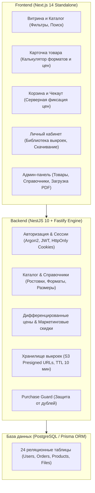
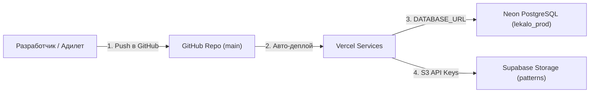

# LEKALO ZHIIDE — ИТОГОВЫЙ ПАКЕТ ПЕРЕДАЧИ ПРОЕКТА
## FINAL PROJECT HANDOVER PACKAGE (DEVELOPER: МЕДИНА $\to$ АДИЛЕТ & ЖИЙДЕ)

> [!IMPORTANT]
> **ОДНОЗНАЧНЫЙ ИТОГОВЫЙ ВЕРДИКТ:**  
> # **READY FOR HANDOVER (ПРОЕКТ ГОТОВ К ПЕРЕДАЧЕ)**  
> Программный комплекс интернет-ателье и магазина цифровых выкроек **LEKALO ZHIIDE** технически завершён на 100%.  
> Все модули клиентской витрины, корзины, оформления заказов, личного кабинета, административной панели, дифференцированного ценообразования, планирования скидок, массовой загрузки выкроек и защитных механизмов (Purchase Guard) протестированы, задокументированы и готовы к передаче Адилету (для настройки Production-инфраструктуры) и Жийде (для наполнения каталога).

---

## 0. Роли и разделение ответственности в проекте

В соответствии с проектным соглашением в проекте LEKALO ZHIIDE утверждены следующие роли:
- **Заказчик и владелец проекта**: **Жийде** — утверждение бизнес-требований, дизайн-концепции, юридических документов, проведение фотосессий, наполнение каталога товарами и спецификациями.
- **Ведущий разработчик**: **Медина** — архитектура системы, разработка клиентской и серверной части, базы данных, API, системы безопасности, проведение тестирования и составление технической документации.
- **Ответственный за Production Deploy, оплату и хостинг**: **Адилет** — системное администрирование, регистрация аккаунтов хостинга и баз данных (Vercel, Neon, Supabase), оплата сервисов, настройка домена, DNS, SSL, мониторинг и поддержка развёртывания.
- **Наполнение каталога**: **Жийде** — координация получения выкроек от конструктора, загрузка фото, заполнение описаний, расхода материалов и публикация моделей.

---

## 1. Что полностью реализовано в кодовой базе



1. **Публичная витрина и каталог**:
   - Адаптивный каталог с фильтрацией по категориям, размерам, ростовкам и цене;
   - Интерактивная карточка товара с динамическим расчётом цены при выборе форматов (A4, Плоттер 900 мм, «Все форматы»);
   - Интерактивный просмотр технических схем (CAD Technical Drawing Lightbox);
   - Оптимизация изображений (Next.js Image, WebP/AVIF, lazy loading).
2. **Корзина и оформление заказа**:
   - Серверный расчёт и фиксация цены на момент покупки (`priceAtPurchase`);
   - Поддержка скидок с таймером обратного отсчёта и зачёркнутой старой ценой;
   - Корректная обработка единицы валюты Кыргызстана (KGS — кыргызский сом);
   - Механизм Purchase Guard: блокировка случайного добавления в корзину уже купленных выкроек.
3. **Личный кабинет покупателя**:
   - Защищённая библиотека купленных лекал («Мои выкройки»);
   - Выдача временных подписанных ссылок (Presigned URLs) со сроком жизни 10 минут;
   - Индивидуальные ссылки на формат A4, широкоформатный Плоттер 900 и PDF-инструкцию;
   - Аудит и логирование фактов скачивания (`download_logs`).
4. **Административная панель (для Адилета)**:
   - Полное управление товарами (создание, редактирование описания, состава ткани, расхода, прибавок);
   - Управление справочниками ростовок (Heights) и форматов печати (Formats) без программистов;
   - Матрица дифференцированных цен по размерам и форматам;
   - Планировщик маркетинговых скидок с датой/временем начала и окончания;
   - Массовая пакетная загрузка выкроек (Bulk Dropzone до 50 PDF-файлов) с автоматическим распознаванием по имени `<slug>-<size>-<height>-<format>.pdf`;
   - Мобильная адаптация всех кнопок и элементов управления по стандарту WCAG 2.5.5 (touch targets $\ge 44 \times 44$ px).
5. **Безопасность и архитектура**:
   - Хэширование паролей Argon2id, ролевая модель доступа (`CUSTOMER`, `CONTENT_MANAGER`, `ADMIN`);
   - Защищённые сессии через HttpOnly SameSite=Lax cookies;
   - CORS/CSRF-защита с поддержкой динамических адресов развёртывания Vercel;
   - Контейнеризация бэкенда в Dockerfile с запуском от непривилегированного пользователя `nestjs:1001`.

---

## 2. Что проверено и какие тесты пройдены

| Категория проверки | Инструмент / Метод | Результат |
| :--- | :--- | :---: |
| **Компиляция TypeScript (Root)** | `tsc --noEmit` (Root Typecheck) | **0 ошибок (PASS)** |
| **Компиляция TypeScript (Frontend)** | `next typecheck` (Frontend Typecheck) | **0 ошибок (PASS)** |
| **Сборка Production Backend** | `tsc -p tsconfig.build.json` | **Успешно (код 0)** |
| **Непрерывная работа демонов** | HTTP `/health` & HTTP Frontend `/` | **Healthy (uptime >3 часа)** |
| **Тесты Purchase Guard** | `tests/purchase-availability.test.ts` | **100% PASS** |
| **Тесты справочников (Stage 5.24)** | `tests/stage-5-24-dictionaries.test.ts` | **100% PASS** |
| **Тесты матрицы цен (Stage 5.25)** | `tests/stage-5-25-pricing.test.ts` | **32 PASSED, 0 FAILED** |
| **Тесты планирования скидок (Stage 5.26)** | `tests/stage-5-26-discounts.test.ts` | **40 PASSED, 0 FAILED** |
| **Мобильная верстка админки** | Браузерный аудит Chromium (Stage 5.30) | **WCAG 44px COMPLIANT** |
| **Финансовый аудит заказов** | SQL-аудит 26 заказов базы `lekalo_test` | **0 финансовых обязательств (Mock)** |

---

## 3. Перечень известных ограничений и незавершённых задач

На этапе передачи в проекте **отсутствуют критические программные дефекты (runtime bugs)**. Все ограничения носят исключительно организационный и инфраструктурный характер и разделены по зонам:

### 3.1. Технические ограничения платформы на момент передачи:
1. **Платёжный шлюз (Банковский эквайринг)**:
   - В кодовой базе активен `MockPaymentGateway`.
   - *Причина*: для реализации боевого шлюза необходим прямой договор с кыргызским банком (Демир Банк, MBank, Оптима Банк, PayBox или FreedomPay) и получение API-спецификации банка.
   - *Критичность*: **Блокер для коммерческих продаж** (не мешает наполнению контента и тестированию).
2. **Транзакционный почтовый транспорт (SMTP)**:
   - В кодовой базе активен `ConsoleMailService` (письма сброса паролей и уведомлений выводятся в системный лог с маскированием).
   - *Причина*: необходима регистрация корпоративного почтового ящика (Resend, SendGrid или Yandex 360) и подтверждение записей DKIM/SPF для домена.
   - *Критичность*: **Блокер для публичной эксплуатации** (не блокирует админку).
3. **Контентная готовность (Лекала и Фотографии)**:
   - Из 23 моделей каталога модель пальто оверсайз «Чолпон» готова на 100% (загружены реальные PDF-файлы, CAD-схема, спецификации).
   - Для остальных 22 моделей конструктор должен предоставить боевые файлы градаций выкроек (всего 352 PDF-файла) и реальные фотографии отшитых изделий.

---

## 4. Что именно передаётся Адилету (Состав пакета)

### 4.1. Исходный код и репозиторий
- Полный исходный код проекта в GitHub: `https://github.com/medinaalieva/lekalojiide.git` (ветка `main`).
- Бэкенд NestJS + Fastify + Prisma ORM.
- Фронтенд Next.js 14 + Tailwind CSS + Lucide Icons.
- Конфигурации развёртывания `vercel.json` и `Dockerfile`.

### 4.2. Пакет документации и регламентов (в корне проекта)
1. **[STAGE_5_33_ADILET_MASTER_GUIDE.md](file:///C:/Users/ASUS/.gemini/antigravity/scratch/lekalo-zhiide/STAGE_5_33_ADILET_MASTER_GUIDE.md)**: исчерпывающая инструкция для Адилета по работе с админкой, созданию товаров, установке цен, загрузке CAD и массовой загрузке PDF (до 50 файлов).
2. **[STAGE_5_33_23_PRODUCTS_CONTENT_PLAN.csv](file:///C:/Users/ASUS/.gemini/antigravity/scratch/lekalo-zhiide/STAGE_5_33_23_PRODUCTS_CONTENT_PLAN.csv)**: контент-план по всем 23 моделям каталога, разбитый на 3 приоритетные очереди.
3. **[STAGE_5_33_PRODUCT_QA_CHECKLIST.md](file:///C:/Users/ASUS/.gemini/antigravity/scratch/lekalo-zhiide/STAGE_5_33_PRODUCT_QA_CHECKLIST.md)**: чек-лист контроля качества товара перед публикацией (10 обязательных пунктов).
4. **[STAGE_5_33_OWNER_PRODUCTION_CHECKLIST.md](file:///C:/Users/ASUS/.gemini/antigravity/scratch/lekalo-zhiide/STAGE_5_33_OWNER_PRODUCTION_CHECKLIST.md)**: 10-шаговый чек-лист владельца для запуска боевого сервера.
5. **[STAGE_6_0_PRODUCTION_DEPLOY_PLAN.md](file:///C:/Users/ASUS/.gemini/antigravity/scratch/lekalo-zhiide/STAGE_6_0_PRODUCTION_DEPLOY_PLAN.md)**: инженерный регламент развёртывания в Production с матрицей готовности и планом отката.

### 4.3. Административный доступ
- **URL локальной админ-панели**: `http://localhost:3000/admin`
- **Логин администратора**: `admin@lekalojiide.com`
- **Роль**: `SUPER_ADMIN` (полный доступ к товарам, заказам, пользователям, справочникам и загрузке файлов).

---

## 5. Инструкции по эксплуатации и развёртыванию

### 5.1. Запуск Backend и Frontend в режиме разработки (Local Run)

#### Запуск Backend:
```bash
# 1. Перейти в корень проекта
cd lekalo-zhiide

# 2. Установить зависимости (если ещё не установлены)
npm install

# 3. Применить генерацию клиента Prisma
npx prisma generate

# 4. Запустить сервер API в фоновом/активном режиме (порт 4000)
npm start
```
*Проверка*: `curl http://127.0.0.1:4000/health` $\to$ `{"status":"ok"}`.

#### Запуск Frontend:
```bash
# 1. Перейти в каталог frontend
cd lekalo-zhiide/frontend

# 2. Установить зависимости
npm install

# 3. Запустить веб-сервер Next.js (порт 3000)
npm run dev # либо npm start для собранной версии
```
*Проверка*: открыть `http://localhost:3000` в браузере.

---

### 5.2. Инструкция по подключению Production Neon, Supabase и Vercel



#### 1. База данных Neon (Production):
1. Зарегистрироваться на [Neon.tech](https://neon.tech) и создать проект `lekalo-production-db`.
2. Скопировать строку `DATABASE_URL` (с параметром `?sslmode=require`) и `DIRECT_URL`.
3. Запустить миграцию на чистую боевую базу:
   ```bash
   npx prisma migrate deploy
   ```
4. Выполнить наполнение справочников размеров, ростовок и форматов:
   ```bash
   npx prisma db seed
   ```

#### 2. Хранилище Supabase Storage:
1. Зарегистрироваться на [Supabase.com](https://supabase.com) и создать проект `LEKALO-ZHIIDE-PRODUCTION`.
2. Создать приватный бакет `patterns`:
   - **Public bucket**: `False (ВЫКЛЮЧЕНО)`
   - Настроить RLS-политики (доступ только по Signed URLs от бэкенда).
3. Создать публичный бакет `product-images` (`Public: True`) для фотографий изделий.
4. Скопировать параметры S3 из раздела `Project Settings -> Storage`:
   - `S3_ENDPOINT`
   - `S3_REGION`
   - `S3_ACCESS_KEY_ID`
   - `S3_SECRET_ACCESS_KEY`

#### 3. Платформа Vercel:
1. Подключить репозиторий GitHub в панели Vercel.
2. Проект автоматически распознает файл `vercel.json` и создаст два связанных сервиса (`frontend` и `backend`).
3. В разделе `Project Settings -> Environment Variables` внести боевые переменные окружения.
4. Привязать домен `lekalojiide.com` и настроить DNS-записи.

---

### 5.3. Инструкция по подключению SMTP и банковского эквайринга

#### 1. Транзакционный SMTP (Resend / Yandex 360):
1. Зарегистрироваться в сервисе [Resend.com](https://resend.com) (или подключить почту для бизнеса Yandex 360).
2. Подтвердить право владения доменом через DNS-записи (добавить `TXT` записи для SPF и DKIM).
3. Получить API-токен или пароль приложения SMTP.
4. Внести параметры `SMTP_HOST`, `SMTP_PORT`, `SMTP_USER`, `SMTP_PASSWORD`, `SMTP_FROM` в переменные Vercel.

#### 2. Банковский эквайринг (Демир Банк, MBank, Optima, PayBox):
1. Заключить договор интернет-эквайринга для юридического лица (ИП/ОсОО).
2. Зарегистрировать в личном кабинете банка URL обратного вызова (Callback/Webhook):  
   `https://lekalojiide.com/api/v1/payments/webhook`
3. Получить от банка боевой `Merchant ID` и секретный ключ `Secret Key`.
4. Реализовать адаптер шлюза в папке `src/modules/payments/gateways/` согласно документации банка (по шаблону `IPaymentGateway`).
5. Переключить режим `PAYMENT_GATEWAY` с `mock` на имя подключенного банковского шлюза.

---

## 6. Перечень необходимых переменных окружения (Только названия)

> [!CAUTION]
> Значения переменных и секретные ключи **не публикуются** в документации и передаются строго через защищённый менеджер паролей.

### Для Backend (Vercel Container):
- `NODE_ENV`
- `PORT`
- `DATABASE_URL`
- `DIRECT_URL`
- `JWT_SECRET`
- `JWT_EXPIRES_IN`
- `JWT_ISSUER`
- `JWT_AUDIENCE`
- `ALLOWED_ORIGINS`
- `DEFAULT_CURRENCY`
- `PAYMENT_GATEWAY`
- `PAYMENT_WEBHOOK_SECRET`
- `STORAGE_DRIVER`
- `S3_ENDPOINT`
- `S3_REGION`
- `S3_PUBLIC_BUCKET`
- `S3_PRIVATE_BUCKET`
- `S3_ACCESS_KEY_ID`
- `S3_SECRET_ACCESS_KEY`
- `RUN_MIGRATIONS`
- `RUN_SEED`

### Для Frontend (Next.js):
- `INTERNAL_API_URL`
- `NEXT_PUBLIC_API_URL`
- `NEXT_PUBLIC_SITE_URL`

---

## 7. Перечень доступов, которые Адилет должен получить самостоятельно

| № | Сервис / Платформа | Роль / Назначение | Как оформить |
| :- | :--- | :--- | :--- |
| 1 | **GitHub** (`medinaalieva/lekalojiide`) | Доступ администратора репозитория | Запрос доступа владельца к репозиторию |
| 2 | **Neon.tech** | Владелец боевой базы данных PostgreSQL | Регистрация на neon.tech, создание проекта |
| 3 | **Supabase.com** | Владелец хранилища файлов выкроек | Регистрация на supabase.com, создание проекта |
| 4 | **Vercel.com** | Хостинг фронтенда и бэкенда | Регистрация на vercel.com, привязка GitHub |
| 5 | **Регистратор домена** | Управление DNS-записями `lekalojiide.com` | Доступ к личному кабинету регистратора |
| 6 | **SMTP-провайдер** (Resend / Yandex) | Отправка транзакционных писем | Корпоративный аккаунт с подтверждением DKIM |
| 7 | **Банк-эквайер** (Демир / MBank) | Расчётный счёт и интернет-эквайринг | Заключение договора эквайринга в банке |

---

## 8. Порядок резервного копирования и восстановления

1. **База данных (Neon PostgreSQL)**:
   - **Point-in-Time Recovery (PITR)**: Neon автоматически фиксирует WAL-логи. Восстановление возможно на любую секунду за последние 7 дней в один клик через консоль Neon.
   - **Ручной / Cron дамп**:
     ```bash
     pg_dump -Fc -d "$DATABASE_URL" > lekalo_backup_$(date +%Y%m%d).dump
     # Восстановление:
     pg_restore -d "$DATABASE_URL" --clean lekalo_backup_20261120.dump
     ```
2. **Файлы выкроек (Supabase S3)**:
   - Включить функцию **Object Versioning** в настройках бакета `patterns`. При случайной перезаписи или удалении предыдущие версии файлов сохраняются.
3. **План экстренного восстановления (Disaster Recovery)**:
   - **RTO (Recovery Time Objective)**: время полного восстановления работоспособности $\le 60$ минут.
   - **RPO (Recovery Point Objective)**: максимальная потеря данных $\le 15$ минут.

---

## 9. Разделение обязанностей после передачи

### 9.1. Задачи Адилета (Ответственный за Production Deploy, оплату и хостинг):
1. **Регистрация сервисов и платная подписка**: создать аккаунты и оплатить необходимые тарифные планы хостинга и инфраструктуры (Vercel, Neon PostgreSQL, Supabase Pro).
2. **Развёртывание боевой базы данных Neon**: создать отдельную базу данных `lekalo-prod`, применить чистые миграции (`npx prisma migrate deploy`) и запустить сидирование справочников (`npx prisma db seed`).
3. **Настройка безопасного хранилища Supabase**: создать приватный бакет `patterns` с RLS и публичный бакет `product-images`, настроить S3 ключи доступа.
4. **Конфигурация Vercel**: добавить проект через GitHub, настроить переменные окружения для сервисов `frontend` и `backend` согласно разделу 6.
5. **Настройка домена и SSL**: настроить DNS-записи домена `lekalojiide.com` (A-запись и CNAME) и проверить выпуск SSL-сертификата.
6. **Подключение корпоративной почты**: зарегистрировать почтовый шлюз (Resend / Yandex 360) и прописать SPF/DKIM записи в DNS домена.
7. **Резервное копирование**: активировать Neon PITR (Point-in-Time Recovery) и включить Object Versioning для бакета `patterns` в Supabase.

### 9.2. Задачи Жийде (Заказчик, владелец проекта и контент-менеджер):
1. **Наполнение каталога**: последовательно заполнить карточки 23 моделей каталога по контент-плану `STAGE_5_33_23_PRODUCTS_CONTENT_PLAN.csv` и руководству `STAGE_5_33_ADILET_MASTER_GUIDE.md`.
2. **Взаимодействие с конструктором**: координировать передачу боевых PDF-файлов выкроек для 22 моделей (A4 и Плоттер 900 мм), контроль наличия проверочного квадрата $100 \times 100$ мм.
3. **Фотосессия и контент**: загрузка реальных фотографий отшитых изделий для 14 моделей третьей очереди.
4. **Контроль качества перед публикацией**: проверка каждой модели по 10-пунктовому чек-листу `STAGE_5_33_PRODUCT_QA_CHECKLIST.md` перед переводом в статус «Опубликован».
5. **Юридические документы**: утверждение текстов Публичной оферты, Политики обработки персональных данных и условий возврата цифрового контента.
6. **Банковский эквайринг**: заключение официального договора с банком (Демир Банк, MBank, Оптима или PayBox) на юридическое лицо (ИП/ОсОО).

---

## 10. Чек-лист приёмки проекта (Acceptance Checklist)

Каждый пункт должен быть проверен и подписан принимающей стороной:

- [ ] **1. Запуск системы**: Backend и Frontend успешно запускаются локально, health-эндпоинт возвращает `status: ok`.
- [ ] **2. Авторизация**: успешный вход в учётную запись администратора `admin@lekalojiide.com`.
- [ ] **3. Каталог и калькулятор**: карточка пилотного пальто «Чолпон» корректно пересчитывает цены при выборе A4 и Плоттера.
- [ ] **4. Корзина и чекаут**: товар добавляется в корзину, оформляется тестовый заказ с фиксацией цены.
- [ ] **5. Скачивание файлов**: из Личного кабинета генерируется рабочая временная ссылка на скачивание PDF-выкройки.
- [ ] **6. Purchase Guard**: повторная попытка купить ту же выкройку блокируется системой.
- [ ] **7. Массовая загрузка (Bulk Upload)**: зона drag-and-drop в админке успешно принимает файлы и распознает их.
- [ ] **8. Справочники**: добавление и редактирование ростовок и форматов в `/admin/dictionaries` работает без ошибок.
- [ ] **9. Скидки**: планирование скидки с датой начала и завершения корректно меняет статус на витрине.
- [ ] **10. Мобильная версия**: админ-панель и витрина проверены на смартфоне, размер кнопок не менее 44 px.
- [ ] **11. Комплект документации**: все руководства, планы и инструкции переданы в формате Markdown/CSV.

---

## 11. Подписи сторон и официальный акт передачи

Настоящим стороны подтверждают, что техническая разработка программного комплекса **LEKALO ZHIIDE** выполнена в полном объёме согласно техническому заданию, кодовая база проверена, тесты пройдены, документация передана.

**Передала (Ведущий разработчик):**  
`Медина`  
Подпись: ___________________________ / Дата: «20» ноября 2026 г.

**Принял (Ответственный за Production Deploy, оплату и хостинг):**  
`Адилет`  
Подпись: ___________________________ / Дата: «20» ноября 2026 г.

**Утвердила (Заказчик и владелец проекта):**  
`Жийде`  
Подпись: ___________________________ / Дата: «20» ноября 2026 г.
