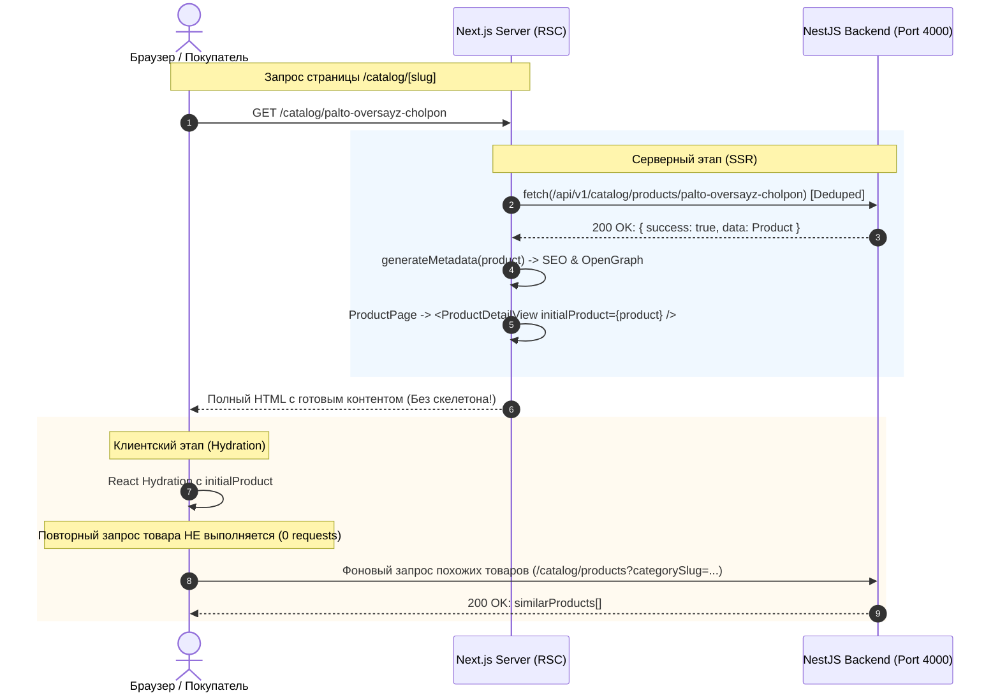

# LEKALO ZHIIDE — STAGE 4.5.5: Server-Side Product Data Loading

## План реализации (Implementation Plan)

> **Статус:** Ожидает подтверждения перед реализацией  
> **Контекст аудита:** Устранение дублирующего запроса данных товара на странице `/catalog/[slug]`, выявленного в [STAGE_4_5_3_PERFORMANCE_AUDIT.md](./STAGE_4_5_3_PERFORMANCE_AUDIT.md).

---

## 1. Результаты анализа (Stage 1. Analysis)

### 1.1. Текущий механизм загрузки товара
1. При переходе на `/catalog/[slug]` сервер Next.js запускает функцию `generateMetadata({ params })` в `frontend/src/app/catalog/[slug]/page.tsx`.
2. `generateMetadata` отправляет серверный запрос к NestJS API:
   `fetch(`${baseUrl}/api/v1/catalog/products/${params.slug}`, { next: { revalidate: 60 } })`.
   Из ответа извлекаются `title`, `description`, `images` для формирования SEO-тегов и OpenGraph.
3. Затем сервер Next.js рендерит компонент страницы:
   `export default function ProductPage({ params }: PageProps) { return <ProductDetailView slug={params.slug} />; }`.
   Данные товара, полученные в `generateMetadata`, в компонент **не передаются**.
4. Клиентский компонент `ProductDetailView.tsx` инициализирует состояние:
   `const [product, setProduct] = useState<Product | null>(null);`
   `const [loading, setLoading] = useState(true);`.
   В сырой HTML-разметке на сервере рендерится исключительно серый пульсирующий скелетон (`animate-pulse`).
5. После гидратации в браузере выполняется `useEffect` в `ProductDetailView`:
   `api.get('/api/v1/catalog/products/' + slug)` — **это второй, полностью дублирующий запрос тех же данных**.
6. Пока длится второй запрос (500–1200 мс), пользователь наблюдает мерцание скелетона. Только после ответа API контент, фото и варианты отображаются на экране.

### 1.2. Сравнение запросов `generateMetadata` и `ProductDetailView`
- **Запрос в `generateMetadata`:** `GET /api/v1/catalog/products/:slug`
- **Запрос в `ProductDetailView`:** `GET /api/v1/catalog/products/:slug`
- **Совпадение:** Запросы идентичны на 100%. Они обращаются к одному эндпоинту и получают абсолютно одинаковый JSON-ответ со всеми вариантами, ценами, изображениями и описаниями.

### 1.3. Данные, необходимые клиентскому компоненту
Эндпоинт `GET /api/v1/catalog/products/:slug` возвращает полный объект `Product`:
- Идентификация и тексты: `id`, `title`, `slug`, `description`, `shortDescription`, `difficultyLevel`.
- Цены и скидки: `basePrice`, `currentPrice`, `isDiscountActive`, `discountPrice`, `discountPercent`, `discountUntil`, `bundlePrice`, `hasBundleOption`.
- Маркетинг: `isNew`, `isBestseller`, `isPopular`.
- Медиа: `coverImage`, `images` (галерея), `technicalDrawingUrl`, `videoUrl`.
- Варианты: `variants` (массив `ProductVariant` с объектами `size`, `height`, `format`, `price`, `sku`, `isAvailable`).
- Характеристики: `fabricDetails` (тип ткани, расход, фурнитура, замеры), `category`.

### 1.4. Данные и действия, которые остаются на клиенте (не переносятся на сервер)
1. **Проверка авторизации (`useAuth()`, `/api/v1/auth/me`):** Зависит от токена в `localStorage`.
2. **Состояние корзины (`useCart()`, `/api/v1/cart`):** Корзина гостя или пользователя управляется через React Context.
3. **Действие добавления в корзину (`POST /api/v1/cart/items`):** Интерактивная отправка выбранного `variantId`.
4. **Похожие товары (`GET /api/v1/catalog/products?categorySlug=...&limit=5`):** Второстепенный блок внизу страницы (below-the-fold). Оставляется фоновым запросом на клиенте, чтобы не увеличивать TTFB страницы.
5. **Интерактивные UI-состояния:** выбор размера/роста/формата, переключение вкладок, открытие Lightbox, тосты.

---

## 2. Архитектурное решение (Целевая модель)



### Преимущества решения:
1. **Ликвидация дублирующего запроса:** Сервер Next.js автоматически дедуплицирует вызовы `fetch` с одинаковым URL между `generateMetadata` и `ProductPage` в рамках одного рендер-прохода. К бэкенду уходит **ровно 1 запрос вместо 2**.
2. **Мгновенное отображение (Zero Layout Shift):** Первый HTML от сервера содержит готовый заголовок, цены, бейджи, галерею и размеры. Нет мерцания серого скелетона.
3. **100% SEO-индексация:** Поисковые роботы видят полную структуру страницы и карточки товара без ожидания выполнения клиентского JS.

---

## 3. Файлы, подлежащие изменению

### 3.1. `frontend/src/app/catalog/[slug]/page.tsx`
- Вынести функцию загрузки данных товара `getProduct(slug: string): Promise<Product | null>` с обработкой ошибок и кэшированием `revalidate: 60`.
- Использовать `getProduct` в `generateMetadata`.
- Сделать `ProductPage` асинхронным серверным компонентом:
  ```tsx
  export default async function ProductPage({ params }: PageProps) {
    const product = await getProduct(params.slug);
    return (
      <ProductDetailView
        key={params.slug}
        slug={params.slug}
        initialProduct={product}
      />
    );
  }
  ```
- Передача `key={params.slug}` гарантирует полный сброс внутреннего состояния компонента при клиентских переходах между разными товарами без утечек устаревших данных.

### 3.2. `frontend/src/app/catalog/[slug]/ProductDetailView.tsx`
- Расширить интерфейс пропсов:
  `interface ProductDetailViewProps { slug: string; initialProduct?: Product | null; }`.
- Инициализировать состояние `product`:
  `const [product, setProduct] = useState<Product | null>(initialProduct ?? null);`.
- Инициализировать `loading`:
  `const [loading, setLoading] = useState<boolean>(!initialProduct);`.
- Инициализировать `selectedImage` сразу из `initialProduct`, чтобы фото не мигало:
  `const [selectedImage, setSelectedImage] = useState<string>(() => getInitialCoverImage(initialProduct));`.
- Инициализировать начальные размер, рост и формат из вариантов `initialProduct`.
- В `useEffect`:
  - Если `initialProduct` передан и его `slug === slug`, **пропустить повторный запрос товара**.
  - Выполнить только фоновую дозагрузку похожих товаров `similarProducts`.
  - Если `initialProduct` отсутствует (fallback при прямом вызове компонента), выполнить стандартную клиентскую загрузку `loadProduct()`.

---

## 4. Обработка 404 (отсутствие товара) и ошибок API

1. **Товар не найден (404 / `PRODUCT_NOT_FOUND`):**
   - Функция `getProduct(slug)` на сервере возвращает `null`.
   - В `page.tsx`: при `product === null` вызывается либо передача `initialProduct={null}` в `ProductDetailView`, либо стандартный `notFound()` из `next/navigation`.
   - Рекомендуемый подход: передавать `initialProduct={null}` с `loading = false`, что позволяет отобразить фирменный ателье-экран с сообщением «Выкройка не найдена» и кнопкой «Вернуться в каталог» без задержки.
2. **Сетевой сбой бэкенда при SSR:**
   - Сервер перехватывает ошибку в блоке `try/catch` и возвращает `null`.
   - На клиенте отображается понятное сообщение об ошибке с возможностью повторить попытку.

---

## 5. Сохранение функциональности

Все существующие функции страницы сохраняются без изменений:
- Выбор размера, роста и формата печати (A4, плоттер).
- Переключение режима покупки («Один размер» / «Комплект ALL»).
- Динамический пересчёт цен, акций и скидок.
- Добавление товара в корзину через `useCart().addItem(...)` с валидацией дубликатов.
- Модальное окно авторизации при необходимости.
- Галерея, зум и полноэкранный Lightbox.
- Табы описания, расхода ткани, замеров, техрисунка и видеоинструкции.
- Блок похожих товаров внизу страницы.

---

## 6. Программа испытаний и доказательства (Verification Strategy)

После реализации будут проведены следующие обязательные проверки:

1. **TypeScript Checks:**
   - Backend: `npm run typecheck` (`tsc --noEmit`) -> Exit code 0
   - Frontend: `npm run typecheck` (`tsc --noEmit`) -> Exit code 0
2. **Next.js Production Build:**
   - `npm run build` в `frontend` -> сборка всех 22 роутов с кодом 0.
3. **Проверка SSR (доказательство отсутствия скелетона в разметке):**
   - HTTP-запрос `GET /catalog/palto-oversayz-cholpon` через `curl`:
     - Подтвердить наличие `<h1 ...>Пальто оверсайз «Чолпон»` непосредственно в SSR-ответе.
     - Подтвердить наличие цен (`520 KGS`), бейджей и ссылки на обложку в первичном HTML.
     - Подтвердить отсутствие разметки скелетона (`animate-pulse`).
4. **Проверка ликвидации дублирующего запроса (Network / Server Log Audit):**
   - Мониторинг входящих HTTP-запросов NestJS Backend на порту 4000.
   - Фиксация запросов при открытии страницы товара:
     - Ожидается: строго 1 запрос от сервера Next.js на этапе SSR.
     - Ожидается: 0 повторных запросов `/api/v1/catalog/products/palto-oversayz-cholpon` после гидратации в браузере.
     - Ожидается: 1 фоновый запрос похожих товаров `/api/v1/catalog/products?categorySlug=...`.
5. **Проверка сценария 404:**
   - Запрос несуществующего товара `/catalog/non-existent-slug`.
   - Подтверждение корректного рендеринга экрана «Выкройка не найдена».
6. **Проверка функциональности корзины и вариантов:**
   - Проверка выбора размеров и добавления в корзину на запущенном продакшн-сервере.
