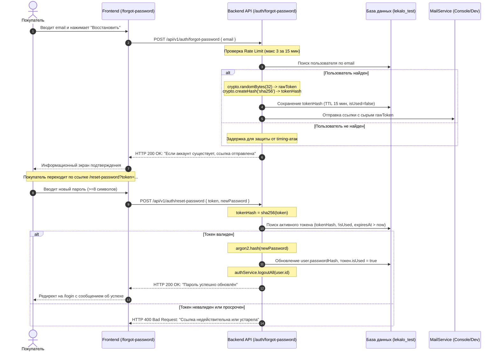

# LEKALO ZHIIDE — STAGE 4.5.7: Password Reset Implementation Plan
## Архитектурный анализ и план реализации самостоятельного восстановления пароля

> **Дата составления:** 18 ноября 2026 г.  
> **Статус:** **PLANNING ONLY** — изменения в кодовой базе и БД не производятся до отдельного согласования.  
> **Цель:** Разработать безопасный, соответствующий современным стандартам (OWASP, NIST) механизм самостоятельного сброса забытого пароля покупателем без привлечения платных сервисов.

---

## 1. Анализ текущей системы авторизации

В проекте **LEKALO ZHIIDE** аутентификация построена на базе:
- **База данных:** PostgreSQL (`lekalo_test`), Prisma ORM.
- **Модели:**
  - `User`: поля `id`, `email`, `passwordHash` (Argon2), `role`, `isActive`, `isEmailVerified`.
  - `UserSession`: поля `id`, `userId`, `refreshTokenHash`, `isRevoked`, `expiresAt`, `ipAddress`, `userAgent`.
- **Backend:** NestJS 10.4 на движке Fastify (`AuthHttpController`, `AuthService`).
  - Применяется хэширование паролей алгоритмом **Argon2id**.
  - Ротация refresh-токенов в защищённых HttpOnly cookies.
  - Метод `authService.logoutAll(userId)` уже реализован и позволяет мгновенно отозвать все активные сессии пользователя.
- **Frontend:** Next.js 13.5 (App Router), `AuthContext`, страница `/login`. В текущей верстке отсутствует ссылка «Забыли пароль?».

---

## 2. Архитектура безопасности сброса пароля



### Принципы безопасности (Security by Design):
1. **Криптографическая стойкость токена:**
   - Токен генерируется криптографическим генератором псевдослучайных чисел: `crypto.randomBytes(32).toString('hex')` (256 бит энтропии).
   - Токен невозможно подобрать перебором (brute-force невозможен в рамках времени жизни).
2. **Хранение только SHA-256 хеша:**
   - В базе данных хранится **исключительно хэш** токена:  
     `tokenHash = crypto.createHash('sha256').update(rawToken).digest('hex')`.
   - Даже при полной компрометации базы данных злоумышленник не сможет восстановить сырой токен и перехватить аккаунты.
3. **Ограниченное время жизни (TTL):**
   - Токен действителен строго **15 минут** с момента создания (`expiresAt = new Date(Date.now() + 15 * 60 * 1000)`).
4. **Одноразовое использование (One-Time Use):**
   - Сразу после успешной смены пароля токен помечается `isUsed: true` (или удаляется). Повторный переход по той же ссылке блокируется.
5. **Защита от раскрытия наличия аккаунтов (User Enumeration Protection):**
   - На запрос сброса пароля API **всегда возвращает идентичный ответ** `HTTP 200 OK`, независимо от того, зарегистрирован email или нет:  
     `{ success: true, message: "Если аккаунт с указанным email существует, на него отправлено письмо со ссылкой для сброса пароля." }`.
   - Для предотвращения timing-атак (определение существования email по времени ответа сервера) применяется фиктивная задержка при отсутствии пользователя.
6. **Инвалидация всех активных сессий:**
   - Смена пароля автоматически вызывает `authService.logoutAll(userId)`. Все выданные ранее токены сессий аннулируются, злоумышленник или потерянное устройство теряют доступ к аккаунту.
7. **Защита от спама и перебора (Rate Limiting):**
   - Не более 3 запросов сброса пароля в 15 минут с одного IP-адреса или на один email.

---

## 3. Модель данных в Prisma

Предлагается добавить в `prisma/schema.prisma` отдельную таблицу `PasswordResetToken`:

```prisma
model PasswordResetToken {
  id        String   @id @default(uuid()) @db.Uuid
  userId    String   @map("user_id") @db.Uuid
  user      User     @relation(fields: [userId], references: [id], onDelete: Cascade)
  tokenHash String   @unique @map("token_hash") @db.VarChar(255)
  expiresAt DateTime @map("expires_at") @db.Timestamptz
  isUsed    Boolean  @default(false) @map("is_used")
  createdAt DateTime @default(now()) @map("created_at") @db.Timestamptz

  @@index([tokenHash])
  @@index([userId])
  @@map("password_reset_tokens")
}
```

*Преимущества отдельной таблицы перед полями в `User`:*
- Полная изоляция логики восстановления.
- Возможность анализировать историю запросов и защищаться от спам-атак.
- Автоматическая очистка просроченных токенов без изменения записей пользователей.
- Каскадное удаление при удалении пользователя.

---

## 4. Архитектура почтовой интеграции (Бесплатные варианты)

Согласно требованию ТЗ, почтовую отправку пока не подключаем. Создаётся гибкий интерфейс `IMailService`, который позволяет легко переключать провайдеров через переменные окружения:

```ts
export interface IMailService {
  sendPasswordResetEmail(to: string, resetUrl: string): Promise<void>;
}
```

### Доступные бесплатные решения для отправки писем:

| Вариант | Условия бесплатного тарифа | Преимущества | Необходимые настройки (`.env`) |
|---|---|---|---|
| **1. Console / Dev Mailer (Рекомендуется для этапа разработки)** | 100% бесплатно, без внешних сервисов | Ссылка сброса выводится в консоль сервера в маскированном виде, идеально для тестирования | `MAIL_PROVIDER=console` |
| **2. Resend (Бесплатный тариф)** | 3 000 писем в месяц, до 100 писем в день | Современный API, быстрая доставка, поддержка DKIM/SPF, готовый SDK | `MAIL_PROVIDER=resend`<br/>`RESEND_API_KEY=re_...`<br/>`MAIL_FROM=no-reply@lekalo-zhiide.kg` |
| **3. SMTP через корпоративную почту бренда (Nodemailer)** | Бесплатно при наличии почты на домене (Яндекс 360, Mail.ru для бизнеса, cPanel хостинга) | Отсутствие зависимости от сторонних SaaS, отправка напрямую с доменного ящика | `MAIL_PROVIDER=smtp`<br/>`SMTP_HOST=smtp.yandex.ru`<br/>`SMTP_PORT=465`<br/>`SMTP_USER=no-reply@...`<br/>`SMTP_PASS=...`<br/>`MAIL_FROM=...` |
| **4. Brevo (бывший Sendinblue)** | До 300 писем в день бесплатно | Надёжный европейский шлюз, SMTP или REST API | `MAIL_PROVIDER=smtp`<br/>`SMTP_HOST=smtp-relay.brevo.com` |

---

## 5. План реализации по шагам (после согласования)

### Шаг 1. Схема данных и сервис токенов
1. Добавить модель `PasswordResetToken` в `prisma/schema.prisma`.
2. Выполнить генерацию Prisma Client (`npm run prisma:generate`) и применить локальную миграцию к `lekalo_test`.
3. Создать модуль `src/modules/auth/password-reset.service.ts`:
   - `createResetToken(email: string): Promise<string | null>`
   - `verifyAndResetPassword(rawToken: string, newPassword: string): Promise<void>`

### Шаг 2. Эндпоинты в `AuthHttpController`
1. `POST /api/v1/auth/forgot-password`:
   - Вход: `{ email: string }`.
   - Zod-валидация email.
   - Единообразный ответ `HTTP 200 OK`.
2. `POST /api/v1/auth/reset-password`:
   - Вход: `{ token: string, newPassword: string }`.
   - Zod-валидация сложности нового пароля ($\ge 8$ символов, латинские буквы, цифры).
   - Хеширование нового пароля через `argon2.hash`.
   - Пометка токена `isUsed: true`.
   - Вызов `authService.logoutAll(user.id)`.

### Шаг 3. Frontend-компоненты
1. В `frontend/src/app/login/page.tsx` добавить ссылку «Забыли пароль?» рядом с полем пароля.
2. Создать страницу `frontend/src/app/forgot-password/page.tsx`:
   - Инпут email с валидацией.
   - Кнопка «Восстановить пароль» (минимальная высота 44px).
   - Экран успешной отправки с таймером повторной отправки (cooldown 60 секунд).
3. Создать страницу `frontend/src/app/reset-password/page.tsx`:
   - Считывание параметра `token` из URL (`searchParams.get("token")`).
   - Поля: «Новый пароль» и «Подтверждение пароля».
   - Индикатор сложности пароля.
   - Обработка ошибок (токен недействителен, просрочен или уже использован).
   - Редирект на `/login` при успешном сбросе.

### Шаг 4. Сквозное автоматизированное тестирование
- **Тест 1:** Запрос с существующим email $\to$ токен сгенерирован, ответ 200 OK.
- **Тест 2:** Запрос с несуществующим email $\to$ ответ 200 OK (идентичный тексту Теста 1, без утечки).
- **Тест 3:** Попытка сброса с просроченным токеном ($>15$ мин) $\to$ отказ 400 Bad Request.
- **Тест 4:** Повторное использование того же токена $\to$ отказ 400 Bad Request.
- **Тест 5:** Попытка сброса с неверным/повреждённым токеном $\to$ отказ 400 Bad Request.
- **Тест 6:** Успешная смена пароля $\to$ пароль обновлён в Argon2.
- **Тест 7:** Попытка входа со старым паролем $\to$ 401 Unauthorized (`INVALID_CREDENTIALS`).
- **Тест 8:** Успешный вход с новым паролем $\to$ 200 OK, сессия создана.
- **Тест 9:** Ограничение повторных запросов (Rate Limiting).
- **Проверки:** `npm run typecheck`, `npm run build` во frontend и backend.
