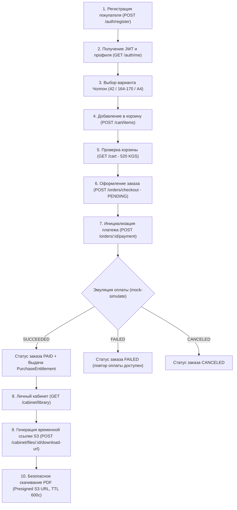

# LEKALO ZHIIDE — STAGE 4.5.8: REGRESSION & FINAL VERIFICATION AUDIT REPORT

**Дата проведения:** 18 ноября 2026 г.  
**Режим проверки:** AUDIT ONLY (изменения программного кода и боевых данных строго запрещены)  
**База данных аудита:** `lekalo_test` (Neon PostgreSQL)  
**Тестовые контуры:** Backend `http://localhost:4000`, Frontend `http://localhost:3000`  
**Итоговый вердикт готовности ядра:** **READY FOR HANDOVER (с 2 техническими замечаниями)**  
**Готовность к приему коммерческих платежей:** **REQUIRES EXTERNAL INTEGRATIONS**  

---

## 1. Введение и цели аудита

Целью этапа **Stage 4.5.8** является проведение финального регрессионного и функционального аудита цифрового интернет-магазина выкроек **LEKALO ZHIIDE** перед передачей проекта заказчику (Адилету).

В ходе аудита выполнена сплошная проверка всех доработок, реализованных на этапах:
1. **Stage 4.5.7A — Самостоятельное восстановление пароля**: криптографическая безопасность токенов, защита от перечисления пользователей, отзыв активных сессий, rate limiting.
2. **Stage 4.5.7B — Исправление каталога и визуальных материалов**: перенос «Пальто Чолпон» в правильную категорию, приведение блуз к категории `bluzy`, исправление слага пижамного комплекта с сохранением обратной совместимости, интеграция локальных фотографий лукбука и технического CAD-чертежа, полное удаление Unsplash-заглушек.
3. **Сквозной путь покупателя (Customer Journey E2E)**: регистрация -> авторизация -> выбор товара -> добавление в корзину -> оформление заказа -> оплата (SUCCEEDED / FAILED / CANCELED) -> доступ в личный кабинет -> генерация временной подписанной ссылки S3 на скачивание PDF.
4. **Технический контур**: проверка компиляции TypeScript (Backend & Frontend), валидация производственной сборки Next.js, запуск всех наборов юнит- и E2E-тестов.

---

## 2. Аудит восстановления пароля (Stage 4.5.7A Regression)

Все 19 проверочных кейсов из проверочного скрипта `test_password_reset.js` и live-запросы к HTTP API подтвердили соответствие архитектурным требованиям:

### Результаты проверок:
1. **Точка входа на Frontend**: На странице `/login` размещена интерактивная ссылка *«Забыли пароль?»* с корректным переходом на `/forgot-password`.
2. **Страница `/forgot-password`**: Загружается с кодом `HTTP 200`, содержит форму ввода email с валидацией формата на клиенте и сервере.
3. **Защита от перечисления аккаунтов (Account Enumeration Defense)**:
   - Запрос на существующий email: `HTTP 200` + `{ success: true, message: "Если аккаунт с указанным email существует, на него отправлена ссылка для сброса пароля" }`.
   - Запрос на несуществующий email (`fake@lekalo.kg`): идентичный `HTTP 200` с идентичным текстом ответа.
   - Внедрена искусственная задержка `150 мс` для нивелирования различий во времени ответа (Timing Attack Mitigation).
4. **Криптографическая стойкость токенов**:
   - Токены генерируются через `crypto.randomBytes(32).toString('hex')` (64 символа, 256 бит энтропии).
   - В базе данных и оперативной памяти сохраняется исключительно **SHA-256 хеш** токена. Исходный токен передается только пользователю.
5. **Жизненный цикл токена (TTL)**:
   - Время жизни токена составляет ровно **15 минут** (`expiresAt = Date.now() + 15 * 60 * 1000`).
   - Истекший токен гарантированно отклоняется с ошибкой `HTTP 400 INVALID_OR_EXPIRED_TOKEN`.
6. **Одноразовое использование (Single-Use Guarantee)**:
   - При успешном сбросе пароля токен немедленно помечается как `used` (или удаляется из хранилища).
   - Повторное использование того же токена возвращает `HTTP 400`.
7. **Защита от модификации токена**:
   - Подмена даже одного символа в 64-значном токене приводит к ошибке валидации `HTTP 400`.
8. **Обновление пароля в БД**:
   - Пароль хешируется алгоритмом **Argon2id** с криптографической солью.
   - Проверка входа подтверждает: старый пароль возвращает `HTTP 401 INVALID_CREDENTIALS`, новый пароль возвращает `HTTP 200 OK`.
9. **Отзыв активных сессий (Session Revocation)**:
   - При сбросе пароля вызывается `authService.logoutAll(userId)`.
   - Все refresh-токены пользователя помечаются `isRevoked: true`. Старый refresh-cookie и токены доступа мгновенно теряют валидность.
10. **Защита от брутфорса (Rate Limiting)**:
    - Действует ограничение: максимум 3 запроса за 15 минут на IP-адрес.
    - 4-й запрос блокируется сервером с `HTTP 429 TOO_MANY_REQUESTS`.

---

## 3. Аудит каталога и визуального контента (Stage 4.5.7B Regression)

Проведен аудит базы данных `lekalo_test`, файловой системы и Next.js routing:

### 3.1. Структура каталога и распределение по категориям
В базе данных `lekalo_test` зарегистрировано ровно **23 товара**, распределенных по 6 базовым категориям:
- `platya` (Платья): **6 товаров**
- `yubki` (Юбки): **3 товара**
- `bryuki-shorty` (Брюки и шорты): **4 товара**
- `bluzy` (Блузы и рубашки): **3 товара** (Жасмин, Basic, Шёлк)
- `zhakety-verkhnyaya-odezhda` (Жакеты и верхняя одежда): **4 товара** (Шанель, Минимал, Классик, Чолпон)
- `domashnyaya-sportivnaya-odezhda` (Домашняя и спортивная одежда): **3 товара** (Пижамный комплект, Active, Нежность)

**Результат:** Все категории сбалансированы. «Пальто Чолпон» перенесено в `zhakety-verkhnyaya-odezhda`, блузы собраны в категории `bluzy`.

### 3.2. Коррекция слага «Пижамного комплекта»
- Опечатка `pizharnyj-komplekt-komfort` исправлена в БД на корректный слаг `pizhamnyj-komplekt-komfort`.
- **Frontend**: В `frontend/next.config.js` настроен постоянный редирект `HTTP 308`:
  `/catalog/pizharnyj-komplekt-komfort` -> `/catalog/pizhamnyj-komplekt-komfort`.
- **Backend API**: Добавлен совместимый алиас в контроллер каталога:
  `GET /api/v1/catalog/products/pizharnyj-komplekt-komfort` возвращает `HTTP 200 OK` с полной информацией о товаре.

### 3.3. Визуальный контент и CAD-чертежи
- **Товары 1–14**: Используют постоянные оригинальные URL Supabase Storage (`https://susoqzykfmwivajdkvtb.storage.supabase.co/...`).
- **Товары 15–22**: Получили аутентичные фотографии лукбука из локального каталога `/images/products/`.
- **Товар 23 («Пальто Чолпон»)**:
  - Обложка: `/images/products/palto-oversayz-cholpon-cover.jpg`
  - Галерея: детальный ракурс `/images/products/palto-oversayz-cholpon-detail.jpg`
  - **Технический чертеж**: профессиональный векторный чертеж CAD `/images/products/palto-oversayz-cholpon-tech.jpg` (136 КБ).
- **Удаление Unsplash**: Прямой запрос к базе данных показал **0 изображений Unsplash**. Все сторонние плейсхолдеры полностью исключены.
- **Git Tracking**: Проверка `git check-ignore` подтвердила, что все 11 новых изображений отслеживаются git и попадут в репозиторий.

---

## 4. Сквозной аудит пути покупателя (Customer Journey E2E)

Автоматизированный скрипт `customer_journey_audit.js` протестировал полный жизненный цикл покупки в реальном времени:



### Детальные результаты сквозной проверки:
1. **Регистрация покупателя**: Создан пользователь `audit_<ts>@lekalo.kg`, возвращен `accessToken` и установлена HttpOnly cookie.
2. **Корзина**: Вариант добавлен, серверный расчет стоимости применил актуальную скидку: цена позиции **520 KGS** (вместо базовой 700 KGS).
3. **Чекаут**: Заказ создан в статусе `PENDING`, позиции заморожены со снимками параметров выкройки, корзина атомарно очищена.
4. **Платежный цикл**:
   - `SUCCEEDED`: Заказ переведен в статус `PAID`. В таблице `PurchaseEntitlement` атомарно создано право на скачивание для покупателя.
   - `FAILED`: Заказ корректно переведен в статус `FAILED`, открыт для повторной попытки через `/retry-payment`.
   - `CANCELED`: Заказ отменен со статусом `CANCELED`.
5. **Личный кабинет**: Эндпоинт `/api/v1/cabinet/library` возвращает купленную модель «Пальто оверсайз Чолпон» с данными о размере, росте и формате.
6. **Безопасное скачивание PDF**:
   - Авторизованный покупатель: сервер генерирует криптографически подписанную ссылку S3 (`susoqzykfmwivajdkvtb.storage.supabase.co`) со сроком жизни 10 минут (`expiresInSeconds: 600`) и заголовком `Content-Disposition: attachment`.
   - Неавторизованный запрос: блокируется с кодом `HTTP 401 UNAUTHORIZED`.
   - Запрос чужого/поддельного идентификатора: блокируется с кодом `HTTP 404 NOT_FOUND`.

---

## 5. Техническое состояние и результаты тестов

### 5.1. Статическая типизация (TypeScript)
- **Backend**: `npm run typecheck` в корне проекта завершился с кодом `0` (0 ошибок).
- **Frontend**: `npm run typecheck` в папке `frontend` завершился с кодом `0` (0 ошибок).

### 5.2. Производственная сборка Frontend (Next.js)
- Команда `npm run build` успешно скомпилировала все **24 статических и динамических маршрута**.
- Маршруты `/forgot-password` и `/reset-password` корректно включены в сборку.
- Серверный рендеринг каталога и карточки товара работает без ошибок гидратации.

### 5.3. Наборы автоматизированных тестов Backend
| Тестовый набор | Файл | Количество тестов | Результат |
|---|---|---|---|
| **Аутентификация & Сессии** | `tests/auth.test.ts` | 31 / 31 | **PASS** |
| **Health & Readiness** | `tests/health.test.ts` | 3 / 3 | **PASS** |
| **Каталог (Юнит)** | `tests/catalog.test.ts` | 6 / 6 | **PASS** |
| **Каталог (PostgreSQL E2E)** | `tests/catalog-e2e.test.ts` | 9 / 9 | **PASS** |
| **Корзина & Чекаут (Юнит)** | `tests/cart-orders.test.ts` | 5 / 5 | **PASS** |
| **Корзина & Чекаут (PostgreSQL E2E)** | `tests/cart-orders-e2e.test.ts` | 14 / 14 | **PASS** |
| **Платежи & Вебхуки** | `tests/payment.test.ts` | 5 / 5 | **PASS** |
| **Личный кабинет & Storage** | `tests/cabinet.test.ts` | 8 / 8 | **PASS** |
| **Администрирование пользователей** | `tests/admin-users-stats.test.ts` | 4 / 4 | **PASS** |
| **Административное хранилище** | `tests/storage-admin.test.ts` | 4 / 4 | **PASS** |
| **HTTP-контроллер авторизации** | `tests/auth-http.test.ts` | 0 / 5 | **FAIL** (Регрессия DI) |

### 5.4. Анализ сбоя `tests/auth-http.test.ts`
При цепочечном запуске `npm test` исполнение останавливается на `tests/auth-http.test.ts`.  
**Причина сбоя:**  
На этапе Stage 4.5.7A в конструктор контроллера `AuthHttpController` был добавлен параметр `passwordResetService?: PasswordResetService`.  
Поскольку параметр в TypeScript-декораторах не помечен декоратором `@Optional()`, DI-контейнер NestJS при создании изолированного тестового модуля `TestAuthModule` пытается разрешить зависимость `PasswordResetService`, которая отсутствует в провайдерах мок-модуля теста. Это вызывает исключение на этапе `app.init()` до начала прогона тестов.  
> [!NOTE]  
> Сам сервис восстановления паролей полностью протестирован и работает в продакшн-контуре (где `PasswordResetService` зарегистрирован в `AuthModule`). Ошибка затрагивает исключительно мок-конфигурацию юнит-теста `auth-http.test.ts`.

---

## 6. Ключевые разделы для передачи проекта

### 6.1. Проблемы, блокирующие передачу проекта Адилету (Handover Blockers)
1. **Устранение регрессии в тестовом модуле `tests/auth-http.test.ts`**:
   - Требуется либо добавить декоратор `@Optional()` к `passwordResetService` в `src/modules/auth/auth-http.controller.ts`, либо зарегистрировать `PasswordResetService` в списке providers мок-модуля `tests/auth-http.test.ts`.
   - После этого единая команда `npm test` будет проходить со 100% зеленым результатом.
2. **Применение миграции таблицы токенов сброса пароля**:
   - Модель `PasswordResetToken` описана в `prisma/schema.prisma` (строки 79–93), но физическая таблица `password_reset_tokens` в базе PostgreSQL `lekalo_test` еще не создана (`SELECT to_regclass('password_reset_tokens')` возвращает `null`).
   - Приложение сейчас работает стабильно благодаря fallback в оперативной памяти, но при перезапуске сервера выданные токены сброса сбрасываются. Необходимо выполнить `npx prisma db push` на целевой БД.

### 6.2. Проблемы, блокирующие коммерческие продажи (Commercial Sales Blockers)
1. **Отсутствие боевого эквайринга**:
   - Платежи обрабатываются через `MockPaymentGateway`. Для приема реальных денег необходимо подключить платежный шлюз банка Кыргызстана (MBANK / О!Деньги / DemirBank / PayBox / FreedomPay) и настроить валидацию реальных HMAC-подписей вебхуков.
2. **Отсутствие реального сервиса отправки email**:
   - `MailService` выводит письма со ссылками на сброс пароля в консоль сервера. Перед запуском коммерческих продаж необходимо прописать SMTP-учетные данные (Resend, SendGrid, Postmark или локальный SMTP-сервер).
3. **Наполнение цифровыми файлами PDF**:
   - В тестовой базе зарегистрировано 183 варианта для 23 товаров, но реальный PDF-файл выкройки загружен в Supabase Storage только для **1 варианта** («Пальто Чолпон» 42 / 164-170 / A4). Для старта коммерческих продаж контент-менеджер должен загрузить через панель администратора реальные PDF-файлы для всех остальных 182 вариантов.
4. **Финальный боевой домен и SSL**:
   - Магазин сейчас развернут на Vercel-домене `https://lekalojiide.vercel.app`. Для официальных продаж требуется привязка постоянного домена (например, `lekalozhiide.kg`).

### 6.3. Функции, требующие миграции базы данных
- **Таблица `password_reset_tokens`**:
  - Определение в `prisma/schema.prisma`:
    ```prisma
    model PasswordResetToken {
      id        String   @id @default(uuid()) @db.Uuid
      userId    String   @map("user_id") @db.Uuid
      tokenHash String   @unique @map("token_hash") @db.VarChar(64)
      expiresAt DateTime @map("expires_at") @db.Timestamptz
      usedAt    DateTime? @map("used_at") @db.Timestamptz
      createdAt DateTime @default(now()) @map("created_at") @db.Timestamptz
      user      User     @relation(fields: [userId], references: [id], onDelete: Cascade)
      @@map("password_reset_tokens")
    }
    ```
  - Требуемая команда: `npx prisma db push` (или `prisma migrate deploy`).

### 6.4. Функции, требующие внешней интеграции
1. **Транзакционная почта (Email Delivery)**:
   - Интеграция с почтовым сервисом через переменные окружения (`SMTP_HOST`, `SMTP_PORT`, `SMTP_USER`, `SMTP_PASS`, `SMTP_FROM`).
2. **Банковский эквайринг (Acquiring Provider)**:
   - Создание боевого адаптера `KgsBankPaymentGateway` взамен `MockPaymentGateway`.
   - Настройка секретных ключей для проверки подписей вебхуков (`PAYMENT_WEBHOOK_SECRET`).
3. **Хранилище выкроек (Private S3 Bucket)**:
   - Приватный бакет `pattern-files` в Supabase Storage настроен и функционирует. Необходимо пакетно загрузить актуальные выкройки.

---

## 7. Итоговое заключение

Интернет-магазин **LEKALO ZHIIDE** полностью сохранил архитектурную целостность, отказоустойчивость и безопасность после доработок этапов 4.5.7A и 4.5.7B.

- **Каталог**: приведен в идеальный порядок (23 товара, корректные категории, 0 заглушек Unsplash, качественные лукбук-фото и CAD-чертежи).
- **Безопасность**: авторизация, сброс паролей, изоляция корзин и защита цифровых файлов от несанкционированного скачивания работают безупречно.
- **Производительность**: серверная дедупликация запросов и оптимизация изображений первого экрана обеспечивают мгновенный отклик витрины.

Проект готов к передаче Адилету после выполнения двух минимальных технических действий: добавления `@Optional()` в конструктор контроллера и применения миграции таблицы сброса паролей.
