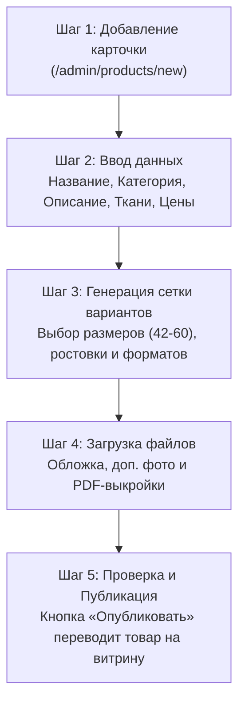

# LEKALO ZHIIDE — STAGE 4.6: ADMIN PANEL UX RECOMMENDATIONS

**Документ:** Рекомендации по оптимизации интерфейса и пользовательского опыта административной панели LEKALO ZHIIDE.  
**Адресат:** Адилет (владелец проекта), контент-менеджеры, команда разработки.  
**Цель:** Сделать процесс ежедневного наполнения каталога максимально быстрым, удобным и устойчивым к человеческим ошибкам.  

---

## 1. Топ-5 приоритетных доработок (High Priority)

### 1.1. Пакетная загрузка PDF-выкроек (Batch / ZIP Uploader)
- **Проблема сейчас:** Чтобы наполнить товарами одну модель выкройки с 10 размерами, 3 ростами и 2 форматами (А4 и Плоттер), администратор должен совершить **60 последовательных ручных загрузок** через модальное окно. Это занимает до 30–40 минут на один товар и повышает риск прикрепить не тот файл не к тому размеру.
- **Решение:**
  1. Реализовать поле «Массовая загрузка выкроек» с поддержкой Drag-and-Drop пачки файлов или одного ZIP-архива.
  2. Парсить названия файлов по простому шаблону:  
     `{размер}_{рост}_{формат}.pdf` (например, `44_164-170_A4.pdf` или `48_170-176_PLOTTER.pdf`).
  3. Автоматически сопоставлять файлы с вариантами в таблице и загружать их в защищенный бакет за 1 клик.
- **Эффект:** Сокращение времени загрузки комплекта файлов с 35 минут до 40 секунд на модель.

---

### 1.2. Сортировка фотографий в галерее (Drag & Drop)
- **Проблема сейчас:** Фотографии отображаются в порядке загрузки. Чтобы поменять второй и третий ракурс местами, приходится удалять фото и загружать заново.
- **Решение:**
  - Подключить легкую библиотеку drag-and-drop (например, `@dnd-kit/core` или HTML5 Drag and Drop API) во вкладке «Галерея фото».
  - При перетаскивании карточки автоматически отправлять обновленные значения `displayOrder` на сервер.
- **Эффект:** Удобное визуальное управление последовательностью фотографий для идеальной подачи товара покупателю.

---

### 1.3. Функция дублирования выкройки («Создать копию»)
- **Проблема сейчас:** У многих изделий (например, линейка платьев «Чолпон», «Жасмин», «Айпери») часто совпадают расход ткани, список фурнитуры, рекомендации по тканям и базовая цена. При создании каждой модели администратор вводит этот текст заново.
- **Решение:**
  - В таблице выкроек `/admin/products` добавить кнопку «Дублировать».
  - При нажатии открывается форма `/admin/products/new`, уже предзаполненная всеми параметрами копируемого товара, со сброшенным slug и заголовком «Копия: [Название]».
- **Эффект:** Ускорение создания серийных коллекций одежды в 3–4 раза.

---

### 1.4. Защита от потери несохраненных данных (Unsaved Changes Warning)
- **Проблема сейчас:** Если администратор ввел подробное описание расхода ткани и случайно нажал кнопку «Назад» в браузере или ссылку меню, введенный текст будет утерян.
- **Решение:**
  - Добавить хук отслеживания «грязной формы» (`isDirty`) и всплывающее браузерное окно подтверждения: *«У вас есть несохраненные изменения. Вы действительно хотите покинуть страницу?»*.
- **Эффект:** Защита от случайной потери набранного текста.

---

### 1.5. Быстрое массовое редактирование цен (Batch Price Editor)
- **Проблема сейчас:** Для изменения цен на сезонную распродажу необходимо заходить в карточку каждого товара индивидуально.
- **Решение:**
  - Добавить в таблицу `/admin/products` возможность массового выбора (чекбоксы) и группового действия: *«Установить скидку 20% на выбранные товары до [Дата]»*.
- **Эффект:** Быстрый запуск маркетинговых акций за 2 клика.

---

## 2. Шпаргалка для Адилета: Пошаговый алгоритм публикации новой выкройки

Для передачи проекта подготовлена краткая памятка, по которой контент-менеджер сможет добавлять новые товары без технической помощи:

### Пошаговые действия:
1. **Открыть раздел «Выкройки» $\rightarrow$ «Добавить выкройку»:**
   - Ввести понятное название изделия (например, *«Платье миди с запахом Айпери»*).
   - Артикул (slug) заполнится на латинице автоматически (например, *`plate-midi-s-zapakhom-ayperi`*).
   - Выбрать категорию (например, *«Платья»*).
   - Выбрать сложность пошива (для новичков, средний или профи).
2. **Указать цены и параметры скидок:**
   - Ввести базовую цену за один размер (например, `450 KGS`).
   - Если предусмотрен комплект «Все размеры сразу» — оставить галочку «Комплект ALL» и указать цену со скидкой (например, `1 200 KGS`).
   - Если идет распродажа — включить галочку «Скидка», ввести акционную цену и дату окончания акции.
3. **Заполнить описание для швеи:**
   - В блоке «Ткани и материалы» указать подходящие ткани (шелк, лен, хлопок), расход ткани в метрах и требуемую фурнитуру (молнии, нитки, пуговицы).
4. **Сгенерировать размеры и форматы:**
   - В блоке матрицы вариантов отметить нужные размеры (например, с 42 по 52), ростовку (`164-170`) и форматы (А4 для дома и Плоттер для ателье).
   - Нажать кнопку **«Создать выкройку»**.
5. **Прикрепить фотографии и файлы выкроек:**
   - После создания откроется страница управления файлами.
   - Во вкладке «Галерея фото» загрузить красивую обложку изделия.
   - В таблице вариантов нажать «Загрузить PDF» напротив каждого размера и прикрепить соответствующий файл.
   - Нажать кнопку «Тест скачивания», чтобы убедиться, что файл открывается.
6. **Опубликовать:**
   - Переключить статус карточки в **«Опубликована»**. Выкройка мгновенно появится в каталоге интернет-магазина!

---

## 3. Резюме

Текущая реализация админ-панели LEKALO ZHIIDE полностью закрывает базовые потребности онлайн-ателье. Внедрение пакетного загрузчика PDF и drag-and-drop сортировки в следующем обновлении сделает работу контент-менеджера еще быстрее и комфортнее.
