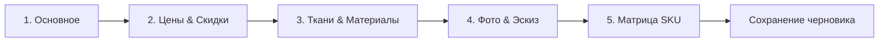

# LEKALO ZHIIDE — ПОЛНОЕ РУКОВОДСТВО АДМИНИСТРАТОРА
## Практическая инструкция по управлению интернет-магазином выкроек

**Кому адресовано:** Владельцу проекта (Адилет) и администраторам ателье  
**Версия документа:** 1.0 (Stage 4.8)  
**Дата актуализации:** 18 ноября 2026 г.

---

## Содержание

1. [Введение и архитектурные особенности](#1-введение-и-архитектурные-особенности)
2. [Вход в административную панель и безопасность](#2-вход-в-административную-панель-и-безопасность)
3. [Создание новой выкройки: пошаговый процесс](#3-создание-новой-выкройки-пошаговый-процесс)
4. [Работа с фотографиями и медиаматериалами](#4-работа-с-фотографиями-и-медиаматериалами)
5. [Размеры, ростовки и матрица вариантов (SKU)](#5-размеры-ростовки-и-матрица-вариантов-sku)
6. [Загрузка, версионирование и тестирование PDF-выкроек](#6-загрузка-версионирование-и-тестирование-pdf-выкроек)
7. [Регламент публикации выкройки на витрину](#7-регламент-публикации-выкройки-на-витрину)
8. [Управление заказами и клиентской базой](#8-управление-заказами-и-клиентской-базой)
9. [Справочники категорий и размеров](#9-справочники-категорий-и-размеров)
10. [Частые ошибки и безопасный порядок действий (Troubleshooting)](#10-частые-ошибки-и-безопасный-порядок-действий-troubleshooting)
11. [Контрольный список перед открытием продаж](#11-контрольный-список-перед-открытием-продаж)

---

## 1. Введение и архитектурные особенности

Интернет-магазин **LEKALO ZHIIDE** — это специализированная платформа для продажи цифровых выкроек одежды. 

В отличие от магазинов физических товаров, здесь ключевым продуктом является **защищенный цифровой контент (PDF-файлы выкроек)**. Система построена на базе современных технологий:
- **Витрина и Панель управления:** Next.js (App Router) с адаптивным интерфейсом под ПК, планшеты и смартфоны.
- **Серверная логика и безопасность:** NestJS + Fastify.
- **База данных:** PostgreSQL на облачной платформе Neon.
- **Файловое хранилище:** Supabase Storage (S3-совместимое объектное хранилище).

### Важнейшие понятия, с которыми вы будете работать:
1. **SKU (Stock Keeping Unit):** Уникальный артикул конкретной комбинации выкройки (например, `plate-ayperi-44-164-170-A4`).
2. **Slug (Слаг):** Человекопонятная часть адреса страницы в браузере (например: `/catalog/letnee-plate-lavanda`). Пишется только латиницей строчными буквами через дефис.
3. **Signed URL (Временная подписанная ссылка):** Безопасная ссылка на скачивание PDF-файла из приватного облака. Ссылка защищена криптографической подписью и действует ровно **300 секунд (5 минут)**. Прямой доступ к файлам из интернета без покупки невозможен.
4. **Бандл (Комплект ALL):** Опция покупки всех доступных размеров выбранной модели одной кнопкой со скидкой.

---

## 2. Вход в административную панель и безопасность

### 2.1. Как открыть панель управления
1. Откройте любой современный веб-браузер (Google Chrome, Safari, Firefox, Edge, Яндекс).
2. Перейдите по адресу:
   - В тестовом/локальном режиме: `http://localhost:3000/admin`
   - На рабочем сайте: `https://lekalo-zhiide.kg/admin`
3. Если вы ещё не авторизованы, система перенаправит вас на страницу входа: `/login?redirect=/admin`.

### 2.2. Авторизация администратора
1. В форме **«Вход в аккаунт»** заполните поля:
   - **Email:** адрес электронной почты учетной записи администратора.
   - **Пароль:** ваш пароль.
2. Нажмите кнопку **«Войти»**.
3. При правильном вводе данных откроется главная страница панели: **«Сводка и показатели»** (`/admin`).

### 2.3. Что делать при сообщении «Доступ ограничен» (ShieldAlert)
Если после входа открывается экран с красным значком щита и надписью:
> *«Доступ ограничен. Этот раздел предназначен только для администраторов LEKALO ZHIIDE. Ваш текущий аккаунт не обладает правами администратора»*

**Причины и решение:**
- **Причина 1:** Вы зашли под учетной записью обычного покупателя (роль `CUSTOMER`).
  - *Решение:* Нажмите в правом верхнем углу сайта на имя пользователя $\rightarrow$ выберите **«Выйти»** $\rightarrow$ войдите под учетной записью администратора.
- **Причина 2:** Новый аккаунт зарегистрирован, но ему ещё не выдана роль `ADMIN`.
  - *Решение:* Существующий главный администратор должен зайти в раздел **«Пользователи»** (`/admin/users`), найти пользователя по email, нажать кнопку **«Изменить роль»** и выбрать `ADMIN`.

### 2.4. Безопасный выход из системы (Logout)
- Для выхода нажмите на ссылку **«На витрину»** (в верхнем правом углу админ-панели).
- На витрине наведите курсор на блок профиля и нажмите **«Выйти»**. Все токены авторизации немедленно удаляются из браузера.

---

## 3. Создание новой выкройки: пошаговый процесс

Для создания новой модели перейдите в раздел **«Выкройки»** (`/admin/products`) и нажмите синюю кнопку **«Добавить выкройку»** (или сразу откройте `/admin/products/new`).

Форма создания разбита на 5 логических блоков:

---

### Блок 1. Основные сведения
1. **Статус публикации (переключатель в правом верхнем углу блока):**  
   - Чекбокс **«✓ Опубликована на сайте»** / **«В черновиках»**.
   > [!IMPORTANT]
   > При создании новой модели **снимите галочку** (оставьте «В черновиках»). Публиковать товар на витрину можно только после того, как к нему будут загружены настоящие PDF-выкройки.
2. **Название модели \*:**  
   - Введите полное название (например: `Платье миди «Айпери» с запахом`).
3. **Артикул / URL Slug \*:**  
   - Поле заполняется автоматически транслитерацией названия (например: `plate-ayperi-midi`). При необходимости отредактируйте его вручную. Используйте только строчные английские буквы, цифры и дефис.
4. **Категория \*:**  
   - Выберите категорию из выпадающего списка:
     - *Платья и сарафаны* (`platya`)
     - *Юбки* (`yubki`)
     - *Брюки и шорты* (`bryuki-shorty`)
     - *Блузы и рубашки* (`bluzy`)
     - *Жакеты и верхняя одежда* (`zhakety-verkhnyaya-odezhda`)
     - *Домашняя и спортивная одежда* (`domashnyaya-sportivnaya-odezhda`)
5. **Сложность пошива:**  
   - Выберите уровень квалификации, необходимый для пошива:
     - `BEGINNER` — Для начинающих
     - `EASY` — Простой
     - `MEDIUM` — Средний
     - `INTERMEDIATE` — Уверенный
     - `ADVANCED` — Продвинутый
     - `EXPERT` — Эксперт / Профи
6. **Краткое описание:**  
   - 1–2 предложения для отображения в каталоге (например: *«Элегантное приталенное платье с запахом и расклешенной юбкой»*).
7. **Полное описание и конструктивные прибавки:**  
   - Подробная информация: силуэт, длина изделия, конструктивные припуски на швы и свободу облегания по груди, талии и бёдрам.

---

### Блок 2. Ценообразование, комплекты и скидки
1. **Базовая цена за 1 размер (KGS) \*:**  
   - Стоимость покупки одного размера в одном формате (например: `550`).
2. **Опция комплекта ALL:**  
   - Установите галочку **«Включить ALL»**.
   - В поле **«Цена комплекта ALL (KGS)»** укажите стоимость бандла (например: `1390`). Покупатель сможет купить сразу всю линейку размеров со скидкой.
3. **Скидочная акция (необязательно):**  
   - Отметьте чекбокс **«Активировать акционную цену»**.
   - В поле **«Акционная цена (KGS)»** укажите цену со скидкой (например: `450`). Система автоматически рассчитает процент скидки и покажет бейдж на витрине.
   - В поле **«Срок действия акции (до даты)»** выберите дату и время завершения таймера. После наступления этой даты цена вернется к базовой автоматически.
4. **Маркетинговые бейджи на витрине:**  
   - Отметьте нужные флаги чекбоксами:
     - **Новинка (`isNew`)** — синий бейдж «Новинка».
     - **Хит продаж (`isBestseller`)** — оранжевый бейдж «Хит».
     - **Популярное (`isPopular`)** — зелёный бейдж «Популярное».

---

### Блок 3. Рекомендуемые ткани, фурнитура и расход
1. **Рекомендуемые ткани:**  
   - Например: *Плательная вискоза, штапель, шёлк, тенсель, лён, крепдешин*.
2. **Необходимая фурнитура:**  
   - Например: *Потайная молния 50 см, нитки в тон (2 катушки), дублерин 0.3 м*.
3. **Расход ткани по размерам:**  
   - Например: *Размеры 42–46: 1.8 м; 48–52: 2.1 м; 54–60: 2.5 м при ширине полотна 140 см*.
4. **Параметры и мерки готового изделия:**  
   - Например: *Длина по спинке: 115 см; прибавка по груди: +4 см; прибавка по талии: +2 см*.

---

### Блок 4. Медиаматериалы (Фотографии, Эскиз, Видео)
1. **Главная фотография изделия (Обложка):**  
   - **Способ 1:** Нажмите кнопку выбора файла и загрузите фото с компьютера (JPG, PNG или WebP, размер до 10 МБ). Файл автоматически отправится в облако Supabase.  
   - **Способ 2:** Вставьте прямую ссылку на фото в поле *«Или прямая ссылка на изображение»*.
2. **Технический рисунок конструкции (URL):**  
   - Вставьте ссылку на изображение схематичного чертежа модели. Если чертёж готов, блок сразу отобразит превью.
3. **Видео готового изделия (URL):**  
   - Ссылка на видеоролик YouTube или RuTube с обзором готового изделия.

---

### Блок 5. Автоматическая генерация матрицы вариантов (SKU)
Генератор позволяет в один клик сформировать сетку всех необходимых комбинаций:
1. Убедитесь, что отмечен чекбокс **«Сгенерировать матрицу»**.
2. **Размеры:** Кликните по нужным размерам (например: `42`, `44`, `46`, `48`, `50`). Выбранные размеры подсветятся тёмным фоном.
3. **Ростовки:** Выберите нужный диапазон роста (например: `164-170 см`).
4. **Форматы PDF:** Выберите форматы печати:
   - `А4 (бытовой принтер)` — для печати на листах А4.
   - `Плоттер 900 мм` — для широкоформатной печати.
5. Информационная плашка покажет итоговое количество создаваемых вариантов (например: *5 размеров × 1 рост × 2 формата = 10 SKU*).

---

### Сохранение выкройки
В правом верхнем или нижнем углу страницы нажмите кнопку **«Создать и опубликовать»** (или «Сохранить черновик»).  
После успешного сохранения карточка появится в списке каталога, и вы сможете перейти к загрузке PDF-файлов.

---

## 4. Работа с фотографиями и медиаматериалами

Управление всеми изображениями конкретной модели выполняется на странице:  
`/admin/products/[ID]/files` $\rightarrow$ вкладка **«Фотографии»**.

### 4.1. Требования к изображениям
- **Форматы:** JPG, JPEG, PNG, WebP.
- **Максимальный размер файла:** **10 МБ**.
- **Пропорции:** Рекомендуются вертикальные фотографии в пропорции 3:4 (например: 1200×1600 пикселей).
- **Фон для технического рисунка:** Чисто белый (`#FFFFFF`) или прозрачный.

### 4.2. Как добавить дополнительные фото в галерею
1. Перейдите во вкладку **«Фотографии»**.
2. В блоке **«Загрузить новое фото в галерею»**:
   - Выберите вкладку *«С компьютера»* и укажите файл.
   - Если это фото должно стать главным, отметьте галочку *«Сделать это фото главной обложкой выкройки»*.
3. Нажмите кнопку **«Загрузить в Supabase Storage»**.
4. Новое фото появится в галерее карточки.

### 4.3. Назначение обложки и удаление фото
- **Сделать фото обложкой:** В карточке фото нажмите кнопку с иконкой звёздочки **«На обложку»**. Золотой бейдж «Обложка» переместится на выбранное изображение.
- **Удалить фото:** Нажмите на иконку красной корзины **«Удалить фото»** и подтвердите действие. Изображение будет удалено из базы и хранилища.

---

## 5. Размеры, ростовки и матрица вариантов (SKU)

Каждая продаваемая выкройка состоит из вариантов (SKU). Покупатель покупает не просто «платье», а конкретный вариант, например: *«Размер 44, Рост 164–170, Формат А4»*.

### 5.1. Доступные размеры
- В системе заложен стандартный диапазон российских размеров: **от 42 до 60**.
- Управление названиями и порядком сортировки размеров находится в разделе **«Размеры»** (`/admin/sizes`).

### 5.2. Комплект ALL
- Обозначение `ALL` означает пакетную покупку.
- Покупатель, оплативший комплект ALL, получает право на скачивание **всех размеров** данной модели в выбранном формате печати.
- Чтобы комплект ALL работал корректно, к **каждому** отдельному размеру должен быть прикреплен свой рабочий PDF-файл.

### 5.3. Ростовки
В лекалах LEKALO ZHIIDE используются стандартные интервалы ростовок:
- `158-164` см
- `164-170` см (базовая и наиболее востребованная ростовка)
- `170-176` см

### 5.4. Форматы печати
- **А4:** Многостраничный PDF-документ со страницами А4, тестовым проверочным квадратом и полями для склейки листов скотчем.
- **PLOTTER_900:** Одностраничный непрерывный PDF-файл шириной 900 мм произвольной длины для вывода на широкоформатный рулонный плоттер без склейки.

---

## 6. Загрузка, версионирование и тестирование PDF-выкроек

Это самый ответственный этап работы администратора. Управление файлами осуществляется на странице:  
`/admin/products/[ID]/files` $\rightarrow$ вкладка **«PDF-выкройки»**.

### 6.1. Индикатор готовности комплекта ALL
Вверху страницы находится блок контроля:
- 🟢 **Зелёный блок:** *«Комплект ALL полностью укомплектован и готов к продаже. Все N вариантов имеют загруженные PDF-файлы»*.
- 🟡 **Жёлтый блок-предупреждение:** *«Комплект ALL не укомплектован! Часть файлов отсутствует. Не хватает: X файлов»*.
- Чтобы отфильтровать таблицу и увидеть только те варианты, куда ещё не загружен файл, нажмите кнопку **«Показать недостающие»**.

---

### 6.2. Пошаговая загрузка PDF-файла к варианту

> [!WARNING]
> **ПРАВИЛО:** Файлы выкроек загружаются **по одному файлу на каждый вариант отдельно**!  
> Нельзя загрузить один файл сразу на все размеры, так как у каждого размера своя индивидуальная геометрия лекал.

1. В таблице матрицы найдите нужную строку (например: `Размер 44 | Рост 164-170 см | Формат А4`).
2. В столбце «Действия» нажмите кнопку **«Загрузить PDF»** (или «Заменить PDF»).
3. Откроется модальное окно:
   - Убедитесь, что размер и формат соответствуют вашему файлу.
   - Выберите вкладку **«Файл с компьютера (PDF)»**.
   - Нажмите кнопку выбора файла и выберите PDF на диске (максимальный размер — **до 30 МБ**).
   - В поле **«Примечание к версии (Changelog)»** напишите комментарий (например: `Первоначальный релиз` или `Релиз 1.0`).
4. Нажмите синюю кнопку **«Сохранить в хранилище»**.
5. Дождитесь закрытия окна. В строке появится зелёная плашка:  
   `✓ v1 (размер в КБ)` и имя загруженного файла.

---

### 6.3. Как проверить, что файл открывается (Тестирование ссылки)
После загрузки файла администратор обязан проверить его работоспособность:
1. В строке варианта нажмите кнопку с иконкой стрелки **«Тест ссылки»**.
2. Система сформирует временную криптографически подписанную ссылку (Signed URL с TTL 300 секунд) и откроет PDF в новой вкладке браузера.
3. **Что проверить в открывшемся файле:**
   - Файл открывается без ошибок повреждения.
   - На первом листе присутствует контрольный квадрат 10×10 см.
   - Номер размера на выкройке совпадает со строкой в таблице (если загружали размер 44, на деталях должно быть написано «Размер 44»).

---

### 6.4. Версионирование и обновление выкройки
Если конструктор внес исправления в лекало (например, скорректировал баланс или длину):
1. В строке нужного размера нажмите **«Заменить PDF»**.
2. Выберите исправленный файл.
3. В примечании напишите суть изменений (например: *«Исправлен припуск по горловине»*).
4. Нажмите **«Сохранить в хранилище»**.
5. Номер версии автоматически увеличится до `v2`. Все покупатели, ранее купившие этот размер, увидят обновленный файл в своем кабинете.

---

## 7. Регламент публикации выкройки на витрину

> [!CAUTION]
> **КАТЕГОРИЧЕСКИЙ ЗАПРЕТ:**  
> **Запрещено переводить выкройку в статус «Опубликована», если к продаваемым вариантам не прикреплены реальные PDF-файлы.**  
> Тестовые файлы-заглушки размером 100 байт не являются настоящими выкройками.

### Чек-лист проверки перед публикацией:
1. [ ] Карточка заполнена: название, категория, описание, ткани, мерки.
2. [ ] Обложка загружена и выглядит привлекательно.
3. [ ] Технический эскиз загружен.
4. [ ] Цены и скидки указаны верно.
5. [ ] **Каждый вариант укомплектован настоящим файлом PDF.**
6. [ ] Проверено тестовое скачивание как минимум двух файлов через «Тест ссылки».

### Как включить публикацию:
- В разделе **«Выкройки»** (`/admin/products`) в строке товара нажмите кнопку **«Опубликовать»**.  
  *Либо:* откройте редактирование выкройки, отметьте галочку **«✓ Опубликована на сайте»** и сохраните.
- Нажмите иконку глаза рядом с товаром, чтобы открыть его карточку на витрине и убедиться, что покупатели видят корректные данные.

---

## 8. Управление заказами и клиентской базой

### 8.1. Раздел «Заказы клиентов» (`/admin/orders`)
Здесь отображается полная история всех оформленных покупок:
- **Поиск:** По email покупателя или номеру заказа (например, `ORD-1794...`).
- **Фильтрация по статусам:**
  - `ALL` — все заказы.
  - `PAID` (Оплачен) — оплата подтверждена банком, цифровые права активированы, покупатель может скачивать выкройки.
  - `PENDING` (В ожидании) — покупатель начал оформление, но ещё не завершил платеж на стороне банка.
  - `CANCELLED` (Отменён) — платеж отклонён или отменён по таймауту.
  - `REFUNDED` (Возвращён) — возврат средств.

### 8.2. Детали заказа (`/admin/orders/[ID]`)
Нажав на иконку глаза в строке заказа, вы открываете детальную страницу:
- Контактные данные покупателя: Email, телефон, ФИО.
- Список купленных позиций: название модели, выбранный размер, рост, формат печати и зафиксированная цена на момент покупки.
- Журнал платежных транзакций и попыток списания.

### 8.3. Раздел «Пользователи» (`/admin/users`)
Список всех зарегистрированных пользователей интернет-магазина.
**Разрешенные действия администратора:**
1. **Просмотр клиентов:** поиск по email и имени, дата регистрации, активность.
2. **Назначение роли администратора:**  
   - Нажмите кнопку **«Изменить роль»** напротив нужного пользователя.
   - Выберите `ADMIN` и подтвердите действие. Пользователь получит доступ к административной панели.
3. **Блокировка доступа:**  
   - При необходимости заблокировать подозрительный аккаунт нажмите **«Заблокировать»**. Пользователь больше не сможет авторизоваться в магазине.

---

## 9. Справочники категорий и размеров

### 9.1. Категории (`/admin/categories`)
- Позволяет добавлять новые категории товаров или переименовывать существующие.
- При создании новой категории обязательными полями являются **Название** (например: *«Жакеты»*) и **Slug** (например: `zhakety`).

### 9.2. Размеры (`/admin/sizes`)
- Справочник размеров ателье.
- Содержит коды размеров (`42`, `44`, `46`... `60`) и комплект `ALL`.
- Отображает счетчик вариантов, в которых используется данный размер.
- Системный размер `ALL` заблокирован от случайного удаления.

---

## 10. Частые ошибки и безопасный порядок действий (Troubleshooting)

### Ситуация 1. Товар создан, но не виден в каталоге на сайте
- **Причина:** Товар находится в статусе «Черновик» (`isActive: false`).
- **Действие:** Зайдите в `/admin/products`, найдите модель и нажмите зелёную кнопку **«Опубликовать»**. Убедитесь, что индикатор сменился на *«Опубликована»*.

---

### Ситуация 2. Фотография не загружается (ошибка при загрузке)
- **Причина 1:** Файл превышает лимит 10 МБ.  
  *Действие:* Уменьшите разрешение или сожмите фото в редакторе (до 2–3 МБ).
- **Причина 2:** Неподдерживаемый формат (например: HEIC с iPhone или BMP).  
  *Действие:* Конвертируйте изображение в стандартный формат JPG, PNG или WebP.

---

### Ситуация 3. PDF-файл выкройки не прикрепляется к варианту
- **Причина 1:** Размер файла превышает 30 МБ.  
  *Действие:* Оптимизируйте PDF через стандартный экспорт в Acrobat/Corel/Illustrator без потери векторного качества.
- **Причина 2:** Выбран файл другого формата (например: ZIP или RAR-архив).  
  *Действие:* Загружайте исключительно файл с расширением `.pdf`.

---

### Ситуация 4. Покупатель пишет в поддержку: «Я оплатил заказ, но ссылка на скачивание не открывается»
- **Порядок проверки администратором:**
  1. Откройте раздел **«Заказы»** (`/admin/orders`) и найдите заказ клиента по email.
  2. Проверьте статус заказа: статус должен быть строго `PAID`. Если статус `PENDING`, значит оплата от банка ещё не поступила.
  3. Перейдите в карточку выкройки (`/admin/products/[ID]/files`) и найдите именно тот размер и формат, который купил клиент.
  4. Проверьте статус файла: если там написано *«⚠️ Файл отсутствует»*, значит этот размер продавался без прикрепленного PDF! Срочно загрузите PDF-файл в этот вариант.
  5. Напомните клиенту: ссылка на скачивание генерируется заново каждый раз при нажатии кнопки «Скачать» в его личном кабинете. Срок действия одной ссылки — 5 минут. Если клиент скопировал ссылку в буфер и открыл через час, она перестает действовать в целях безопасности. Клиенту нужно просто нажать кнопку «Скачать» повторно.

---

### Ситуация 5. Ошибка входа в админку: «Неверный логин или пароль»
- **Действие:**
  1. Проверьте раскладку клавиатуры и клавишу Caps Lock.
  2. Если пароль забыт, перейдите по ссылке **«Забыли пароль?»** на странице `/login`.
  3. Введите свой email. На него придет одноразовая ссылка для безопасного сброса пароля (ссылка действует 15 минут).

---

### Ситуация 6. Заказ долго висит в статусе «PENDING»
- **Причина:** Клиент перешел на страницу банка, но не ввел SMS-код подтверждения или закрыл вкладку оплаты.
- **Действие:** Никаких ручных списаний делать не нужно. Если банк не подтвердит оплату, заказ останется в статусе ожидания или перейдет в отмененные. Если клиент утверждает, что деньги списаны, перейдите в раздел **«Платежи»** (`/admin/payments`) и проверьте, пришел ли webhook от платежного шлюза.

---

## 11. Контрольный список перед открытием продаж

Перед тем как запускать платную рекламу и объявлять об открытии интернет-магазина, выполните финальную сверку:

| № | Пункт проверки | Ответственный | Готовность |
|---|---|---|:---:|
| 1 | Все 23 товара каталога укомплектованы реальными рабочими PDF-выкройками | Контент-команда / Адилет | ⏳ |
| 2 | Проверено тестовое скачивание как минимум одной выкройки в А4 и Плоттере | Адилет | ⏳ |
| 3 | Подключен боевой шлюз эквайринга банка Кыргызстана (MBank / Freedom / Demir) | DevOps / Адилет | ⏳ |
| 4 | Настроен рабочий SMTP-сервер для отправки писем о заказах покупателям | DevOps | ⏳ |
| 5 | Проверено открытие сайта со смартфона (адаптивность, бургер-меню, корзина) | Адилет | ⏳ |
| 6 | В подвале сайта указаны актуальные контакты, WhatsApp и Instagram ателье | Адилет | ⏳ |

---

*Документ составлен для проекта LEKALO ZHIIDE. При возникновении технических вопросов обращайтесь к разработчикам платформы.*
