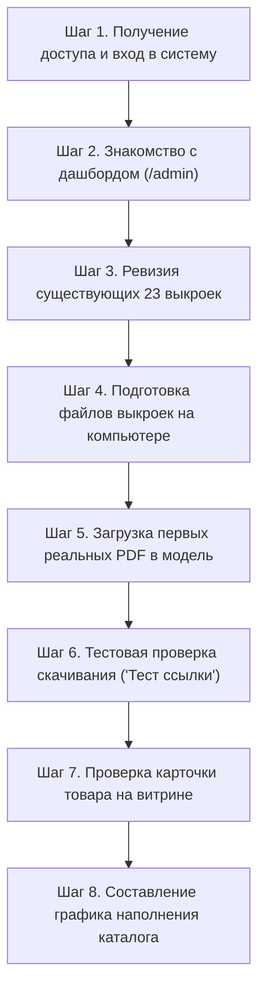

# LEKALO ZHIIDE — ПЕРВЫЙ РАБОЧИЙ ДЕНЬ АДИЛЕТА
## Пошаговый практический план погружения и работы с платформой

**Для кого:** Адилет (Владелец интернет-магазина LEKALO ZHIIDE)  
**Цель первого дня:** Уверенно освоить панель управления, проверить готовые 23 товара, научиться загружать рабочие PDF-выкройки и протестировать витрину магазина.  
**Дата:** 18 ноября 2026 г.

---

## Распорядок и шаги первого дня

---

### Шаг 1. Получение доступа и первый вход (Утро: 15–20 минут)
1. Откройте браузер на компьютере (рекомендуется Google Chrome или Яндекс Браузер).
2. Перейдите по ссылке:
   - В тестовой среде: `http://localhost:3000/login?redirect=/admin`
   - На боевом домене: `https://lekalo-zhiide.kg/login?redirect=/admin`
3. Введите логин (ваш рабочий email) и пароль администратора.
4. Нажмите синюю кнопку **«Войти»**.
5. **Результат:** Перед вами откроется панель управления с тёмным верхним меню и заголовком *«Сводка и показатели»*.

---

### Шаг 2. Знакомство с панелью управления (30 минут)
Обратите внимание на вкладки в верхней панели:
- **«Обзор» (`/admin`):** Главный дашборд. Здесь отображаются 4 ключевые карточки: общая выручка, количество заказов, число моделей в каталоге и база покупателей.
- **«Выкройки» (`/admin/products`):** Основной рабочий раздел, где хранятся карточки всех моделей.
- **«Категории» (`/admin/categories`):** 6 разделов ателье (Платья, Юбки, Брюки, Блузы, Жакеты, Домашняя одежда).
- **«Размеры» (`/admin/sizes`):** Справочник размеров от 42 до 60 и комплект `ALL`.
- **«Заказы» (`/admin/orders`):** История покупок клиентов.
- **«Пользователи» (`/admin/users`):** Управление аккаунтами.

---

### Шаг 3. Ревизия каталога: проверка 23 созданных моделей (45 минут)
1. Перейдите во вкладку **«Выкройки»** (`/admin/products`).
2. В таблице вы увидите все **23 товара**, уже внесенные в базу данных.
3. Проверьте:
   - У каждого товара есть студийная фотография обложки.
   - Указаны базовые розничные цены (от 420 до 890 сомов).
   - Для товаров «Аида» и «Чолпон» подключена опция пакетного комплекта `ALL`.
   - Статус всех товаров сейчас — *«Опубликована»*.
4. Нажмите на иконку глаза («Открыть карточку на сайте») в строке любой модели, чтобы увидеть, как её видят обычные посетители магазина.

---

### Шаг 4. Подготовка файлов первой модели на компьютере (1 час)
Выберите одну модель для полной боевой комплектации (например, **«Пальто оверсайз «Чолпон»** или **«Платье миди «Аида»**):
1. Запросите у конструктора лекал готовые PDF-файлы для этой модели.
2. Проверьте файлы на компьютере:
   - Формат файлов — строго `.pdf`.
   - Размер файла — до 30 МБ (обычно выкройка весит от 1 до 5 МБ).
   - На первом листе присутствует квадрат 10×10 см (или 5×5 см) для калибровки принтера.
   - Файлы разделены по размерам: отдельный PDF для 42, отдельный для 44, отдельный для 46 и т.д.
   - Подготовлены оба формата печати: файл для принтера **А4** и файл для рулонного **Плоттера 900 мм**.

---

### Шаг 5. Загрузка первых реальных PDF-выкроек (45 минут)
1. В списке моделей (`/admin/products`) найдите выбранный товар и нажмите кнопку **«Файлы»** (с иконкой документа).
2. Вы попадете на страницу управления файлами: `/admin/products/[ID]/files`.
3. Вверху вы увидите желтый блок-предупреждение:  
   *«Комплект ALL не укомплектован! Часть файлов отсутствует»*.
4. В таблице матрицы вариантов найдите строку нужного размера (например: `Размер 42 | Рост 164-170 | А4`).
5. Нажмите кнопку **«Загрузить PDF»** (или «Заменить PDF»):
   - В модальном окне выберите вкладку *«Файл с компьютера (PDF)»*.
   - Выберите подготовленный файл на диске.
   - В поле «Примечание к версии» напишите: `Релиз 1.0 (боевые лекала)`.
   - Нажмите синюю кнопку **«Сохранить в хранилище»**.
6. Повторите операцию для остальных строк выбранной модели.
7. **Результат:** После загрузки всех файлов желтый блок сменится на **зелёный индикатор**:  
   *«Комплект ALL полностью укомплектован и готов к продаже (100%)»*.

---

### Шаг 6. Тестирование защищенного скачивания (15 минут)
1. В таблице матрицы вариантов найдите строку, куда только что загрузили файл.
2. Нажмите кнопку **«Тест ссылки»** (иконка со стрелочкой вниз).
3. В новой вкладке браузера сформируется защищенная ссылка и откроется ваш PDF-файл.
4. Убедитесь, что файл открывается без ошибок, линии выкройки четкие, а надписи читаемы.
5. *Помните:* эта ссылка одноразовая и живет ровно 5 минут. Покупатели в личном кабинете будут получать точно такие же персональные ссылки.

---

### Шаг 7. Проверка карточки на витрине и мобильном телефоне (30 минут)
1. Нажмите в строке товара иконку глаза («Открыть карточку на сайте»).
2. Проверьте:
   - Обложка изделия загружается быстро и четко.
   - При выборе разных размеров (42, 44, 46) кнопки переключаются плавно.
   - При выборе формата печати (А4 или Плоттер) цена отображается корректно.
   - Блок «Комплект всех размеров» активен и считает правильную сумму со скидкой.
   - Кнопка **«В корзину»** добавляет выбранный размер.
3. Откройте эту же страницу на смартфоне и убедитесь, что верстка удобна для пальца, а кнопка покупки зафиксирована внизу экрана.

---

### Шаг 8. Итоги первого дня и план на неделю (Вечер: 30 минут)
Поздравляем! За первый день вы:
- Освоили вход и структуру панели управления.
- Узнали, как устроен каталог и матрица SKU.
- Загрузили первые реальные лекала и протестировали их защищенное скачивание.

**Задача на ближайшие дни:**
Совместно с конструктором лекал подготовить и поочередно загрузить PDF-файлы для остальных моделей каталога (по чек-листу [STAGE_4_8_PRODUCT_UPLOAD_CHECKLIST.md](file:///C:/Users/ASUS/.gemini/antigravity/scratch/lekalo-zhiide/STAGE_4_8_PRODUCT_UPLOAD_CHECKLIST.md)).
