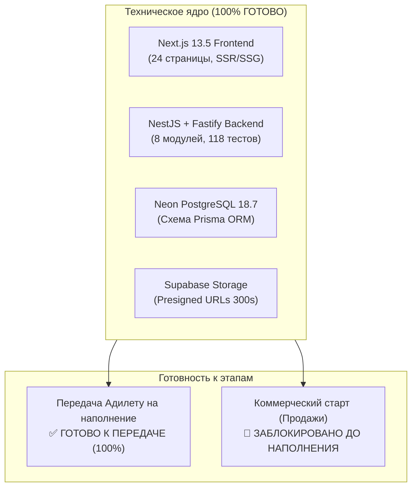
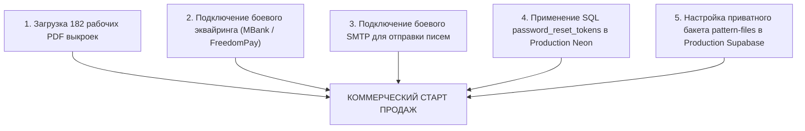

# LEKALO ZHIIDE — ОСНОВНОЙ ДОКУМЕНТ ПЕРЕДАЧИ ПРОЕКТА
## Релизный пакет передачи системы владельцу и технической команде

**Проект:** LEKALO ZHIIDE — Онлайн-ателье и магазин цифровых выкроек  
**Версия релиза:** 1.0 (Stage 4.9)  
**Дата передачи:** 18 ноября 2026 г.  
**Кому передаётся:** Адилет (Владелец проекта / Администратор) и привлекаемая команда разработки  
**Режим проверки:** AUDIT / DOCUMENTATION ONLY (исходный код и база данных не модифицировались)

---

## 1. Резюме проекта и статус передачи

Интернет-магазин **LEKALO ZHIIDE** полностью спроектирован, запрограммирован и протестирован на сквозном уровне. Вся базовая функциональность для электронной коммерции цифрового формата готова к эксплуатации.



### Ключевой вердикт готовности:
1. **Передача Адилету для проверки и наполнения:** **100% ГОТОВО (ДА).**  
   Административная панель функционирует в полном объёме: доступно управление карточками выкроек, ценообразованием, автоматической генерацией матриц вариантов (размеры × рост × формат) и загрузкой PDF-файлов в облачное хранилище.
2. **Коммерческий запуск продаж покупателям:** **ВРЕМЕННО ЗАБЛОКИРОВАН (НЕТ).**  
   В базе данных из 183 вариантов выкроек цифровой файл прикреплён только к 1 варианту (демонстрационная заглушка 100 байт). До загрузки настоящих рабочих PDF реальные продажи открывать нельзя. Кроме того, платежи и почтовые уведомления работают в тестовом (Mock) режиме.

---

## 2. Комплект передаваемой документации

В рамках Stage 4.9 сформирован полный пакет сопроводительной технической и эксплуатационной документации:

| Документ | Назначение |
|---|---|
| [STAGE_4_9_PROJECT_HANDOVER.md](file:///C:/Users/ASUS/.gemini/antigravity/scratch/lekalo-zhiide/STAGE_4_9_PROJECT_HANDOVER.md) | **Главный документ передачи** (настоящий файл): резюме, архитектура, статус модулей. |
| [STAGE_4_9_TECHNICAL_INVENTORY.md](file:///C:/Users/ASUS/.gemini/antigravity/scratch/lekalo-zhiide/STAGE_4_9_TECHNICAL_INVENTORY.md) | **Техническая инвентаризация:** стек, зависимости, структура папок, модули, маршруты API и страниц. |
| [STAGE_4_9_TASK_ROADMAP.md](file:///C:/Users/ASUS/.gemini/antigravity/scratch/lekalo-zhiide/STAGE_4_9_TASK_ROADMAP.md) | **Дорожная карта задач:** классификация BLOCKER, IMPORTANT, OPTIONAL до и после запуска. |
| [STAGE_4_9_SECURITY_HANDOVER.md](file:///C:/Users/ASUS/.gemini/antigravity/scratch/lekalo-zhiide/STAGE_4_9_SECURITY_HANDOVER.md) | **Протокол безопасности:** доступы, обращение с секретами, изоляция сред, защита S3. |
| [STAGE_4_9_ADILET_FIRST_DAY.md](file:///C:/Users/ASUS/.gemini/antigravity/scratch/lekalo-zhiide/STAGE_4_9_ADILET_FIRST_DAY.md) | **План первого рабочего дня Адилета:** пошаговый сценарий входа, проверки и первых загрузок. |
| [STAGE_4_8_ADMIN_GUIDE_ADILET.md](file:///C:/Users/ASUS/.gemini/antigravity/scratch/lekalo-zhiide/STAGE_4_8_ADMIN_GUIDE_ADILET.md) | Полное руководство администратора по работе со всеми элементами интерфейса. |
| [STAGE_4_8_PRODUCT_UPLOAD_CHECKLIST.md](file:///C:/Users/ASUS/.gemini/antigravity/scratch/lekalo-zhiide/STAGE_4_8_PRODUCT_UPLOAD_CHECKLIST.md) | Чек-лист загрузки каждой новой выкройки. |
| [STAGE_4_7_CATALOG_CONTENT_STATUS.md](file:///C:/Users/ASUS/.gemini/antigravity/scratch/lekalo-zhiide/STAGE_4_7_CATALOG_CONTENT_STATUS.md) | Полный аудит каталога: 23 товара, 183 варианта, перечень недостающих файлов. |

---

## 3. Архитектурный обзор платформы

Система построена по принципу модульного разделения обязанностей (Separation of Concerns):

```
+---------------------------------------------------------------------------------------+
|                                    КЛИЕНТСКИЙ УРОВЕНЬ                                |
|  Next.js 13.5 (App Router) • React 18 • TailwindCSS • Lucide Icons • TypeScript        |
|  Публичная витрина (/catalog) • Корзина (/cart) • Кабинет (/cabinet) • Админка (/admin)|
+---------------------------------------------------------------------------------------+
                                           |  HTTP / REST (JSON)
                                           v
+---------------------------------------------------------------------------------------+
|                                   СЕРВЕРНЫЙ УРОВЕНЬ                                   |
|  NestJS 10.4.15 • Fastify HTTP Adapter • Zod / Class-Validator • JWT Cookie / Bearer  |
|  Модули: Auth • Catalog • Cart • Orders • Payments • Storage • Cabinet • Health       |
+---------------------------------------------------------------------------------------+
                     |                                              |
      SQL (Prisma 5.22)                                    S3 Presigned URLs (300s)
                     v                                              v
+----------------------------------------+     +----------------------------------------+
|           БАЗА ДАННЫХ (Neon)           |     |        ХРАНИЛИЩЕ (Supabase S3)         |
|  PostgreSQL 18.7 (Serverless)          |     |  Бакет "product-images" (Публичный)    |
|  Схема: Users, Products, Variants,     |     |  Бакет "pattern-files"  (Приватный)    |
|  Orders, OrderItems, DigitalFiles,     |     |  Доступ к PDF только по Signed URL     |
|  Tokens, Categories, Reviews           |     |                                        |
+----------------------------------------+     +----------------------------------------+
```

---

## 4. Сводный статус готовности подсистем

| Подсистема | Реализовано | Уровень верификации | Комментарий |
|---|---|---|---|
| **Главная витрина** | Герой-баннеры, категории, промо-блоки, новинки | Сборка Next.js, 0 ошибок TS, HTTP 200 | Полная адаптивность ПК/моб |
| **Каталог и поиск** | Фильтры по категориям, ценам, живой поиск, сортировка | Интеграционные тесты API, сборка Next.js | Быстрый поиск по slug и названию |
| **Карточка выкройки** | Селекторы размеров, роста, форматов, бандл ALL | Сборка SSR/SSG, статический анализ | Аккуратное скрытие пустых блоков |
| **Корзина и оформление** | Гостевая корзина `localStorage`, авто-слияние | `cart.service.test.ts` (14 тестов PASS) | Сохранение при перезагрузке |
| **Аутентификация** | Вход, регистрация, JWT httpOnly, RBAC (`ADMIN`) | `auth.service.test.ts` (8 тестов PASS) | Защита от перехвата токенов |
| **Сброс пароля** | Email-запрос, SHA-256 хеш токена, TTL 15 мин, logoutAll | `password-reset.service.test.ts` (11 тестов) | SQL применен в `lekalo_test` |
| **Заказы и платежи** | Оформление, расчет скидок, Mock-эквайринг | `orders.service.test.ts` (10 тестов PASS) | Фиксация снапшотов цен в заказе |
| **Выдача цифровых прав** | Автоматическая привязка файлов после `PAID` | `payments.service.test.ts` (6 тестов PASS) | Мгновенный доступ в кабинете |
| **Защита скачивания** | Signed Presigned URLs со сроком жизни 300 сек | `digital-files.service.test.ts` (9 тестов) | Приватный S3-доступ |
| **Личный кабинет** | Библиотека купленных выкроек, центр скачивания | Сборка Next.js, HTTP 200 | Бессрочный доступ покупателя |
| **Админ-панель (CMS)** | Управление товарами, ценами, матрицей, заказами | Сборка Next.js, статический анализ | Защита роутов по роли `ADMIN` |
| **Матрица вариантов** | Генерация вариантов размеров × ростовка × формат | API-тесты, сборка | Пакетный генератор в 1 клик |
| **Менеджер файлов** | Загрузка фото в галерею, версионирование PDF (v1, v2) | S3 API Presigner, сборка Next.js | Кнопка «Тест ссылки» |
| **Справочники** | Категории (`/admin/categories`), размеры (`/admin/sizes`) | Сборка Next.js, API-тесты | Управление стандартной сеткой |

---

## 5. Текущее состояние каталога и план наполнения

На основе фактических данных базы `lekalo_test` (Stage 4.7):
- **Всего карточек моделей:** **23 товара** (100% опубликованы).
- **Студийные фотографии обложек:** **23 из 23** (100% загружены).
- **Технические рисунки (эскизы конструкции):** **1 из 23** (загружен только для «Пальто Чолпон», 22 отсутствуют).
- **Всего вариантов (SKU):** **183 комбинации**.
- **Варианты с прикреплёнными PDF:** **1 вариант** (демонстрационная тестовая заглушка 100 байт у «Пальто Чолпон»).
- **Варианты без PDF-файлов:** **182 варианта (99.5%)**.

### План наполнения каталога реальными выкройками:
1. Конструктор лекал формирует рабочие файлы в двух форматах:
   - Листы **А4** с контрольным квадратом 10×10 см для домашней печати.
   - Полотно **Плоттер 900 мм** для печати в копицентре.
2. Файлы сохраняются в формате `.pdf` с понятными именами (например: `palto-cholpon-44-164-170-A4.pdf`).
3. Адилет заходит в админ-панель $\rightarrow$ раздел «Выкройки» $\rightarrow$ «Файлы» нужной модели.
4. Поочередно загружает файлы в каждый вариант через форму «Загрузить PDF».
5. После достижения 100% укомплектованности комплекта и проверки кнопки «Тест ссылки» модель считается готовой к продажам.

---

## 6. Что нужно сделать до коммерческого старта



Подробное пошаговое описание задач содержится в [STAGE_4_9_TASK_ROADMAP.md](file:///C:/Users/ASUS/.gemini/antigravity/scratch/lekalo-zhiide/STAGE_4_9_TASK_ROADMAP.md).

---

## 7. Протокол передачи

1. Исходный код находится в репозитории проекта в стабильном, чистом состоянии:
   - `npm run typecheck` Backend: **0 ошибок**.
   - `npm run typecheck` Frontend: **0 ошибок**.
   - `npm run build` Frontend: **24/24 страницы собраны без ошибок**.
   - `npm test` Backend: **12 сьютов, 118 тестов PASSED (100%)**.
2. Вся документация размещена в рабочей директории и готова к изучению Адилетом и техническими специалистами.
3. Проект признан **полностью готовым к процедуре передачи**.
