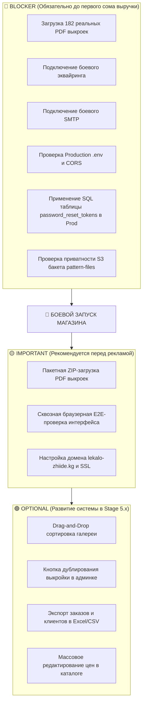

# LEKALO ZHIIDE — ДОРОЖНАЯ КАРТА ЗАДАЧ (TASK ROADMAP)
## План завершения подготовки, запуска и развития платформы

**Проект:** LEKALO ZHIIDE  
**Дата актуализации:** 18 ноября 2026 г.  
**Среда:** Переход от тестовой среды (`lekalo_test`) к боевой (`Production`)

---

## 1. Сводная классификация задач

Все оставшиеся технические и организационные задачи строго разделены на 3 уровня приоритета:



---

## 2. 🔴 БЛОКЕРЫ (BLOCKER — Критический путь до открытия продаж)

Без выполнения этих 6 пунктов интернет-магазин **НЕЛЬЗЯ открывать для реальных покупателей**.

| № | Задача | Суть и необходимость | Кто выполняет | Оценка времени |
|---|---|---|---|:---:|
| **B1** | **Загрузка 182 реальных PDF-выкроек** | Сейчас из 183 вариантов загружена лишь 1 демо-заглушка (100 байт). Реальные лекала отсутствуют на 99.5%. Покупка в текущем виде приведет к жалобам. | Адилет / Контент-команда | 2–3 дня |
| **B2** | **Подключение боевого эквайринга** | Замена тестового Mock-провайдера на реальный банк Кыргызстана (FreedomPay, MBank, PayBox или Demir Bank). Заключение договора, получение `MERCHANT_ID` и `SECRET_KEY`. | Адилет (договор) + DevOps (ключи) | 3–5 дней (банк) |
| **B3** | **Подключение боевого SMTP-сервера** | Почтовый сервер для автоматической отправки писем с чеками заказов, подтверждениями и ссылками сброса пароля (Yandex 360, Google Workspace, Resend). | DevOps / Разработчик | 2–3 часа |
| **B4** | **Проверка Production-конфигурации** | Проверка изолированного файла `.env.production`: уникальные `JWT_SECRET`, боевые URL фронтенда в CORS, строгие параметры безопасности кук (`secure: true`). | DevOps / Разработчик | 2 часа |
| **B5** | **Безопасное применение SQL в Production Neon** | Выполнение скрипта `manual_password_reset_tokens.sql` на боевой базе данных Neon для создания таблицы `password_reset_tokens`. | Разработчик / DBA | 30 минут |
| **B6** | **Проверка приватности Production Storage** | Гарантия того, что бакет `pattern-files` в боевом проекте Supabase имеет статус `public: false` (файлы отдаются только по Signed URL на 300 сек). | DevOps / Разработчик | 30 минут |

---

## 3. 🟡 ВАЖНЫЕ ЗАДАЧИ (IMPORTANT — Перед стартом рекламных кампаний)

Эти задачи повышают комфорт работы администратора и гарантируют стабильность под нагрузкой.

| № | Задача | Суть и необходимость | Кто выполняет | Оценка времени |
|---|---|---|---|:---:|
| **I1** | **Пакетная загрузка PDF (ZIP-архивы)** | Модуль автоматической распаковки ZIP-архива с файлами линейки (например, сразу все размеры А4 и Плоттер) с автораскладкой по вариантам SKU, чтобы не загружать по 8 файлов вручную на каждый товар. | Разработчик Backend/Frontend | 1–2 дня |
| **I2** | **Сквозная браузерная E2E-проверка** | Запуск автоматизированных сценариев Playwright/Cypress в среде с выделенным браузером (эмуляция реальных кликов, корзины и оформления на мобильных устройствах). | QA / Разработчик | 1 день |
| **I3** | **Настройка основного домена и SSL** | Привязка основного домена (например, `lekalo-zhiide.kg`), настройка DNS-записей (`A`, `CNAME`, `MX`, `SPF`, `DKIM`), выпуск бесплатного сертификата Let's Encrypt / Vercel SSL. | DevOps | 3–4 часа |

---

## 4. 🟢 НЕБЛОКИРУЮЩИЕ УЛУЧШЕНИЯ (OPTIONAL — Развитие Stage 5.x)

Улучшения интерфейса и аналитики, которые можно внедрять в плановом порядке после старта коммерческих продаж:

| № | Задача | Описание улучшения | Ожидаемый эффект |
|---|---|---|---|
| **O1** | **Drag-and-Drop в галерее фото** | Визуальное перетаскивание картинок мышью для смены порядка отображения на витрине. | Ускорение работы контент-менеджера. |
| **O2** | **Кнопка дублирования выкройки** | Создание новой карточки товара в 1 клик на основе существующей с сохранением свойств тканей и мерок. | Быстрое добавление похожих платьев/юбок. |
| **O3** | **Экспорт заказов в Excel / CSV** | Выгрузка реестра продаж за выбранный период для передачи в бухгалтерию и налоговую отчетность. | Упрощение финансового учёта. |
| **O4** | **Массовое редактирование цен** | Возможность применить скидку 15% сразу на всю категорию «Платья» перед праздниками. | Эффективное проведение промо-акций. |

---

## 5. График перехода в боевой режим (Go-Live Timeline)

```
[День 1–2] ──────────► [День 3–4] ──────────► [День 5–7] ──────────► [СТАРТ]
• Подписание договора  • Наполнение каталога • Настройка домена     • Запуск продаж
  с банком (эквайринг)   (загрузка PDF)        и SMTP-почты         • Рекламный трафик
• Создание боевой БД   • Тестовые платежи   • Проверка безопасности
  и приватного S3        в песочнице банка     всех 23 товаров
```
