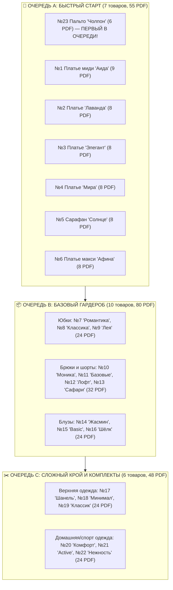

# STAGE 5.0 — ОЧЕРЕДНОСТЬ РАБОТ ДЛЯ АДИЛЕТА (WORK QUEUE)
## Практический пошаговый план наполнения каталога LEKALO ZHIIDE

**Для кого:** Адилет (Владелец проекта) и контент-команда  
**Дата составления:** 18 ноября 2026 г.  
**Цель:** Оптимально распределить усилия по загрузке лекал и материалов, чтобы максимально быстро открыть первые продажи.

---

## 1. Сводное распределение по очередям приоритета

---

## 2. 🌟 ОЧЕРЕДЬ A — Наиболее полный контент (Быстрый запуск продаж)

В эту очередь входят товары, карточки которых уже сейчас на 80–95% укомплектованы визуалом и текстом. Для них требуется минимальное количество действий, чтобы открыть продажи.

### Рекомендованный первый товар:
> [!IMPORTANT]
> **ТОП-1 К ЗАГРУЗКЕ:**  
> **Товар №23: «Пальто оверсайз «Чолпон» (Лимитированная серия)»**  
> **Почему именно он:**  
> 1. Единственный товар в базе, имеющий **полный комплект визуала**: обложку спереди, фотографию вида сзади/деталей и технический CAD-рисунок.  
> 2. Самый компактный размерный ряд: **всего 6 вариантов** (размеры 42, 44, 46 в росте 164–170 см для А4 и Плоттера).  
> 3. Достаточно заменить 1 демонстрационный файл (100 байт) и загрузить 5 недостающих PDF, чтобы товар стал готов к реальной продаже на 100%!

---

### Подробный реестр товаров Очереди A:

| № | Товар | Slug | Категория | Вариантов | Что уже готово | Что необходимо сделать |
|---|---|---|---|:---:|---|---|
| **23** | **Пальто оверсайз «Чолпон»** | `palto-oversayz-cholpon` | Верхняя одежда | **6** | 3 фото (обложка, спинка, эскиз), ткани, мерки, бандл ALL | 1) Заменить 1 демо-файл 100 байт на реальный PDF. 2) Загрузить 5 недостающих PDF. |
| **1** | **Платье миди «Аида»** | `plate-midi-aida-s-zapakhom` | Платья | **9** | Обложка, подробнейшее описание (1254 симв.), ткани, фурнитура, мерки, бандл ALL | 1) Добавить технический рисунок CAD. 2) Загрузить 9 PDF (8 размеров + 1 бандл ALL). |
| **2** | **Летнее платье «Лаванда»** | `letnee-plate-lavanda` | Платья | **8** | Обложка студийного уровня, описание (273 симв.), мерки, ткани | 1) Добавить технический рисунок. 2) Загрузить 8 PDF (42, 44, 46, 48 × А4/Плоттер). |
| **3** | **Платье-футляр «Элегант»** | `plate-futlyar-elegant` | Платья | **8** | Обложка, описание (230 симв.), ткани, мерки | 1) Добавить технический рисунок. 2) Загрузить 8 PDF. |
| **4** | **Платье свободного кроя «Мира»** | `plate-svobodnogo-kroya-mira` | Платья | **8** | Обложка, описание (194 симв.), ткани, мерки | 1) Добавить технический рисунок. 2) Загрузить 8 PDF. |
| **5** | **Сарафан «Солнце»** | `sarafan-solntse` | Платья | **8** | Обложка, описание (168 симв.), ткани, мерки | 1) Добавить технический рисунок. 2) Загрузить 8 PDF. |
| **6** | **Платье макси «Афина»** | `plate-maksi-afina` | Платья | **8** | Обложка, описание (197 симв.), ткани, мерки | 1) Добавить технический рисунок. 2) Загрузить 8 PDF. |

*Итого по Очереди A: **7 товаров, 55 вариантов выкроек**.*

---

## 3. 📦 ОЧЕРЕДЬ B — Базовый гардероб (Юбки, Брюки, Блузы)

У товаров этой очереди есть отличные обложки и заполнены параметры расхода тканей, но описания краткие (до 150 символов), отсутствуют эскизы и не загружены файлы.

| № | Товар | Slug | Категория | Вариантов | Задачи для Адилета |
|---|---|---|---|:---:|---|
| **7** | Юбка-солнце «Романтика» | `yubka-solntse-romantika` | Юбки | 8 | Добавить эскиз, дополнить описание, загрузить 8 PDF |
| **8** | Юбка-карандаш «Классика» | `yubka-karandash-klassika` | Юбки | 8 | Добавить эскиз, дополнить описание, загрузить 8 PDF |
| **9** | Юбка миди со складками «Лея» | `yubka-midi-so-skladkami-leya` | Юбки | 8 | Добавить эскиз, дополнить описание, загрузить 8 PDF |
| **10** | Брюки палаццо «Моника» | `bryuki-palatstso-monika` | Брюки/шорты | 8 | Добавить эскиз карманов/пояса, загрузить 8 PDF |
| **11** | Классические прямые брюки «Базовые» | `klassicheskie-pryamye-bryuki-bazovye` | Брюки/шорты | 8 | Добавить эскиз гульфика/стрелок, загрузить 8 PDF |
| **12** | Брюки свободного кроя «Лофт» | `bryuki-svobodnogo-kroya-loft` | Брюки/шорты | 8 | Добавить эскиз, дополнить описание, загрузить 8 PDF |
| **13** | Летние шорты «Сафари» | `letnie-shorty-safari` | Брюки/шорты | 8 | Добавить эскиз отворотов/карманов, загрузить 8 PDF |
| **14** | Блузка с рукавами-фонариками «Жасмин» | `bluzka-s-rukavami-fonarikami-zhasmin` | Блузы | 8 | Добавить эскиз сборки рукава, загрузить 8 PDF |
| **15** | Рубашка оверсайз «Basic» | `rubashka-oversajz-basic` | Блузы | 8 | Добавить эскиз воротника/кокетки, загрузить 8 PDF |
| **16** | Блузка с запахом «Шёлк» | `bluzka-s-zapakhom-shyolk` | Блузы | 8 | Добавить эскиз застежки/драпировки, загрузить 8 PDF |

*Итого по Очереди B: **10 товаров, 80 вариантов выкроек**.*

---

## 4. ✂️ ОЧЕРЕДЬ C — Сложный крой, верхняя одежда и костюмы

Товары повышенной сложности пошива или состоящие из двух предметов гардероба. Требуют тщательного описания технологии сборки.

| № | Товар | Slug | Категория | Вариантов | Задачи для Адилета |
|---|---|---|---|:---:|---|
| **17** | Жакет «Шанель» | `zhaket-shanel` | Верхняя одежда | 8 | Сложность ADVANCED. Добавить эскиз бортов/тесьмы, подробную технологию ВТО, 8 PDF |
| **18** | Жилет «Минимал» | `zhilet-minimal` | Верхняя одежда | 8 | Добавить эскиз подкладки/проймы, 8 PDF |
| **19** | Тренч «Классик» | `trench-klassik` | Верхняя одежда | 8 | Сложность ADVANCED. Добавить эскиз эполетов, кокетки, пояса, технологию пошива, 8 PDF |
| **20** | Пижамный комплект «Комфорт» | `pizhamnyj-komplekt-komfort` | Домашняя одежда | 8 | Описать крой рубашки и брюк отдельно, добавить эскиз комплекта, 8 PDF |
| **21** | Спортивный костюм «Active» | `sportivnyj-kostyum-active` | Спортивная одежда | 8 | Описать пошив худи и джоггеров, добавить эскиз манжет/капюшона, 8 PDF |
| **22** | Домашнее платье «Нежность» | `domashnee-plate-nezhnost` | Домашняя одежда | 8 | Добавить эскиз кулиски/горловины, 8 PDF |

*Итого по Очереди C: **6 товаров, 48 вариантов выкроек**.*

---

## 5. Итоговые контрольные ответы

1. **Сколько товаров можно быстрее всего подготовить к продаже?**  
   $\rightarrow$ **7 товаров (Очередь A)**. В первую очередь платья и пальто «Чолпон».
2. **Сколько товаров требуют дополнительных материалов?**  
   $\rightarrow$ **16 товаров** (10 товаров Очереди B и 6 товаров Очереди C).
3. **Сколько PDF-выкроек отсутствует в каталоге?**  
   $\rightarrow$ **182 файла отсутствуют полностью** + **1 файл (демо 100 байт) требует замены**. Итого необходимо подготовить и загрузить **183 настоящих рабочих PDF**.
4. **Сколько фотографий и технических рисунков нужно подготовить?**  
   $\rightarrow$ **22 технических рисунка CAD** (для товаров №1–22). Также рекомендуется отснять **22 фотографии вида сзади**, чтобы на витрине у всех товаров была полноценная галерея.
5. **Какой товар рекомендуется взять в работу первым?**  
   $\rightarrow$ **Товар №23: «Пальто оверсайз «Чолпон» (Лимитированная серия)»**. У него уже загружены обложка, фото сзади и технический эскиз, а вариантов всего 6. Это идеальный пилотный товар для первой полной комплектации.
