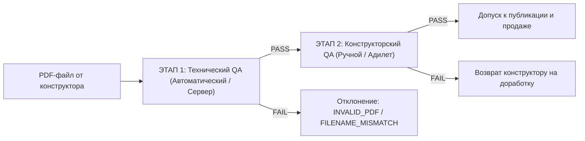

# LEKALO ZHIIDE — STAGE 5.13: Чек-лист приемки и контроля качества PDF «Чолпон»

**Товар:** Пальто оверсайз «Чолпон» (Лимитированная серия)  
**Контролеры:** Конструктор лекал / Администратор каталога (Адилет)  
**Цель:** Исключить попадание бракованных, немасштабных или неполных лекал покупателям.

---

## 1. Разграничение этапов контроля: Технический vs Конструкторский

- **Этап 1 (Технический):** Проверяет байтовую структуру файла, заголовок `%PDF-`, маркер `%%EOF`, объекты страниц и имя файла. Выполняется сервером при загрузке.
- **Этап 2 (Конструкторский):** Проверяет геометрию, детали, масштаб и швейные припуски. Выполняется человеком с линейкой и PDF-ридером.

---

## 2. Чек-лист ЭТАПА 1: Техническая валидация файла

| № | Параметр проверки | Критерий соответствия | Результат проверки |
| :-: | :--- | :--- | :-: |
| 1.1 | **Имя файла** | Строго соответствует SKU: `palto-oversayz-cholpon-{size}-164-170-{format}.pdf` | [ ] |
| 1.2 | **Формат документа** | Стандартный PDF (ISO 32000-1), версия от 1.4 до 1.7 | [ ] |
| 1.3 | **Размер файла** | Более 50 КБ и менее 30 МБ (стабы < 1024 байт запрещены) | [ ] |
| 1.4 | **Парольная защита** | Документ открывается без запроса пароля, печать разрешена | [ ] |
| 1.5 | **Целостность структуры** | Наличие заголовка `%PDF-`, трейлера `%%EOF`, объектов `/Catalog` и `/Pages` | [ ] |
| 1.6 | **Страницы** | Документ содержит не менее 1 страницы, пустые белые листы отсутствуют | [ ] |

---

## 3. Чек-лист ЭТАПА 2: Конструкторская приемка лекал

### 3.1. Масштаб и тестовый квадрат (Главный Quality Gate)
- [ ] **Печать без масштабирования:** В настройках принтера выбрано «Пользовательский масштаб: 100%» или «Реальный размер» (Real size / Do not scale). Опция «Подогнать под размер страницы» (Fit to page) **строго выключена**.
- [ ] **Замер тестового квадрата линейкой:** Контрольный проверочный квадрат на первой странице замерен металлической линейкой:
  - Горизонталь: строго **100.0 мм (10 см)**.
  - Вертикаль: строго **100.0 мм (10 см)**.
  - Погрешность: не более ±0.5 мм. При отклонении более 1 мм файл бракуется.

### 3.2. Спецификация деталей кроя пальто «Чолпон»
Проверьте наличие полного комплекта деталей (всего 12 позиций деталей):
- [ ] **1. Полочка (перед):** 2 детали (левая и правая, двубортный заход с разметкой петель и пуговиц).
- [ ] **2. Спинка:** 2 детали со средним швом и шлицей (или 1 деталь со сгибом).
- [ ] **3. Подборт:** 2 детали.
- [ ] **4. Верхняя половинка рукава:** 2 детали (двухшовный рукав).
- [ ] **5. Нижняя половинка рукава:** 2 детали.
- [ ] **6. Верхний воротник:** 1 деталь со сгибом.
- [ ] **7. Нижний воротник:** 2 детали (со средним швом) или 1 деталь со сгибом.
- [ ] **8. Стойка воротника:** 2 детали (верхняя и нижняя стойки).
- [ ] **9. Листочка прорезного кармана:** 2 детали со сгибом.
- [ ] **10. Подзор кармана:** 2 детали.
- [ ] **11. Мешковины кармана (верхняя и нижняя):** 4 детали.
- [ ] **12. Комплект подкладки:** полочка подкладки, спинка подкладки, рукава подкладки.

### 3.3. Разметка и технологическая маркировка деталей
- [ ] **Маркировка на каждой детали:** Текст содержит название модели (*Пальто Чолпон*), размер (*42 / 44 / 46*), рост (*164-170*), наименование детали и количество деталей для кроя (например: *«Полочка — 2 дет. из осн. ткани»*).
- [ ] **Долевая нить (нить основы):** На каждой детали нанесена прямая линия со стрелками, указывающая направление основы ткани.
- [ ] **Монтажные надсечки:**
  - Надсечки по линии талии и бедер на полочке и спинке совмещаются.
  - Надсечки по окату рукава и пройме совмещаются (передний перекат, вершина оката к плечевому шву, локтевой перекат).
  - Линии совмещения полузаноса (центр переда) и край борта нанесены четко.
- [ ] **Припуски на швы:**
  - Основные стачные швы: 1.0 см.
  - Горловина и пройма: 1.0 см.
  - Низ пальто: 3.5 – 4.0 см.
  - Низ рукавов: 3.0 – 3.5 см.
  - Величина припусков явно прописана в паспорте или контур припуска выделен пунктирной линией.

### 3.4. Особенности формата А4
- [ ] По периметру каждого листа присутствует контрольная рамка.
- [ ] Буквенно-цифровая нумерация листов (ряд А листы 1..8, ряд B листы 1..8 и т.д.).
- [ ] В углах и на стыках листов присутствуют треугольники/крестики для точного совмещения при склейке.
- [ ] Линии выкройки непрерывны при переходе через границы листов.

### 3.5. Особенности формата Plotter 900
- [ ] Ширина документа в свойствах файла не превышает **900 мм**.
- [ ] Детали уложены компактно, без наложения линий деталей друг на друга.
- [ ] Отступы от краев полотна составляют не менее 10 мм.
- [ ] Раскладка представляет собой единый непрерывный лист (длина 2.5 – 3.2 м).

---

## 4. Итоговое заключение о допуске к загрузке

Товар допускается к загрузке через Bulk Upload **только при 100% совпадении всех пунктов чек-листа**.

- Конструктор (ФИО / Подпись): __________________ / Дата: ____________
- Контролер-администратор Адилет (Подпись): __________________ / Дата: ____________
- Статус: **[ ] ПРИНЯТО К ЗАГРУЗКЕ / [ ] ВОЗВРАЩЕНО НА ДОРАБОТКУ**
