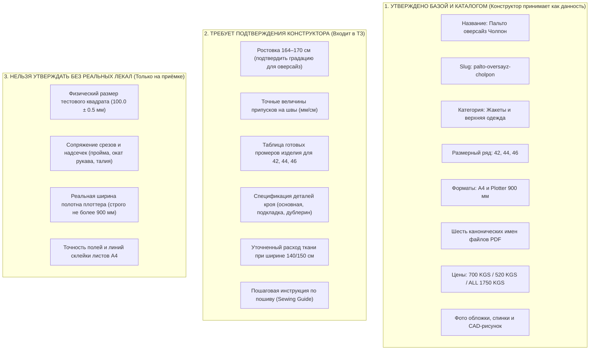

# LEKALO ZHIIDE — STAGE 5.14: Итоговый статус технического задания конструктору

**Дата завершения:** 19 ноября 2026 г.  
**Среда:** Изолированная база `lekalo_test` (Neon PostgreSQL 18.7)  
**Режим:** READ-ONLY / DOCUMENTATION  
**Статус ТЗ:** **ПОЛНОСТЬЮ СФОРМИРОВАНО И ГОТОВО К ПЕРЕДАЧЕ КОНСТРУКТОРУ**

---

## 1. Классификация конструктивных и технических параметров

В соответствии с требованиями безопасности и конструкторской этики параметры изделия разделены на три строгие категории:

---

## 2. Комплект подготовленной документации передачи (Stage 5.14)

1. **[STAGE_5_14_CHOLPON_CONSTRUCTOR_BRIEF.md](file:///C:/Users/ASUS/.gemini/antigravity/brain/3daab444-6aee-43d6-99f4-0bf7d10f7def/STAGE_5_14_CHOLPON_CONSTRUCTOR_BRIEF.md)**  
   *(Копия в проекте: [STAGE_5_14_CHOLPON_CONSTRUCTOR_BRIEF.md](file:///C:/Users/ASUS/.gemini/antigravity/scratch/lekalo-zhiide/STAGE_5_14_CHOLPON_CONSTRUCTOR_BRIEF.md))*  
   Основной документ технического задания для конструктора САПР. Включает паспорт модели, канонические имена 6 файлов, требования ISO 32000-1, маркировку деталей, запрос сопутствующих документов и правила приемки.

2. **[STAGE_5_14_CHOLPON_DELIVERABLES_MATRIX.md](file:///C:/Users/ASUS/.gemini/antigravity/brain/3daab444-6aee-43d6-99f4-0bf7d10f7def/STAGE_5_14_CHOLPON_DELIVERABLES_MATRIX.md)**  
   *(Копия в проекте: [STAGE_5_14_CHOLPON_DELIVERABLES_MATRIX.md](file:///C:/Users/ASUS/.gemini/antigravity/scratch/lekalo-zhiide/STAGE_5_14_CHOLPON_DELIVERABLES_MATRIX.md))*  
   Матрица ожидаемых результатов: 6 файлов PDF, таблица готовых промеров, спецификация деталей, карта расхода материалов и иллюстрированная инструкция по пошиву.

3. **[STAGE_5_14_CHOLPON_ACCEPTANCE_PROTOCOL.md](file:///C:/Users/ASUS/.gemini/antigravity/brain/3daab444-6aee-43d6-99f4-0bf7d10f7def/STAGE_5_14_CHOLPON_ACCEPTANCE_PROTOCOL.md)**  
   *(Копия в проекте: [STAGE_5_14_CHOLPON_ACCEPTANCE_PROTOCOL.md](file:///C:/Users/ASUS/.gemini/antigravity/scratch/lekalo-zhiide/STAGE_5_14_CHOLPON_ACCEPTANCE_PROTOCOL.md))*  
   Официальный двухэтапный бланк приёмки (Этап 1: техническая валидация файлов Адилетом; Этап 2: контрольный замер квадрата 100×100 мм и сопряжения срезов конструктором).

---

## 3. Подтверждение соблюдения требований безопасности

- **База данных:** Контрольный запрос `SELECT current_database()` подтвердил работу строго в тестовой БД `lekalo_test`.
- **Продакшн:** Подключения к Production Neon, Supabase и Vercel **не производились**.
- **Файловая система:** Фиктивные PDF-файлы не генерировались и не загружались.
- **Статус каталога:** Цены, товары, категории и варианты не изменялись.
- **Статус витрины:** Все 6 вариантов пальто «Чолпон» остаются в статусе `isAvailable: false` под защитой Purchase Guard.
- **Git:** Никаких коммитов или пушей в репозиторий не выполнялось.
