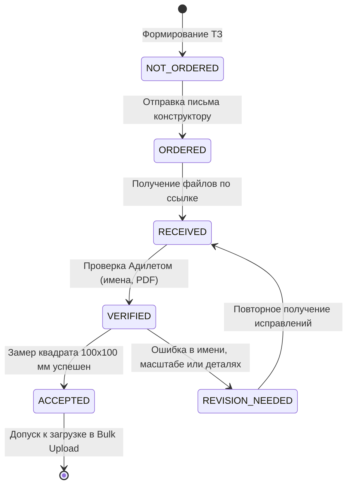

# LEKALO ZHIIDE — STAGE 5.15: Чек-лист поставки результатов конструктора
## Модель: Пальто оверсайз «Чолпон» (Лимитированная серия)

**Назначение:** Операционный чек-лист для контроля всех результатов работы конструктора САПР на всех стадиях жизненного цикла заказа.

---

## 1. Стандартные статусы позиций чек-листа

Каждая позиция поставки в любой момент времени имеет строго один из 6 статусов:

| Статус | Обозначение | Описание этапа |
| :--- | :---: | :--- |
| **НЕ ЗАКАЗАНО** | ⚪ `NOT_ORDERED` | ТЗ сформировано, но еще не направлено конструктору. |
| **ЗАКАЗАНО** | 🟡 `ORDERED` | Письмо и ТЗ отправлены конструктору, согласованы сроки и стоимость. |
| **ПОЛУЧЕНО** | 🔵 `RECEIVED` | Файл или документ получен от конструктора по почте или ссылке. |
| **ПРОВЕРЕНО** | 🟣 `VERIFIED` | Пройдена автоматическая техническая валидация или ручной замер квадрата. |
| **ПРИНЯТО** | 🟢 `ACCEPTED` | Результат полностью удовлетворяет стандартам качества и допущен к загрузке. |
| **ТРЕБУЕТСЯ ИСПРАВЛЕНИЕ** | 🔴 `REVISION_NEEDED` | Обнаружен брак (ошибка в имени, отклонение масштаба, нехватка деталей). Возврат. |

---

## 2. Чек-лист 6 производственных файлов PDF

| № | Наименование результата | Каноническое имя файла | Размер / Формат | Текущий статус | Дата получения | Результат проверки |
| :-: | :--- | :--- | :---: | :---: | :---: | :---: |
| **1** | PDF выкройки: р-р 42 (А4) | `palto-oversayz-cholpon-42-164-170-A4.pdf` | 42 / A4 | **НЕ ЗАКАЗАНО** | — | Ожидает отправки ТЗ |
| **2** | PDF выкройки: р-р 42 (Плоттер) | `palto-oversayz-cholpon-42-164-170-PLOTTER_900.pdf` | 42 / Plotter 900 | **НЕ ЗАКАЗАНО** | — | Ожидает отправки ТЗ |
| **3** | PDF выкройки: р-р 44 (А4) | `palto-oversayz-cholpon-44-164-170-A4.pdf` | 44 / A4 | **НЕ ЗАКАЗАНО** | — | Ожидает отправки ТЗ |
| **4** | PDF выкройки: р-р 44 (Плоттер) | `palto-oversayz-cholpon-44-164-170-PLOTTER_900.pdf` | 44 / Plotter 900 | **НЕ ЗАКАЗАНО** | — | Ожидает отправки ТЗ |
| **5** | PDF выкройки: р-р 46 (А4) | `palto-oversayz-cholpon-46-164-170-A4.pdf` | 46 / A4 | **НЕ ЗАКАЗАНО** | — | Ожидает отправки ТЗ |
| **6** | PDF выкройки: р-р 46 (Плоттер) | `palto-oversayz-cholpon-46-164-170-PLOTTER_900.pdf` | 46 / Plotter 900 | **НЕ ЗАКАЗАНО** | — | Ожидает отправки ТЗ |

---

## 3. Чек-лист сопутствующих материалов и документации

| № | Позиция документации | Требуемое содержание | Текущий статус | Дата получения | Примечания |
| :-: | :--- | :--- | :---: | :---: | :--- |
| **7** | **Таблица готовых промеров (42, 44, 46)** | Длина спинки, обхват груди, талии, бедер, длина рукава от горловины, ширина рукава по бицепсу. | **НЕ ЗАКАЗАНО** | — | Критично для выбора размера покупателем. |
| **8** | **Спецификация деталей кроя** | Список 12 деталей с количеством кроя из верха, подкладки и дублерина. | **НЕ ЗАКАЗАНО** | — | Обязательно для раскроя ткани. |
| **9** | **Расход ткани (140 см и 150 см)** | Точный метраж с учетом направления ворса ткани пальто + подкладка. | **НЕ ЗАКАЗАНО** | — | Необходимо для карточки товара. |
| **10** | **Инструкция по пошиву (Sewing Guide)** | Последовательность сборки: дублирование, карманы, воротник, рукава, подкладка. | **НЕ ЗАКАЗАНО** | — | Комплектный файл для покупателей. |
| **11** | **Контрольный квадрат 100×100 мм** | Проверка тестовой распечатки металлической линейкой (100.0 ± 0.5 мм). | **НЕ ЗАКАЗАНО** | — | Главный барьер качества перед загрузкой. |

---

## 4. Маршрут движения статусов позиции при приёмке

