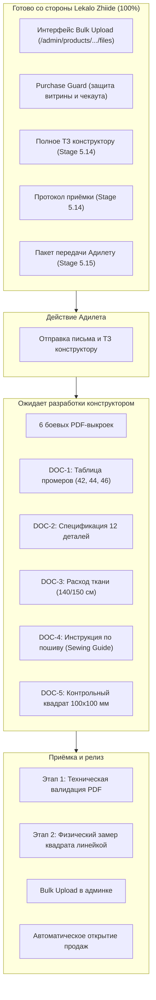

# LEKALO ZHIIDE — STAGE 5.15: Итоговый отчет о готовности пакета передачи конструктору
## Модель: Пальто оверсайз «Чолпон» (Лимитированная серия)

**Дата фиксации:** 19 ноября 2026 г.  
**Статус этапа:** ВЫПОЛНЕН УСПЕШНО (STAGE 5.15 COMPLETE)  
**Режим выполнения:** READ-ONLY / DOCUMENTATION ONLY  

---

## 1. Резюме этапа Stage 5.15

В рамках этапа Stage 5.15 сформирован полный операционный пакет для передачи технического задания конструктору на разработку 6 производственных PDF-выкроек модели «Пальто оверсайз Чолпон» (`palto-oversayz-cholpon`). 

Все материалы согласованы со стандартами платформы (Stage 5.1, Stage 5.2), производственным манифестом (Stage 5.13) и техническим заданием (Stage 5.14). Каталог и витрина защищены механизмом Purchase Guard (Stage 5.9–5.11): варианты без проверенных производственных PDF заблокированы для покупки.

---

## 2. Безопасность окружения и целостность данных

Перед выполнением этапа проведены проверки безопасности:
- **База данных:** подтверждено фактическое подключение к `lekalo_test` (`SELECT current_database() = 'lekalo_test'`).
- **Изоляция:** доступ к боевым средам Neon, Supabase и Vercel полностью исключен.
- **Целостность данных:** миграции схемы не выполнялись, данные каталога, вариантов, цен и существующих файлов не изменялись.
- **Конфиденциальность:** секреты, учетные данные и токены окружения не раскрывались.
- **Контроль версий:** коммиты и пуши в Production не производились.

---

## 3. Перечень созданных документов Stage 5.15

Все документы сохранены как в директории артефактов (`brain/<conversation-id>/`), так и в корне рабочей директории проекта (`scratch/lekalo-zhiide/`):

| Документ | Формат | Назначение |
| :--- | :---: | :--- |
| [STAGE_5_15_CHOLPON_CONSTRUCTOR_EMAIL.md](file:///C:/Users/ASUS/.gemini/antigravity/scratch/lekalo-zhiide/STAGE_5_15_CHOLPON_CONSTRUCTOR_EMAIL.md) | Markdown | Готовый шаблон делового письма конструктору на русском языке со спецификацией файлов и условий. |
| [STAGE_5_15_CHOLPON_DELIVERY_CHECKLIST.md](file:///C:/Users/ASUS/.gemini/antigravity/scratch/lekalo-zhiide/STAGE_5_15_CHOLPON_DELIVERY_CHECKLIST.md) | Markdown | Операционный чек-лист приёмки 6 PDF и 5 сопутствующих документов с жизненным циклом статусов. |
| [STAGE_5_15_CHOLPON_CONSTRUCTOR_TRACKER.csv](file:///C:/Users/ASUS/.gemini/antigravity/scratch/lekalo-zhiide/STAGE_5_15_CHOLPON_CONSTRUCTOR_TRACKER.csv) | CSV | Табличный трекер (11 строк) для поэлементного контроля статусов, дат и результатов двухэтапной верификации. |
| [STAGE_5_15_ADILET_HANDOVER.md](file:///C:/Users/ASUS/.gemini/antigravity/scratch/lekalo-zhiide/STAGE_5_15_ADILET_HANDOVER.md) | Markdown | Пошаговое руководство для Адилета: отправка ТЗ, приёмка, физический замер квадрата, Bulk Upload и запреты. |
| [STAGE_5_15_FINAL_STATUS.md](file:///C:/Users/ASUS/.gemini/antigravity/scratch/lekalo-zhiide/STAGE_5_15_FINAL_STATUS.md) | Markdown | Итоговый сводный отчёт и план следующих действий. |

---

## 4. Канонические спецификации выкроек

Каждый файл должен быть изготовлен в строгом соответствии с каноническим шаблоном наименования:

```text
palto-oversayz-cholpon-{size}-{height}-{format}.pdf
```

### Комплект из 6 производственных файлов:
1. `palto-oversayz-cholpon-42-164-170-A4.pdf` (Размер 42, Рост 164–170, А4)
2. `palto-oversayz-cholpon-42-164-170-PLOTTER_900.pdf` (Размер 42, Рост 164–170, Плоттер 900 мм)
3. `palto-oversayz-cholpon-44-164-170-A4.pdf` (Размер 44, Рост 164–170, А4)
4. `palto-oversayz-cholpon-44-164-170-PLOTTER_900.pdf` (Размер 44, Рост 164–170, Плоттер 900 мм)
5. `palto-oversayz-cholpon-46-164-170-A4.pdf` (Размер 46, Рост 164–170, А4)
6. `palto-oversayz-cholpon-46-164-170-PLOTTER_900.pdf` (Размер 46, Рост 164–170, Плоттер 900 мм)

---

## 5. Статус готовности vs Ожидание конструктора



---

## 6. Следующие шаги для Адилета

1. **Заполнить личные контакты** и имя конструктора в [STAGE_5_15_CHOLPON_CONSTRUCTOR_EMAIL.md](file:///C:/Users/ASUS/.gemini/antigravity/scratch/lekalo-zhiide/STAGE_5_15_CHOLPON_CONSTRUCTOR_EMAIL.md).
2. **Отправить письмо** с приложенными файлами ТЗ (`STAGE_5_14_CHOLPON_CONSTRUCTOR_BRIEF.md`, `STAGE_5_14_CHOLPON_ACCEPTANCE_PROTOCOL.md`).
3. **Обновить трекер** [STAGE_5_15_CHOLPON_CONSTRUCTOR_TRACKER.csv](file:///C:/Users/ASUS/.gemini/antigravity/scratch/lekalo-zhiide/STAGE_5_15_CHOLPON_CONSTRUCTOR_TRACKER.csv) (перевести позиции в статус `ORDERED`).
4. **При получении файлов**:
   - Сверить точные имена файлов (не переименовывать наугад!).
   - Распечатать страницу 1 формата А4 в 100% масштабе и измерить тестовый квадрат линейкой (строго 100.0 мм ±0.5 мм).
   - Заполнить и подписать Протокол приёмки.
5. **Выполнить Bulk Upload** через административный интерфейс:
   - Применить флаг `allowOverwrite` для обновления существующих тестовых заглушек 42-А4 и 44-А4 на версию `v2`.
   - Убедиться, что на витрине все 6 вариантов перешли в статус доступных для покупки.
