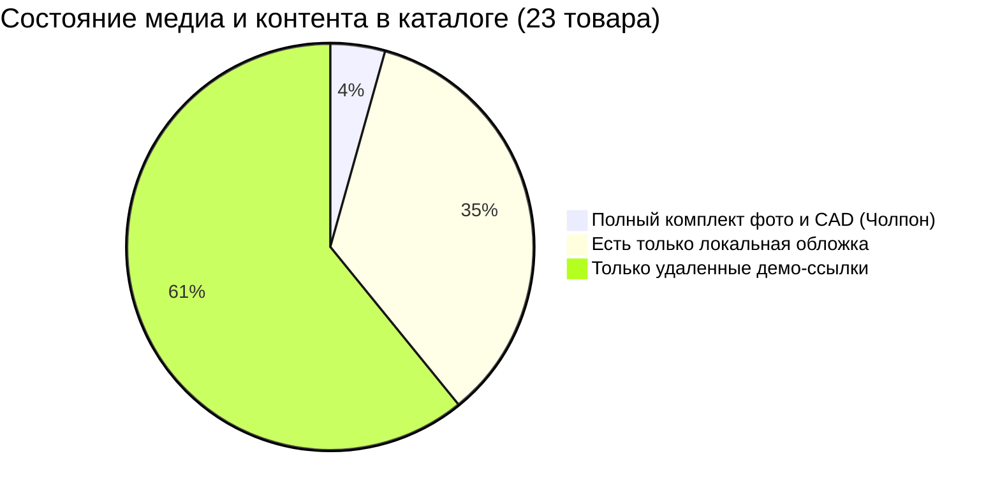

# LEKALO ZHIIDE — STAGE 5.16: Полный аудит контента каталога
## Комплексная инвентаризация 23 товаров и 183 вариантов перед наполнением

**Дата аудита:** 19 ноября 2026 г.  
**Режим выполнения:** READ-ONLY / AUDIT / DOCUMENTATION ONLY  
**Статус безопасности:** БАЗА ДАННЫХ `lekalo_test` ПОДТВЕРЖДЕНА (`SELECT current_database() = 'lekalo_test'`)  
**Производственные изменения:** 0 изменений в схеме, товарах, ценах, статусах и медиафайлах  

---

## 1. Исполнительное резюме

В рамках этапа **Stage 5.16** проведен полный аудит 23 товаров каталога платформы Lekalo Zhiide с целью фиксации фактической готовности контента к передаче администратору Адилету для наполнения.

### Ключевые показатели:
- **Всего товаров в каталоге:** 23 (расхождений нет, 100% согласованность с предыдущими аудитами).
- **Всего товарных вариантов (SKU):** 183 (расхождений нет: 1 товар × 9 вариантов + 21 товар × 8 вариантов + 1 товар × 6 вариантов = 183).
- **Уникальность slug:** дубликатов нет (0 дубликатов среди 23 slug).
- **Физические медиафайлы на диске:** ровно 11 файлов изображений в директории `frontend/public/images/products/` (суммарный объем ~5.95 МБ).
- **Товары с подтвержденными локальными студийными фото обложки:** 9 из 23 (39.1%).
- **Товары с фото спинки:** 1 из 23 (4.3% — только «Пальто оверсайз Чолпон»).
- **Товары с техническим CAD-чертежом:** 1 из 23 (4.3% — только «Пальто оверсайз Чолпон»).
- **Товары с подробным описанием (>100 символов):** 23 из 23 (100%).
- **Реальные производственные PDF-выкройки:** **0 из 183 вариантов (0.0%)**.
- **Демонстрационные заглушки (Stubs < 1024 байт):** 2 варианта («Чолпон» 42-А4 [79 байт] и 44-А4 [335 байт]).
- **Отсутствующие выкройки:** 181 вариант (98.9%).
- **Доступность для покупки по серверному Purchase Guard:** **0 товаров / 0 вариантов (0.0%)**. Защита клиентов функционирует безотказно — ни один товар не может быть куплен без боевого лекала.

---

## 2. Физическая проверка медиафайлов на диске

Аудит строго разграничивает записи в базе данных и физическое наличие файлов на сервере/диске.

> [!IMPORTANT]
> Наличие URL в базе данных **не является** подтверждением доступности или коммерческого качества материала.

### 2.1. Физически подтвержденные файлы на диске (`frontend/public/images/products/`):

| № | Файл | Размер | Товар | Назначение | Статус проверки |
| :-: | :--- | :-: | :--- | :--- | :---: |
| 1 | `palto-oversayz-cholpon-cover.jpg` | 633 533 Б | `palto-oversayz-cholpon` | Обложка (студийное фото) | ПОДТВЕРЖДЕНО НА ДИСКЕ |
| 2 | `palto-oversayz-cholpon-detail.jpg` | 624 660 Б | `palto-oversayz-cholpon` | Вид сзади / деталь | ПОДТВЕРЖДЕНО НА ДИСКЕ |
| 3 | `palto-oversayz-cholpon-tech.jpg` | 257 721 Б | `palto-oversayz-cholpon` | Технический чертеж CAD | ПОДТВЕРЖДЕНО НА ДИСКЕ |
| 4 | `rubashka-oversajz-basic.jpg` | 540 053 Б | `rubashka-oversajz-basic` | Обложка (студийное фото) | ПОДТВЕРЖДЕНО НА ДИСКЕ |
| 5 | `bluzka-s-zapakhom-shyolk.jpg` | 577 143 Б | `bluzka-s-zapakhom-shyolk` | Обложка (студийное фото) | ПОДТВЕРЖДЕНО НА ДИСКЕ |
| 6 | `zhaket-shanel.jpg` | 529 065 Б | `zhaket-shanel` | Обложка (студийное фото) | ПОДТВЕРЖДЕНО НА ДИСКЕ |
| 7 | `zhilet-minimal.jpg` | 530 449 Б | `zhilet-minimal` | Обложка (студийное фото) | ПОДТВЕРЖДЕНО НА ДИСКЕ |
| 8 | `trench-klassik.jpg` | 585 107 Б | `trench-klassik` | Обложка (студийное фото) | ПОДТВЕРЖДЕНО НА ДИСКЕ |
| 9 | `pizhamnyj-komplekt-komfort.jpg` | 516 025 Б | `pizhamnyj-komplekt-komfort` | Обложка (студийное фото) | ПОДТВЕРЖДЕНО НА ДИСКЕ |
| 10 | `sportivnyj-kostyum-active.jpg` | 540 350 Б | `sportivnyj-kostyum-active` | Обложка (студийное фото) | ПОДТВЕРЖДЕНО НА ДИСКЕ |
| 11 | `domashnee-plate-nezhnost.jpg` | 665 279 Б | `domashnee-plate-nezhnost` | Обложка (студийное фото) | ПОДТВЕРЖДЕНО НА ДИСКЕ |

**Итого локальных медиафайлов:** 11 файлов (~5.95 МБ).

### 2.2. Удаленные демонстрационные изображения (Supabase Storage):
Товары 1–14 имеют записи в таблице `product_images`, ссылающиеся на внешний Supabase Storage (`https://susoqzykfmwivajdkvtb.storage.supabase.co/...`).  
- **Физическое наличие на локальном диске:** ОТСУТСТВУЮТ (0 файлов на диске).
- **Характер материалов:** ранние демонстрационные изображения, созданные на предварительных этапах разработки.
- **Требование к производству:** требуют полной фотосессии и замены на реальные студийные фотографии перед публичным коммерческим запуском.

---

## 3. Сводная матрица аудита по всем 23 товарам

| № | Название | Slug | Категория | Варианты | Обложка | Спинка | CAD | Описание | Реальные PDF | Sewing Guide | Purchase Guard | Приоритет |
| :-: | :--- | :--- | :--- | :-: | :-: | :-: | :-: | :-: | :-: | :-: | :-: | :-: |
| 1 | Платье миди «Аида» с запахом | `plate-midi-aida-s-zapakhom` | Платья | 9 | Remote | ❌ | ❌ | ✅ | 0 | ❌ | 🔒 BLOCKED | C |
| 2 | Летнее платье «Лаванда» | `letnee-plate-lavanda` | Платья | 8 | Remote | ❌ | ❌ | ✅ | 0 | ❌ | 🔒 BLOCKED | C |
| 3 | Платье-футляр «Элегант» | `plate-futlyar-elegant` | Платья | 8 | Remote | ❌ | ❌ | ✅ | 0 | ❌ | 🔒 BLOCKED | C |
| 4 | Платье свободного кроя «Мира» | `plate-svobodnogo-kroya-mira` | Платья | 8 | Remote | ❌ | ❌ | ✅ | 0 | ❌ | 🔒 BLOCKED | C |
| 5 | Сарафан «Солнце» | `sarafan-solntse` | Платья | 8 | Remote | ❌ | ❌ | ✅ | 0 | ❌ | 🔒 BLOCKED | C |
| 6 | Платье макси «Афина» | `plate-maksi-afina` | Платья | 8 | Remote | ❌ | ❌ | ✅ | 0 | ❌ | 🔒 BLOCKED | C |
| 7 | Юбка-солнце «Романтика» | `yubka-solntse-romantika` | Юбки | 8 | Remote | ❌ | ❌ | ✅ | 0 | ❌ | 🔒 BLOCKED | C |
| 8 | Юбка-карандаш «Классика» | `yubka-karandash-klassika` | Юбки | 8 | Remote | ❌ | ❌ | ✅ | 0 | ❌ | 🔒 BLOCKED | C |
| 9 | Юбка миди со складками «Лея» | `yubka-midi-so-skladkami-leya` | Юбки | 8 | Remote | ❌ | ❌ | ✅ | 0 | ❌ | 🔒 BLOCKED | C |
| 10 | Брюки палаццо «Моника» | `bryuki-palatstso-monika` | Брюки | 8 | Remote | ❌ | ❌ | ✅ | 0 | ❌ | 🔒 BLOCKED | C |
| 11 | Классические прямые брюки «Базовые» | `klassicheskie-pryamye-bryuki-bazovye` | Брюки | 8 | Remote | ❌ | ❌ | ✅ | 0 | ❌ | 🔒 BLOCKED | C |
| 12 | Брюки свободного кроя «Лофт» | `bryuki-svobodnogo-kroya-loft` | Брюки | 8 | Remote | ❌ | ❌ | ✅ | 0 | ❌ | 🔒 BLOCKED | C |
| 13 | Летние шорты «Сафари» | `letnie-shorty-safari` | Шорты | 8 | Remote | ❌ | ❌ | ✅ | 0 | ❌ | 🔒 BLOCKED | C |
| 14 | Блузка с рукавами-фонариками «Жасмин» | `bluzka-s-rukavami-fonarikami-zhasmin` | Блузки | 8 | Remote | ❌ | ❌ | ✅ | 0 | ❌ | 🔒 BLOCKED | C |
| 15 | Рубашка оверсайз «Basic» | `rubashka-oversajz-basic` | Рубашки | 8 | ✅ Диск | ❌ | ❌ | ✅ | 0 | ❌ | 🔒 BLOCKED | B |
| 16 | Блузка с запахом «Шёлк» | `bluzka-s-zapakhom-shyolk` | Блузки | 8 | ✅ Диск | ❌ | ❌ | ✅ | 0 | ❌ | 🔒 BLOCKED | B |
| 17 | Жакет «Шанель» | `zhaket-shanel` | Жакеты | 8 | ✅ Диск | ❌ | ❌ | ✅ | 0 | ❌ | 🔒 BLOCKED | B |
| 18 | Жилет «Минимал» | `zhilet-minimal` | Жилеты | 8 | ✅ Диск | ❌ | ❌ | ✅ | 0 | ❌ | 🔒 BLOCKED | B |
| 19 | Тренч «Классик» | `trench-klassik` | Верхняя одежда | 8 | ✅ Диск | ❌ | ❌ | ✅ | 0 | ❌ | 🔒 BLOCKED | B |
| 20 | Пижамный комплект «Комфорт» | `pizhamnyj-komplekt-komfort` | Домашняя одежда | 8 | ✅ Диск | ❌ | ❌ | ✅ | 0 | ❌ | 🔒 BLOCKED | B |
| 21 | Спортивный костюм «Active» | `sportivnyj-kostyum-active` | Спортивная одежда | 8 | ✅ Диск | ❌ | ❌ | ✅ | 0 | ❌ | 🔒 BLOCKED | B |
| 22 | Домашнее платье «Нежность» | `domashnee-plate-nezhnost` | Домашняя одежда | 8 | ✅ Диск | ❌ | ❌ | ✅ | 0 | ❌ | 🔒 BLOCKED | B |
| 23 | Пальто оверсайз «Чолпон» (Лимит) | `palto-oversayz-cholpon` | Верхняя одежда | 6 | ✅ Диск | ✅ Диск | ✅ Диск | ✅ | 0 | ❌ | 🔒 BLOCKED | A |

---

## 4. Разделение материалов по категориям достоверности

### 1. Реальные студийные фотографии (Confirmed Studio Photos):
- **Модель «Чолпон» (№23):** 2 фото (обложка + вид со спины в деталях).
- **Модели №15–22:** 8 фото (по одной локальной студийной обложке высокого разрешения).
- **Итого реальных подтвержденных фото:** 10 файлов.

### 2. Технические чертежи (CAD Technical Drawings):
- **Модель «Чолпон» (№23):** 1 файл (`palto-oversayz-cholpon-tech.jpg`).
- **Остальные 22 модели:** 0 файлов. Требуется заказ у конструктора CAD-схем раскладки и узлов.

### 3. Демонстрационные материалы (Demo / Stubs):
- **Товары №1–14:** 14 ссылок на удаленные демонстрационные заглушки.
- **Выкройки «Чолпон»:** 2 синтетических файла (79 и 335 байт), используемые в Stage 5.6–5.10 для стресс-тестирования валидатора.

### 4. Отсутствующие материалы (Missing Deliverables):
- **Реальные PDF-выкройки:** 183 производственных файла.
- **Фото спинки (Back Photos):** 22 товара.
- **Технические чертежи (CAD):** 22 товара.
- **Инструкции по пошиву (Sewing Guides):** 23 товара.

---

## 5. Аудит защиты покупки (Purchase Guard)

В соответствии с правилами Stage 5.9 и утилитой `src/utils/pattern-availability.ts`:
- Минимальный порог производственного файла: **1024 байта**.
- Запрещены ключевые слова: `demo`, `stub`, `dummy`, `fake`, `заглушка`, `демо`, `фиктивн`.
- Результат проверки: **Все 183 варианта каталога признаны не готовыми к отгрузке покупателю**.
- Ни на один вариант невозможно оформить заказ или добавить его в корзину через Storefront или прямой API-запрос к `POST /cart/items` и `POST /checkout`.
- **Вывод:** Клиенты на 100% защищены от покупки «пустых» или «битых» файлов.

---

## 6. Выводы и готовность к передаче

1. **Пилотная модель «Чолпон» (Приоритет A):** полностью готова к заказу у конструктора. Весь пакет Stage 5.15 сформирован и ждет отправки Адилетом.
2. **Группа товаров с локальными обложками (Приоритет B — 8 моделей):** имеет готовую визуальную базу обложек, требует доработки чертежей, фото спинки и разработки комплектов лекал (64 PDF).
3. **Базовая группа (Приоритет C — 14 моделей):** требует комплексной фотосессии, разработки чертежей и 113 комплектов лекал с нуля.
