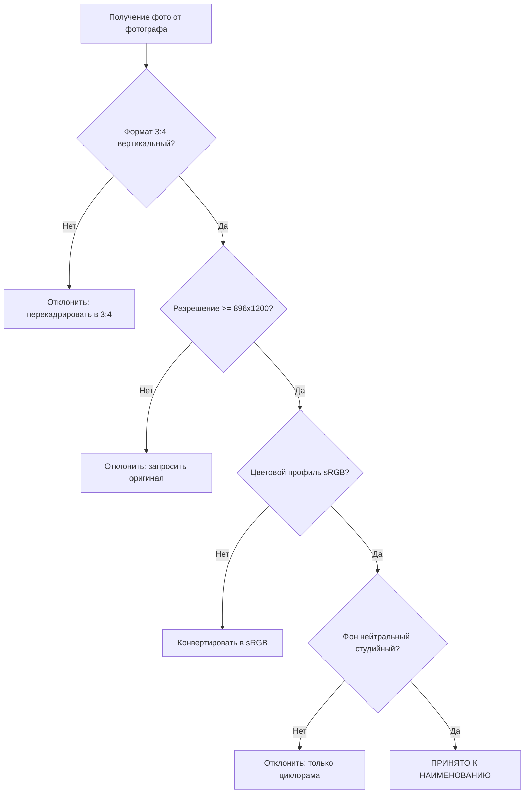

# LEKALO ZHIIDE — STAGE 5.17: Руководство Адилету по работе с фотографиями товаров
## Инструкция по приёмке, наименованию и загрузке фотоконтента в каталог

**Кому:** Администратору каталога Адилету  
**Назначение:** Практический регламент входного контроля фотографий, проверки соответствия моделям и загрузки в базу данных.  

---

## 1. Шаг 1. Визуальная верификация 8 файлов Группы B

В директории `frontend/public/images/products/` уже находятся 8 студийных фотографий для моделей Группы B. Перед привязкой новых ракурсов необходимо лично открыть каждый файл и визуально подтвердить его соответствие товару в базе:

1. Откройте папку: [`frontend/public/images/products/`](file:///C:/Users/ASUS/.gemini/antigravity/scratch/lekalo-zhiide/frontend/public/images/products/).
2. Проверьте соответствие по чек-листу:
   - [ ] `rubashka-oversajz-basic.jpg` — на фото именно хлопковая рубашка оверсайз мужского/свободного кроя с отложным воротником.
   - [ ] `bluzka-s-zapakhom-shyolk.jpg` — шелковая блузка с запахом и драпировкой.
   - [ ] `zhaket-shanel.jpg` — жакет без воротника прямого кроя в стиле Шанель с тесьмой.
   - [ ] `zhilet-minimal.jpg` — лаконичный костюмный жилет без рукавов.
   - [ ] `trench-klassik.jpg` — двубортный плащ-тренчкот с поясом и погонами.
   - [ ] `pizhamnyj-komplekt-komfort` — домашний костюм/пижама (рубашка + брюки).
   - [ ] `sportivnyj-kostyum-active.jpg` — трикотажный костюм (худи/свитшот + джоггеры).
   - [ ] `domashnee-plate-nezhnost.jpg` — мягкое трикотажное или муслиновое домашнее платье.
3. Если модель на фото не совпадает с описанием в базе (например, вместо тренча изображена ветровка), зафиксируйте это и отправьте в досъемку.

---

## 2. Шаг 2. Приёмка новых фотографий от фотографа (Входной QA)

Как только фотограф присылает готовые снимки, проверьте каждый файл по техническому чек-листу:



---

## 3. Шаг 3. Стандарт канонического наименования файлов

Категорически запрещено загружать файлы с именами от камеры (`IMG_8492.jpg` или `DSC_0012.jpg`).

Перед загрузкой на сервер файлы должны быть переименованы строго по шаблону:

```text
{slug}-{angle}.jpg
```

### Канонические суффиксы ракурсов:
1. Обложка (фас, главное фото): `{slug}-cover.jpg`
2. Спинка (вид сзади): `{slug}-back.jpg`
3. Полуоборот (3/4 динамика): `{slug}-angle.jpg`
4. Крупный план детали: `{slug}-detail-1.jpg`, `{slug}-detail-2.jpg`
5. Технический CAD-чертеж: `{slug}-tech.jpg`

#### Пример для модели «Жакет Шанель» (`zhaket-shanel`):
- `zhaket-shanel-cover.jpg` (главное фото, `displayOrder: 0`, `isCover: true`)
- `zhaket-shanel-back.jpg` (вид со спинки, `displayOrder: 1`, `isCover: false`)
- `zhaket-shanel-angle.jpg` (полуоборот, `displayOrder: 2`, `isCover: false`)
- `zhaket-shanel-detail-1.jpg` (крупный план кармана, `displayOrder: 3`, `isCover: false`)
- `zhaket-shanel-tech.jpg` (технический чертеж, `displayOrder: 4`, `isCover: false`)

---

## 4. Шаг 4. Загрузка в административную панель

1. Откройте панель управления каталогом: `/admin/products`.
2. Выберите нужный товар и перейдите во вкладку **«Изображения»**.
3. Загрузите подготовленные файлы.
4. Обязательно заполните атрибуты для каждого кадра:
   - **Alt Text (на русском):** например, «Жакет Шанель — вид со спины на модели».
   - **Порядок отображения (`displayOrder`):** 0 для обложки, 1 для спинки, 2 для ракурса, 3 для деталей, 4 для чертежа.
   - **Флаг обложки (`isCover`):** установите галочку строго на одном файле `*-cover.jpg`.
5. Сохраните изменения.

---

## 5. Шаг 5. Контроль витрины магазина

После сохранения проверьте товар в публичной части сайта (`/catalog/{slug}`):
- [ ] Главная обложка корректно отображается в карточке товара и каталоге.
- [ ] При клике на миниатюры галереи фото переключаются без мерцания.
- [ ] Пропорции фотографий не искажаются (нет растяжения или сжатия).
- [ ] Зум / лупа детализации позволяет рассмотреть качество ткани и строчек.
- [ ] Технический чертеж отображается на своем месте в галерее или в специальном табе «Конструкция и лекала».

---

## 6. Категорические запреты для Адилета

- ❌ **ЗАПРЕЩЕНО** загружать «сырые» файлы тяжелее 3 МБ без веб-оптимизации.
- ❌ **ЗАПРЕЩЕНО** назначать обложкой фотографию спинки или технический чертеж.
- ❌ **ЗАПРЕЩЕНО** загружать картинки с водяными знаками (ватермарками) чужих сайтов.
- ❌ **ЗАПРЕЩЕНО** оставлять пустым поле `altText` — это ухудшает доступность сайта и снижает позиции в поисковых системах.
