# LEKALO ZHIIDE — STAGE 5.17: Итоговый отчет инвентаризации и маппинга фотографий
## Фиксация статуса готовности фотоконтента для 23 товаров каталога

**Дата фиксации:** 19 ноября 2026 г.  
**Статус этапа:** ВЫПОЛНЕН УСПЕШНО (STAGE 5.17 COMPLETE)  
**Режим выполнения:** READ-ONLY / AUDIT / DOCUMENTATION ONLY  
**Безопасность окружения:** БАЗА ДАННЫХ `lekalo_test` ПОДТВЕРЖДЕНА (`SELECT current_database() = 'lekalo_test'`)  

---

## 1. Резюме этапа Stage 5.17

В ходе этапа Stage 5.17 произведено полное обследование директории `frontend/public/images/products/`, выполнен криптографический и технический анализ медиафайлов (разрешение, пропорции, SHA256-хеши) и сформирована сквозная матрица соответствия изображений всем 23 товарам каталога.

### Ключевые показатели:
- **Всего реальных файлов найдено на диске:** **11 файлов** (~5.82 МБ).
  - 10 фотографий готовых изделий на модели.
  - 1 технический CAD-чертеж (`palto-oversayz-cholpon-tech.jpg`).
- **Фотографий, подтвержденных для конкретных моделей:** 
  - **2 фотографии** подтверждены для флагмана «Пальто оверсайз Чолпон» (обложка + вид со спины в деталях).
  - **8 фотографий** обложек на диске сопоставлены по именам моделям Группы B (требуют визуального подтверждения Адилетом).
  - **0 фотографий** на локальном диске для 14 моделей Группы C (ссылаются на внешние демо-заглушки).
- **Товаров, готовых по фотографиям:** **1 товар** («Пальто оверсайз Чолпон» имеет 2 качественных ракурса и 1 CAD-чертеж, готов к пилотному запуску).
- **Товаров, требующих новых съемок:** **22 товара** (8 моделей требуют досъемки спинки и деталей; 14 моделей требуют полной фотосессии с нуля).

---

## 2. Что подтверждено аппаратной и программной проверкой

1. **Единый технический формат:**
   - Все 11 файлов имеют одинаковое портретное разрешение **896 × 1200 пикселей** (соотношение сторон 3:4).
   - Все файлы имеют формат JPEG с оптимизированным сжатием (от 251 КБ до 650 КБ).
2. **Отсутствие дубликатов:**
   - 0 дубликатов среди 11 файлов (все SHA256-хеши уникальны).
3. **Разделение чертежей и фото:**
   - Файл `palto-oversayz-cholpon-tech.jpg` идентифицирован как CAD-схема раскладки деталей и отделен от фотогалереи изделия.
4. **Безопасность каталога:**
   - База данных `lekalo_test` и файлы на диске остались в неприкосновенности (0 изменений).

---

## 3. Что требует ручной проверки человеком (Адилетом)

1. **Визуальная сверка 8 файлов Группы B:**
   - Открыть файлы [`frontend/public/images/products/`](file:///C:/Users/ASUS/.gemini/antigravity/scratch/lekalo-zhiide/frontend/public/images/products/) и убедиться, что на фото действительно изображены соответствующие изделия (рубашка, шелковая блузка, твидовый жакет, жилет, тренч, пижама, спортивный костюм, домашнее платье).
2. **Контроль цветопередачи на экранах:**
   - Проверить, совпадает ли оттенок ткани на фото с цветом, заявленным в описании товара.
3. **Согласование графика съемок:**
   - Передать фотографу [STAGE_5_17_MISSING_PHOTOS_BRIEF.md](file:///C:/Users/ASUS/.gemini/antigravity/scratch/lekalo-zhiide/STAGE_5_17_MISSING_PHOTOS_BRIEF.md).

---

## 4. Сформированный комплект документов Stage 5.17

Все документы сохранены как в директории артефактов, так и в корне проекта:

| Документ | Формат | Назначение |
| :--- | :---: | :--- |
| [STAGE_5_17_PRODUCT_IMAGE_INVENTORY.md](file:///C:/Users/ASUS/.gemini/antigravity/scratch/lekalo-zhiide/STAGE_5_17_PRODUCT_IMAGE_INVENTORY.md) | Markdown | Полный реестр 11 файлов: размеры, пропорции, хеши, типы контента. |
| [STAGE_5_17_PRODUCT_IMAGE_MAPPING.csv](file:///C:/Users/ASUS/.gemini/antigravity/scratch/lekalo-zhiide/STAGE_5_17_PRODUCT_IMAGE_MAPPING.csv) | CSV | Табличный маппинг 23 товаров: текущие обложки, найденные фото, недостающие ракурсы, приоритет. |
| [STAGE_5_17_MISSING_PHOTOS_BRIEF.md](file:///C:/Users/ASUS/.gemini/antigravity/scratch/lekalo-zhiide/STAGE_5_17_MISSING_PHOTOS_BRIEF.md) | Markdown | Техническое задание для фотографа: стандарт 4 ракурсов, свет, фон sRGB, запрет нейросетей. |
| [STAGE_5_17_ADILET_PHOTO_GUIDE.md](file:///C:/Users/ASUS/.gemini/antigravity/scratch/lekalo-zhiide/STAGE_5_17_ADILET_PHOTO_GUIDE.md) | Markdown | Инструкция для Адилета: канонический нейминг (`*-cover.jpg`, `*-back.jpg`), загрузка в админке, порядок в галерее. |
| [STAGE_5_17_FINAL_STATUS.md](file:///C:/Users/ASUS/.gemini/antigravity/scratch/lekalo-zhiide/STAGE_5_17_FINAL_STATUS.md) | Markdown | Итоговый отчет и перечень задач. |

---

## 5. Список моделей для следующей съемочной очереди

```mermaid
flowchart LR
    subgraph Pilot ["1. Пилот (Готов)"]
        P1["Пальто Чолпон (доснять 1 макро)"]
    end
    subgraph Queue1 ["2. Первая очередь съемок (Группа B)"]
        Q1["Рубашка Basic (спинка + детали)"]
        Q2["Блузка Шёлк (спинка + детали)"]
        Q3["Жакет Шанель (спинка + детали)"]
        Q4["Жилет Минимал (спинка + детали)"]
        Q5["Тренч Классик (спинка + детали)"]
        Q6["Пижама Комфорт (спинка + детали)"]
        Q7["Спорткостюм Active (спинка + детали)"]
        Q8["Платье Нежность (спинка + детали)"]
    end
    subgraph Queue2 ["3. Вторая очередь съемок (Группа C)"]
        M1["14 моделей платьев, юбок и брюк (с нуля по 4 ракурса)"]
    end

    Pilot --> Queue1 --> Queue2
```

1. **Приоритет 1 (Досъемка):** 8 моделей Группы B (требуется отснять только спинку и детали: 24 кадра).
2. **Приоритет 2 (Съемка с нуля):** 14 моделей Группы C (требуется полная съемка: 56 кадров).
