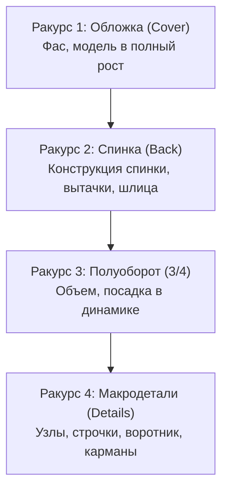

# LEKALO ZHIIDE — STAGE 5.17: Техническое задание на фотосъемку каталога
## Бриф для фотографа и контент-продюсера на досъемку недостающих материалов

**Кому:** Контент-команде, студийному фотографу и администратору Адилету  
**Назначение:** Четкие требования к фотосессиям для доведения карточек 23 товаров каталога до премиального коммерческого стандарта.  

---

## 1. Технический стандарт фотосъемки

Каждая фотография каталога Lekalo Zhiide должна строго соответствовать следующим техническим нормативам:

| Параметр | Требование | Пояснение |
| :--- | :--- | :--- |
| **Ориентация** | Строго вертикальная (Portrait) | Исключает обрезку и сдвиги в мобильной и десктопной сетке |
| **Соотношение сторон** | **3:4** (канонический коэффициент 0.75:1) | Обязательный стандарт e-commerce витрины платформы |
| **Разрешение** | От **896 × 1200 px** до **1600 × 2133 px** | Высокая четкость при ретина-экранах и зумировании |
| **Формат файла** | JPEG (`.jpg`) с качеством 85–90% | Баланс между резкостью деталей ткани и весом файла (500–800 КБ) |
| **Цветовое пространство** | **sRGB** | Точная цветопередача на всех мобильных и десктопных устройствах |
| **Фон** | Нейтральная циклорама (светло-серый, белый или теплый беж) | Акцент строго на конструкции изделия, чистые контуры |
| **Освещение** | Мягкий студийный рассеянный свет | Четкая видимость рельефа ткани, строчек, вытачек и драпировок |

---

## 2. Обязательный стандарт из 4 ракурсов для каждой модели

Покупатель лекала должен перед покупкой видеть изделие так же детально, как профессиональный конструктор. Для каждой карточки требуется комплект из 4 ракурсов:

### Ракурс 1: Главная фотография (Обложка — Cover)
- Модель в полный рост или план 7/8 (от колен и выше).
- Вид строго спереди (анфас), естественная ровная осанка.
- Четко видна посадка изделия по плечам, груди и талии, длина изделия и рукавов.

### Ракурс 2: Фотография спинки (Back photo) — КРИТИЧНО ДЛЯ ВЫКРОЕК
- Модель стоит строго спиной к камере.
- Руки слегка отведены или опущены вдоль тела, не закрывая талиевые вытачки и боковые швы.
- Должны быть отчетливо видны: средний шов спинки, кокетка, застежка-молния, пуговицы или разрез/шлица.

### Ракурс 3: Полуоборот (3/4 angle) / Динамика
- Модель в легком повороте (угол 30–45 градусов к камере).
- Демонстрация свободы облегания, глубины проймы, формы рукава и драпировки ткани в движении.

### Ракурс 4: Крупные детали кроя (Detail macro)
- Макроплан ключевого технологического узла:
  - для рубашек и блузок: воротник на стойке, манжета, планка;
  - для жакетов и пальто: лацкан, прорезной карман с листочкой, шлица;
  - для брюк и юбок: притачной пояс, гульфик, стрелка, боковой карман.

> [!WARNING]
> **Разделение фотографии и чертежа:**  
> Технический CAD-чертеж (раскладка деталей и схема сборки) заказывается у конструктора лекал в векторном виде и загружается отдельно. Категорически запрещено помещать чертеж на место фотографии готового изделия.

---

## 3. Спецификация съемочных задач по группам товаров

### 3.1. Группа A: Флагман «Пальто оверсайз Чолпон» (`palto-oversayz-cholpon`)
- **В наличии:** Обложка (`palto-oversayz-cholpon-cover.jpg`), спинка (`palto-oversayz-cholpon-detail.jpg`), CAD (`palto-oversayz-cholpon-tech.jpg`).
- **Требуется доснять:** **1–2 кадра деталей**:
  1. Крупный план кармана с листочкой и строчки борта.
  2. Узел подкладки / внутренней обработки шлицы.

### 3.2. Группа B: 8 моделей с готовыми обложками
Для каждой из 8 моделей обложка уже есть. Требуется отснять **по 3 кадра на модель** (итого **24 кадра**):
1. `rubashka-oversajz-basic`: спинка (кокетка, складка) + полуоборот + воротник/манжета.
2. `bluzka-s-zapakhom-shyolk`: спинка (вытачки) + полуоборот + узел запаха и завязки.
3. `zhaket-shanel`: спинка + полуоборот + тесьма/пуговицы горловины.
4. `zhilet-minimal`: спинка (хлястик/регулятор) + полуоборот + карманы-прорезные.
5. `trench-klassik`: спинка (отлетная кокетка, шлица) + полуоборот + погоны/пряжки.
6. `pizhamnyj-komplekt-komfort`: спинка + полуоборот + пояс брюк и кант ворота.
7. `sportivnyj-kostyum-active`: спинка худи (капюшон) + полуоборот + манжеты и карман кенгуру.
8. `domashnee-plate-nezhnost`: спинка + полуоборот + сборка талии и горловина.

### 3.3. Группа C: 14 базовых моделей (Полный цикл съемки с нуля)
Требуется отснять **по 4 кадра на модель** (итого **56 кадров**):
1. `plate-midi-aida-s-zapakhom` (Платье с запахом) — 4 кадра
2. `letnee-plate-lavanda` (Льняное платье) — 4 кадра
3. `plate-futlyar-elegant` (Платье-футляр) — 4 кадра
4. `plate-svobodnogo-kroya-mira` (Свободное платье) — 4 кадра
5. `sarafan-solntse` (Сарафан) — 4 кадра
6. `plate-maksi-afina` (Платье макси) — 4 кадра
7. `yubka-solntse-romantika` (Юбка-солнце) — 4 кадра
8. `yubka-karandash-klassika` (Юбка-карандаш) — 4 кадра
9. `yubka-midi-so-skladkami-leya` (Юбка со складками) — 4 кадра
10. `bryuki-palatstso-monika` (Брюки палаццо) — 4 кадра
11. `klassicheskie-pryamye-bryuki-bazovye` (Прямые брюки) — 4 кадра
12. `bryuki-svobodnogo-kroya-loft` (Брюки свободные) — 4 кадра
13. `letnie-shorty-safari` (Шорты сафари) — 4 кадра
14. `bluzka-s-rukavami-fonarikami-zhasmin` (Блузка фонарики) — 4 кадра

---

## 4. Категорические запреты для контент-команды

- ❌ **ЗАПРЕЩЕНО** генерировать искусственные изображения нейросетями (Midjourney, Stable Diffusion и др.) взамен реальных фото отшитых изделий. Покупатель выкройки шьет вещь по реальным конструктивным линиям и ожидает увидеть реальную посадку на фигуре.
- ❌ **ЗАПРЕЩЕНО** использовать фотографии чужих брендов или стоковые картинки без подтверждения соответствия конструкции лекала.
- ❌ **ЗАПРЕЩЕНО** сдавать фотографии с «замыленными» швами или чрезмерной ретушью, скрывающей детали кроя.
- ❌ **ЗАПРЕЩЕНО** загружать файлы с горизонтальной ориентацией или произвольным соотношением сторон.
