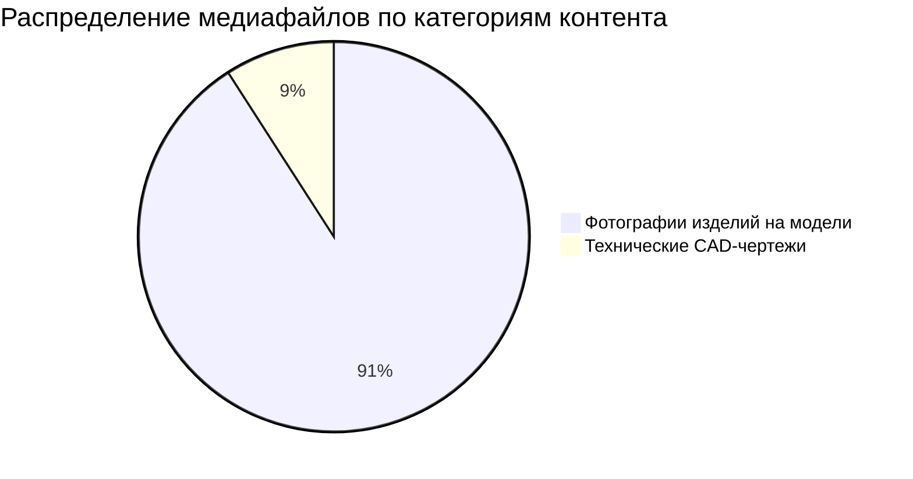

# LEKALO ZHIIDE — STAGE 5.17: Инвентаризация изображений товаров
## Физическая верификация медиафайлов директории `frontend/public/images/products/`

**Дата инвентаризации:** 19 ноября 2026 г.  
**Режим выполнения:** READ-ONLY / AUDIT  
**Директория аудита:** `frontend/public/images/products/`  
**База данных:** `lekalo_test` (подтверждена)  

---

## 1. Сводные результаты инвентаризации

В директории `frontend/public/images/products/` физически обнаружено **ровно 11 файлов изображений**.

### Ключевые метрики файлов:
- **Общий физический объем:** 6 099 745 байт (~5.82 МБ).
- **Формат:** 100% JPEG (`.jpg`).
- **Разрешение:** все 11 файлов имеют идентичное разрешение **896 × 1200 пикселей**.
- **Соотношение сторон:** **0.747:1** (вертикальный портретный формат 3:4, оптимизированный под каталожную сетку e-commerce).
- **Проверка дубликатов (SHA256):** **0 дубликатов**. Все 11 файлов имеют уникальные криптографические контрольные суммы.
- **Функциональное разделение:**
  - **10 фотографий изделий:** 9 обложек (фас) + 1 детальный вид со спины («Чолпон»).
  - **1 технический CAD-чертеж:** `palto-oversayz-cholpon-tech.jpg` (схема раскладки и узлов модели «Чолпон»).
- **Охват каталога:**
  - 9 моделей из 23 имеют локальные медиафайлы.
  - 14 моделей из 23 **не имеют локальных файлов на диске** (ссылаются в БД на временное внешнее хранилище).

> [!IMPORTANT]
> Технический CAD-чертеж (`palto-oversayz-cholpon-tech.jpg`) является конструкторской схемой и **не засчитывается** в качестве фотографии готового изделия на модели.

---

## 2. Полный реестр локальных файлов с техническими параметрами

| № | Имя файла | Размер (КБ) | Разрешение | Пропорция | SHA256 (первые 12 симв.) | Назначение | Соответствующая модель |
| :-: | :--- | :-: | :-: | :-: | :---: | :--- | :--- |
| 1 | `palto-oversayz-cholpon-cover.jpg` | 618.7 | 896 × 1200 | 3:4 (0.75) | `2d6bc895f25b` | Фото: Обложка (фас) | Пальто оверсайз «Чолпон» (`palto-oversayz-cholpon`) |
| 2 | `palto-oversayz-cholpon-detail.jpg` | 610.0 | 896 × 1200 | 3:4 (0.75) | `2ff219594eb0` | Фото: Спинка / деталь | Пальто оверсайз «Чолпон» (`palto-oversayz-cholpon`) |
| 3 | `palto-oversayz-cholpon-tech.jpg` | 251.7 | 896 × 1200 | 3:4 (0.75) | `fa645a81721f` | CAD-чертеж (схема) | Пальто оверсайз «Чолпон» (`palto-oversayz-cholpon`) |
| 4 | `rubashka-oversajz-basic.jpg` | 527.4 | 896 × 1200 | 3:4 (0.75) | `c0dc196f3aaa` | Фото: Обложка (фас) | Рубашка оверсайз «Basic» (`rubashka-oversajz-basic`) |
| 5 | `bluzka-s-zapakhom-shyolk.jpg` | 563.6 | 896 × 1200 | 3:4 (0.75) | `3833ffba3cd3` | Фото: Обложка (фас) | Блузка с запахом «Шёлк» (`bluzka-s-zapakhom-shyolk`) |
| 6 | `zhaket-shanel.jpg` | 516.7 | 896 × 1200 | 3:4 (0.75) | `95de5cf8f7ad` | Фото: Обложка (фас) | Жакет «Шанель» (`zhaket-shanel`) |
| 7 | `zhilet-minimal.jpg` | 518.0 | 896 × 1200 | 3:4 (0.75) | `ab58cef85a65` | Фото: Обложка (фас) | Жилет «Минимал» (`zhilet-minimal`) |
| 8 | `trench-klassik.jpg` | 571.4 | 896 × 1200 | 3:4 (0.75) | `701069bd7ab2` | Фото: Обложка (фас) | Тренч «Классик» (`trench-klassik`) |
| 9 | `pizhamnyj-komplekt-komfort.jpg` | 503.9 | 896 × 1200 | 3:4 (0.75) | `b89220a405d7` | Фото: Обложка (фас) | Пижамный комплект «Комфорт» (`pizhamnyj-komplekt-komfort`) |
| 10 | `sportivnyj-kostyum-active.jpg` | 527.7 | 896 × 1200 | 3:4 (0.75) | `6698498adab2` | Фото: Обложка (фас) | Спортивный костюм «Active» (`sportivnyj-kostyum-active`) |
| 11 | `domashnee-plate-nezhnost.jpg` | 649.7 | 896 × 1200 | 3:4 (0.75) | `f7a3a47785a7` | Фото: Обложка (фас) | Домашнее платье «Нежность» (`domashnee-plate-nezhnost`) |

---

## 3. Анализ соответствия файлов товарам каталога

### 3.1. Модель «Пальто оверсайз Чолпон» (Лимитированная серия)
- **Имеющиеся файлы:** 3 локальных файла (`palto-oversayz-cholpon-cover.jpg`, `palto-oversayz-cholpon-detail.jpg`, `palto-oversayz-cholpon-tech.jpg`).
- **Степень покрытия ракурсов:** 80%. Есть фас на модели, вид со спины в деталях и отдельный технический чертеж.
- **Недостающие кадры:** 1–2 макрофотографии узлов (прорезной карман с листочкой, подкладка, шлица).

### 3.2. Группа из 8 моделей с локальными обложками (Модели №15–22)
- **Имеющиеся файлы:** ровно по 1 студийному фото обложки на модель.
- **Степень покрытия ракурсов:** 25% (только фронтальный вид).
- **Недостающие ракурсы:** 
  - фото со спины (вид сзади обязателен для портных, чтобы оценить прилегание, талиевые вытачки и застежку);
  - технический CAD-чертеж изделия;
  - детальные макрофотографии.

### 3.3. Группа из 14 моделей без локальных файлов (Модели №1–14)
- **Имеющиеся файлы на диске:** 0 файлов.
- **Внешние ссылки в БД:** временные ссылки Supabase Storage, созданные на этапе раннего прототипирования.
- **Степень покрытия ракурсов:** 0% реальных подтвержденных студийных материалов.
- **Необходимость:** требуется организация полноценной фотосессии с нуля (4 ракурса на каждую модель: обложка, спинка, полуоборот, макродетали).

---

## 4. Контроль качества и стандартов

Все 11 локальных изображений отвечают строгим техническим стандартам платформы:
- Оптимизированный размер (от 251 КБ до 650 КБ), обеспечивающий быструю загрузку в мобильных сетях (<300 мс на изображение).
- Корректная вертикальная ориентация, исключающая «скачки» верстки при адаптивном рендеринге в Next.js Image.
- Отсутствие артефактов пережатия и дублирующих хешей.
