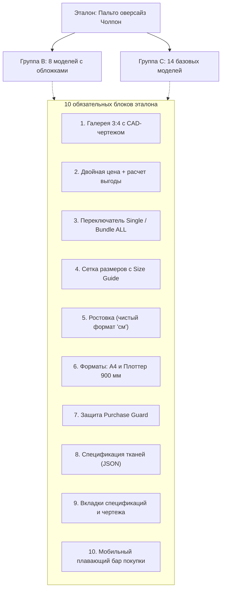

# LEKALO ZHIIDE — STAGE 5.18: Эталонный шаблон карточки товара
## Стандарт проектирования и наполнения для 22 карточек каталога

**Назначение:** Единый эталонный стандарт структуры данных, визуальных элементов и бизнес-логики карточки товара на базе пилотной модели «Пальто оверсайз Чолпон» (`palto-oversayz-cholpon`).  
**Кому:** Контент-менеджеру Адилету, фотографам, конструкторам и разработчикам платформы.  

---

## 1. Концепция эталона

Модель «Пальто оверсайз Чолпон» признана **базовым эталоном платформы Lekalo Zhiide**. Все последующие 22 товара каталога обязаны приводиться к точно такой же полноте данных, визуальной эстетике и технической надежности.



---

## 2. Спецификация 10 эталонных блоков карточки

### Блок 1. Галерея изображений (3:4 Portrait Gallery)
- **Пропорции:** строго **3:4** (896 × 1200 px или 1200 × 1600 px).
- **Комплектность:** минимум 3 кадра (обложка, спинка, CAD-чертеж); в идеале — 4–5 кадров (+ полуоборот и макродетали).
- **Порядок (`displayOrder`):**
  - `0`: Обложка изделия на модели (`isCover: true`).
  - `1`: Вид со спинки (Back photo).
  - `2`: Ракурс полуоборот (3/4 angle).
  - `3`: Макродетали узлов (Detail macro).
  - `4`: Технический CAD-чертеж (`technicalDrawingUrl`).
- **Интерактив:** плавный зум при наведении, лента миниатюр внизу, полноэкранный Lightbox.

### Блок 2. Ценовой блок и расчет выгоды (Pricing & Discounts)
- **Базовая цена (`basePrice`):** перечеркнутая стандартная цена одного размера (например, 700 KGS).
- **Акционная цена (`discountPrice`):** крупный акцентный ценник со скидкой (например, 520 KGS).
- **Пакетная цена (`bundlePrice`):** стоимость комплекта ALL (все размеры) с указанием экономии в KGS и процентах.
- **Дата окончания акции:** форматированная дата на русском языке («до 30 ноября 2026 г.»).

### Блок 3. Режим покупки (Purchase Mode Switcher)
- Две вкладки переключателя:
  - **«Один размер»** — стандартный выбор для индивидуального пошива.
  - **«Все размеры (Комплект ALL)»** — премиальный выбор для ателье и швейных производств с выгодой от 20% до 35%.

### Блок 4. Селектор размера (Size Selector)
- Кнопки размеров: 40, 42, 44, 46, 48, 50, 52 (в зависимости от категории).
- Сенсорная зона: минимум 44×44 px для мобильных тач-интерфейсов.
- Подсказки обхватов: при наведении выводится краткий ориентир (ОГ/ОТ/ОБ).
- Кнопка **«Таблица размеров»**: открывает модальное окно с размерной сеткой ГОСТ.

### Блок 5. Селектор ростовки (Height Selector)
- Нормализованное отображение ростовок: `164–170 см` (без программных артефактов вроде «164-170 см см»).
- Для изделий с градацией по росту (158–164, 164–170, 170–176) — выбор радио-кнопками.

### Блок 6. Селектор формата печати (Print Format Selector)
- Два канонических формата:
  - **«А4 (домашний принтер)»** — с поясняющей подписью: *«Печать на бытовом принтере А4 с полями для склейки»*.
  - **«Плоттер 900 мм»** — с подписью: *«Широкоформатная печать без склейки на рулоне»*.

### Блок 7. Защита от покупки ненастоящих выкроек (Purchase Guard)
- Если вариант не имеет действующего файла PDF (или размер < 1024 байт):
  - Кнопка «Добавить в корзину» **деактивирована (`disabled`)**.
  - Текст кнопки: **«Выкройка пока готовится»** с иконкой `AlertCircle`.
  - Над кнопкой выводится янтарный информационный баннер.
  - При клике показывается Toast: *«Выкройка пока готовится конструктором и недоступна для заказа»*.

### Блок 8. Структура характеристик тканей (`fabricDetails` JSON)
В базе данных поле `fabric_details` должно быть заполнено строгой JSON-структурой:
```json
{
  "mainFabric": "Пальтовая шерсть, кашемир, твид (плотность 380–520 г/м²)",
  "consumption": {
    "width140": "2.80 м",
    "width150": "2.50 м"
  },
  "liningFabric": "Вискоза / поливискоза — 2.10 м",
  "interfacing": "Дублерин средней жесткости — 1.60 м",
  "notions": "2 пуговицы 25-28 мм, 1 подпуговица, нитки в тон"
}
```

### Блок 9. Вкладки спецификаций (Tabbed Specifications)
- **Таб 1: Описание модели** — конструкция, силуэт, особенности посадки, рекомендации по уходу.
- **Таб 2: Ткани и материалы** — подробный расчет расхода и плотностей.
- **Таб 3: Мерки изделия** — готовая таблица прибавок на свободу облегания.
- **Таб 4: Технический рисунок** — крупное векторное изображение CAD-схемы.

### Блок 10. Мобильный плавающий бар (Sticky Buy Bar)
- Появляется при скролле ниже основного блока покупки на экранах `< 1024px`.
- Содержит: мини-фото 40×48 px, название товара, выбранную конфигурацию, актуальную цену и компактную кнопку.

---

## 3. Чек-лист готовности карточки к тиражированию

Перед тем как карточка товара считается готовой:
- [ ] Все 10 блоков заполнены и согласованы.
- [ ] Фотографии проверены линейкой масштаба и загружены в sRGB 3:4.
- [ ] Технический чертеж прикреплен и отображается в отдельном табе.
- [ ] Все варианты лекал прошли физический замер квадрата 100×100 мм и загружены через Bulk Upload.
- [ ] Purchase Guard разблокировал кнопку, и товар успешно добавляется в корзину.
