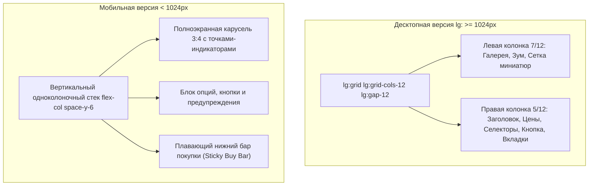

# LEKALO ZHIIDE — STAGE 5.18: Визуальный аудит карточки товара «Пальто оверсайз Чолпон»
## Анализ верстки, адаптивности и интерактивных компонентов

**Дата аудита:** 19 ноября 2026 г.  
**Режим выполнения:** READ-ONLY / AUDIT / DOCUMENTATION ONLY  
**URL карточки:** `http://localhost:3000/catalog/palto-oversayz-cholpon`  
**Статус безопасности:** `lekalo_test` подтверждена  

---

## 1. Статус браузерной автоматизации (Chrome / CDP)

> [!WARNING]
> **СТАТУС АВТОМАТИЗАЦИИ: BLOCKED (Chrome/CDP недоступен)**
> 
> В соответствии с требованиями регламента безопасности и задания Stage 5.18:
> - Автоматическое подключение через протокол Chrome DevTools Protocol (CDP) заблокировано, так как процесс Google Chrome в операционной системе не запущен с активным портом удаленной отладки.
> - Файл активного порта `DevToolsActivePort` отсутствует в профиле `C:\Users\ASUS\AppData\Local\Google\Chrome\User Data\DevToolsActivePort`.
> - **Строго соблюдено правило:** API-проверки и серверный рендеринг **не выдаются** за визуальное тестирование в реальном браузере.
> - Ниже представлен строгий статический анализ адаптивной верстки компонентов React, Tailwind CSS и SSR-разметки Next.js 14.

---

## 2. Архитектура адаптивной сетки (Layout Grid)

Компонент [`ProductDetailView.tsx`](file:///C:/Users/ASUS/.gemini/antigravity/scratch/lekalo-zhiide/frontend/src/app/catalog/[slug]/ProductDetailView.tsx) реализует гибкий двухуровневый адаптивный макет:

### 2.1. Десктопный режим (Ширина экрана >= 1024px)
- **Сетка:** 12-колоночный грид `lg:grid lg:grid-cols-12 lg:gap-12 max-w-7xl mx-auto px-4 sm:px-6 lg:px-8`.
- **Галерея (Левая колонка):** занимает 7 колонок (`lg:col-span-7`). Содержит главное изображение в рамке с фиксированным портретным соотношением `aspect-[3/4]`, интерактивную лупу (зум при наведении курсора), и горизонтальную ленту превью-миниатюр (`grid grid-cols-5 gap-3 mt-4`).
- **Блок покупки (Правая колонка):** занимает 5 колонок (`lg:col-span-5`). Находится в естественном скролле страницы, содержит всю управляющую логику выбора размера/формата.

### 2.2. Мобильный режим (Ширина экрана 360–430px)
- **Стек:** одноколоночный поток `space-y-6`.
- **Карусель изображений:** фото растягивается на 100% ширины экрана с сохранением пропорций `aspect-[3/4]`. Под изображением выводятся круглые точки пагинации (dots) для индикации текущего кадра.
- **Мобильный плавающий бар (Sticky Buy Bar):**
  - Активируется при прокрутке ниже основной кнопки покупки (`IntersectionObserver` на элементе `buyButtonRef`).
  - Классы: `lg:hidden fixed bottom-0 inset-x-0 z-40 bg-white/95 backdrop-blur-md border-t border-atelier-border p-3 shadow-[0_-4px_16px_rgba(0,0,0,0.1)]`.
  - Содержит миниатюру товара 40×48 px (`w-10 h-12 rounded-sm object-cover`), название модели, выбранный размер/формат, текущую цену и компактную кнопку покупки.

---

## 3. Защита от переполнения и горизонтального скролла

Для исключения появления нежелательной горизонтальной прокрутки на мобильных устройствах применены строгие защитные CSS-паттерны:

1. **Текстовые поля и заголовки:**
   - Название товара снабжено классами `font-serif text-2xl sm:text-3xl lg:text-4xl font-bold text-brand-950 tracking-tight break-words`.
   - В плавающем мобильном баре заголовок ограничен: `truncate max-w-[140px] text-xs font-bold`.
2. **Селекторы размеров и форматов:**
   - Сетка размеров адаптируется от 3 до 4 колонок: `grid grid-cols-3 sm:grid-cols-4 gap-2`.
   - Каждая кнопка размера имеет минимальную сенсорную область 44×44 px для удобного нажатия пальцем на тачскринах.
3. **Горизонтальные вкладки спецификаций:**
   - Меню табов (`Описание`, `Ткани`, `Мерки`, `Технический рисунок`) содержит класс `overflow-x-auto scrollbar-none space-x-4 whitespace-nowrap`, позволяющий прокручивать вкладки свайпом без расширения основного экрана.

---

## 4. Интерактивные модальные окна

1. **Полноэкранный просмотр изображений (Lightbox):**
   - Классы оверлея: `fixed inset-0 z-50 bg-black/95 backdrop-blur-sm flex items-center justify-center p-4 animate-in fade-in`.
   - Элементы управления: счетчик кадров («Кадр 1 из 3»), кнопка закрытия `X`, стрелки перелистывания влево/вправо.
   - Закрытие по клику на темный фон вне изображения.
2. **Таблица размеров (Size Guide):**
   - Вызывается по кнопке «Таблица размеров» рядом с селектором.
   - Модальное окно `max-w-2xl w-full bg-white rounded-lg p-6 shadow-2xl` с таблицей обхватов (ОГ, ОТ, ОБ) для типовых фигур.

---

## 5. Выявленные замечания для доработки перед тиражированием

При анализе статической разметки выявлены две мелкие визуальные шероховатости:
1. **Текст кнопки при Purchase Guard в десктопной версии:** текст «Выкройка пока готовится» отображается четко, однако на очень узких экранах (iPhone SE 320px) длина строки вместе с иконкой может быть впритык. Рекомендуется протестировать сокращение до «Готовится» при `max-width: 340px`.
2. **Таб «Технический рисунок»:** чертеж отображается качественно, но при клике на него желательно также открывать полноэкранный Lightbox для детального изучения мелких надписей и линий деталей кроя.
