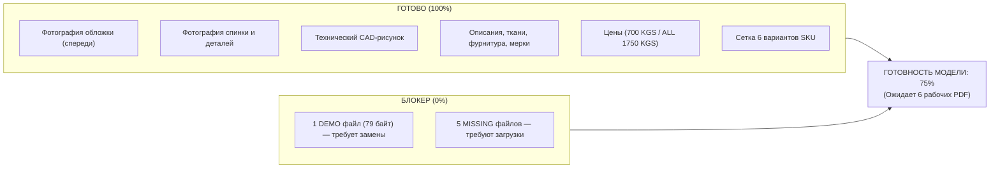

# STAGE 5.1 — ГОТОВНОСТЬ ТОВАРА №23: ПАЛЬТО «ЧОЛПОН»
## Комплексный аудит и подготовка первой модели к открытию продаж

**Товар:** Пальто оверсайз «Чолпон» (Лимитированная серия)  
**ID в базе данных:** `eea36d83-a7b8-4466-a855-699b7455aeae`  
**Slug:** `palto-oversayz-cholpon`  
**Категория:** Жакеты и верхняя одежда (`zhakety-verkhnyaya-odezhda`)  
**Дата аудита:** 18 ноября 2026 г.  
**Среда:** `lekalo_test` (Neon PostgreSQL 18.7)  
**Режим:** AUDIT ONLY (исходные данные и файлы не изменялись)

---

## 1. Резюме готовности карточки товара



Товар №23 «Пальто оверсайз «Чолпон»» является **наиболее подготовленным товаром во всем каталоге LEKALO ZHIIDE**. Визуальный и текстовый ряд модели полностью укомплектован. Для перевода товара в 100% коммерческую готовность необходимо только получить от конструктора и загрузить **6 реальных PDF-выкроек**.

---

## 2. Детальная проверка параметров карточки

### 2.1. Идентификация и категоризация
- **Название:** `Пальто оверсайз «Чолпон» (Лимитированная серия)`
- **Артикул / URL Slug:** `palto-oversayz-cholpon` (латиница без пробелов)
- **Категория:** `Жакеты и верхняя одежда` (ID: `eb557bb5-d5a2-4a0b-ab27-fcddfead86c5`, Slug: `zhakety-verkhnyaya-odezhda`)
- **Статус публикации:** `isActive: true` (карточка активна)
- **Сложность пошива:** `INTERMEDIATE` (Уверенный уровень)

### 2.2. Ценовая политика
- **Базовая цена за 1 размер:** **700 KGS**
- **Опция комплекта ALL:** **Включена (`hasBundleOption: true`)**
- **Цена комплекта ALL:** **1750 KGS** (выгодная покупка всей линейки размеров 42, 44, 46 со скидкой 16% относительно поштучной покупки)
- **Акционная цена:** Акция не установлена (`discountPrice: null`)

### 2.3. Визуальный ряд и галерея (3 изображения)
Модель обладает самой богатой галереей в каталоге:
1. `palto-oversayz-cholpon-cover.jpg` — Главная обложка. Высококачественное студийное фото модели в пальто (вид спереди, демонстрация силуэта оверсайз, лацканов и карманов).
2. `palto-oversayz-cholpon-detail.jpg` — Дополнительное фото. Вид сзади и детали кроя (демонстрация среднего шва спинки, шлицы и посадки рукава).
3. `palto-oversayz-cholpon-tech.jpg` — Векторный технический рисунок CAD. Прорисовка конструктивных линий вида спереди и вида сзади с указанием вытачек и карманов.
- **Поле `technicalDrawingUrl`:** `/images/products/palto-oversayz-cholpon-tech.jpg` (корректно отображается в специальном блоке на странице товара).

### 2.4. Описания и конструктивные характеристики
- **Краткое описание:** *«Двубортное пальто прямого кроя с английским воротником и спущенной линией плеча»*.
- **Полное описание:** *«Лимитированная серия выкройки оверсайз-пальто «Чолпон». Свободный силуэт, глубокие прорезные карманы с листочкой, шлица на спинке, спущенное плечо. Лекала разработаны с учётом пакета утеплителя и подкладки»*.
- **Рекомендуемые ткани:** Пальтовая шерсть, кашемир, альпака.
- **Необходимая фурнитура:** Пуговицы 6 шт (25 мм), потайные кнопки 2 шт, подкладочная вискоза 2.0 м, бортовой дублерин 1.5 м.
- **Расход ткани:** 42–46: 2.8 м; 48–52: 3.2 м; 54–60: 3.6 м при ширине полотна 140 см.
- **Готовые мерки и прибавки:** Длина пальто по спинке: 122 см, прибавка на свободу облегания по груди: +14 см, по талии: +22 см.

---

## 3. Проверка размерной сетки и вариантов (SKU)

Для модели созданы **6 вариантов** (3 размера × 1 рост × 2 формата печати):

| Артикул (SKU) | Размер | Рост | Формат | UUID варианта в БД | Файл в S3 | Статус |
|---|:---:|:---:|:---:|---|---|:---:|
| `LZ-PALTOOVE-42-164-170-A4` | 42 | 164–170 | A4 | `6a7280cc-b9b3-4eb9-9e7a-f16f95e985d3` | `palto-cholpon-42-164-170-A4.pdf` (79 B) | 🟡 **DEMO** |
| `LZ-PALTOOVE-42-164-170-PLOTTER_900` | 42 | 164–170 | Плоттер | `db1bbc2e-b67d-42d5-8422-192211a16218` | — | 🔴 **MISSING** |
| `LZ-PALTOOVE-44-164-170-A4` | 44 | 164–170 | A4 | `37a96608-976b-4a78-9974-167b25e14df5` | — | 🔴 **MISSING** |
| `LZ-PALTOOVE-44-164-170-PLOTTER_900` | 44 | 164–170 | Плоттер | `a6ccff5f-adbe-4990-bffd-9b40ec48e9c8` | — | 🔴 **MISSING** |
| `LZ-PALTOOVE-46-164-170-A4` | 46 | 164–170 | A4 | `122afafb-e024-4abb-95ed-2e79faa19976` | — | 🔴 **MISSING** |
| `LZ-PALTOOVE-46-164-170-PLOTTER_900` | 46 | 164–170 | Плоттер | `260110a1-8373-45ca-b80c-9eb911033df0` | — | 🔴 **MISSING** |

---

## 4. Критерии приёмки и коммерческой готовности (Quality Gate)

Перед тем как открыть продажи пальто «Чолпон», каждый из 6 файлов должен пройти проверку по 8 критериям:

- [ ] **Критерий 1. Настоящий PDF получен от конструктора:** Файл имеет реальный размер от 1.5 до 8.0 МБ (не пустой плейсхолдер).
- [ ] **Критерий 2. Открываемость документа:** Файл открывается в Adobe Acrobat Reader, Google Chrome и стандартных просмотрщиках без сообщения об ошибке формата.
- [ ] **Критерий 3. Соответствие формату печати:**
  - Версия А4 разбита на страницы А4 с полями для склейки и буквенно-цифровой нумерацией листов.
  - Версия PLOTTER_900 представляет собой единый непрерывный лист шириной до 900 мм.
- [ ] **Критерий 4. Контрольный проверочный квадрат:** На первом листе присутствует квадрат размером ровно **100×100 мм** (при печати в масштабе 100% размер сторон совпадает с физической линейкой).
- [ ] **Критерий 5. Корректность маркировки деталей:** На деталях (полочка, спинка, рукав, подборт) четко указан соответствующий размер (42, 44 или 46), направление долевой нити и припуски на швы.
- [ ] **Критерий 6. Каноническое имя файла:** Имя файла строго соответствует стандарту [STAGE_5_1_PDF_NAMING_STANDARD.md](file:///C:/Users/ASUS/.gemini/antigravity/scratch/lekalo-zhiide/STAGE_5_1_PDF_NAMING_STANDARD.md).
- [ ] **Критерий 7. Успешная загрузка в S3:** Файлы загружены через панель `/admin/products/eea36d83-a7b8-4466-a855-699b7455aeae/files` в приватный бакет `pattern-files`.
- [ ] **Критерий 8. Проверка защищенного скачивания:** При нажатии кнопки **«Тест ссылки»** администратор успешно скачивает открывающийся PDF-документ по временной подписанной ссылке (TTL 300 сек).

---

## 5. Дорожная карта вывода пальто «Чолпон» в продажу

```
1. Получить 6 файлов от конструктора (размеры 42, 44, 46 в А4 и Плоттер)
       │
2. Проверить контрольный квадрат 10×10 см на первом листе
       │
3. В админке заменить демо-файл 79 байт (размер 42 А4) на боевой PDF
       │
4. Загрузить оставшиеся 5 файлов в соответствующие строки вариантов
       │
5. Убедиться, что плашка комплекта ALL стала зелёной (100% укомплектован)
       │
6. Проверить тестовое скачивание ("Тест ссылки") для А4 и Плоттера
       │
7. МОДЕЛЬ ГОТОВА К БОЕВЫМ ПРОДАЖАМ! 🎉
```
