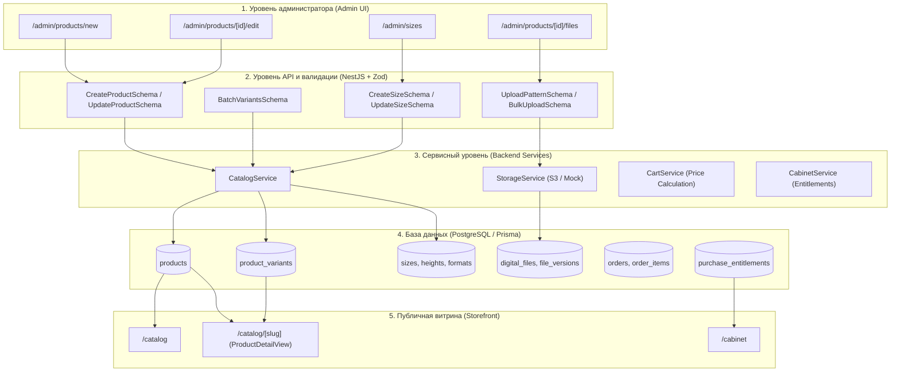

# LEKALO ZHIIDE — STAGE 5.21: DATABASE AND API AUDIT

**Environment**: Node.js v18.12.1 / NestJS / Prisma ORM  
**Database**: Neon Serverless PostgreSQL (`lekalo_test`, Read-Only Verified)  
**Audit Date**: 2026-11-19  

---

## 1. Архитектурная схема прохождения данных



---

## 2. Поля модели товара (Product): Сквозной аудит по слоям

| Поле сущности | Колонка в PostgreSQL (`products`) | Валидация в DTO (`catalog.dto.ts`) | Поле в Admin UI | Отображение на витрине | Статус |
|---|---|---|---|---|:---:|
| `id` | `UUID PRIMARY KEY` | Не передается (генерируется) | В URL `[id]` | Не отображается | **PASS** |
| `title` | `VARCHAR(255) NOT NULL` | `z.string().min(2).max(255)` | `<input name="title">` | `<h1>` заголовок товара | **PASS** |
| `slug` | `VARCHAR(255) UNIQUE NOT NULL` | `z.string().min(2).max(255)` | Автотранслит + ручной ввод | URL карточки `/catalog/[slug]` | **PASS** |
| `categoryId` | `UUID REFERENCES categories(id)` | `z.string().uuid()` | `<select name="categoryId">` | Хлебные крошки и бейдж | **PASS** |
| `description` | `TEXT NOT NULL` | `z.string().min(5)` | `<textarea name="description">` | Вкладка «Описание» | **PASS** |
| `shortDescription` | `TEXT NULL` | `z.string().optional().nullable()` | `<input name="shortDescription">` | Краткое превью в листинге | **PASS** |
| `basePrice` | `DECIMAL(12,2) NOT NULL` | `z.number().nonnegative()` | `<input name="basePrice">` | Цена одного размера (KGS) | **PASS** |
| `bundlePrice` | `DECIMAL(12,2) NULL` | `z.number().nonnegative().nullable()`| `<input name="bundlePrice">` | Цена комплекта «Все размеры» | **PASS** |
| `hasBundleOption`| `BOOLEAN DEFAULT true` | `z.boolean().default(true)` | Чекбокс опции комплекта | Переключатель режима покупки | **PASS** |
| `discountPrice` | `DECIMAL(12,2) NULL` | `z.number().nonnegative().nullable()`| `<input name="discountPrice">` | Акционная цена, зачеркивание | **PASS** |
| `discountUntil` | `TIMESTAMPTZ NULL` | `z.string().datetime().nullable()` | `<input type="datetime-local">` | «Скидка действует до ...» | **PASS** |
| *discountFrom* | **ОТСУТСТВУЕТ В БАЗЕ** | **ОТСУТСТВУЕТ В DTO** | **ОТСУТСТВУЕТ В UI** | Скидка действует сразу | **GAP (P2)** |
| `isNew` | `BOOLEAN DEFAULT false` | `z.boolean().default(false)` | Карточка-тумблер «Новинка» | Бейдж «Новинка» на фото | **PASS** |
| `isBestseller` | `BOOLEAN DEFAULT false` | `z.boolean().default(false)` | Карточка-тумблер «Хит продаж» | Бейдж «Хит продаж» на фото | **PASS** |
| `isPopular` | `BOOLEAN DEFAULT false` | `z.boolean().default(false)` | Карточка-тумблер «Популярное» | Фильтрация в каталоге | **PASS** |
| `difficultyLevel`| `ENUM ('BEGINNER','INTERMEDIATE','ADVANCED')` | `z.nativeEnum(DifficultyLevel)` | Радио-кнопки 3 уровней | Индикатор сложности | **PASS** |
| `fabricDetails` | `JSONB NULL` | `z.any().optional().nullable()` | 4 поля (ткань, фурнитура, расход, мерки) | Вкладки «Ткани» и «Мерки» | **PASS** |
| `technicalDrawingUrl`| `VARCHAR(1000) NULL` | `z.string().url().nullable()` | `<input name="technicalDrawingUrl">`| Вкладка CAD + Lightbox | **PASS** |
| `videoUrl` | `VARCHAR(1000) NULL` | `z.string().url().nullable()` | `<input name="videoUrl">` | Вкладка «Видеообзор» (YouTube)| **PASS** |
| `isActive` | `BOOLEAN DEFAULT true` | `z.boolean().default(true)` | Тумблер публикации | Скрытие из каталога гостей | **PASS** |

---

## 3. Модель матрицы вариантов (`ProductVariant`)

- **Таблица в БД**: `product_variants`
- **Колонки**:
  - `id`: UUID (Primary Key)
  - `productId`: UUID (FK `products`)
  - `sizeId`: UUID (FK `sizes`)
  - `heightId`: UUID (FK `heights`)
  - `formatId`: UUID (FK `formats`)
  - `sku`: VARCHAR(100) UNIQUE (автоматический формат `LZ-{SLUG}-{SIZE}-{HEIGHT}-{FORMAT}`)
  - `priceOverride`: DECIMAL(12,2) NULL (индивидуальное переопределение цены)
  - `isActive`: BOOLEAN DEFAULT true
- **Уникальное ограничение (Unique Constraint)**:
  ```sql
  UNIQUE (product_id, size_id, height_id, format_id)
  ```
  Это исключает случайное дублирование комбинаций.
- **Матричный генератор**:
  - API: `POST /api/v1/admin/products/:id/variants/batch`
  - DTO: `BatchVariantsSchema` (принимает массивы `sizes`, `heights`, `formats`, `priceOverride`, `skuPrefix`).
  - Сервис выполняет декартово произведение ($S \times H \times F$) и создает недостающие варианты в рамках единой транзакции Prisma `$transaction`.

---

## 4. Хранение файлов и версионирование

1. **Изображения товара (`ProductImage`)**:
   - Таблица: `product_images`
   - Колонки: `id`, `productId`, `imageUrl`, `altText`, `displayOrder`, `isCover`.
   - Загрузка: `POST /api/v1/admin/storage/upload-image` с валидацией MIME (`jpeg, png, webp`) и размера ($\le 10\text{ MB}$).

2. **PDF-выкройки (`DigitalFile` & `FileVersion`)**:
   - Модель `DigitalFile` связана с конкретным `ProductVariant` (1:1 или 1:N).
   - Модель `FileVersion` хранит историю версий:
     - `versionNumber`: Int (1, 2, 3...)
     - `s3Bucket`, `s3Key`: приватный бакет
     - `originalFileName`, `fileSizeBytes`, `checksumSha256`, `changelog`
   - Уникальный ключ: `UNIQUE (digital_file_id, version_number)`.
   - Проверено: при повторной загрузке файла через `allowOverwrite: true` создается новая версия с сохранением старой.

3. **Инструкции по пошиву (`ProductInstruction`)**:
   - Таблица: `product_instructions`
   - Колонки: `id`, `productId`, `title`, `s3Bucket`, `s3Key`, `fileName`, `fileSizeBytes`, `checksumSha256`, `version`, `isActive`.
   - **GAP**: Нет контроллера для загрузки инструкций администратором.

---

## 5. Корзина, Заказы и Выдача прав (Entitlements)

1. **Корзина (`CartItem`)**:
   - Связывает `cartId` и `productVariantId`.
   - Расчет цены: `variant.priceOverride ?? variant.product.basePrice`.
   - Защита Purchase Guard: если у варианта нет активного PDF в `DigitalFile`, каталог отдает `isAvailable: false`, а корзина отклоняет добавление с ошибкой `PATTERN_FILE_NOT_READY`.

2. **Фиксация заказа (`OrderItem`)**:
   - `priceAtPurchase`: цена замораживается на момент оформления заказа.
   - `productSnapshot`: полный JSON-снимок товара и варианта на момент покупки.

3. **Цифровые права (`PurchaseEntitlement`)**:
   - Создаются атомарно при получении вебхука успешной оплаты (`PaymentWebhookEvent` $\to$ `Order.PAID`).
   - Привязаны к конкретному `userId` и `variantId`.
   - Выдача ссылки: `POST /api/v1/cabinet/files/:entitlementId/download-url` генерирует Presigned URL с `Content-Disposition: attachment` и логирует в `DownloadLog`.

---

## 6. Итоги аудита слоёв данных
БД и API спроектированы профессионально с соблюдением 3-й нормальной формы (3NF), внешних ключей, каскадных ограничений и уникальных индексов.
Выявленные пробелы сосредоточены на уровне **административных контроллеров справочников (`heights`, `formats`)** и **загрузчика инструкций (`ProductInstruction`)**.
