# LEKALO ZHIIDE — STAGE 5.23: FINAL STATUS REPORT

## 1. Итоговый статус этапа: ✅ 100% ЗАВЕРШЁН

Этап **Stage 5.23: Управление инструкциями по пошиву (Sewing Instructions Upload & Management)** полностью реализован, всесторонне протестирован и готов к эксплуатации.

Администраторы проекта (Адилет и контент-менеджеры) получили полноценный интерфейс для загрузки, версионирования, предпросмотра и деактивации инструкций по пошиву через веб-интерфейс без необходимости написания ручных SQL-запросов или прямого доступа к облачному хранилищу S3.

---

## 2. Ключевые результаты и достижения

```mermaid
graph TD
    A["Stage 5.23 Задачи"] --> B["1. Аудит подсистемы инструкций"]
    A --> C["2. Разработка Backend API & Безопасность"]
    A --> D["3. Разработка Frontend Admin & Cabinet UI"]
    A --> E["4. Комплексное тестирование и регрессия"]
    A --> F["5. Документация и инструкция владельцу"]

    B --> B1["Модель ProductInstruction валидирована в Prisma"]
    C --> C1["5 новых эндпоинтов в StorageAdminController"]
    C --> C2["Глубокая валидация PDF %PDF- и anti-polyglot"]
    C --> C3["Автоматическое версионирование и SHA-256"]
    C --> C4["Изоляция прав доступа PurchaseEntitlement"]

    D --> D1["Новый таб 'Инструкции' в админке файлов"]
    D --> D2["Форма загрузки с валидацией размера"]
    D --> D3["Таблица истории версий и предпросмотр"]
    D --> D4["Информативный fallback в кабинете покупателя"]

    E --> E1["12/12 тестов Stage 5.23 успешно"]
    E --> E2["86/86 регрессионных тестов пройдено"]
    E --> E3["TypeScript проверка: 0 ошибок"]

    F --> F1["Подробное руководство для Адилета"]
```

### Главные вехи:
1. **Аудит архитектуры**: Зафиксировано исходное состояние, подтверждена корректность модели `ProductInstruction` в Prisma, определена стратегия безопасного версионирования.
2. **Серверный контур безопасности**:
   - Реализована глубокая проверка бинарного буфера (`validatePdfBuffer`): сигнатура `%PDF-`, минимальный размер 120 байт, защита от HTML/JS-полиглотов и исполняемых бинарных файлов (MZ, ELF, ZIP).
   - Расчёт контрольной суммы SHA-256 при каждой загрузке.
   - Изолированное хранение в приватном S3-бакете `pattern-files` по каноническому пути:  
     `instructions/${productId}/${timestamp}-v${version}-${safeName}.pdf`.
   - Решена проблема сериализации `BigInt` поля `fileSizeBytes` в NestJS/Fastify.
3. **Автоматическое версионирование**:
   - Загрузка нового файла автоматически создаёт инкрементную версию (`v1`, `v2`, ...).
   - Предыдущие версии атомарно переводятся в статус `isActive = false`, сохраняясь в базе данных и хранилище.
   - Поддержана возможность ручного переключения активности любой версии.
4. **Административный интерфейс**:
   - На странице `/admin/products/[id]/files` развёрнута вкладка «Инструкции» с индикатором количества файлов.
   - Размещена карточка активной инструкции с кнопкой мгновенного тестирования ссылки скачивания (TTL 5 минут).
   - Интегрирована таблица истории версий с полными метаданными (размер, дата, SHA-256, статус).
5. **Клиентский опыт в кабинете покупателя**:
   - Для купленных товаров без загруженной инструкции выводится дружелюбный статус: «Инструкция по пошиву готовится».
   - После публикации инструкции покупателю предоставляется кнопка защищённого скачивания с коротким TTL (10 минут).
   - Попытка неавторизованного или межпродуктного доступа строго блокируется сервером (`403 Forbidden`).

---

## 3. Матрица верификации требований

| Требование ТЗ | Реализация | Результат проверки |
| :--- | :--- | :---: |
| Проверка базы данных перед стартом | Подключение строго к `lekalo_test` (Neon PostgreSQL) | ✅ Подтверждено |
| Отсутствие деструктивных миграций | Использована существующая модель `ProductInstruction` | ✅ Подтверждено |
| Не затрагивать Production окружение | Neon Prod, Supabase Prod и Vercel изолированы | ✅ Гарантировано |
| Сохранение закрытых продаж для Чолпон | Все 6 вариантов Чолпон недоступны к покупке (`isAvailable: false`) | ✅ Проверено E2E |
| Никаких фиктивных файлов в реальных товарах | Все тесты использовали синтетические фикстуры `TEST-INST-...` | ✅ 0 файлов в каталоге |
| Защита от поддельных PDF | Валидация сигнатуры `%PDF-` и блокировка полиглотов | ✅ Проверено тестом №4 |
| Защита от повреждённых/пустых файлов | Проверка длины буфера $\ge 120$ байт | ✅ Проверено тестом №5 |
| Идемпотентность и история версий | Атомарная транзакция: архивирование старых + создание новой | ✅ Проверено тестом №6 |
| Разграничение прав покупателей | Проверка `PurchaseEntitlement` со статусом `ACTIVE` | ✅ Проверено тестами №9-11 |

---

## 4. Реестр подготовленных документов Stage 5.23

Все 5 обязательных документов подготовлены и сохранены в двух экземплярах: в каталоге артефактов сессии и в корне рабочего репозитория:

1. **[STAGE_5_23_INSTRUCTIONS_AUDIT.md](file:///C:/Users/ASUS/.gemini/antigravity/scratch/lekalo-zhiide/STAGE_5_23_INSTRUCTIONS_AUDIT.md)**:
   Детальный архитектурный аудит подсистемы инструкций, сопоставление состояния «До и После», структура связей в БД и контур безопасности.
2. **[STAGE_5_23_INSTRUCTIONS_IMPLEMENTATION.md](file:///C:/Users/ASUS/.gemini/antigravity/scratch/lekalo-zhiide/STAGE_5_23_INSTRUCTIONS_IMPLEMENTATION.md)**:
   Полный технический отчёт о внедрении, код серверных эндпоинтов в `StorageAdminController`, сериализация BigInt, структура фронтенд-компонентов и sequence-диаграмма потоков данных.
3. **[STAGE_5_23_INSTRUCTIONS_TEST_REPORT.md](file:///C:/Users/ASUS/.gemini/antigravity/scratch/lekalo-zhiide/STAGE_5_23_INSTRUCTIONS_TEST_REPORT.md)**:
   Протокол выполнения тестов: 12 сценариев управления инструкциями (100% OK), 86 регрессионных тестов (корзина, заказы, бандлы, Purchase Guard) и проверка сборки TypeScript.
4. **[STAGE_5_23_ADILET_GUIDE.md](file:///C:/Users/ASUS/.gemini/antigravity/scratch/lekalo-zhiide/STAGE_5_23_ADILET_GUIDE.md)**:
   Практическое пошаговое руководство для владельца проекта (Адилета) по загрузке файлов, контролю версий, проверке ссылок и правилам работы с реальными товарами.
5. **[STAGE_5_23_FINAL_STATUS.md](file:///C:/Users/ASUS/.gemini/antigravity/scratch/lekalo-zhiide/STAGE_5_23_FINAL_STATUS.md)**:
   Сводный отчёт о завершении этапа и текущем статусе готовности платформы.

---

## 5. Готовность системы к следующему этапу
Платформа **LEKALO ZHIIDE** находится в полностью стабильном состоянии. Серверы бэкенда (порт 4000) и фронтенда (порт 3000) работают штатно. Инфраструктура полностью готова к приёму настоящих производственных файлов от конструктора.
