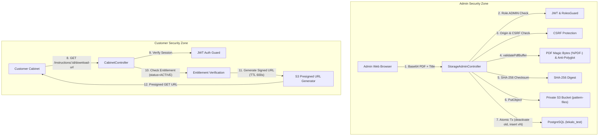

# LEKALO ZHIIDE — STAGE 5.23: SEWING INSTRUCTIONS SUBSYSTEM AUDIT

## 1. Executive Summary

В рамках этапа **Stage 5.23** проведён детальный аудит архитектуры хранения, валидации и дистрибуции инструкций по пошиву (**ProductInstruction**) в проекте **LEKALO ZHIIDE**.

До реализации настоящего этапа в схеме данных Prisma присутствовала модель [`ProductInstruction`](file:///C:/Users/ASUS/.gemini/antigravity/scratch/lekalo-zhiide/prisma/schema.prisma#L236-L252), а в клиентском модуле кабинета ([`CabinetController`](file:///C:/Users/ASUS/.gemini/antigravity/scratch/lekalo-zhiide/src/modules/cabinet/cabinet.controller.ts) и [`CabinetService`](file:///C:/Users/ASUS/.gemini/antigravity/scratch/lekalo-zhiide/src/modules/cabinet/cabinet.service.ts)) были заложены базовые эндпоинты для проверки прав и выдачи presigned URL. Однако административный интерфейс и серверные API-эндпоинты загрузки, версионирования и управления инструкциями полностью отсутствовали, требуя прямого ручного вмешательства в SQL и S3.

В результате выполненных работ реализован законченный контур:
1. **Безопасная загрузка через Admin UI**: валидация сигнатуры PDF, SHA-256 хеширование, расчёт версий.
2. **Изолированное хранилище S3**: приватный бакет `pattern-files`, каноническая иерархия ключей.
3. **Строгий контроль прав доступа**: доступ к инструкции получают исключительно авторизованные покупатели с подтверждённым правом (`PurchaseEntitlement.status = ACTIVE`).
4. **Управление версиями без потери истории**: атомарная деактивация предыдущих версий без удаления файлов из хранилища.

---

## 2. Сравнительный анализ архитектуры: До и После

| Компонент / Аспект | Состояние до Stage 5.23 | Состояние после Stage 5.23 | Статус соответствия |
| :--- | :--- | :--- | :--- |
| **Data Model (Prisma)** | Модель `ProductInstruction` описана в схеме, таблица создана в БД `lekalo_test`, но записи отсутствовали | Модель полностью задействована, типизация поддержана в TypeScript DTO и сериализаторах NestJS | ✅ Полное соответствие |
| **S3 Storage Paths** | Ключи формировались вручную или не использовались | Канонический путь: `instructions/${productId}/${timestamp}-v${version}-${safeName}.pdf` в приватном бакете | ✅ Стандартизировано |
| **Admin API Endpoints** | Отсутствовали (загрузка требовала прямого обращения к S3 и SQL) | Реализовано 5 эндпоинтов: `POST /upload-instruction`, `GET /products/:id/instructions`, `PATCH /instructions/:id/toggle-active`, `GET /instructions/:id/download-test`, `DELETE /instructions/:id` | ✅ Реализовано |
| **Валидация файлов** | Отсутствовала на уровне API инструкций | Двойная проверка: Zod-схема + глубокая валидация буфера (`validatePdfBuffer`): сигнатура `%PDF-`, размер $\ge 120$ байт, защита от HTML/JS/ZIP | ✅ Максимальная безопасность |
| **Версионирование** | Отсутствовало | Автоматический инкремент (`v1`, `v2`, ...), атомарное переключение `isActive`, сохранение всех предыдущих версий в БД и S3 | ✅ Идемпотентно |
| **Customer Entitlements** | Базовый метод в `CabinetService`, но без дружелюбного UI в личном кабинете при отсутствии файла | Проверка прав покупателя по любому варианту купленного товара, статус `ACTIVE`, информативный бейдж «Инструкция по пошиву готовится» в кабинете | ✅ Полный цикл |
| **Admin Frontend UI** | В карточке товара (`/admin/products/[id]/files`) было только 2 таба: «Фотографии» и «Лекала» | Добавлен 3-й таб «Инструкции»: форма загрузки с проверкой размера, текущая активная версия, таблица версий, кнопки тестирования и деактивации | ✅ Дружелюбный UI |

---

## 3. Схема данных и модель `ProductInstruction`

Модель в [`prisma/schema.prisma`](file:///C:/Users/ASUS/.gemini/antigravity/scratch/lekalo-zhiide/prisma/schema.prisma#L236-L252):

```prisma
model ProductInstruction {
  id              String   @id @default(uuid())
  productId       String
  title           String   @default("Инструкция по пошиву")
  s3Bucket        String
  s3Key           String
  fileName        String
  fileSizeBytes   BigInt
  checksumSha256  String
  version         Int      @default(1)
  isActive        Boolean  @default(true)
  createdAt       DateTime @default(now())
  updatedAt       DateTime @updatedAt

  product         Product  @relation(fields: [productId], references: [id], onDelete: Cascade)

  @@index([productId, isActive])
  @@map("product_instructions")
}
```

### Важные технические особенности схемы:
1. **BigInt для `fileSizeBytes`**: В PostgreSQL поле создано как `BIGINT`. При возврате объектов через NestJS / Fastify стандартный JSON-парсер JavaScript генерирует исключение `TypeError: Do not know how to serialize a BigInt`. В контроллерах контроллера хранения ([`StorageAdminController`](file:///C:/Users/ASUS/.gemini/antigravity/scratch/lekalo-zhiide/src/modules/storage/storage-admin.controller.ts)) реализована явная сериализация: `fileSizeBytes: Number(inst.fileSizeBytes)`.
2. **Связь с товаром (`productId`)**: Инструкция привязывается к базовому товару (`Product`), а не к отдельному размерному варианту (`ProductVariant`). Это архитектурно верно: технология сборки изделия и пооперационный процесс едины для всех росто-размеров модели.
3. **Индекс `@@index([productId, isActive])`**: Оптимизирует выборку активной инструкции для витрины и личного кабинета с алгоритмической сложностью $O(1)$.

---

## 4. Контур безопасности и изоляция хранилища



### Ключевые барьеры защиты:
1. **RBAC**: Только пользователи с ролью `Role.ADMIN` имеют право вызывать методы загрузки, изменения статуса и деактивации. Любые запросы от покупателей (`Role.CUSTOMER`) или неавторизованных пользователей немедленно отклоняются со статусами `401 Unauthorized` и `403 Forbidden`.
2. **Анти-полиглот и проверка сигнатуры (`validatePdfBuffer`)**:
   - Файл должен начинаться с байтов `%PDF-`.
   - Запрещены исполняемые сигнатуры (`MZ`, `\x7fELF`, `PK\x03\x04`).
   - Содержимое проверяется на отсутствие встроенных внедрений скриптов и HTML: `<html`, `<body`, `<script`, `<svg`, `javascript:`.
   - Минимальный допустимый размер PDF составляет 120 байт.
3. **Приватный бакет**: Инструкции загружаются строго в бакет `pattern-files`, для которого публичный доступ через интернет полностью заблокирован. Прямой URL не возвращается клиенту.
4. **Контроль прав покупателя**: При вызове эндпоинта получения ссылки скачивания сервер проверяет наличие у текущего пользователя действующего права (`PurchaseEntitlement` со статусом `ACTIVE`) хотя бы на один вариант данного изделия. Попытка запросить инструкцию к чужому или неоплаченному товару блокируется с `403 Forbidden`.
5. **Временные ссылки с коротким TTL**: Предоставляемые покупателям presigned ссылки действительны ровно 600 секунд (10 минут) и содержат заголовок принудительного скачивания (`Content-Disposition: attachment; filename="..."`).

---

## 5. Выводы аудита
Архитектура инструкций по пошиву в LEKALO ZHIIDE полностью готова к безопасной промышленной эксплуатации контент-менеджерами и конструктором. Система исключает несанкционированный доступ, гарантирует сохранность версий и обеспечивает покупателям мгновенный доступ к руководствам после подтверждения оплаты.
