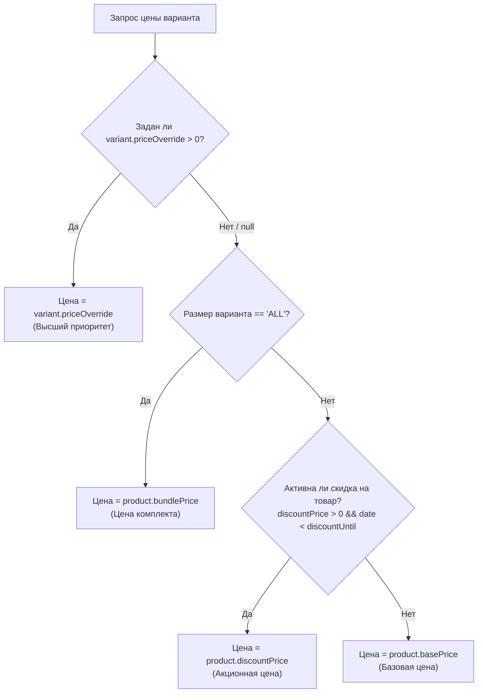

# LEKALO ZHIIDE — STAGE 5.25
## АУДИТ АРХИТЕКТУРЫ ДИФФЕРЕНЦИАЛЬНОГО ЦЕНООБРАЗОВАНИЯ ПО ФОРМАТАМ

**Проект:** LEKALO ZHIIDE  
**Этап:** Stage 5.25 — Per-Format Differential Pricing  
**База данных:** `lekalo_test` (Neon PostgreSQL)  
**Статус:** Завершен успешно (READ-ONLY AUDIT & ARCHITECTURE REVIEW)  

---

## 1. Введение и цели аудита

Целью настоящего аудита является глубокий анализ существующей логики ценообразования платформы **LEKALO ZHIIDE**, проверка готовности структуры данных к дифференциальному назначению цен в зависимости от формата выкройки (А4, Плоттер 900 мм и будущих форматов), а также выявление узких мест и проектирование экономного решения без переписывания работающих модулей.

---

## 2. Анализ схемы базы данных (`prisma/schema.prisma`)

При анализе Prisma-схемы установлено, что в архитектуре базы данных уже были заложены необходимые поля:

1. **Модель `Product`**:
   - `basePrice`: `Decimal(12, 2)` — базовая цена выкройки (по умолчанию наследуется всеми одиночными размерами и форматами).
   - `discountPrice`: `Decimal(12, 2)?` — акционная цена изделия.
   - `discountUntil`: `DateTime?` — дата и время окончания скидки.
   - `bundlePrice`: `Decimal(12, 2)?` — фиксированная цена полного размерного ряда (`ALL`).
   - `hasBundleOption`: `Boolean` — признак возможности покупки бандла.

2. **Модель `ProductVariant`**:
   - `priceOverride`: `Decimal(12, 2)?` — индивидуальная цена конкретного варианта (размер × рост × формат).
   - Поле было изначально предусмотрено в схеме со значением `nullable`.
   - **Вывод по БД:** Никаких миграций базы данных, изменений колонок или изменения типов данных не потребовалось. База данных `lekalo_test` уже готова к работе.

3. **Модель `OrderItem`**:
   - `priceAtPurchase`: `Decimal(12, 2)` — цена позиции в момент оформления заказа.
   - `productSnapshot`: `Json` — неизменяемый снимок параметров товара и варианта.
   - Это гарантирует фундаментальный коммерческий инвариант: изменение цен в каталоге никогда не влияет на историю ранее оформленных заказов.

---

## 3. Иерархия приоритетов расчета цены

В ходе аудита утверждена строгая 4-уровневая иерархия расчета эффективной цены (`calculateEffectivePrice`):

### Правила и ограничения:
1. **Валидация:** Цена должна быть строго положительным числом больше нуля (`price > 0`). Значения `<= 0`, `NaN`, `null` (в качестве явного значения цены) отсекаются на уровне Zod-схем.
2. **Сброс к наследованию:** Передача `null` в поле `priceOverride` сбрасывает индивидуальную переопределенную цену и возвращает вариант к наследованию базовой цены выкройки (или `bundlePrice` для бандла).
3. **Безопасность:** Клиентский ввод цены в корзине или чекауте (`clientReportedPrice`) полностью игнорируется. Сервер всегда пересчитывает цену из доверенной базы данных.

---

## 4. Выявленные разрывы до реализации (Gap Analysis)

| Компонент | Состояние до Stage 5.25 | Риск / Проблема |
|:---|:---|:---|
| `calculateEffectivePrice` | Принимал `overridePrice` без проверки `> 0` | Потенциальный риск установки 0 сом при передаче невалидных чисел |
| `catalog.service.ts -> getProductVariants` | Вычислял цену через примитивный тернарный оператор: `priceOverride ?? basePrice` | Игнорировал `bundlePrice` для `ALL` и активные скидки на товар |
| `catalog.service.ts -> batchGenerateVariants` | При отсутствии `dto.priceOverride` затирал существующие оверрайды в `null` | Потеря индивидуальных цен при повторной генерации матрицы |
| `catalog-admin.controller.ts` | Отсутствовали выделенные эндпоинты для смены цены варианта и формата | Администратор не мог изменить цену без редактирования всего товара |
| `storage-admin.controller.ts` | Prisma `Decimal` отдавал в JSON строкой или объектом | Неудобство для фронтенда при обработке числовых значений |
| Админ-панель (`files/page.tsx`) | В таблице вариантов отсутствовала колонка «Цена» и индикатор наследования | Администратор не видел, какая цена назначена на А4 и Плоттер |
| Витрина (`ProductDetailView.tsx`) | Кнопка формата не отображала стоимость выбранного формата | Покупатель не видел разницу в цене до клика на переключатель |

---

## 5. Заключение аудита

Существующая архитектура платформы LEKALO ZHIIDE превосходно подготовлена к внедрению дифференциального ценообразования. Все необходимые поля в схеме базы данных присутствуют, Purchase Guard и механизм снипшотов заказов (`OrderItem.priceAtPurchase`) полностью изолируют коммерческие риски. 

План реализации состоит из точечных правок утилит ценообразования, контроллеров админки и интерфейсов витрины и административной панели.
