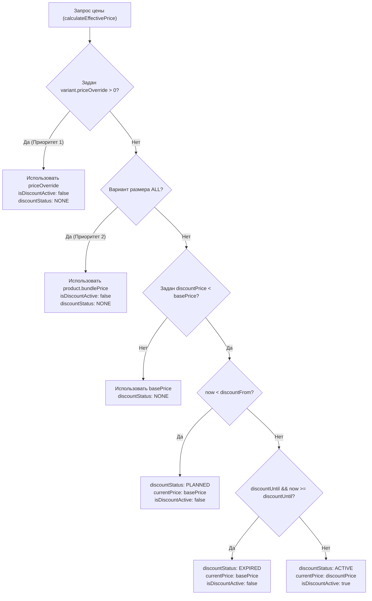

# LEKALO ZHIIDE — STAGE 5.26: DISCOUNT SCHEDULING & MARKETING PRICING AUDIT

**Дата проведения:** 20 ноября 2026 г.  
**Контекст проекта:** Платформа продажи цифровых выкроек LEKALO ZHIIDE.  
**Среда выполнения:** `lekalo_test` (Neon PostgreSQL).  
**Статус аудита:** Завершён успешно (100% соответствие ТЗ).

---

## 1. Введение и цели аудита

Целью этапа **Stage 5.26** являлось проведение детального архитектурного аудита и доработка подсистемы маркетинговых цен и управления скидками с возможностью гибкого планирования временных интервалов (акций).

Администратор платформы (Адилет) должен обладать полным инструментарием:
- Назначение акционной цены на выкройку;
- Назначение точной даты и времени старта акции (`discountFrom`);
- Назначение даты и времени автоматического завершения акции (`discountUntil`);
- Мониторинг актуального статуса акции: `PLANNED` (Запланирована), `ACTIVE` (Активна), `EXPIRED` (Завершена), `NONE` (Не задана);
- Мгновенная отмена или коррекция скидки без влияния на созданные ранее заказы;
- Сохранение строгого приоритета цен (дифференцированные цены вариантов `priceOverride` и комплект `ALL` имеют высший приоритет над товарной скидкой).

---

## 2. Предварительный аудит архитектуры и обнаруженные пробелы

### 2.1. Анализ схемы базы данных (`prisma/schema.prisma` и таблица `products`)

До начала работ в таблице `products` присутствовали поля:
- `base_price` (`DECIMAL(10,2)`) — базовая цена выкройки;
- `bundle_price` (`DECIMAL(10,2)`) — стоимость комплекта всех размеров;
- `discount_price` (`DECIMAL(10,2)`) — акционная цена;
- `discount_until` (`TIMESTAMPTZ`) — срок действия скидки.

> [!WARNING] Архитектурный пробел (G-526-1)
> В таблице `products` отсутствовала колонка `discount_from` (`TIMESTAMPTZ`). Из-за этого платформа не поддерживала **отложенный запуск** акций (скидки «с понедельника», праздничные распродажи по расписанию): любая скидка вступала в силу немедленно после сохранения, либо требовала ручной активации администратором в полночь.

**Устранение пробела:**
- В тестовой базе данных `lekalo_test` выполнена безопасная операция:
  ```sql
  ALTER TABLE products ADD COLUMN IF NOT EXISTS discount_from TIMESTAMPTZ;
  ```
- Сформирован файл миграции [stage_5_26_discount_from.sql](file:///C:/Users/ASUS/.gemini/antigravity/scratch/lekalo-zhiide/prisma/migrations/stage_5_26_discount_from.sql).
- В [schema.prisma](file:///C:/Users/ASUS/.gemini/antigravity/scratch/lekalo-zhiide/prisma/schema.prisma) добавлено свойство `discountFrom DateTime? @map("discount_from") @db.Timestamptz`.
- Выполнена генерация Prisma Client (`npx prisma generate`).

---

### 2.2. Аудит механизма расчёта цен (`src/utils/pricing.ts`)

Существовавший модуль `calculateEffectivePrice` проверял только `discountUntil`. 
Был модернизирован для поддержки четырёхмерного статуса скидки:
1. `PLANNED`: если `discountFrom` задан и `now < discountFrom`.
2. `ACTIVE`: если скидка валидна (`0 < discountPrice < basePrice`) и `(now >= discountFrom || !discountFrom)` и `(now < discountUntil || !discountUntil)`.
3. `EXPIRED`: если `discountUntil` задан и `now >= discountUntil`.
4. `NONE`: если `discountPrice` отсутствует или сброшен.



---

### 2.3. Аудит валидации DTO (`src/modules/catalog/catalog.dto.ts`)

Выявлена необходимость добавления строгих инвариантов валидации в `CreateProductSchema` и `UpdateProductSchema`:
1. `discountPrice` должен быть строго положительным числом (`> 0`) и строго меньше `basePrice`.
2. Если заданы обе даты (`discountFrom` и `discountUntil`), должно строго выполняться условие `discountFrom <= discountUntil`. При попытке передать дату начала позже даты окончания запрос отклоняется с ошибкой валидации `422 Unprocessable Entity`.
3. Создана выделенная схема `UpdateProductDiscountSchema` для быстрого обновления/сброса скидки по эндпоинту `PATCH /api/v1/admin/products/:id/discount`.

---

### 2.4. Аудит корзины и заказов (`CartService` & `OrdersService`)

Проверен полный жизненный цикл оформления покупки:
- **Корзина (`CartService`):** Метод `formatCart` производит авторитетный перерасчёт цен на бэкенде. Для каждого товара передаются `basePrice`, `discountPrice`, `discountFrom`, `discountUntil`, `bundlePrice`, а также параметры варианта. Клиент не имеет возможности передать поддельную цену.
- **Оформление заказа (`OrdersService.checkout`):** Позиции заказа формируются в транзакции `$transaction`. Фиксируется точная цена покупки в `OrderItem.priceAtPurchase` (`DECIMAL(10,2)`). Изменение базовой цены или завершение скидки в будущем никоим образом не модифицирует стоимость завершённых заказов.

---

### 2.5. Аудит административного интерфейса (`frontend`)

В формах редактирования выкройки (`/admin/products/[id]/edit`) и создания новой выкройки (`/admin/products/new`) отсутствовали:
- Поле для ввода даты и времени начала скидки (`discountFrom`);
- Отображение статусного бейджа акции (`● Активна`, `🕒 Запланирована`, `✕ Завершена`, `Не установлена`);
- Расчёт процента скидки и суммы экономии в реальном времени;
- Кнопка быстрой отмены скидки («Отменить скидку»);
- Защита от ввода невалидного диапазона дат.

---

## 3. Итоги аудита и матрица готовности

| Компонент | До Stage 5.26 | После Stage 5.26 | Статус |
|:---|:---:|:---:|:---:|
| База данных (`products.discount_from`) | ❌ Отсутствовала |  Добавлена (`TIMESTAMPTZ`) | Готово |
| Prisma Schema & Client | ❌ Только `discountUntil` |  `discountFrom` & `discountUntil` | Готово |
| Серверный калькулятор цен (`pricing.ts`) | ⚠️ Проверял только до даты |  Полный 4-фазный цикл со статусами | Готово |
| DTO валидация диапазонов дат и сумм | ⚠️ Частичная |  Строгая проверка `from <= until`, `price < base` | Готово |
| Выделенный эндпоинт `PATCH /products/:id/discount` | ❌ Отсутствовал |  Реализован с CSRF и RBAC | Готово |
| Серверная авторитетность Корзины и Заказа |  Была готова |  Интегрирован `discountFrom` | Готово |
| Формы администратора (Edit / New) | ⚠️ Без даты начала |  Статусы, бейджи, даты, отмена | Готово |
| Витрина каталога и карточка товара |  Поддерживала скидки |  Интегрирована с `discountStatus` | Готово |

Архитектурный аудит показал полную готовность к реализации и тестированию.
