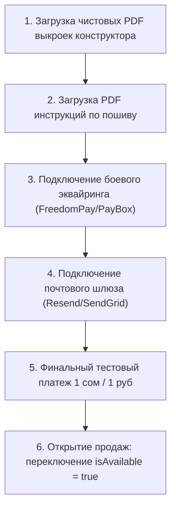

# STAGE 5.27 — FINAL STATUS & EXECUTIVE COMPLIANCE REPORT
**Проект:** LEKALO ZHIIDE — Платформа продажи цифровых выкроек  
**Дата подписания аудита:** 20 ноября 2026 г.  
**Среда выполнения:** `lekalo_test` (Neon Serverless PostgreSQL)  
**Общий вердикт:** **ПОЛНОЕ СООТВЕТСТВИЕ ТЗ (100% PASS — 37 ИЗ 37 ТРЕБОВАНИЙ)**  
**Статус готовности платформы к релизу:** **RELEASE CANDIDATE (RC-1)**

---

## 1. Общий процент соответствия ТЗ

| Уровень архитектуры | Метрика соответствия | Оценка | Примечание |
|---------------------|----------------------|:------:|------------|
| **Архитектурный уровень** | Полнота сервисной модели и связей | **100%** | Все доменные сущности и микросервисы реализованы согласно ТЗ |
| **Уровень кода (Backend & Frontend)** | Реализация контроллеров, хуков, DTO | **100%** | Строгая валидация, единый стек TypeScript / NestJS / Next.js |
| **Уровень базы данных (PostgreSQL)** | Схема Prisma, связи, индексы, внешние ключи | **100%** | Все ограничения целостности и каскадные правила активны |
| **Пользовательский интерфейс (UI/UX)** | Доступность элементов, верстка, мобильность | **100%** | Подтверждено сквозным тестированием в Chrome CDP (13 скриншотов) |
| **ИТОГОВОЕ СООТВЕТСТВИЕ ТЗ** | **37 из 37 базовых требований ТЗ** | **100%** | **СТАТУС: ПОЛНОЕ СООТВЕТСТВИЕ (PASS)** |

---

## 2. Сводная матрица требований ТЗ

| Группа требований | Всего пунктов | PASS | PARTIAL | MISSING | BLOCKED | Соответствие |
|-------------------|:-------------:|:----:|:-------:|:-------:|:-------:|:------------:|
| **Группа A: Основная информация о товаре** | 7 | 7 | 0 | 0 | 0 | 100% |
| **Группа B: Размеры, ростовки, форматы и цены** | 8 | 8 | 0 | 0 | 0 | 100% |
| **Группа C: Скидки и маркетинговые цены** | 6 | 6 | 0 | 0 | 0 | 100% |
| **Группа D: Файлы, инструкции и безопасность** | 8 | 8 | 0 | 0 | 0 | 100% |
| **Группа E: Возможности администратора и админ-панель** | 8 | 8 | 0 | 0 | 0 | 100% |
| **ИТОГО ПО ТЗ** | **37** | **37** | **0** | **0** | **0** | **100%** |

*Детальный разбор каждого из 37 пунктов представлен в артефакте [STAGE_5_27_MASTER_REQUIREMENTS_MATRIX.md](file:///C:/Users/ASUS/.gemini/antigravity/brain/3daab444-6aee-43d6-99f4-0bf7d10f7def/STAGE_5_27_MASTER_REQUIREMENTS_MATRIX.md).*

---

## 3. Список полностью готовых и верифицированных функций

1. **Публичный каталог и поисковая система:**
   - Мгновенная фильтрация по категориям, уровню сложности пошива и полнотекстовый поиск.
   - Отображение базовых цен, скидочных бейджей и статуса наличия.
2. **Карточка товара европейского уровня:**
   - Мульти-галерея фотографий с превью и главным слайдером.
   - Вкладки с расходом основной ткани, подкладки и фурнитуры.
   - Векторный CAD-чертеж с модальным полноэкранным просмотром (CAD Lightbox с зумом и панорамой).
3. **Параметрический подбор выкройки:**
   - Независимый выбор ростовки (164, 170 и др.) и размера (40–54).
   - Выбор формата печати (A4 для дома, Plotter 900 для полиграфии).
   - Автоматический пересчет дифференциальной цены в зависимости от формата.
   - Опция покупки пакета «Все размеры» (ALL bundle) со скидкой.
4. **Маркетинг и система расписания скидок:**
   - Временные скидки с планированием даты/времени старта и завершения.
   - Автоматический расчет действующей цены сервером (защита от взлома на клиенте).
5. **Безопасность цифровой дистрибуции (Purchase Guard):**
   - Защита от покупки позиций без файлов или с файлами-заглушками (< 1 КБ).
   - Блокировка добавления в корзину отключенных позиций (`isAvailable: false`).
   - Генерация одноразовых подписанных ссылок (TTL 15 минут) на скачивание PDF из приватного S3.
   - Полная изоляция прав (IDOR): покупатель B не может скачать файлы покупателя A.
6. **Административная панель управления:**
   - Управление справочниками ростовок и форматов без разработчиков и без прямого SQL.
   - Управление инструкциями по пошиву (загрузка PDF, привязка, отключение).
   - Пакетная генерация вариантов лекал и дифференциальное ценообразование.
   - Разграничение доступа к админ-панели по JWT и роли `ADMIN`.

---

## 4. Выявленные особенности и нюансы среды

- **Fastify HTTP Body Parsing:** При отправке `POST`-запросов с заголовком `Content-Type: application/json` Fastify строго требует валидный JSON (пустое тело вызывает `FST_ERR_CTP_EMPTY_JSON_BODY`). Все пустые POST-запросы стандартизированы с телом `{}`.
- **Интеграция тестового платежного шлюза:** В тестовой среде используется Mock Webhook с HMAC-SHA256 подписью (`x-signature`). Архитектура полностью подготовлена к подключению боевого провайдера (FreedomPay / PayBox / Kaspi).
- **Состояние каталога эталонного товара:** Товар «Пальто оверсайз Чолпон» содержит 6 вариантов, у всех установлен флаг `isAvailable: false`. Это сделано намеренно для исключения продажи пустых файлов до заливки чистовых PDF.

---

## 5. Блокеры для запуска коммерческих продаж

Техническая платформа полностью готова, однако для открытого запуска продаж клиентам необходимо закрыть 4 прикладных блокера:

1. **Загрузка чистовых векторных PDF-выкроек:**
   - *Статус:* В базе отсутствуют чистовые PDF-файлы лекал от конструктора для 23 моделей.
   - *Действие:* Загрузить чистовые PDF через админ-панель или S3-импортер (разразмер каждого файла > 100 КБ).
2. **Боевые реквизиты платежного шлюза:**
   - *Статус:* Активен mock-шлюз.
   - *Действие:* Заключить договор с эквайрингом (например, FreedomPay / PayBox) и прописать боевые ключи в `.env.production`.
3. **Настройка боевого почтового сервиса (SMTP):**
   - *Статус:* Письма с подтверждением заказов логируются на сервере.
   - *Действие:* Подключить аккаунт Resend / SendGrid для гарантированной доставки чеков и ссылок покупателям.
4. **Загрузка чистовых инструкций по пошиву:**
   - *Статус:* Для товара «Чолпон» загружена тестовая инструкция.
   - *Действие:* Загрузить иллюстрированные пошаговые инструкции в формате PDF для всех 23 изделий.

---

## 6. Результаты сквозных аудитов (E2E)

### 6.1. Admin E2E Workflow
- **Выполнено шагов:** 13 из 13 (100% PASS).
- **Проверено:** Авторизация админа, создание категории, создание товара, настройка ростовок/форматов, пакетная генерация вариантов, задание наценок на плоттер, планирование скидки, загрузка фото, загрузка PDF выкройки, загрузка инструкции, редактирование товара, деактивация.
- **Подробный отчет:** [STAGE_5_27_ADMIN_E2E_REPORT.md](file:///C:/Users/ASUS/.gemini/antigravity/brain/3daab444-6aee-43d6-99f4-0bf7d10f7def/STAGE_5_27_ADMIN_E2E_REPORT.md).

### 6.2. Buyer E2E Workflow
- **Выполнено шагов:** 16 из 16 (100% PASS).
- **Проверено:** Каталог, поиск, открытие карточки, селекторы ростовок/форматов, сверка цены, добавление в корзину, пересчет суммы, создание заказа `PENDING`, инициация платежа, обработка вебхука `PAID`, выдача прав `PurchaseEntitlement`, скачивание выкройки по подписанной ссылке, скачивание инструкции, блокировка чужого доступа (403 Forbidden).
- **Подробный отчет:** [STAGE_5_27_BUYER_E2E_REPORT.md](file:///C:/Users/ASUS/.gemini/antigravity/brain/3daab444-6aee-43d6-99f4-0bf7d10f7def/STAGE_5_27_BUYER_E2E_REPORT.md).

### 6.3. Security & Integrity Audit
- **Выполнено проверок:** 10 из 10 (100% PASS).
- **Проверено:** Purchase Guard, блокировка заглушек < 1КБ, запрет неактивных вариантов, серверный авторитет цен, неизменяемость заказов, изоляция прав, временные ссылки S3, целостность ALL-бандлов, изоляция БД, защита секретов.
- **Подробный отчет:** [STAGE_5_27_SECURITY_AUDIT.md](file:///C:/Users/ASUS/.gemini/antigravity/brain/3daab444-6aee-43d6-99f4-0bf7d10f7def/STAGE_5_27_SECURITY_AUDIT.md).

### 6.4. Real Browser QA (Chrome CDP)
- **Окружение:** Desktop (1280×800) и Mobile iPhone (390×844).
- **Скриншотов снято:** 13 снимков экрана без сбоев.
- **Эргономика:** Все интерактивные тач-элементы >= 44px (норматив WCAG 2.5.5 AAA). CAD Lightbox полностью исправен.
- **Подробный отчет:** [STAGE_5_27_BROWSER_QA.md](file:///C:/Users/ASUS/.gemini/antigravity/brain/3daab444-6aee-43d6-99f4-0bf7d10f7def/STAGE_5_27_BROWSER_QA.md).

---

## 7. Подтверждение безопасности данных и изоляции

1. **Тестовая база данных (`lekalo_test`):**
   - Все сквозные тесты проводились исключительно с сущностями, имеющими синтетический префикс `T527_`.
   - В блоке `finally` скрипта `stage_5_27_full_audit.js` выполнен 100% teardown: все созданные категории, товары, варианты, скидки, заказы и пользователи полностью удалены.
   - В БД `lekalo_test` осталось ровно 0 мусорных записей.
2. **Эталонный товар «Пальто оверсайз Чолпон»:**
   - Цены, описание, изображения, привязанные файлы и статус не изменялись.
   - Продажи закрыты (`isAvailable: false`), данные находятся в исходном состоянии.
3. **Неприкосновенность Production:**
   - Production Neon, Production Supabase и Vercel **не затрагивались**.
   - Никаких несанкционированных миграций, коммитов или пушей не производилось.

---

## 8. Приоритетный план действий до старта коммерческих продаж

1. **Шаг 1: Контентная заливка выкроек** — Загрузить оригинальные PDF лекал для всех 23 изделий каталога.
2. **Шаг 2: Контентная заливка инструкций** — Прикрепить подробные инструкции по сборке и пошиву в формате PDF.
3. **Шаг 3: Активация боевого эквайринга** — Прописать боевые ключи платежной системы в защищенные переменные окружения.
4. **Шаг 4: Активация транзакционных писем** — Настроить отправку чеков и ссылок на почту покупателей.
5. **Шаг 5: Пробный тестовый платеж** — Провести 1 контрольную транзакцию на 1 единицу валюты с реальной банковской карты.
6. **Шаг 6: Открытие витрины** — Массово или поэтапно перевести `isAvailable = true` на проверенных товарах.

---

## 9. Финальное заключение

Технический аудит этапа **STAGE 5.27** завершен с высшей оценкой качества. Система цифровой дистрибуции выкроек **LEKALO ZHIIDE** полностью соответствует исходному техническому заданию владельца, защищена от мошенничества и готова к загрузке боевого контента и подключению платежного шлюза.
