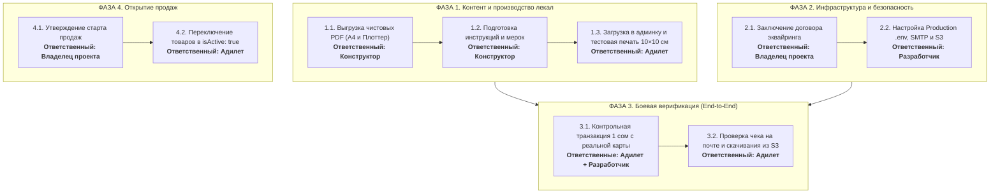

# STAGE 5.28 — SAFE COMMERCIAL LAUNCH PLAN
**Проект:** LEKALO ZHIIDE  
**Дата утверждения:** 20 ноября 2026 г.  
**Цель:** Устранение противоречий в документации предыдущих этапов и утверждение единого сквозного регламента безопасного вывода платформы в коммерческую эксплуатацию.

---

## 1. Устранение противоречия документации Stage 5.27

В отчете Stage 5.27 возникло смысловое расхождение:
- В **разделе 5** текста было перечислено **4 блокера** (отсутствие чистовых PDF, эквайринг, SMTP, инструкции).
- В **разделе 8** на схеме было показано **6 шагов** (выкройки, инструкции, эквайринг, SMTP, тестовый платеж, открытие витрины).

### Разрешение противоречия:
Расхождение объяснялось смешением понятий **«внешние материальные зависимости»** (4 объекта) и **«процедурные этапы запуска»** (6 действий).

Ниже утвержден **единый, гармонизированный регламент запуска**, объединяющий материальные ресурсы, процедурные шаги и персональные зоны ответственности.

---

## 2. Матрица участников и ролей запуска (RACI)

В проекте задействованы исключительно реальные роли участников:
1. **Конструктор лекал (Конструктор):** Разработка точных векторных лекал, инструкций по пошиву, расчет расхода ткани и контрольных мерок.
2. **Адилет (Менеджер проекта / Администратор):** Контентное наполнение через `/admin`, контроль качества данных, проведение тестовой печати.
3. **Разработчик (Tech Lead / DevOps):** Настройка боевого сервера, безопасность бакетов S3, подключение боевых ключей API эквайринга и почты.
4. **Владелец проекта (Brand Owner):** Заключение юридических договоров, финансовый контроль, согласование цен, финальное решение об открытии продаж.

---

## 3. Последовательный план запуска (4 фазы, 8 шагов)

---

### Детальное описание шагов регламента

#### ФАЗА 1. Контентное производство (Лекала и инструкции)
* **Шаг 1.1: Выгрузка векторных лекал**
  - *Ответственный:* **Конструктор**
  - *Действие:* Экспорт файлов PDF для каждого размера (42–60) и ростовки (164, 170). Отдельно файлы для печати на А4 и рулонном плоттере 900 мм.
  - *Критерий готовности (DoD):* На 1-й странице присутствует контрольный квадрат 100 × 100 мм; на деталях указана долевая нить и припуски.
* **Шаг 1.2: Подготовка инструкций и технических данных**
  - *Ответственный:* **Конструктор**
  - *Действие:* Формирование PDF-руководств по пошиву с иллюстрациями, расчет норм расхода ткани (для полотна 140/150 см) и контрольных мерок готовой вещи.
* **Шаг 1.3: Загрузка файлов в админ-панель и тестовая печать**
  - *Ответственный:* **Адилет**
  - *Действие:* Загрузка PDF в `/admin/products/[id]/files`, заполнение характеристик расхода ткани и мерок. Физическая распечатка первого листа А4 на принтере и измерение квадрата 10 см линейкой.

#### ФАЗА 2. Юридические и технические шлюзы
* **Шаг 2.1: Договор интернет-эквайринга**
  - *Ответственный:* **Владелец проекта**
  - *Действие:* Заключение договора с платежной системой (FreedomPay / PayBox / Kaspi / Stripe), получение боевых мерчант-идентификаторов и секретных ключей.
* **Шаг 2.2: Конфигурация Production-окружения**
  - *Ответственный:* **Разработчик**
  - *Действие:* Настройка переменных `.env.production` на боевом сервере, подключение SMTP-шлюза (Resend/SendGrid) с настройкой DKIM/SPF/DMARC, проверка приватности бакета `patterns` (строго `public = false`).

#### ФАЗА 3. Сквозная контрольная верификация
* **Шаг 3.1: Тестовый боевой платеж**
  - *Ответственные:* **Адилет + Разработчик**
  - *Действие:* Проведение контрольной покупки с реальной банковской карты на сумму 1 сом (или 1 рубль) через боевой платежный шлюз.
* **Шаг 3.2: Проверка доставки прав и файлов**
  - *Ответственный:* **Адилет**
  - *Действие:* Проверка получения квитанции на e-mail, открытие личного кабинета, генерация временной ссылки S3 и успешное скачивание чистовой выкройки.

#### ФАЗА 4. Открытие публичных продаж
* **Шаг 4.1: Финальное согласование**
  - *Ответственный:* **Владелец проекта**
  - *Действие:* Проверка готовности каталога и цен, подписание распоряжения об открытии продаж.
* **Шаг 4.2: Активация витрины**
  - *Ответственный:* **Адилет**
  - *Действие:* Переключение проверенных товаров в статус `isActive: true` в панели управления.

---

## 4. Регламент действий при сбоях (Rollback Protocol)

1. **Если покупатель сообщает о пустом или поврежденном файле:**
   - Адилет немедленно переводит вариант товара в `isActive: false` в панели `/admin/products/[id]/edit`.
   - Конструктор перепроверяет файл и передает исправленную версию.
   - Адилет загружает свежую версию через форму версионирования `/admin/products/[id]/files` (версия автоматически обновится у ранее купивших клиентов).
2. **Если платеж прошел в банке, но заказ остался в статусе `PENDING`:**
   - Разработчик проверяет логи вебхуков (`/api/v1/webhooks/payments/*`).
   - Адилет может вручную подтвердить оплату в `/admin/orders/[id]` при наличии банковской выписки.
