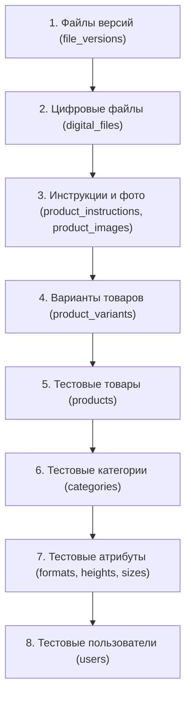

# STAGE 5.29 — SAFE TEST DATA CLEANUP PLAN
**Проект:** LEKALO ZHIIDE  
**Дата разработки плана:** 20 ноября 2026 г.  
**Целевая база данных:** `lekalo_test` (Neon PostgreSQL)  
**Статус выполнения:** **ТОЛЬКО ПЛАН — НЕ ВЫПОЛНЯТЬ В РАМКАХ STAGE 5.29**  
*(План подготовлен для выполнения техническим специалистом в момент финальной подготовки базы к релизу).*

---

## 1. Введение и принципы безопасности очистки

Цель плана — предоставить проверенный, транзакционно-безопасный SQL-скрипт для удаления остаточных тестовых данных (созданных в ходе этапов 5.21 и 5.24), гарантируя:
1. Полную сохранность 23 коммерческих товаров каталога (включая «Чолпон» и «Аида»).
2. Полную сохранность корневых справочников ростовок (158–164, 164–170, 170–176), форматов (А4, Плоттер 900, Letter) и типовых размеров (40–60).
3. Полную сохранность учетной записи администратора `admin@lekalojiide.com`.
4. Строгое соблюдение каскадности внешних ключей (Foreign Key Constraints) PostgreSQL.

---

## 2. Порядок удаления и анализ зависимостей

Порядок удаления строго учитывает связи реляционной схемы:



---

## 3. Транзакционный SQL-скрипт очистки (Dry-Run / Ready to Apply)

> [!CAUTION]
> **НЕ ВЫПОЛНЯТЬ АВТОМАТИЧЕСКИ.** Скрипт оформлен в транзакционном блоке `BEGIN ... COMMIT` с обязательными контрольными проверками `SELECT count(*)`.

```sql
-- =============================================================================
-- LEKALO ZHIIDE: БЕЗОПАСНАЯ ОЧИСТКА ТЕСТОВЫХ ДАННЫХ В LEKALO_TEST
-- ВНИМАНИЕ: Перед выполнением убедитесь: SELECT current_database() = 'lekalo_test';
-- =============================================================================

BEGIN;

-- 0. ПРОВЕРКА БАЗЫ ДАННЫХ
DO $$
BEGIN
  IF current_database() != 'lekalo_test' THEN
    RAISE EXCEPTION 'FATAL: Попытка выполнения скрипта не в lekalo_test! Текущая БД: %', current_database();
  END IF;
END $$;

-- 1. УДАЛЕНИЕ ВЕРСИЙ ФАЙЛОВ ДЛЯ ТЕСТОВЫХ ВАРИАНТОВ
DELETE FROM "file_versions"
WHERE "digital_file_id" IN (
  SELECT df."id" FROM "digital_files" df
  JOIN "product_variants" pv ON df."variant_id" = pv."id"
  JOIN "products" p ON pv."product_id" = p."id"
  WHERE p."slug" IN ('t524_966295-dress', 'silk-elegance-1795174646438')
);

-- 2. УДАЛЕНИЕ ЦИФРОВЫХ ФАЙЛОВ ТЕСТОВЫХ ВАРИАНТОВ
DELETE FROM "digital_files"
WHERE "variant_id" IN (
  SELECT pv."id" FROM "product_variants" pv
  JOIN "products" p ON pv."product_id" = p."id"
  WHERE p."slug" IN ('t524_966295-dress', 'silk-elegance-1795174646438')
);

-- 3. УДАЛЕНИЕ ФОТОГРАФИЙ И ИНСТРУКЦИЙ ТЕСТОВЫХ ТОВАРОВ
DELETE FROM "product_images"
WHERE "product_id" IN (
  SELECT "id" FROM "products"
  WHERE "slug" IN ('t524_966295-dress', 'silk-elegance-1795174646438')
);

DELETE FROM "product_instructions"
WHERE "product_id" IN (
  SELECT "id" FROM "products"
  WHERE "slug" IN ('t524_966295-dress', 'silk-elegance-1795174646438')
);

-- 4. УДАЛЕНИЕ ТЕСТОВЫХ ВАРИАНТОВ ТОВАРОВ
DELETE FROM "product_variants"
WHERE "product_id" IN (
  SELECT "id" FROM "products"
  WHERE "slug" IN ('t524_966295-dress', 'silk-elegance-1795174646438')
);

-- 5. УДАЛЕНИЕ САМИХ ТЕСТОВЫХ ТОВАРОВ
DELETE FROM "products"
WHERE "slug" IN ('t524_966295-dress', 'silk-elegance-1795174646438');

-- 6. УДАЛЕНИЕ ТЕСТОВЫХ КАТЕГОРИЙ
DELETE FROM "categories"
WHERE "slug" IN ('t524_966295-cat', 'cab-dresses-1795174645979');

-- 7. УДАЛЕНИЕ СИНТЕТИЧЕСКИХ ФОРМАТОВ ПЕЧАТИ
DELETE FROM "formats"
WHERE "code" IN ('T524_966295-F1', 'CA4-187144', 'CA4-648555');

-- 8. УДАЛЕНИЕ СИНТЕТИЧЕСКИХ РОСТОВОК
DELETE FROM "heights"
WHERE "code" IN ('T524_966295-H1', 'C170-187144', 'C170-648555');

-- 9. УДАЛЕНИЕ СИНТЕТИЧЕСКИХ РАЗМЕРОВ
DELETE FROM "sizes"
WHERE "code" IN ('C44-187144', 'C44-648555');

-- 10. УДАЛЕНИЕ ТЕСТОВЫХ ПОЛЬЗОВАТЕЛЕЙ И СЕССИЙ
DELETE FROM "user_sessions"
WHERE "user_id" IN (
  SELECT "id" FROM "users"
  WHERE "email" LIKE 't524_%'
     OR "email" LIKE '%@test-lekalo-zhiide.local'
     OR "email" LIKE 'pwtest_%'
     OR "email" LIKE 'test_reg_%'
     OR "email" LIKE 'pw_reset_test_%'
     OR "email" LIKE 'audit_test_%'
     OR "email" = 'buyer_test_44_1@example.com'
);

DELETE FROM "users"
WHERE "email" LIKE 't524_%'
   OR "email" LIKE '%@test-lekalo-zhiide.local'
   OR "email" LIKE 'pwtest_%'
   OR "email" LIKE 'test_reg_%'
   OR "email" LIKE 'pw_reset_test_%'
   OR "email" LIKE 'audit_test_%'
   OR "email" = 'buyer_test_44_1@example.com';

COMMIT;
```

---

## 4. Контрольные запросы для проверки результата (Post-Verification)

После выполнения очистки в базе данных `lekalo_test` должны строго выполняться следующие инварианты:

```sql
-- 1. Количество товаров должно составлять ровно 23 (коммерческий каталог)
SELECT count(*) FROM "products"; -- Ожидается: 23

-- 2. Отсутствие записей с префиксами T524_ и CAB
SELECT count(*) FROM "products" WHERE "slug" LIKE '%t524%' OR "slug" LIKE '%silk-elegance%'; -- Ожидается: 0
SELECT count(*) FROM "formats" WHERE "code" LIKE 'T524%' OR "code" LIKE 'CA4%'; -- Ожидается: 0
SELECT count(*) FROM "heights" WHERE "code" LIKE 'T524%' OR "code" LIKE 'C170%'; -- Ожидается: 0
SELECT count(*) FROM "sizes" WHERE "code" LIKE 'C44%'; -- Ожидается: 0

-- 3. Сохранность эталонного товара «Пальто оверсайз Чолпон»
SELECT "id", "slug", "title", "is_active" FROM "products" WHERE "slug" = 'palto-oversayz-cholpon';
-- Ожидается: запись присутствует, isActive = true

-- 4. Сохранность администратора
SELECT "id", "email", "role" FROM "users" WHERE "email" = 'admin@lekalojiide.com';
-- Ожидается: e4242e5d-dab2-465e-9dd5-9f3697f3ea29, role = ADMIN
```

---

## 5. Оценка рисков и последствия

1. **Риск случайного удаления заказов:** Отсутствует. Все удаляемые тестовые товары имеют 0 связанных записей в `order_items` и `purchase_entitlements`.
2. **Риск нарушения внешних ключей:** Устранен строгой топологической последовательностью скрипта (от дочерних `file_versions` к родительским `products` и `categories`).
3. **Возможность отката (Rollback):** Скрипт обернут в транзакцию `BEGIN ... COMMIT`. Любая ошибка автоматически отменяет все изменения без повреждения базы.
