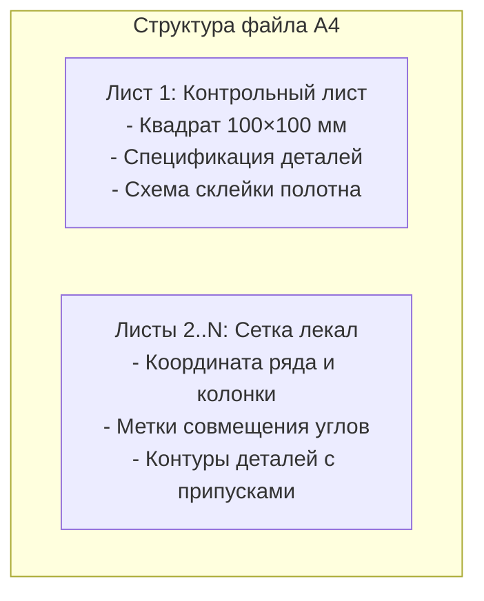
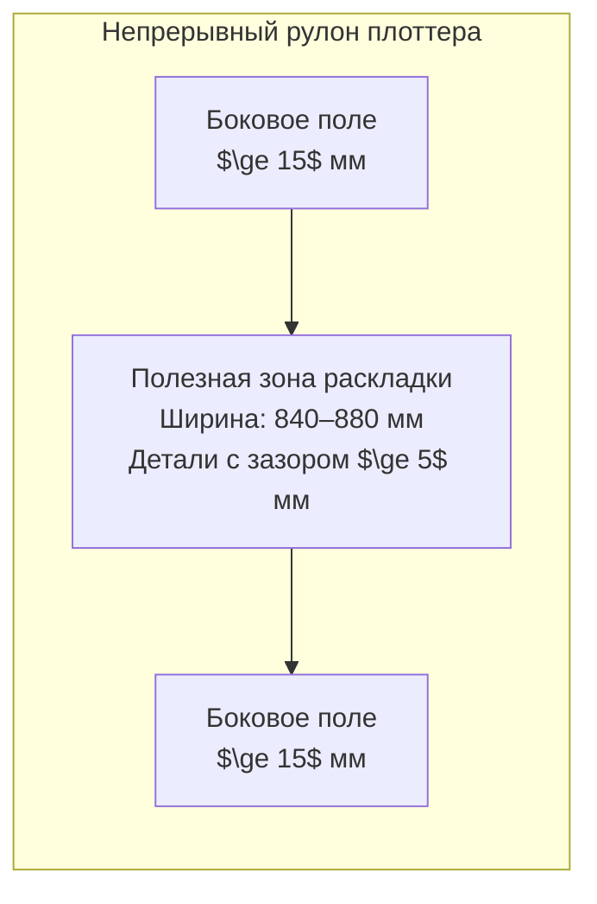

# LEKALO ZHIIDE — ИНЖЕНЕРНО-ТЕХНИЧЕСКИЕ ТРЕБОВАНИЯ К ФОРМАТАМ А4 И ПЛОТТЕР 900 ММ
## Руководство по экспорту и геометрической подготовке файлов выкроек

**Проект:** LEKALO ZHIIDE  
**Назначение:** Технический регламент для конструкторов САПР (Grafis, Julivi, Gerber, Optitex, CLO 3D, Валентина)  
**Версия документа:** 1.0 (Stage 5.2)  
**Дата:** 18 ноября 2026 г.  
**Статус:** ОБЯЗАТЕЛЬНЫЙ СТАНДАРТ

---

## 1. Сравнительная матрица спецификаций форматов

| Параметр | Формат А4 (Печать дома) | Формат Plotter 900 (Широкоформатная печать) |
| :--- | :--- | :--- |
| **Геометрический размер холста** | Строго 210 × 297 мм (ISO 216 / Portrait) | Ширина: 840–900 мм; Длина: 1200–5000 мм (динамическая) |
| **Ориентация страницы** | Книжная (Portrait) | Рулонная непрерывная (Continuous Roll) |
| **Количество страниц** | Многостраничный PDF (от 10 до 50+ листов) | Одностраничный непрерывный PDF (Single-page PDF) |
| **Печатное поле (Safe Margin)** | Отступ от края листа $\ge 10$ мм со всех 4 сторон | Отступ по бокам рулона $\ge 15$ мм (под прижимные ролики) |
| **Полезная рабочая область** | Максимум 190 × 277 мм | Ширина 810–870 мм, длина по раскладке + 20 мм поля |
| **Система склейки** | Рамка + поля нахлёста + координатная сетка | Не требуется (готовые лекала для вырезания) |
| **Контрольный квадрат** | 100 × 100 мм на 1-м печатном листе | 100 × 100 мм в верхнем левом углу полотна |
| **Схема сборки (Assembly Map)** | ОБЯЗАТЕЛЬНА на листе №1 | Не требуется |
| **Размер файла PDF** | 0.8 МБ – 6 МБ | 0.5 МБ – 4 МБ |
| **Целевое оборудование** | Бытовые принтеры A4 (струйные / лазерные) | Инженерные плоттеры (HP DesignJet, Canon imagePROGRAF, Epson SureColor) |

---

## 2. Инженерные требования к формату А4

### 2.1. Геометрия листа и технологические поля
1. **Точный размер холста в PDF:** ровно `595.28 × 841.89 points` (соответствует 210.0 × 297.0 мм при 72 DPI).
2. **Границы печати (Dead Zones):**
   - Большинство домашних принтеров имеют аппаратную непечатную зону от 3 до 6 мм.
   - Во избежание обрезки линий граница внешней рамки должна отступать от физического края бумаги **минимум на 10.0 мм** со всех сторон.
   - Полезная площадь листа для печати контуров: **190 × 277 мм**.

### 2.2. Система координат и разметка совмещения (Tiling System)
Каждый лист документа А4 (начиная с листов раскладки) должен содержать:
1. **Координатный маркер в правом верхнем и левом нижнем углах:**
   - Формат буквенно-цифровой: `Ряд [Число] — Колонка [Буква]` (например: `Ряд 1 - А`, `Ряд 1 - B`, `Ряд 2 - А`...) либо числовая матрица (`Ряд 1 / Лист 1`, `Ряд 1 / Лист 2`).
2. **Угловые маркеры (Alignment Crosshairs):**
   - По 4 углам технологической рамки размещаются перекрестия толщиной 0.25 мм с кругом диаметром 6 мм.
3. **Поля нахлёста (Overlap Margins):**
   - Ширина поля нахлёста для нанесения клея или скотча: **10–12 мм**.
   - Линия среза обозначается пунктиром с пиктограммой ножниц `✂ - - - - - - - -`.
   - На поле нахлёста наносится текст: *«Линия совмещения / склейки. Отрезать правое/нижнее поле и наложить на соседний лист»*.

### 2.3. Лист №1 — Технический информационный лист
Первый лист файла А4 резервируется как сервисно-информационный и содержит:
1. Логотип и торговое наименование: `LEKALO ZHIIDE`.
2. Полное наименование модели, размер, рост, артикул.
3. **Контрольный тестовый квадрат 100 × 100 мм** с внутренней разбивкой на 10-миллиметровую миллиметровку и диагональными контрольными линиями (длина диагонали квадрата $100 \times 100$ мм составляет ровно $141.4$ мм).
4. **Схема раскладки листов (Assembly Map):**
   - Миниатюрная матрица (таблица-схема), показывающая взаимное расположение всех листов (например, 4 ряда по 6 колонок = 24 листа).
   - На схеме наглядно отображено, на каких именно листах располагаются крупные детали (полочка, рукав, спинка).
5. **Таблица расхода материалов и фурнитуры:**
   - Длина основной ткани (при ширине 140 см / 150 см).
   - Длина подкладочной ткани.
   - Длина клеевого прокладочного материала (дублерин).
   - Количество пуговиц, кнопок, ниток, клеевой кромки.

---

## 3. Инженерные требования к формату Plotter 900 мм

### 3.1. Параметры страницы и геометрия рулона
1. **Ширина листа в PDF:**
   - Базовая ширина: **900 мм** (или стандартная ширина листа 841 мм для рулонов DIN A0).
   - Максимально допустимая ширина: **900 мм**. Превышение ширины свыше 900 мм **строго запрещено**, так как большинство копировальных центров и ателье оснащены рулонами 900 мм / 914 мм (36 дюймов).
2. **Длина листа:**
   - Длина формируется автоматически в САПР по фактической длине раскладки всех деталей одного размера + технологический припуск 50 мм в начале и конце.
   - Запрещено дробить плоттерный файл на страницы: файл Plotter 900 должен состоять из **строго 1 страницы** (непрерывная лента).
3. **Безопасные поля (Grip Margins):**
   - Боковые отступы от левого и правого краёв полотна: **не менее 15 мм**.
   - Попадание линий деталей в крайние 15 мм полотна приводит к непечати из-за роликового механизма плоттера.

### 3.2. Правила компоновки деталей (Nesting & Placement)
1. **Направление долевой нити:** Все детали должны быть сориентированы долевой нитью строго вдоль длины рулона (параллельно кромке рулона), если конструктивно не предусмотрен крой по косой.
2. **Межлекальные зазоры:**
   - Расстояние между наружными контурами любых двух деталей: **не менее 5 мм** (рекомендуется 8–10 мм).
   - Запрещено совмещать срезы разных деталей «встык» одной линией, так как при вырезании ножницами одна из деталей потеряет припуск.
3. **Группировка деталей:**
   - Рекомендуется группировать детали по материалам:
     - Блок 1: Детали верха (основная ткань).
     - Блок 2: Детали подкладки.
     - Блок 3: Детали дублирования (клеевой флизелин / дублерин).
   - В начале рулона (первые 200–300 мм) размещается информационный штамп заказа и проверочный квадрат 100 × 100 мм.

---

## 4. Требования к векторной графике, линиям и шрифтам

### 4.1. Векторный стандарт PDF
1. **Формат сохранения:** PDF версии 1.4 – 1.7, совместимый со стандартом ISO 32000-1.
2. **Запрет растрирования:** Все линии деталей, надсечки, маркировка и текстовые надписи должны быть чистыми векторными объектами (векторные пути `Path`, `Bezier Curves`).
3. **Запрет растровых подложек:** Категорически запрещено экспортировать выкройки как отсканированные растровые изображения (JPEG / PNG), упакованные в PDF. Такие файлы размываются при печати и не подлежат масштабированию.

### 4.2. Спецификация типов линий и толщин (Line Weights)

| Тип линии | Назначение | Толщина (мм) | Толщина (pt) | Начертание | Цвет (HEX) |
| :--- | :--- | :--- | :--- | :--- | :--- |
| **Линия среза (Cut Line)** | Внешний контур детали (с припуском) | 0.35 – 0.50 мм | 1.0 – 1.4 pt | Сплошная (Solid) | `#000000` (Чёрный) |
| **Линия шва (Stitch Line)** | Чистый контур детали (без припуска) | 0.20 – 0.25 мм | 0.5 – 0.7 pt | Пунктирная (Dashed, 3/2 мм) | `#4A5568` (Тёмно-серый) |
| **Линия сгиба (Fold Line)** | Сгиб ткани (середина спинки, полочки) | 0.30 – 0.35 мм | 0.8 – 1.0 pt | Штрихпунктир (`- · - · -`) | `#000000` (Чёрный) |
| **Долевая нить (Grainline)** | Направление долевой со стрелками | 0.25 – 0.35 мм | 0.7 – 1.0 pt | Сплошная со стрелками $\updownarrow$ | `#2B6CB0` (Синий) / `#000` |
| **Монтажная надсечка** | Контрольная метка стыковки швов | 0.35 – 0.50 мм | 1.0 – 1.4 pt | Перпендикулярный отрезок 4–5 мм | `#000000` (Чёрный) |
| **Линия кармана / вытачки** | Местоположение внутренних элементов | 0.25 мм | 0.7 pt | Тонкая пунктирная | `#2D3748` (Серый) |
| **Рамка совмещения А4** | Внутренняя граница листа для склейки | 0.25 мм | 0.7 pt | Тонкая сплошная | `#718096` (Серый) |

### 4.3. Требования к типографике и шрифтам
1. **Перевод шрифтов в кривые (Create Outlines / Convert to Curves) [КРИТИЧНО / MUST]:**
   - При экспорте из САПР абсолютно все текстовые блоки должны быть переведены в векторные кривые.
   - Это гарантирует идентичное отображение на любых устройствах, устраняет проблему отсутствия кириллических шрифтов (ш, щ, ы, ч, ж, ө, ү, ң) и сдвига текста при открытии в сторонних просмотрщиках.
2. **Читаемость текста:**
   - Высота основного текста штампа деталей: **не менее 3.0 мм** (8–10 pt).
   - Высота наименования детали и размера: **не менее 4.5–5.0 мм** (12–14 pt, полужирный шрифт).
   - Цвет шрифта: высококонтрастный чёрный (`#000000`).

---

## 5. Допуски, погрешности и геометрический контроль

1. **Допуск на контрольный квадрат:**
   - Номинал: $100.0 \times 100.0$ мм.
   - Максимально допустимое отклонение: $\le \pm 1.0$ мм (допустимый диапазон $99.0$ – $101.0$ мм).
2. **Допуск на сопряжение швов:**
   - Разница длин сопрягаемых срезов (например, боковой шов полочки и спинки) без учета технологической посадки: $\le \pm 1.0$ мм.
   - При наличии проектной посадки (например, по окату рукава или плечевому срезу спинки) величина посадки должна быть явно указана в технологической записке к лекалу.
3. **Сходимость линий при склейке А4:**
   - Непрерывная линия контура детали, пересекающая границу двух соседних листов А4, должна совпадать с точностью до **$\pm 0.5$ мм** при совмещении по реперным крестам.

---

## 6. Требования к метаданным и именованию PDF

1. **Имя файла:** Строго по платформенному стандарту LEKALO ZHIIDE:
   `[slug]-[размер]-[рост]-[ФОРМАТ].pdf`
   - Пример A4: `palto-oversayz-cholpon-42-164-170-A4.pdf`
   - Пример Plotter: `palto-oversayz-cholpon-42-164-170-PLOTTER_900.pdf`
2. **Свойства документа PDF (Document Properties):**
   - `Title`: LEKALO ZHIIDE — [Название модели] — Размер [Р] — Рост [Рост] — [Формат]
   - `Author`: LEKALO ZHIIDE
   - `Subject`: Выкройка женской одежды для пошива
   - `Keywords`: выкройка, лекало, шитье, оверсайз, пальто, PDF, А4, плоттер, лекало жийде
   - `Initial View`: Actual Size (100%), Single Page (для Плоттера) / Continuous (для А4).
