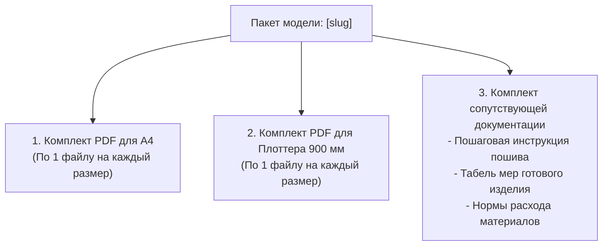

# LEKALO ZHIIDE — ТЕХНИЧЕСКОЕ ЗАДАНИЕ ДЛЯ КОНСТРУКТОРОВ САПР (CONSTRUCTOR BRIEF)
## Регламент разработки, градации и сдачи комплектов цифровых лекал одежды

**Заказчик:** Онлайн-магазин цифровых выкроек «LEKALO ZHIIDE»  
**Исполнитель:** Конструктор швейных изделий / Бюро САПР  
**Версия документа:** 1.0 (Stage 5.2)  
**Дата утверждения:** 18 ноября 2026 г.  
**Статус:** ОБЯЗАТЕЛЬНОЕ ПРИЛОЖЕНИЕ К ДОГОВОРУ НА РАЗРАБОТКУ ЛЕКАЛ

---

## 1. Предмет технического задания

Исполнитель обязуется разработать, провести градацию по размерам и ростам, оформить и передать Заказчику готовые цифровые лекала в формате PDF в соответствии с отраслевыми стандартами конструирования и настоящим Техническим заданием.

Лекала предназначены для продажи розничным покупателям через интернет-магазин **LEKALO ZHIIDE** для последующей домашней печати на принтерах А4 и широкоформатной печати на плоттерах.

---

## 2. Комплектность поставки на каждую модель

На каждую согласованную модель Заказчик должен получить единый цифровой архив, содержащий:

### 2.1. Файлы выкроек (Строго PDF):
1. **Для каждого размера модели** формируется отдельный файл формата **А4**.
2. **Для каждого размера модели** формируется отдельный файл формата **Plotter 900 мм**.
*(Объединение нескольких размеров в один файл «все размеры на одном листе разными цветами» ЗАПРЕЩЕНО, если иное прямо не оговорено Заказчиком).*

### 2.2. Сопутствующая документация к модели:
1. **Табель мер готового изделия (Measurement Chart):**
   - Основные конструктивные промеры по размерам (длина по спинке, ширина по груди, талии, бедрам, длина рукава, ширина низа).
   - Величины прибавок на свободу облегания ($П_г$, $П_т$, $П_б$, $П_{ор}$).
2. **Расход материалов и спецификация фурнитуры:**
   - Норма расхода основной ткани для каждого размера при ширине 140 см и 150 см.
   - Норма расхода подкладочной ткани, дублерина, клеевых кромок.
   - Фурнитура: пуговицы, молнии, кнопки, резинка, плечевые накладки (с указанием точных параметров).
3. **Технологическая последовательность пошива (Sewing Guide):**
   - Пошаговый иллюстрированный регламент сборки узлов изделия (раскрой, дублирование, карманы, воротник/горловина, рукава, подкладка, подгибка низа, ВТО).

---

## 3. Стандарт именования файлов

Все передаваемые файлы должны строго следовать шаблону именования платформы без использования пробелов, кириллицы в именах файлов и спецсимволов:

$$\text{\texttt{[slug]-[размер]-[рост]-[ФОРМАТ].pdf}}$$

- **slug** — утвержденный системный идентификатор модели из каталога LEKALO ZHIIDE;
- **размер** — российский размер по ГОСТ (40, 42, 44, 46, 48, 50, 52);
- **рост** — диапазон роста в см (164-170, 158-164, 170-176);
- **ФОРМАТ** — строго `A4` либо `PLOTTER_900`.

**Примеры правильных имен файлов:**
- `palto-oversayz-cholpon-42-164-170-A4.pdf`
- `palto-oversayz-cholpon-42-164-170-PLOTTER_900.pdf`
- `plate-a-silueta-aychurok-44-164-170-A4.pdf`
- `bryuki-palatstso-altynay-46-164-170-PLOTTER_900.pdf`

---

## 4. Инженерные требования к геометрии и экспорту

| Параметр | Требование к А4 | Требование к Плоттер 900 |
| :--- | :--- | :--- |
| **Масштаб экспорта** | Строго 100% (1:1), запрещено масштабирование | Строго 100% (1:1) |
| **Контрольный квадрат** | 100 × 100 мм на первом листе (погрешность $\le \pm 1$ мм) | 100 × 100 мм в начале рулона |
| **Ширина холста** | 210 мм (высота 297 мм) | Не более 900 мм (рабочая зона 840–880 мм) |
| **Поля безопасности** | Не менее 10 мм от всех 4 краев каждого листа | Не менее 15 мм от боковых кромок рулона |
| **Система склейки** | Рамка совмещения, угловые кресты, индексы (Ряд-Колонка) | Не требуется (сплошной непрерывный лист) |
| **Схема сборки** | Обязательна мини-карта сборки листов на стр. 1 | Не требуется |
| **Шрифты** | **ВСЕ ШРИФТЫ ПЕРЕВЕДЕНЫ В ВЕКТОРНЫЕ КРИВЫЕ (OUTLINES)** | **ВСЕ ШРИФТЫ ПЕРЕВЕДЕНЫ В КРИВЫЕ** |
| **Линии контура** | Векторные пути (черный срез 0.35–0.5 мм, серый шов 0.25 мм) | Векторные пути |

---

## 5. Требования к маркировке деталей

Каждая деталь выкройки на полотне должна иметь несмываемый читаемый информационный штамп:
1. Бренд: **LEKALO ZHIIDE**
2. Модель: Название модели на русском языке (например, *Пальто оверсайз «Чолпон»*)
3. Артикул / Slug: например, `palto-oversayz-cholpon`
4. Размер и рост: например, *Размер 44 / Рост 164–170*
5. Наименование детали: например, *Полочка*, *Спинка*, *Подборт*, *Верхняя часть рукава*
6. Материал и количество деталей для кроя:
   - *«2 дет. из основной ткани»*
   - *«2 дет. из подкладки»*
   - *«2 дет. из дублерина»*
7. Стрелка направления долевой нити (длиной не менее половины высоты детали).
8. Контрольные монтажные надсечки (длиной 4–5 мм) в точках сопряжения швов.
9. Разметка конструктивных элементов: линии талии, бедер, полузаноса, сгиба, петель, пуговиц, карманов.

---

## 6. Регламент приемки и гарантийные обязательства

1. **Срок входного контроля:** Заказчик осуществляет проверку переданных файлов по чек-листу стандарта качества в течение **5 рабочих дней** с момента передачи.
2. **Критерии брака (Дефекты класса Critical):**
   - Отклонение стороны контрольного квадрата более чем на 1.0 мм при печати со 100% масштабом.
   - Ширина плоттерного файла более 900 мм.
   - Непереведенные в кривые шрифты, приведшие к искажению или сдвигу надписей.
   - Отсутствие хотя бы одной сопрягаемой детали (подборта, обтачки, карманы, подкладка).
   - Несоответствие длин сопрягаемых швов более чем на 1.0 мм (без технологической посадки).
3. **Гарантийное устранение дефектов:**
   - При выявлении любых дефектов из п. 6.2 Исполнитель обязуется бесплатно исправить и повторно экспортировать файлы в течение **48 часов**.

---

## 7. Сводный реестр всех 23 моделей каталога для разработки

| № | Наименование модели | Системный slug модели | Категория | Диапазон размеров | Рост | Требуется вариантов |
| :-: | :--- | :--- | :--- | :-: | :-: | :-: |
| 1 | Платье А-силуэта «Айчурок» | `plate-a-silueta-aychurok` | Платья | 40, 42, 44, 46, 48, 50, 52 | 164–170 | **14 файлов** (7 А4 + 7 Плоттер) |
| 2 | Платье миди с запахом «Перизат» | `plate-midi-s-zapachem-perizat` | Платья | 40, 42, 44, 46, 48, 50, 52 | 164–170 | **14 файлов** |
| 3 | Платье-рубашка «Каныкей» | `plate-rubashka-kanykey` | Платья | 42, 44, 46, 48, 50, 52 | 164–170 | **12 файлов** |
| 4 | Платье вечернее «Курманжан» | `plate-vechernee-kurmanzhan` | Платья | 40, 42, 44, 46, 48 | 164–170 | **10 файлов** |
| 5 | Платье ярусное бохо «Жылдыз» | `plate-yarusnoe-boho-zhyldyz` | Платья | 42, 44, 46, 48, 50, 52 | 164–170 | **12 файлов** |
| 6 | Платье прямое с разрезом «Аида» | `plate-pryamoe-s-razrezom-aida` | Платья | 40, 42, 44, 46, 48 | 164–170 | **10 файлов** |
| 7 | Платье-комбинация «Бермет» | `plate-kombinatsiya-bermet` | Платья | 40, 42, 44, 46, 48 | 164–170 | **10 файлов** |
| 8 | Платье трапеция с воланом «Мээрим» | `plate-trapetsiya-s-volanom-meerim` | Платья | 42, 44, 46, 48, 50 | 164–170 | **10 файлов** |
| 9 | Блузка с бантом «Айгуль» | `bluzka-s-bantom-aygul` | Блузки | 40, 42, 44, 46, 48, 50 | 164–170 | **12 файлов** |
| 10 | Рубашка оверсайз «Чолпон» | `rubashka-oversayz-cholpon` | Блузки | 42, 44, 46, 48, 50, 52 | 164–170 | **12 файлов** |
| 11 | Блузка с баской «Нургуль» | `bluzka-s-baskoy-nurgul` | Блузки | 40, 42, 44, 46, 48 | 164–170 | **10 файлов** |
| 12 | Топ шелковый базовый «Асель» | `top-shelkovyy-bazovyy-asel` | Блузки | 40, 42, 44, 46, 48 | 164–170 | **10 файлов** |
| 13 | Юбка-карандаш со шлицей «Замира» | `yubka-karandash-so-shlitsey-zamira` | Юбки | 40, 42, 44, 46, 48, 50 | 164–170 | **12 файлов** |
| 14 | Юбка плиссе миди «Динара» | `yubka-plisse-midi-dinara` | Юбки | 42, 44, 46, 48, 50 | 164–170 | **10 файлов** |
| 15 | Юбка А-силуэта на пуговицах «Алия» | `yubka-a-silueta-na-pugovitsakh-aliya` | Юбки | 40, 42, 44, 46, 48, 50 | 164–170 | **12 файлов** |
| 16 | Брюки палаццо широкие «Алтынай» | `bryuki-palatstso-shirokie-altynay` | Брюки | 40, 42, 44, 46, 48, 50 | 164–170 | **12 файлов** |
| 17 | Брюки классические со стрелками «Гульнара» | `bryuki-klassicheskie-so-strelkami-gulnara` | Брюки | 42, 44, 46, 48, 50, 52 | 164–170 | **12 файлов** |
| 18 | Брюки зауженные к низу «Айпери» | `bryuki-zauzhennye-k-nizu-ayperi` | Брюки | 40, 42, 44, 46, 48 | 164–170 | **10 файлов** |
| 19 | Жакет двубортный классический «Томирис» | `zhaket-dvubortnyy-klassicheskiy-tomiris` | Жакеты | 42, 44, 46, 48, 50 | 164–170 | **10 файлов** |
| 20 | Жакет приталенный с баской «Салтанат» | `zhaket-pritalennyy-s-baskoy-saltanat` | Жакеты | 40, 42, 44, 46, 48 | 164–170 | **10 файлов** |
| 21 | Жакет прямого кроя «Райхан» | `zhaket-pryamogo-kroya-raykhan` | Жакеты | 42, 44, 46, 48, 50, 52 | 164–170 | **12 файлов** |
| 22 | Жилет классический удлиненный «Бактыгуль» | `zhilet-klassicheskiy-udlinennyy-baktygul` | Жакеты | 40, 42, 44, 46, 48, 50 | 164–170 | **12 файлов** |
| 23 | Пальто оверсайз «Чолпон» (Пилотный запуск) | `palto-oversayz-cholpon` | Верхняя одежда | 42, 44, 46 | 164–170 | **6 файлов** (3 А4 + 3 Плоттер) |
| **ИТОГО** | **23 модели каталога** | — | **5 категорий** | — | — | **183 файла PDF** |

---

## 8. Приоритетность сдачи работ

- **Очередь 1 (Пилотная модель):** Товар №23 *Пальто оверсайз «Чолпон»* (6 файлов: размеры 42, 44, 46) — срок сдачи: 1-я очередь.
- **Очередь 2 (Базовые бестселлеры):** Модели №1–4 (Платья «Айчурок», «Перизат», «Каныкей», «Курманжан») — 50 файлов.
- **Очередь 3 (Поясные изделия и блузки):** Модели №9, 10, 13, 16, 17 — 60 файлов.
- **Очередь 4 (Остальные модели каталога):** Модели №5–8, 11, 12, 14, 15, 18–22 — 67 файлов.
