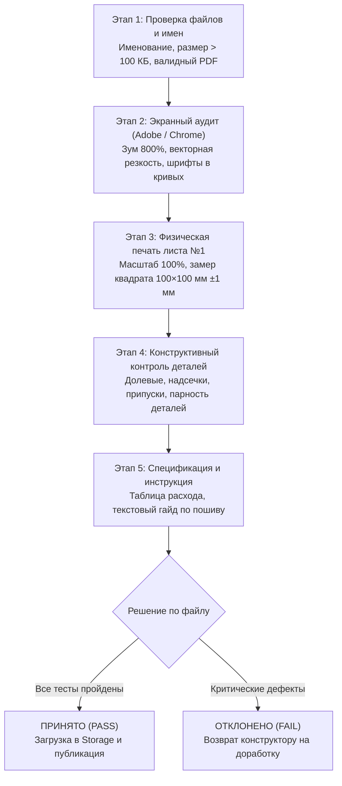

# LEKALO ZHIIDE — ПРАКТИЧЕСКИЙ ЧЕК-ЛИСТ ПРИЁМКИ ЦИФРОВЫХ ЛЕКАЛ
## Регламент входного контроля PDF-файлов для Адилета перед загрузкой на платформу

**Проект:** LEKALO ZHIIDE  
**Для кого:** Администратор платформы (Адилет), технический контролер качества  
**Версия документа:** 1.0 (Stage 5.2)  
**Дата:** 18 ноября 2026 г.  
**Статус:** ОБЯЗАТЕЛЬНЫЙ РЕГЛАМЕНТ ПРИЁМКИ

---

## 1. Универсальный 6-этапный регламент приёмки файлов от конструктора



---

### Этап 1. Первичная проверка файлов и именования
| № | Проверяемый параметр | Метод проверки | Критерий прохождения (Pass) | Статус |
| :-: | :--- | :--- | :--- | :-: |
| 1.1 | **Имя файла соответствует стандарту** | Визуально в Проводнике | `[slug]-[размер]-[рост]-[ФОРМАТ].pdf` без пробелов и спецсимволов | [ ] |
| 1.2 | **Размер файла адекватен** | Свойства файла | Не менее **100 КБ** и не более **15 МБ** (файлы < 1 КБ — фиктивные заглушки!) | [ ] |
| 1.3 | **Целостность PDF-контейнера** | Открытие в просмотрщике | Файл открывается без ошибок синтаксиса и повреждений | [ ] |
| 1.4 | **Формат и страница** | Свойства страницы | А4: многостраничный; Plotter 900: ровно 1 длинная страница | [ ] |

---

### Этап 2. Экранный аудит (Screen Inspection)
| № | Проверяемый параметр | Метод проверки | Критерий прохождения (Pass) | Статус |
| :-: | :--- | :--- | :--- | :-: |
| 2.1 | **Векторная четкость (Anti-raster)** | Увеличение зума до **800%** | Все линии остаются идеально гладкими, без пикселизации и артефактов JPEG | [ ] |
| 2.2 | **Шрифты переведены в кривые** | Выделение текста курсором | Текст не должен выделяться как системный шрифт; все буквы отрисованы векторными контурами | [ ] |
| 2.3 | **Разметка листов А4** | Просмотр страниц 2..N | На каждом листе есть рамка, координатная метка (Ряд-Колонка) и метки нахлёста | [ ] |
| 2.4 | **Ширина плоттера** | Свойства страницы в PDF | Ширина рулона **$\le 900$ мм** (допустимо 840–900 мм, но ни в коем случае не > 900 мм) | [ ] |

---

### Этап 3. Тестовая печать первого листа (Физический замер)
> [!IMPORTANT]
> **Главное правило печати:** В настройках принтера строго выставить **«Реальный размер» (Actual size / 100%)**. Любые опции «Подогнать под размер страницы» или «Уменьшить большие страницы» должны быть отключены!

| № | Проверяемый параметр | Метод проверки | Критерий прохождения (Pass) | Статус |
| :-: | :--- | :--- | :--- | :-: |
| 3.1 | **Печать листа №1 на А4** | Вывод на домашний/офисный принтер | Лист напечатан полностью, рамка не обрезана принтером | [ ] |
| 3.2 | **Замер стороны квадрата X** | Металлическая линейка (ГОСТ 427-75) | Строго **100 мм $\pm 1$ мм** (допустимо 99.0 – 101.0 мм) | [ ] |
| 3.3 | **Замер стороны квадрата Y** | Металлическая линейка (ГОСТ 427-75) | Строго **100 мм $\pm 1$ мм** (допустимо 99.0 – 101.0 мм) | [ ] |
| 3.4 | **Замер диагонали квадрата** | Замер от угла до угла | Ровно **141.4 мм $\pm 1.5$ мм** (проверка на отсутствие искажений геометрии) | [ ] |

---

### Этап 4. Конструктивный контроль лекал
| № | Проверяемый параметр | Метод проверки | Критерий прохождения (Pass) | Статус |
| :-: | :--- | :--- | :--- | :-: |
| 4.1 | **Маркировка каждой детали** | Визуально по всем лекалам | Указаны: бренд, модель, размер, рост, название детали, количество для кроя | [ ] |
| 4.2 | **Линии долевой нити** | Проверка каждой детали | Стрелка долевой нити присутствует и занимает не менее 60% длины детали | [ ] |
| 4.3 | **Монтажные надсечки** | Сравнение сопрягаемых деталей | Надсечки есть на пройме, окате рукава, талии, боковых срезах, горловине | [ ] |
| 4.4 | **Припуски на швы** | Проверка контуров | Припуски заложены в лекала; ширина припусков (1.0 см, 1.5 см, 4.0 см) явно указана | [ ] |
| 4.5 | **Парность и симметрия** | Сверка со спецификацией | Для симметричных деталей указано «2 дет.» или «со сгибом» | [ ] |
| 4.6 | **Детали подкладки и дублерина** | Проверка комплекта | В комплект включены подборта, обтачки, мешковины карманов, подкладка и дублерин | [ ] |

---

### Этап 5. Спецификация и документация
| № | Проверяемый параметр | Метод проверки | Критерий прохождения (Pass) | Статус |
| :-: | :--- | :--- | :--- | :-: |
| 5.1 | **Схема склейки листов А4** | Лист №1 файла А4 | Присутствует мини-карта сборки всех страниц с номерами рядов и колонок | [ ] |
| 5.2 | **Таблица расхода материалов** | Лист №1 или инструкция | Указан метраж основной ткани, подкладки, дублерина и перечень фурнитуры | [ ] |
| 5.3 | **Пошаговая инструкция пошива** | Отдельный файл или блок в PDF | Наличие иллюстрированного руководства по последовательности сборки изделия | [ ] |

---

### Этап 6. Матрица принятия решения

```
┌────────────────────────────────────────────────────────────────────────┐
│ Все пункты [MUST] пройдены без единого замечания?                       │
├────────────────────────────────┬───────────────────────────────────────┤
│ ДА (100% соответствие)         │ ➔ СТАТУС: APPROVED (ПРИНЯТО К ЗАГРУЗКЕ) │
│ Есть хотя бы 1 дефект [MUST]   │ ➔ СТАТУС: REJECTED (ВОЗВРАТ В САПР)    │
│ Замечания по [SHOULD]          │ ➔ СТАТУС: CONDITIONAL (ДОРАБОТКА ТЕКСТА)│
└────────────────────────────────┴───────────────────────────────────────┘
```

---

## 2. Индивидуальный приёмочный чек-лист для товара №23 «Пальто оверсайз Чолпон»

**Товар:** Пальто оверсайз «Чолпон» (`palto-oversayz-cholpon`, ID: 23)  
**Количество требуемых файлов:** 6 файлов (3 размера $\times$ 2 формата)  
**Ростовая группа:** 164–170 см  
**Размеры:** 42, 44, 46  

### 2.1. Статус готовности файлов в базе данных и Storage (на 18.11.2026)

| № | SKU варианта | Размер | Формат | Фактический файл в Storage | Текущее состояние | Готовность к продаже |
| :-: | :--- | :-: | :-: | :--- | :-: | :-: |
| 1 | `LZ-PALTOOVE-42-164-170-A4` | 42 | A4 | `palto-cholpon-42-164-170-A4.pdf` (79 байт) | **DEMO ЗАГЛУШКА** | ❌ НЕ ГОТОВ |
| 2 | `LZ-PALTOOVE-42-164-170-PLOTTER_900` | 42 | Plotter | Отсутствует (`fileUrl: null`) | **MISSING** | ❌ НЕ ГОТОВ |
| 3 | `LZ-PALTOOVE-44-164-170-A4` | 44 | A4 | Отсутствует (`fileUrl: null`) | **MISSING** | ❌ НЕ ГОТОВ |
| 4 | `LZ-PALTOOVE-44-164-170-PLOTTER_900` | 44 | Plotter | Отсутствует (`fileUrl: null`) | **MISSING** | ❌ НЕ ГОТОВ |
| 5 | `LZ-PALTOOVE-46-164-170-A4` | 46 | A4 | Отсутствует (`fileUrl: null`) | **MISSING** | ❌ НЕ ГОТОВ |
| 6 | `LZ-PALTOOVE-46-164-170-PLOTTER_900` | 46 | Plotter | Отсутствует (`fileUrl: null`) | **MISSING** | ❌ НЕ ГОТОВ |

> [!WARNING]
> Ни один из 6 файлов пальто «Чолпон» в текущий момент **НЕ ГОТОВ** к коммерческой реализации. Единственный существующий файл — это 79-байтовая текстовая заглушка. Все 6 файлов должны быть получены от конструктора САПР и проверены по чек-листу ниже.

---

### 2.2. Спецификация лекал пальто «Чолпон» для проверки комплектности

При приёмке каждого из 6 файлов Адилет обязан сверить наличие всех **18 конструктивных деталей**:

#### А. Детали верха (из основной пальтовой ткани — драп, шерсть, кашемир):
- [ ] 1. **Полочка** — 2 детали (с разметкой входа в прорезной карман, полузаноса, петель и пуговиц)
- [ ] 2. **Спинка** — 2 детали (со средним швом и шлицей) либо 1 деталь со сгибом
- [ ] 3. **Верхняя половинка рукава** — 2 детали (двухшовный рукав)
- [ ] 4. **Нижняя половинка рукава** — 2 детали
- [ ] 5. **Подборт цельнокроеный или отрезной** — 2 детали
- [ ] 6. **Воротник верхний** — 1 деталь со сгибом
- [ ] 7. **Воротник нижний** — 2 детали (крой по косой с припуском на шов расстрочки)
- [ ] 8. **Стойка воротника** (если предусмотрена конструкцией) — 2 детали
- [ ] 9. **Листочка кармана** (или клапан) — 2 детали
- [ ] 10. **Обтачка кармана** — 2 детали
- [ ] 11. **Обтачка горловины спинки** — 1 деталь со сгибом
- [ ] 12. **Пояс съемный** (если модель под пояс) — 1 деталь со сгибом

#### Б. Детали подкладки:
- [ ] 13. **Полочка подкладки** — 2 детали (с вычетом ширины подборта)
- [ ] 14. **Спинка подкладки** — 1 деталь со сгибом (со складкой на свободу движения по среднему шву)
- [ ] 15. **Верхняя половинка рукава подкладки** — 2 детали
- [ ] 16. **Нижняя половинка рукава подкладки** — 2 детали
- [ ] 17. **Мешковина кармана верхняя (из подкладки)** — 2 детали
- [ ] 18. **Мешковина кармана нижняя (из подкладки или основной ткани)** — 2 детали

#### В. Детали дублирования (клеевой дублерин):
- [ ] Полочка полностью или фронтально (включая лацкан и подборт)
- [ ] Верхняя часть спинки, пройма спинки, шлица, низ спинки
- [ ] Воротник верхний и нижний
- [ ] Листочки и вход в карман
- [ ] Низ рукавов (припуск подгибки)

---

### 2.3. Повариантный протокол приёмки (6 вариантов)

#### Вариант 1: `LZ-PALTOOVE-42-164-170-A4`
- [ ] Файл переименован в `palto-oversayz-cholpon-42-164-170-A4.pdf`
- [ ] Размер файла: `______` КБ (требуется от 1.5 до 6 МБ)
- [ ] Тестовый квадрат 100×100 мм распечатан и замерен линейкой: `___ × ___` мм
- [ ] Все 18 деталей пальто присутствуют на листах
- [ ] Схема склейки А4 присутствует на листе №1
- [ ] **Решение:** `[ ] ПРИНЯТО / [ ] ОТКЛОНЕНО` (Подпись: ___________)

#### Вариант 2: `LZ-PALTOOVE-42-164-170-PLOTTER_900`
- [ ] Файл переименован в `palto-oversayz-cholpon-42-164-170-PLOTTER_900.pdf`
- [ ] Размер полотна в свойствах PDF: ширина `______` мм ($\le 900$ мм), длина `______` мм
- [ ] Тестовый квадрат 100×100 мм присутствует в начале полотна
- [ ] Все детали разложены с зазором $\ge 5$ мм вдоль долевой
- [ ] **Решение:** `[ ] ПРИНЯТО / [ ] ОТКЛОНЕНО` (Подпись: ___________)

#### Вариант 3: `LZ-PALTOOVE-44-164-170-A4`
- [ ] Файл переименован в `palto-oversayz-cholpon-44-164-170-A4.pdf`
- [ ] Размер файла: `______` КБ
- [ ] Тестовый квадрат 100×100 мм замерен: `___ × ___` мм
- [ ] Проверена градация: лекала 44 размера шире 42 размера на соответствующие приращения (обхват груди +4 см)
- [ ] **Решение:** `[ ] ПРИНЯТО / [ ] ОТКЛОНЕНО` (Подпись: ___________)

#### Вариант 4: `LZ-PALTOOVE-44-164-170-PLOTTER_900`
- [ ] Файл переименован в `palto-oversayz-cholpon-44-164-170-PLOTTER_900.pdf`
- [ ] Ширина рулона $\le 900$ мм
- [ ] Проверена комплектность и маркировка 44 размера
- [ ] **Решение:** `[ ] ПРИНЯТО / [ ] ОТКЛОНЕНО` (Подпись: ___________)

#### Вариант 5: `LZ-PALTOOVE-46-164-170-A4`
- [ ] Файл переименован в `palto-oversayz-cholpon-46-164-170-A4.pdf`
- [ ] Размер файла: `______` КБ
- [ ] Тестовый квадрат 100×100 мм замерен: `___ × ___` мм
- [ ] Проверена градация лекал 46 размера
- [ ] **Решение:** `[ ] ПРИНЯТО / [ ] ОТКЛОНЕНО` (Подпись: ___________)

#### Вариант 6: `LZ-PALTOOVE-46-164-170-PLOTTER_900`
- [ ] Файл переименован в `palto-oversayz-cholpon-46-164-170-PLOTTER_900.pdf`
- [ ] Ширина рулона $\le 900$ мм
- [ ] Проверена комплектность и маркировка 46 размера
- [ ] **Решение:** `[ ] ПРИНЯТО / [ ] ОТКЛОНЕНО` (Подпись: ___________)

---

## 3. Финальный лист согласования приемки пальто «Чолпон»

| Этап приемки | Ответственный | Дата проверки | Результат | Примечания |
| :--- | :--- | :--- | :--- | :--- |
| **Геометрический аудит (масштаб и квадрат)** | Адилет | ___.___.2026 | [ ] OK / [ ] FAIL | |
| **Технологический аудит (детали и припуски)** | Конструктор / Технолог | ___.___.2026 | [ ] OK / [ ] FAIL | |
| **Загрузка в Supabase Storage** | Адилет | ___.___.2026 | [ ] Загружено | 6 файлов в бакет `patterns` |
| **Тестовая покупка и скачивание** | Адилет | ___.___.2026 | [ ] Успешно | Проверена выдача ссылок |
| **Перевод товара №23 в статус PUBLISHED** | Адилет | ___.___.2026 | [ ] Опубликован | Товар доступен в каталоге |
