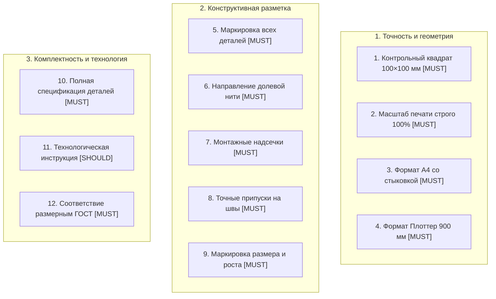

# LEKALO ZHIIDE — ТЕХНИЧЕСКИЙ СТАНДАРТ КАЧЕСТВА PDF-ВЫКРОЕК (PDF QUALITY STANDARD)
## Стандарт разработки, оформления и приёмки цифровых лекал одежды

**Проект:** LEKALO ZHIIDE (Онлайн-ателье и магазин цифровых выкроек)  
**Для кого:** Конструкторы САПР, технологи швейного производства, администраторы, Адилет  
**Версия документа:** 1.0 (Stage 5.2)  
**Дата утверждения:** 18 ноября 2026 г.  
**Статус:** ОБЯЗАТЕЛЬНЫЙ СТАНДАРТ ПЛАТФОРМЫ

---

## 1. Введение и область применения

Настоящий стандарт устанавливает единые требования к геометрической точности, графическому оформлению, информационной разметке и комплектности цифровых файлов выкроек в формате PDF, реализуемых через интернет-магазин **LEKALO ZHIIDE**.

Цифровая выкройка — это высокоточный инженерный чертёж. Ошибка даже в 2–3 мм или некорректный масштаб печати приводит к порче дорогостоящей ткани покупателя и репутационным потерям бренда.

> [!IMPORTANT]
> **Классификация требований стандарта:**
> - **[ОБЯЗАТЕЛЬНО / MUST]** — Критические требования. Без их выполнения файл отклоняется при приёмке и не допускается к публикации в каталоге.
> - **[РЕКОМЕНДАЦИЯ / SHOULD]** — Отраслевые стандарты качества, повышающие лояльность покупателей и удобство раскроя.

---

## 2. 12 ключевых пунктов стандарта качества лекал

---

### Пункт 1. Контрольный проверочный квадрат 100×100 мм [ОБЯЗАТЕЛЬНО]
1. На первой странице каждого документа А4 и в начале рулона Плоттера **в обязательном порядке** размещается контрольный тестовый квадрат.
2. Эталонный размер квадрата: строго **100×100 мм** (допускается дублирующий малый квадрат **50×50 мм**).
3. Допустимая погрешность при печати: **не более ±1.0 мм**.
4. Внутри квадрата размещается читаемый текст:  
   *«Контрольный квадрат 100 × 100 мм. Измерьте линейкой после печати первого листа. Если размер не совпадает, проверьте масштаб печати (должен быть 100% / Без масштабирования)»*.

---

### Пункт 2. Правильный масштаб печати 100% [ОБЯЗАТЕЛЬНО]
1. Файл экспортируется из САПР в физическом масштабе **1:1 (100%)**.
2. В свойствах PDF-документа запрещено задавать принудительную подгонку по полям принтера (*Fit to page*, *Shrink to printable area*).
3. Все векторные контуры должны сохранять истинные геометрические размеры при открытии в любой программе (Adobe Acrobat Reader, Google Chrome, Apple Preview, Foxit).

---

### Пункт 3. Формат А4: корректная разбивка и метки склейки [ОБЯЗАТЕЛЬНО]
1. **Размер печатного листа:** Строго **210 × 297 мм (А4)**.
2. **Непечатные поля:** По периметру каждого листа А4 предусмотрена технологическая рамка с отступом не менее **10 мм** от края листа (для учета физических «мертвых зон» бытовых струйных и лазерных принтеров).
3. **Координатная сетка совмещения:**
   - Каждый лист имеет буквенно-цифровое обозначение ряда и колонки (например: `Ряд 1 - Лист А`, `Ряд 1 - Лист B` или `1-1`, `1-2`...).
   - По углам рамки нанесены метки совмещения (перекрестия, круги с крестом или уголки).
   - Линии нахлёста снабжены пиктограммой ножниц и надписью: *«Отрезать по линии и наложить на следующий лист»*.
4. **Общая схема сборки:** На первом листе файла размещается уменьшенная карта раскладки всех страниц документа (схема склейки).

---

### Пункт 4. Формат Plotter: ширина рулона до 900 мм [ОБЯЗАТЕЛЬНО]
1. **Ширина листа:** Строго **не более 900 мм** (рекомендуемая рабочая ширина — **840–880 мм** под стандартный рулон бумаги 900–914 мм / 36 дюймов).
2. **Длина листа:** Единое непрерывное полотно необходимой длины без деления на страницы.
3. **Технологические отступы:** Отступ от боковых краев рулона — не менее **15 мм** (зона прижимных роликов плоттера).
4. **Компактность раскладки:** Детали уложены с минимальным межлекальным расстоянием (не менее 5 мм) с соблюдением направления долевой нити.

---

### Пункт 5. Нумерация и маркировка деталей [ОБЯЗАТЕЛЬНО]
Каждая деталь выкройки на чертеже снабжается информационным блоком (штампом), включающим:
1. Наименование бренда: `LEKALO ZHIIDE`.
2. Название модели (например: *Пальто оверсайз «Чолпон»*).
3. Артикул модели (например: `palto-oversayz-cholpon`).
4. Номер размера и рост (например: *Размер 44, Рост 164–170 см*).
5. Наименование детали (например: *Полочка*, *Спинка*, *Верхняя половинка рукава*, *Подборт*, *Листочка кармана*).
6. Количество деталей для кроя:
   - Из основной ткани (например: *«2 дет. из основной ткани»*).
   - Из подкладочной ткани (например: *«2 дет. из подкладки»*).
   - Из дублерина / флизелина (например: *«2 дет. из клеевой»*).

---

### Пункт 6. Обозначение долевой нити [ОБЯЗАТЕЛЬНО]
1. На каждой детали кроя нанесена сплошная линия со стрелками на обоих концах и надписью **«Долевая нить»** (или **«Нить основы»**).
2. Длина линии долевой нити должна составлять не менее 60% длины всей детали (для точной ориентации по кромке ткани).
3. Для симметричных деталей, кроящихся со сгибом, линия сгиба обозначается тройной точкой/стрелкой и надписью **«Сгиб ткани»**.

---

### Пункт 7. Надсечки и контрольные метки [ОБЯЗАТЕЛЬНО]
1. Все сопрягаемые срезы снабжаются монтажными надсечками глубиной **4–5 мм**:
   - Совмещение боковых и плечевых швов.
   - Центр оката рукава и плечевой шов.
   - Передний и локтевой перекат рукава с проймой полочки и спинки.
   - Линии талии, бёдер и коленей.
   - Местоположение вытачек, складок, защипов и карманов.
2. Разметка карманов и петель нанесена пунктиром с указанием крайних точек крестиками.

---

### Пункт 8. Припуски на швы и их точное указание [ОБЯЗАТЕЛЬНО]
1. **Тип контуров на лекалах:**
   - Внутренний контур (тонкая линия) — **чистая линия шва / линия стачивания**.
   - Внешний контур (жирная линия) — **линия среза с учетом припусков**.
2. **Маркировка величины припусков:** В штампе каждой детали или в спецификации указана точная ширина припусков:
   - Соединительные швы: **1.0 см** (для трикотажа — 0.7 см под 4-ниточный оверлок).
   - Горловина и пройма: **1.0 см**.
   - Подгибка низа изделия: **3.0–4.0 см**.
   - Подгибка низа рукава: **3.0–4.0 см**.
   - Шлицы и разрезы: **3.0–4.0 см**.

---

### Пункт 9. Размерные линии и маркировка роста [ОБЯЗАТЕЛЬНО]
1. Выкройка экспортируется строго под один конкретный размер и диапазон роста.
2. В углах каждого листа и на титульной странице указаны:  
   *«Размер: 44 \| Рост: 164–170 см \| Формат: А4»*.
3. Для контроля баланса на лекала наносятся горизонтальные базовые конструктивные линии: линия груди, талии, бёдер.

---

### Пункт 10. Комплектность всех деталей [ОБЯЗАТЕЛЬНО]
Файл должен содержать **100% всех необходимых элементов кроя**, включая мелкие детали:
1. Основные детали верха (спинка, полочка, рукава, воротник).
2. Детали подкладки (если изделие на подкладке).
3. Мелкие отделочные детали: подборта, обтачки горловины, листочки карманов, мешковины карманов, шлёвки, пояс, паты.
4. Отсутствие хотя бы одной мелкой детали (например, мешковины кармана) считается **браком лекала**.

---

### Пункт 11. Сопроводительная технологическая инструкция [РЕКОМЕНДАЦИЯ]
В начале файла (или в приложении) рекомендуется включать краткую технологическую памятку:
- Таблица расхода ткани при стандартной ширине 140 см.
- Перечень необходимой фурнитуры.
- Таблица типовых размерных признаков (обхват груди, талии, бёдер).
- Схема рекомендуемой раскладки лекал на ткани.
- Рекомендуемая последовательность пошива изделия.

---

### Пункт 12. Соответствие размерным типологиям [ОБЯЗАТЕЛЬНО]
1. Лекала строятся строго на основе утвержденной размерной сетки (типовые женские фигуры по ГОСТ 17522-72 / ЦНИИШП).
2. Заявленный размер выкройки должен точно соответствовать базовым меркам:
   - Размер 42: ОГ 84 см, ОТ 66 см, ОБ 92 см.
   - Размер 44: ОГ 88 см, ОТ 70 см, ОБ 96 см.
   - Размер 46: ОГ 92 см, ОТ 74 см, ОБ 100 см.
   - Размер 48: ОГ 96 см, ОТ 78 см, ОБ 104 см.
   - Размер 50: ОГ 100 см, ОТ 82 см, ОБ 108 см.
3. Конструктивные прибавки на свободу облегания должны соответствовать силуэту, заявленному в карточке (приталенный, полуприлегающий, свободный, оверсайз).

---

## 3. Таблица штрафных дефектов при приёмке

| Дефект | Степень критичности | Действие администратора |
|---|:---:|---|
| Контрольный квадрат отличается более чем на 1.5 мм | 🛑 БЛОКЕР | Возврат конструктору на переэкспорт |
| Отсутствует метка долевой нити хотя бы на 1 детали | 🛑 БЛОКЕР | Возврат конструктору на доработку |
| Нет припусков или не указана их точная ширина | 🛑 БЛОКЕР | Возврат конструктору |
| Ширина файла Плоттера превышает 900 мм | 🛑 БЛОКЕР | Возврат на перекомпоновку |
| Отсутствуют надсечки совмещения на окате и пройме | 🛑 БЛОКЕР | Возврат конструктору |
| Не хватает мелкой детали (обтачка, мешковина) | 🛑 БЛОКЕР | Возврат конструктору |
| Шрифты в PDF не переведены в кривые (искажение текста) | ⚠️ ВАЖНО | Запрос исправленного PDF |
| Не оптимизирован размер файла (весит более 30 МБ) | ⚠️ ВАЖНО | Сжатие без потери векторных линий |
