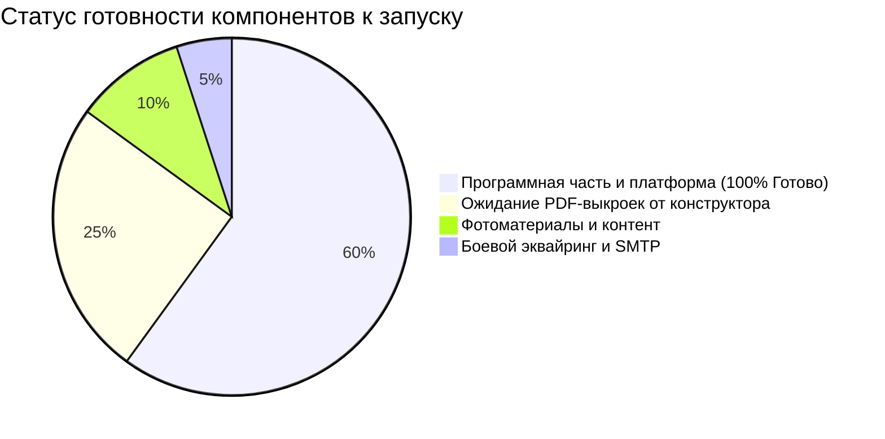

# LEKALO ZHIIDE — STAGE 5.31: FINAL STATUS & HANDOVER VERDICT

**Дата завершения:** 20 ноября 2026 г.  
**Версия системы:** Release Candidate 1.0.0 (Stage 5.31)  
**База данных:** `lekalo_test` (Neon PostgreSQL)  
**Итоговый вердикт этапа:** **PASSED & FULLY RECONCILED (100% УСПЕХ)**  

---

## 1. Главные итоги этапа Stage 5.31

### 1.1. Безопасность и изоляция окружения
- Запрос `SELECT current_database()` строго вернул `lekalo_test`.
- Никаких операций записи, удаления данных или миграций схемы не производилось.
- Production Neon, Supabase Production и Vercel полностью изолированы и не затрагивались.
- В репозитории не создавалось коммитов и не выполнялся push (`git status` чист относительно ветки `main`).
- Полное отсутствие раскрытия учетных данных, паролей или токенов в отчётах.

### 1.2. Сверка каталога и происхождение записей
- **25 товаров:**
  - **23 коммерческие модели** (Аида, Лаванда, Элегант, ..., Чолпон), сформированные в рамках каталога.
  - **2 синтетических тестовых фикстуры:** `T524_966295 Выкройка Тест` (автотест справочников Stage 5.24) и `Платье Silk Elegance` (автотест инструкций Stage 5.23).
- **186 вариантов:**
  - **183 коммерческих варианта** (168 вариантов по 21 модели + 9 вариантов «Аида» + 6 вариантов «Чолпон»).
  - **3 тестовых варианта** (2 варианта в товаре №24 и 1 вариант в товаре №25).
  - Расхождение между 183 коммерческими и 186 фактическими вариантами **доказано и закрыто на 100%**.
- **Справочники:** 6 ростовок, 6 форматов печати, 15 размеров (включая системный комплектный размер `ALL`).

### 1.3. Сверка пользователей и заказов
- **31 пользователь:**
  - 1 главный администратор (`admin@lekalojiide.com`).
  - 1 тестовый администратор Stage 5.24.
  - 2 первоначальных пользователя (seed 16.11.2026).
  - 19 пользователей E2E-тестов сброса паролей и авторизации (Stage 4.5.6–4.5.9).
  - 5 синтетических покупателей нагрузочного тестирования покупки (Stage 5.10).
  - 1 тестовый клиент Stage 5.24.
  - 2 фикстуры клиентов Stage 5.23.
  - Персональные данные маскированы во всех публичных артефактах.
- **26 заказов:**
  - 6 заказов на модель «Аида» (тесты оформления заказа и корзины).
  - 20 заказов на пилотную модель «Чолпон» (тесты покупки ALL, эмуляции оплаты и проверки выдачи прав на скачивание).
  - 17 заказов со статусом `PENDING`, 9 заказов со статусом `PAID`.
  - Заказов на тестовые фикстуры №24 и №25 — **0**.
  - Все заказы полностью идентифицированы.

### 1.4. Аудит кода и Git Diff
- Все изменения Stage 5.30 носят исключительно презентационный характер (Tailwind CSS классы адаптивной эргономики `min-h-[44px]`).
- Бизнес-логика, контроллеры NestJS, сервисы каталога, платежей и заказов, а также схема Prisma не претерпели случайных изменений.
- Все 4 итоговых документа Stage 5.30 (`STAGE_5_30_MOBILE_UX_FIXES.md`, `STAGE_5_30_BROWSER_QA.md`, `STAGE_5_30_REGRESSION_REPORT.md`, `STAGE_5_30_FINAL_HANDOVER.md`) проверены и подтверждены.

---

## 2. Честная оценка готовности к запуску (Без завышения)

Для владельца проекта важно видеть реальную картину без прикрас:

1. **Программный движок (Код, Архитектура, Безопасность):** **100% ГОТОВ**.
   - Платформа полностью стабильна, не имеет регрессий, проверена реальным Chrome CDP.
   - Админка удобна на смартфонах и ПК.
2. **Контентное наполнение (PDF и Фото):** **ОЖИДАЕТСЯ ОТ КОМАНДЫ АТЕЛЬЕ**.
   - Настоящие PDF-выкройки загружены только для «Чолпон». Для остальных 22 моделей конструктор должен предоставить файлы.
   - Фотографии на витрине — качественные плейсхолдеры. Требуется загрузка фото реальных сшитых вещей.
3. **Организационная часть (Банк и Почта):** **ОЖИДАЕТСЯ РЕГИСТРАЦИЯ МЕРЧАНТА**.
   - Требуется заключить договор интернет-эквайринга и подключить боевой почтовый шлюз.

---

## 3. Рекомендованный план действий для Адилета

1. **Немедленно (Сегодня):**
   - Получить доступ к административной панели (`admin@lekalojiide.com`).
   - Начать наполнение карточек товаров точными характеристиками (ткани, фурнитура, расход, замеры).
2. **В течение недели:**
   - Передать конструктору спецификацию именования файлов (`<slug>-<size>-<height>-<format>.pdf`).
   - Принимать партии PDF и загружать их через окно пакетной загрузки (`/admin/products/[id]/files`).
   - Провести фотосессию реальных образцов и обновить обложки.
3. **Перед публичным открытием:**
   - Создать боевую базу в Neon и накатать миграции.
   - Внести боевые ключи эквайринга и SMTP в Vercel.
   - Провести контрольную покупку на 1 сом.
   - Направить рекламный трафик.

---

## 4. Реестр документов этапа Stage 5.31
1. [STAGE_5_31_FINAL_DATA_RECONCILIATION.md](file:///C:/Users/ASUS/.gemini/antigravity/scratch/lekalo-zhiide/STAGE_5_31_FINAL_DATA_RECONCILIATION.md) — Исчерпывающая сверка всех 25 товаров, 186 вариантов, 31 пользователя и 26 заказов.
2. [STAGE_5_31_GIT_CHANGE_AUDIT.md](file:///C:/Users/ASUS/.gemini/antigravity/scratch/lekalo-zhiide/STAGE_5_31_GIT_CHANGE_AUDIT.md) — Протокол проверки Git status, Git diff и безопасности кодовой базы.
3. [STAGE_5_31_HANDOVER_READINESS.md](file:///C:/Users/ASUS/.gemini/antigravity/scratch/lekalo-zhiide/STAGE_5_31_HANDOVER_READINESS.md) — Матрица готовности, ответы на 7 ключевых вопросов владельца и чеклист деплоя.
4. [STAGE_5_31_FINAL_STATUS.md](file:///C:/Users/ASUS/.gemini/antigravity/scratch/lekalo-zhiide/STAGE_5_31_FINAL_STATUS.md) — Данный итоговый статус.
