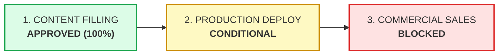

# LEKALO ZHIIDE — STAGE 5.32: FINAL HANDOVER DECISION & TRIPLE-STATUS VERDICT

**Дата вынесения решения:** 20 ноября 2026 г.  
**Владелец проекта:** Адилет  
**Проект:** LEKALO ZHIIDE (Интернет-магазин и ателье выкроек)  
**Итоговый вердикт о передаче панели управления:** **ОДНОЗНАЧНО РАЗРЕШЕНО (APPROVED FOR HANDOVER)**  

---

## 1. Три независимых статуса готовности системы

В соответствии с требованиями аудита готовность проекта разделена на **три отдельных, независимых статуса**:

---

### СТАТУС 1: READY FOR CONTENT FILLING (Готовность к наполнению каталога)
### ВЕРДИКТ: **APPROVED (ПОДТВЕРЖДЕНО НА 100%)**

**Обоснование:**
- Программная часть административной панели полностью завершена, протестирована и верифицирована.
- Мобильная эргономика адаптирована под стандарт **WCAG 2.5.5 (все сенсорные зоны ≥ 44×44 px)** на экранах смартфонов 390×844.
- Доступны все необходимые инструменты контент-менеджера:
  1. Редактирование карточек товаров: название, slug, описания, рекомендованные ткани, фурнитура, замеры готовых изделий.
  2. Загрузка фото обложек и галереи ракурсов.
  3. Пакетная и одиночная загрузка PDF-выкроек с автоматическим сопоставлением SKU.
  4. Управление пошаговыми PDF-инструкциями по пошиву.
  5. Справочники ростовок (см) и форматов печати (A4, Плоттер 900 и др.).
  6. Управление базовыми ценами, дифференцированными ценами по форматам и акционными скидками.
- **Безопасность для покупателей:** Встроенный модуль `pattern-availability.ts` автоматически защищает витрину: ни один товар без настоящего файла выкройки не может быть куплен.

---

### СТАТУС 2: READY FOR PRODUCTION DEPLOYMENT (Готовность к развёртыванию в продакшн)
### ВЕРДИКТ: **CONDITIONAL (ГОТОВО ПРИ ВЫПОЛНЕНИИ ИНФРАСТРУКТУРНОГО РЕГЛАМЕНТА)**

**Обоснование:**
Кодовая база полностью готова к деплою (0 ошибок компиляции TypeScript, 25 скомпилированных маршрутов Next.js). Однако публичное развёртывание на продакшене возможно **только после выполнения 4 обязательных условий**:
1. **Боевая база данных Neon PostgreSQL:** создание чистой production-базы без тестовых заказов с применением схемы через `npx prisma migrate deploy`.
2. **Боевое хранилище Supabase:** создание приватного бакета `patterns` для PDF и публичного бакета `products` для фото.
3. **Реальный почтовый сервер (SMTP):** привязка боевого домена `lekalojiide.com` к SendGrid / Mailgun / Postmark для отправки писем со ссылками на скачивание.
4. **Конфигурация переменных окружения Vercel:** безопасный ввод боевых ключей без их сохранения в Git-репозитории.

---

### СТАТУС 3: READY FOR COMMERCIAL SALES (Готовность к коммерческим продажам)
### ВЕРДИКТ: **BLOCKED (ЗАБЛОКИРОВАНО ДО ВЫПОЛНЕНИЯ БЛОКЕРОВ)**

**Обоснование:**
Приём реальных платежей от населения и коммерческая продажа выкроек **категорически заблокированы** до устранения трёх внешних факторов:
1. **Блокер 1 (Контент лекал):** Конструктор предоставил реальные PDF-выкройки только для 1 пилотной модели («Пальто Чолпон»). Для остальных 22 моделей реальные PDF отсутствуют (требуется порядка 352 файлов).
2. **Блокер 2 (Банковский эквайринг):** Подключение боевого шлюза эквайринга (Stripe / PayBox / FreedomPay) не произведено, система работает через встроенный эмулятор (`mock`).
3. **Блокер 3 (Реальные фотоматериалы):** На витрине отображаются временные демонстрационные фото. Необходима загрузка реальных фотографий отшитых изделий.

---

## 2. Однозначный ответ владельцу: Можно ли передавать админку Адилету?

### **ОДНОЗНАЧНЫЙ ВЫВОД: ДА, АДМИНИСТРАТИВНУЮ ПАНЕЛЬ МОЖНО И НУЖНО ПЕРЕДАВАТЬ АДИЛЕТУ ПРЯМО СЕЙЧАС.**

Передача админки Адилету на текущем этапе является **наиболее эффективным и безопасным решением**:
1. **Никакого риска финансовых потерь:** В базе нет реальных денег, все 26 тестовых заказов созданы mock-шлюзом и не несут обязательств.
2. **Никакого риска для покупателей:** Публичные клиенты физически не смогут оформить заказ на товары без загруженных PDF благодаря автоматическому механизму Purchase Guard.
3. **Экономия времени:** Адилет может параллельно наполнять карточки товаров описаниями, замерами и фотографиями, не дожидаясь конструктора.
4. **Удобство работы:** Адилет может работать как с ноутбука в ателье, так и со смартфона — мобильный интерфейс полностью оптимизирован под сенсорное управление (44×44 px).

---

## 3. Пошаговая инструкция для Адилета при получении доступа

1. **Шаг 1. Вход в систему:**
   - Перейти по ссылке: `http://localhost:3000/admin` (или production URL после деплоя).
   - Ввести логин: `admin@lekalojiide.com`.
   - Ввести временный пароль, переданный в защищённом сообщении.
2. **Шаг 2. Смена пароля:**
   - Перейти в профиль или использовать форму сброса пароля ([`/forgot-password`](file:///C:/Users/ASUS/.gemini/antigravity/scratch/lekalo-zhiide/frontend/src/app/forgot-password/page.tsx)) для установки личного постоянного пароля.
3. **Шаг 3. Заполнение каталога:**
   - Открыть раздел «Выкройки» ([`/admin/products`](file:///C:/Users/ASUS/.gemini/antigravity/scratch/lekalo-zhiide/frontend/src/app/admin/products/page.tsx)).
   - Поочерёдно открывать модели и вносить:
     - Описание изделия и рекомендации по стилю.
     - Список необходимых тканей и фурнитуры.
     - Точные таблицы расхода по размерам.
     - Ссылки на видео-инструкции по пошиву.
4. **Шаг 4. Загрузка выкроек от конструктора:**
   - При получении пакета PDF от конструктора открыть страницу «Файлы» нужной модели (`/admin/products/[id]/files`).
   - Перетащить файлы в зону пакетной загрузки (Bulk Upload).
   - Система автоматически проверит SKU и привяжет файлы к размерам и форматам.
   - Нажать кнопку «Цены по форматам» для назначения стоимости на A4 и Плоттер 900.

---

## 4. Реестр документов этапа Stage 5.32
1. [STAGE_5_32_ORDER_AUDIT.md](file:///C:/Users/ASUS/.gemini/antigravity/scratch/lekalo-zhiide/STAGE_5_32_ORDER_AUDIT.md) — Исчерпывающий финансовый аудит 26 заказов, доказательство 100% отсутствия финансовых обязательств.
2. [STAGE_5_32_ADILET_ACCESS_AUDIT.md](file:///C:/Users/ASUS/.gemini/antigravity/scratch/lekalo-zhiide/STAGE_5_32_ADILET_ACCESS_AUDIT.md) — Аудит безопасности доступа, ролевой модели RBAC и механизма Purchase Guard.
3. [STAGE_5_32_FINAL_HANDOVER_DECISION.md](file:///C:/Users/ASUS/.gemini/antigravity/scratch/lekalo-zhiide/STAGE_5_32_FINAL_HANDOVER_DECISION.md) — Данный документ окончательного решения и тройного статуса готовности.
