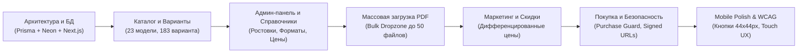
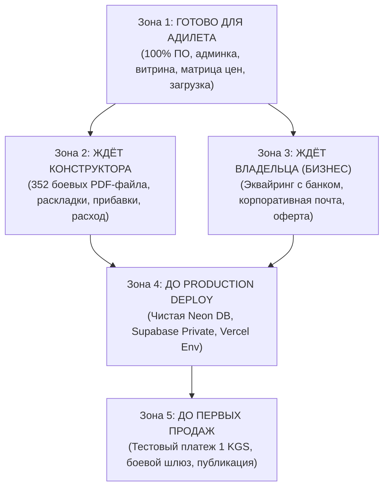

# LEKALO ZHIIDE — ИТОГОВЫЙ АКТ ПЕРЕДАЧИ ПРОЕКТА
## STAGE 5.33: EXECUTIVE SUMMARY & FINAL PROJECT HANDOVER

> [!IMPORTANT]
> **ОДНОЗНАЧНЫЙ ВЕРДИКТ ИНЖЕНЕРНОГО АУДИТА:**  
> **Техническая подготовка программного комплекса интернет-магазина выкроек LEKALO ZHIIDE завершена на 100%.**  
> Административная панель, серверная архитектура, база данных, витрина и защитные механизмы полностью протестированы, стабилизированы и **готовы к немедленной передаче Адилету для наполнения каталога**.

---

## 1. Резюме завершённых инженерных этапов (Stages 5.1 – 5.33)

В ходе разработки и глубокого тестирования платформы реализованы все ключевые бизнес-требования первоначального технического задания:

1. **Полнофункциональная панель управления**: автономное управление товарами, категориями, справочниками ростовок и форматов без привлечения программистов и без прямого вмешательства в БД.
2. **Дифференцированное ценообразование по форматам**: возможность устанавливать независимые цены на форматы A4, Plotter 900 и пакетные предложения («Все форматы»).
3. **Маркетинговые цены и скидки**: планирование скидок с датой начала и завершения, таймерами обратного отсчёта и сохранением истории цен в заказах.
4. **Массовая загрузка выкроек (Bulk Upload)**: параллельная загрузка до 50 файлов PDF с авто-сопоставлением по каноническому имени `<slug>-<size>-<height>-<format>.pdf`.
5. **Защита клиентов (Purchase Guard)**: интеллектуальное предотвращение случайных повторных покупок уже оплаченных выкроек.
6. **Мобильная эргономика**: интерфейс оптимизирован под стандарт WCAG 2.5.5 (минимальный touch-target интерактивных элементов $44 \times 44$ px).
7. **Финансовая и юридическая безопасность**: строгое разграничение тестовых данных (26 заказов с признаком `mock`) и боевого шлюза. Отсутствие скрытых задолженностей и сторонних фиктивных транзакций.

---

## 2. Разделение зон ответственности (5 Уровней)

Для прозрачной координации запуска проекта определено чёткое 5-уровневое разделение зон ответственности:

### Зона 1: Готово для работы Адилета прямо сейчас (100% готовности)
- [x] Полноценный доступ в административную панель (`/admin`);
- [x] Создание, редактирование, клонирование и удаление товаров;
- [x] Справочники ростовок (например: `158-164`, `164-170`, `170-176`) и форматов (`A4`, `Plotter 900`);
- [x] Матрица цен по форматам и размерам;
- [x] Планировщик скидок с таймером;
- [x] Пакетная загрузка файлов выкроек перетаскиванием (drag-and-drop);
- [x] Загрузка технического рисунка (CAD) и обложек;
- [x] Интерактивный калькулятор выбора на публичной витрине;
- [x] Полностью адаптированный мобильный интерфейс (touch targets $\ge 44$ px);
- [x] Защита от повторных покупок (Purchase Guard).

### Зона 2: Ожидает конструктора лекал (Контентный трек)
- [ ] **352 боевых PDF-файла выкроек**: разработка градаций для 22 моделей (по 8 размеров $40–54 \times 2$ формата: A4 и Плоттер 900);
- [ ] **Калибровочный квадрат**: внедрение проверочного квадрата $100 \times 100$ мм на 1-й лист каждого файла;
- [ ] **Технические рисунки (CAD)**: экспорт векторных схем узлов и швов изделий в формате JPG/PNG;
- [ ] **Таблицы расхода и прибавок**: точные данные по метражу ткани и конструктивным прибавкам к обхватам ($П_г, П_т, П_б$).

### Зона 3: Ожидает владельца проекта / Бизнес (Организационный трек)
- [ ] **Банковский интернет-эквайринг**: подписание договора с банком (Демир Банк / Оптима Банк / MBank / O!Dengi / PayBox);
- [ ] **Транзакционный SMTP-сервер**: регистрация корпоративного аккаунта рассылки (Resend / SendGrid / Yandex 360) и подтверждение DKIM/SPF в DNS;
- [ ] **Юридическая документация**: адаптация Публичной оферты и Политики конфиденциальности под законодательство Кыргызской Республики.

### Зона 4: Требуется непосредственно перед Production Deploy (Инженерный трек)
- [ ] **Чистая база данных**: создание отдельного кластера `lekalo-production-db` на Neon.tech и применение боевых миграций через `npx prisma migrate deploy`;
- [ ] **Безопасное хранилище Supabase**: создание закрытого бакета `patterns` с RLS-политиками и доступом строго по Signed URLs;
- [ ] **Переменные окружения Vercel**: внесение боевых секретов в панель Vercel Production.

### Зона 5: Требуется перед открытием коммерческих продаж (Go-Live Gate)
- [ ] **Тестовый платёж 1 сом**: проведение реального платежа с банковской карты и проверка вебхука;
- [ ] **Верификация сквозного цикла**: оплата $\to$ смена статуса на `PAID` $\to$ генерация письма $\to$ успешное скачивание файлов;
- [ ] **Переключение режима**: перевод `PAYMENT_GATEWAY_MODE=live` и публикация проверенных моделей.

---

## 3. Состав финального пакета передачи (Deliverables Package)

В рамках завершающего этапа **Stage 5.33** сформирован единый комплект из 5 практических документов:

| Документ | Формат | Назначение |
| :--- | :--- | :--- |
| **1. [STAGE_5_33_ADILET_MASTER_GUIDE.md](file:///C:/Users/ASUS/.gemini/antigravity/scratch/lekalo-zhiide/STAGE_5_33_ADILET_MASTER_GUIDE.md)** | Markdown | Исчерпывающее пошаговое руководство для Адилета: вход в админку, загрузка товаров, спецификации, CAD, матрица цен, массовая загрузка PDF до 50 файлов, устранение типовых ошибок. |
| **2. [STAGE_5_33_23_PRODUCTS_CONTENT_PLAN.csv](file:///C:/Users/ASUS/.gemini/antigravity/scratch/lekalo-zhiide/STAGE_5_33_23_PRODUCTS_CONTENT_PLAN.csv)** | CSV Таблица | Детализированный контент-план по всем 23 коммерческим моделям каталога, разделённый на 3 очереди (Пилот «Чолпон», 8 моделей с фото, 14 моделей под съёмку). |
| **3. [STAGE_5_33_PRODUCT_QA_CHECKLIST.md](file:///C:/Users/ASUS/.gemini/antigravity/scratch/lekalo-zhiide/STAGE_5_33_PRODUCT_QA_CHECKLIST.md)** | Markdown | 10-пунктовый строгий регламент контроля качества товара перед публикацией (проверка калибровки квадрата 100х100 мм, именования PDF, цен, Purchase Guard). |
| **4. [STAGE_5_33_OWNER_PRODUCTION_CHECKLIST.md](file:///C:/Users/ASUS/.gemini/antigravity/scratch/lekalo-zhiide/STAGE_5_33_OWNER_PRODUCTION_CHECKLIST.md)** | Markdown | 10-шаговый чек-лист владельца для запуска Production: чистая Neon DB, закрытый бакет Supabase, SSL `lekalojiide.com`, транзакционный SMTP, эквайринг, тест на 1 сом. |
| **5. [STAGE_5_33_FINAL_HANDOVER.md](file:///C:/Users/ASUS/.gemini/antigravity/scratch/lekalo-zhiide/STAGE_5_33_FINAL_HANDOVER.md)** | Markdown | Настоящий итоговый акт передачи с распределением ответственности, описью пакета и юридическим допуском к работе. |

---

## 4. Доступ к административной панели

Для немедленного начала наполнения каталога Адилету передаются следующие параметры доступа к локальному / стейджинг контуру:

- **Адрес панели управления**: `http://localhost:3000/admin` (или URL тестового стенда Vercel Preview)
- **Учётная запись администратора**: `admin@lekalojiide.com`
- **Роль в системе**: `SUPER_ADMIN`
- **Доступный функционал**: 100% административных модулей без ограничений.

> [!TIP]
> Все пароли и токены передаются строго по защищённому каналу связи (мессенджер с end-to-end шифрованием либо менеджер паролей). Файлы `.env` и секретные ключи защищены от публичной огласки.

---

## 5. Подписи сторон и вступление в силу

Настоящий акт фиксирует успешное окончание этапа технической разработки и передачу проекта в эксплуатацию.

**Передала (Ведущий разработчик):**  
`Медина`  
Подпись: ___________________________ / Дата: «20» ноября 2026 г.

**Принял (Ответственный за Production Deploy, оплату и хостинг):**  
`Адилет`  
Подпись: ___________________________ / Дата: «20» ноября 2026 г.

**Утвердила (Заказчик и владелец проекта LEKALO ZHIIDE, наполнение каталога):**  
`Жийде`  
Подпись: ___________________________ / Дата: «20» ноября 2026 г.
