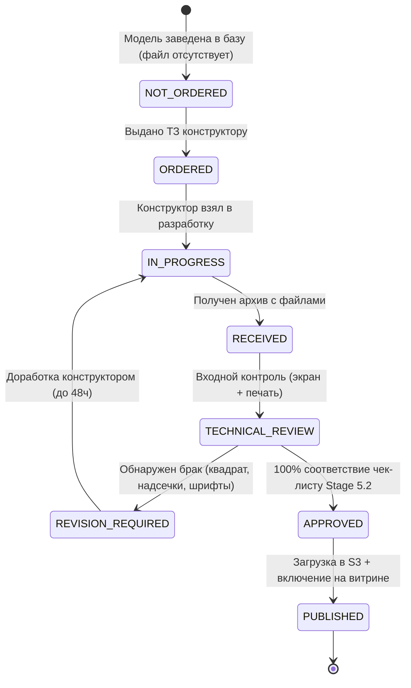
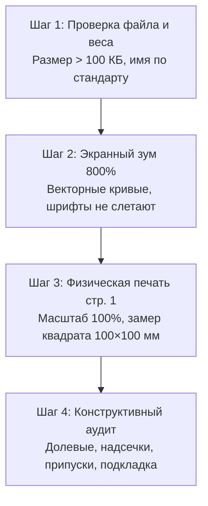

# LEKALO ZHIIDE — РЕГЛАМЕНТ РАБОТЫ АДИЛЕТА С ТРЕКЕРОМ ЛЕКАЛ (WORKFLOW)
## Практическое руководство по управлению производством и приёмкой PDF-выкроек

**Проект:** LEKALO ZHIIDE  
**Для кого:** Адилет (Владелец проекта / Администратор каталога)  
**Версия документа:** 1.0 (Stage 5.3)  
**Дата утверждения:** 19 ноября 2026 г.  
**Связанные документы:**
- [STAGE_5_3_PDF_PRODUCTION_TRACKER.csv](file:///C:/Users/ASUS/.gemini/antigravity/scratch/lekalo-zhiide/STAGE_5_3_PDF_PRODUCTION_TRACKER.csv)
- [STAGE_5_2_PDF_QUALITY_STANDARD.md](file:///C:/Users/ASUS/.gemini/antigravity/scratch/lekalo-zhiide/STAGE_5_2_PDF_QUALITY_STANDARD.md)
- [STAGE_5_2_PATTERN_ACCEPTANCE_CHECKLIST.md](file:///C:/Users/ASUS/.gemini/antigravity/scratch/lekalo-zhiide/STAGE_5_2_PATTERN_ACCEPTANCE_CHECKLIST.md)
- [STAGE_5_3_CONSTRUCTOR_DELIVERY_PROTOCOL.md](file:///C:/Users/ASUS/.gemini/antigravity/scratch/lekalo-zhiide/STAGE_5_3_CONSTRUCTOR_DELIVERY_PROTOCOL.md)

---

## 1. Жизненный цикл цифровой выкройки на платформе

Каждый из 183 вариантов выкроек проходит строгий 8-этапный жизненный цикл. Запрещено перескакивать через этапы или публиковать товар без прохождения полного цикла контроля.

### Допустимые системные статусы:
1. `NOT_ORDERED` — Выкройка еще не заказана у конструктора. В каталоге и хранилище файлов нет.
2. `ORDERED` — Сформировано и отправлено техническое задание конструктору САПР.
3. `IN_PROGRESS` — Конструктор подтвердил заказ и выполняет построение/градацию.
4. `RECEIVED` — Файлы получены от конструктора (ссылка на диск или архив) и распакованы во внутреннюю папку входящих.
5. `TECHNICAL_REVIEW` — Адилет проводит входную проверку (экранный аудит, печать тестового квадрата, проверка спецификации деталей).
6. `REVISION_REQUIRED` — Выявлен хотя бы один дефект (квадрат $\ne 100$ мм, нет надсечек, шрифты не в кривых, ширина плоттера $> 900$ мм). Файл возвращен на исправление.
7. `APPROVED` — Файл полностью прошёл все тесты по стандарту Stage 5.2. Подписан акт приёмки.
8. `PUBLISHED` — Файл физически загружен в защищенное облачное хранилище (Supabase Storage), ссылка привязана к SKU, товар активен для продажи покупателям.

---

## 2. Порядок фиксации получения файлов от конструктора

Когда конструктор передает партию файлов:
1. **Сохранить входящий архив:**
   - Поместить архив в рабочую папку: `patterns_staging/incoming/[ГГГГ-ММ-ДД]_[ИмяКонструктора]/`.
2. **Открыть реестр `STAGE_5_3_PDF_PRODUCTION_TRACKER.csv`:**
   - Найти строки соответствующих вариантов по `expected_file_name` или комбинации `product_slug` + `size` + `format`.
3. **Обновить поля в трекере:**
   - `status` $\rightarrow$ установить значение `RECEIVED` (или сразу `TECHNICAL_REVIEW`, если приёмка начинается немедленно).
   - `received_date` $\rightarrow$ указать фактическую дату получения в формате `ГГГГ-ММ-ДД` (например: `2026-11-20`).
   - `comment` $\rightarrow$ внести примечание (например: *«Получен первичный файл от конструктора Анны»*).

---

## 3. Регламент проведения проверки по стандарту Stage 5.2

Проверка проводится строго в 4 шага:

### Шаг 1. Проверка файла и размера
- Сверить имя файла с колонкой `expected_file_name`. Имя должно совпадать **буква в букву**.
- Проверить размер файла:
  - **Если размер < 100 КБ** — перед вами фиктивная текстовая заглушка (как у пальто Чолпон в тесте 79 байт). Сразу ставить `REVISION_REQUIRED`!
  - Нормальный вес качественного векторного файла А4: **1.5 – 6.0 МБ**.
  - Нормальный вес файла Плоттер 900: **0.8 – 4.0 МБ**.

### Шаг 2. Экранный аудит (Adobe Acrobat Reader / Google Chrome)
- Открыть файл и увеличить масштаб до **800%**.
- Линии должны оставаться идеально четкими и гладкими (вектор). Если контуры распадаются на пиксели — выкройка была растрирована или отсканирована. Это брак!
- Попробовать выделить текст мышкой: текст не должен выделяться стандартным системным шрифтом (все надписи должны быть преобразованы в векторные кривые `Outlines`).

### Шаг 3. Печать листа №1 на домашнем/офисном принтере (КРИТИЧНО)
- Отправить на печать **только страницу 1**.
- В настройках печати строго проверить:
  - Масштаб: **«100%»** или **«Реальный размер» (Actual Size)**.
  - Опции «Подогнать под размер листа» или «Fit to page» должны быть **ОТКЛЮЧЕНЫ**.
- Взять металлическую линейку и измерить контрольный квадрат:
  - Сторона по горизонтали: ровно **100 мм** (допустимо 99.0–101.0 мм).
  - Сторона по вертикали: ровно **100 мм** (допустимо 99.0–101.0 мм).
  - Диагональ: **141.4 мм** ($\pm 1.5$ мм).
- Если размер стороны квадрата 95 мм или 105 мм — масштаб нарушен!

### Шаг 4. Конструктивный аудит лекал
- Проверить наличие всех деталей из спецификации (полочка, спинка, рукава, воротник, подборта, мешковины карманов, подкладка, клеевые детали).
- Проверить наличие стрелок долевой нити на каждой детали.
- Проверить монтажные надсечки на сопрягаемых срезах (окат рукава к пройме, талиевые метки, боковые срезы).
- Проверить ширину плоттера: в свойствах документа PDF ширина полотна не должна превышать **900 мм**.

---

## 4. Порядок фиксации брака и возврата на доработку

Если хотя бы один пункт проверки не пройден:

1. **Немедленно зафиксировать дефект в `STAGE_5_3_PDF_PRODUCTION_TRACKER.csv`:**
   - `status` $\rightarrow$ `REVISION_REQUIRED`.
   - `technical_review_result` $\rightarrow$ `FAIL ([краткое описание дефекта])` (например: *«FAIL: Квадрат 96 мм вместо 100 мм»* или *«FAIL: Отсутствует деталь подборта»*).
   - `adilet_review_result` $\rightarrow$ `REJECTED`.
   - `sale_approval_status` $\rightarrow$ `BLOCKED`.
   - `comment` $\rightarrow$ подробное описание проблемы для конструктора.
2. **Сформировать рекламацию конструктору:**
   - Направить мотивированный отказ со скриншотом или фото замера линейкой.
   - Указать срок гарантийного устранения дефекта — **до 48 часов** (согласно разделу 6 ТЗ для конструкторов).

---

## 5. Условия присвоения статуса `APPROVED`

Статус `APPROVED` имеет право устанавливать **только Адилет** при одновременном соблюдении всех 5 условий:

| № | Обязательное условие (Gatekeeper) | Факт подтверждения |
| :-: | :--- | :--- |
| 1 | Имя файла строго соответствует стандарту Stage 5.1 | [x] Проверено |
| 2 | Физический замер тестового квадрата показал $100 \times 100$ мм ($\pm 1$ мм) | [x] Проверено линейкой |
| 3 | Шрифты переведены в векторные кривые, линии не растрированы | [x] Проверено при зуме 800% |
| 4 | Все детали из спецификации присутствуют, надсечки и долевые нанесены | [x] Проверено по чек-листу |
| 5 | Для плоттера ширина полотна $\le 900$ мм, для А4 есть схема склейки | [x] Проверено в свойствах PDF |

При соблюдении условий в трекере отмечается:
- `status` $\rightarrow$ `APPROVED`
- `technical_review_result` $\rightarrow$ `PASS`
- `adilet_review_result` $\rightarrow$ `APPROVED`
- `sale_approval_status` $\rightarrow$ `READY_FOR_UPLOAD`

---

## 6. Регламент допуска к публикации (`PUBLISHED`)

> [!CAUTION]
> **ПРАВИЛО КОМПЛЕКТНОСТИ МОДЕЛИ:**  
> Модель **НЕЛЬЗЯ** переводить в статус `PUBLISHED` на витрине частично (например, если готовы только размеры 42 и 44, а размер 46 еще в доработке, или если готов формат А4, но отсутствует Плоттер).  
> Все заявленные в карточке товара размеры и оба формата (А4 и Плоттер) должны иметь статус `APPROVED` одновременно!

### Процедура публикации модели:
1. Все файлы модели загружаются в Supabase Storage (бакет `patterns/`).
2. В административной панели интернет-магазина проверяется привязка реальных URL ко всем вариантам.
3. Администратор оформляет тестовый заказ (с тестовой ценой 0 KGS или через тестовый платеж) и скачивает каждый файл по полученной защищенной ссылке.
4. Проверяется, что скачанный покупателем файл открывается, не поврежден и совпадает с принятым мастер-файлом.
5. Карточка товара переводится в статус **Опубликовано (`isActive = true`)**.
6. В трекере `STAGE_5_3_PDF_PRODUCTION_TRACKER.csv` для всех вариантов модели статус меняется на `PUBLISHED`, а в `sale_approval_status` выставляется `LIVE`.
