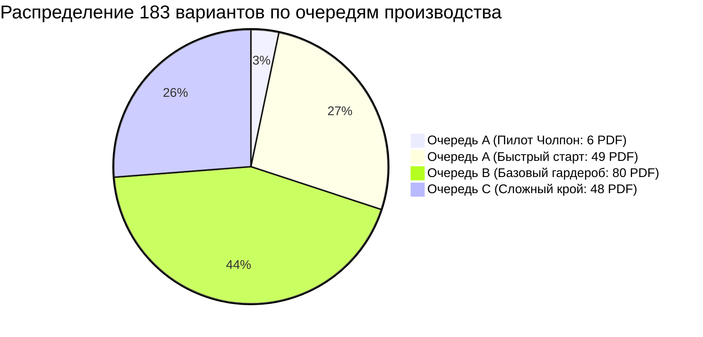

# LEKALO ZHIIDE — СВОДНЫЙ ОТЧЁТ ПРОИЗВОДСТВА ЛЕКАЛ (PRODUCTION SUMMARY)
## Итоги инвентаризации, контроль качества трекера и статус готовности каталога

**Проект:** LEKALO ZHIIDE  
**Среда аудита:** `lekalo_test` (Neon PostgreSQL 18.7)  
**Режим:** DOCUMENTATION / READ-ONLY (Strictly zero mutations)  
**Версия документа:** 1.0 (Stage 5.3)  
**Дата:** 19 ноября 2026 г.

---

## 1. Сводные метрики трекера производства

В рамках этапа Stage 5.3 сформирован единый рабочий реестр производства и приёмки лекал [STAGE_5_3_PDF_PRODUCTION_TRACKER.csv](file:///C:/Users/ASUS/.gemini/antigravity/scratch/lekalo-zhiide/STAGE_5_3_PDF_PRODUCTION_TRACKER.csv).

| Показатель | Значение | Результат контроля |
| :--- | :---: | :---: |
| **Всего карточек моделей в каталоге** | **23** | ✅ 100% совпадение с БД и Stage 5.0 |
| **Всего позиций лекал (вариантов SKU)** | **183** | ✅ 100% совпадение с БД и Stage 5.0 |
| **Количество строк данных в CSV-файле** | **183** (+1 заголовок) | ✅ Ровно 184 физические строки |
| **Дубликаты ожидаемых имён файлов** | **0** | ✅ Все 183 имени файлов уникальны |
| **Покрытие товарами и форматами** | **100%** | ✅ У каждого варианта есть ID, размер и формат |
| **Реальных готовых лекал (`APPROVED`)** | **0** | 🛑 **Блокер открытых продаж** |
| **Опубликованных настоящих лекал (`PUBLISHED`)** | **0** | 🛑 **Блокер открытых продаж** |
| **Требуют замены / исправления (`REVISION_REQUIRED`)** | **1** (0.5%) | ⚠️ Демо-заглушка 79 байт (пальто Чолпон 42 А4) |
| **Ожидают заказа конструктору (`NOT_ORDERED`)** | **182** (99.5%) | 📦 В очереди производства |

---

## 2. Распределение вариантов по производственным очередям

В соответствии с утвержденным планом наполнения каталога ([STAGE_5_0_ADILET_WORKQUEUE.md](file:///C:/Users/ASUS/.gemini/antigravity/brain/3daab444-6aee-43d6-99f4-0bf7d10f7def/STAGE_5_0_ADILET_WORK_QUEUE.md)) все 183 варианта распределены по 3 очередям:

| Очередь производства | Состав моделей | Кол-во моделей | Формула расчета | Итого PDF | Приоритет сдачи |
| :--- | :--- | :---: | :---: | :---: | :---: |
| **Queue A (Pilot)** | №23 Пальто оверсайз «Чолпон» | 1 | 3 размера $\times$ 2 формата | **6** | 🔥 **Приоритет №1** |
| **Queue A (Fast Start)** | №1 Платье «Аида» (9 PDF) №2–6 Платья «Лаванда», «Элегант», «Мира», «Солнце», «Афина» (по 8 PDF) | 6 | $9 + (5 \times 8)$ | **49** | ⚡ **Приоритет №2** |
| **Queue B (Base Wardrobe)** | №7–9 Юбки «Романтика», «Классика», «Лея» (24 PDF) №10–13 Брюки «Моника», «Базовые», «Лофт», «Сафари» (32 PDF) №14–16 Блузки «Жасмин», «Basic», «Шёлк» (24 PDF) | 10 | $3 \times 8 + 4 \times 8 + 3 \times 8$ | **80** | 📦 **Приоритет №3** |
| **Queue C (Complex Cut)** | №17–19 Жакеты/тренч «Шанель», «Минимал», «Классик» (24 PDF) №20–22 Домашняя/спорт «Комфорт», «Active», «Нежность» (24 PDF) | 6 | $3 \times 8 + 3 \times 8$ | **48** | ✂️ **Приоритет №4** |
| **ИТОГО** | **Все 23 модели каталога** | **23** | — | **183** | — |

---

## 3. Детальный статус 6 вариантов пилотной модели №23 «Пальто оверсайз Чолпон»

Пилотная модель каталога (ID: `eea36d83-a7b8-4466-a855-699b7455aeae`, slug: `palto-oversayz-cholpon`) предназначена для первой обкатки полного производственного цикла:

| № | SKU варианта | Размер | Формат | Ожидаемое каноническое имя файла | Фактическое состояние в хранилище | Статус производства | Результат проверки | Допуск к продаже |
| :-: | :--- | :---: | :---: | :--- | :--- | :---: | :---: | :---: |
| **1** | `LZ-PALTOOVE-42-164-170-A4` | 42 | A4 | `palto-oversayz-cholpon-42-164-170-A4.pdf` | Прикреплен файл `palto-cholpon-42-164-170-A4.pdf` (**79 байт**) | `REVISION_REQUIRED` | `FAIL (79b stub)` | 🛑 **BLOCKED** |
| **2** | `LZ-PALTOOVE-42-164-170-PLOTTER_900` | 42 | Plotter | `palto-oversayz-cholpon-42-164-170-PLOTTER_900.pdf` | Файл отсутствует (`fileUrl: null`) | `NOT_ORDERED` | — | 🛑 **BLOCKED** |
| **3** | `LZ-PALTOOVE-44-164-170-A4` | 44 | A4 | `palto-oversayz-cholpon-44-164-170-A4.pdf` | Файл отсутствует (`fileUrl: null`) | `NOT_ORDERED` | — | 🛑 **BLOCKED** |
| **4** | `LZ-PALTOOVE-44-164-170-PLOTTER_900` | 44 | Plotter | `palto-oversayz-cholpon-44-164-170-PLOTTER_900.pdf` | Файл отсутствует (`fileUrl: null`) | `NOT_ORDERED` | — | 🛑 **BLOCKED** |
| **5** | `LZ-PALTOOVE-46-164-170-A4` | 46 | A4 | `palto-oversayz-cholpon-46-164-170-A4.pdf` | Файл отсутствует (`fileUrl: null`) | `NOT_ORDERED` | — | 🛑 **BLOCKED** |
| **6** | `LZ-PALTOOVE-46-164-170-PLOTTER_900` | 46 | Plotter | `palto-oversayz-cholpon-46-164-170-PLOTTER_900.pdf` | Файл отсутствует (`fileUrl: null`) | `NOT_ORDERED` | — | 🛑 **BLOCKED** |

> [!IMPORTANT]
> **Вывод по товару №23:** Единственный имеющийся файл (`palto-cholpon-42-164-170-A4.pdf`) на аудите Stage 5.1 признан недействительным (текстовый суррогат размером 79 байт). Он имеет статус `REVISION_REQUIRED` и подлежит замене на полноценный векторный чертёж САПР. Остальные 5 файлов еще не заказывались конструктору (`NOT_ORDERED`).

---

## 4. Разбор расхождений между документами Stage 5.0, 5.1, 5.2 и базой данных

В соответствии с требованием регламента проведен детальный аудит непротиворечивости данных между этапами. Выявлены следующие расхождения:

### Расхождение №1: Размерные сетки в базе данных (183 SKU) vs Таблица 7 ТЗ конструктора (Stage 5.2)
- **Фактическое состояние базы (Stage 5.0):**  
  База данных содержит ровно **183 варианта**:
  - Модели 2–22 имеют по 4 размера: **42, 44, 46, 48** (по 8 файлов).
  - Модель 1 имеет 4 размера + 1 бандл ALL (9 файлов).
  - Модель 23 («Чолпон») имеет 3 размера: **42, 44, 46** (6 файлов).
- **Текст документа Stage 5.2 (Constructor Brief, Таблица 7):**  
  В таблице 7 ТЗ для конструкторов в качестве ориентира для перспективного развития фабричного ассортимента были указаны расширенные размерные ряды (например, 40–52, 14 файлов на модель).
- **Решение в Stage 5.3:**  
  В трекере [STAGE_5_3_PDF_PRODUCTION_TRACKER.csv](file:///C:/Users/ASUS/.gemini/antigravity/scratch/lekalo-zhiide/STAGE_5_3_PDF_PRODUCTION_TRACKER.csv) зафиксированы **строго фактические 183 варианта**, существующие в базе данных и подтвержденные Stage 5.0. Никаких вымышленных размеров или несуществующих вариантов не добавлено.

### Расхождение №2: Полные слаги базы данных vs Сокращенные имена файлов в примерах Stage 5.1
- **Фактическое состояние базы:**  
  Слаги товаров в базе данных являются полными составными строками:
  `palto-oversayz-cholpon`, `plate-midi-aida-s-zapakhom`, `bryuki-palatstso-monika`, `klassicheskie-pryamye-bryuki-bazovye`.
- **Примеры в тексте Stage 5.1:**  
  В тексте Stage 5.1 в качестве иллюстраций приводились сокращенные имена (`palto-cholpon-42-164-170-A4.pdf`, `plate-aida-44-164-170-A4.pdf`), а тестовый файл в хранилище был загружен именно под коротким именем `palto-cholpon-42-164-170-A4.pdf`.
- **Решение в Stage 5.3:**  
  В соответствии с формулой канонического стандарта `{slug}-{size}-{height}-{format}.pdf` в колонке `expected_file_name` использован **официальный системный slug из базы данных** (`palto-oversayz-cholpon-42-164-170-A4.pdf`). Это исключает коллизии слагов в базе данных. Для варианта пальто «Чолпон» в комментарии явно зафиксировано несоответствие старого демо-имени и нового канонического имени.

### Расхождение №3: Уникальный бандл-вариант платья «Аида» (ALL)
- Товар №1 («Платье миди «Аида» с запахом») имеет 9-й вариант с `sizeCode: ALL` и SKU `LZ-AIDA-ALL-164-170-A4`. У остальных 22 товаров бандл-варианты в базу не заведены.
- **Решение в Stage 5.3:**  
  Вариант `LZ-AIDA-ALL-164-170-A4` включен в трекер под именем `plate-midi-aida-s-zapakhom-ALL-164-170-A4.pdf` с сохранением его принадлежности к очереди Queue A.

---

## 5. Контрольный лист проверки трекера Stage 5.3

- [x] Реестр `STAGE_5_3_PDF_PRODUCTION_TRACKER.csv` создан и содержит **ровно 183 строки данных**.
- [x] Все 183 имени файлов уникальны, дубликаты отсутствуют (0 дубликатов).
- [x] Все строки содержат обязательные атрибуты (`product_id`, `product_name`, `slug`, `size`, `height`, `format`, `production_batch`, `status`).
- [x] Имена файлов строго сформированы по формуле канонического стандарта Stage 5.1.
- [x] Ни одному варианту не присвоен фиктивный статус `APPROVED` или `PUBLISHED`.
- [x] Для неизвестных дат и проверок поля оставлены строго пустыми.
- [x] Подготовлены инструкции для Адилета ([STAGE_5_3_ADILET_WORKFLOW.md](file:///C:/Users/ASUS/.gemini/antigravity/scratch/lekalo-zhiide/STAGE_5_3_ADILET_WORKFLOW.md)).
- [x] Подготовлен протокол передачи для конструкторов ([STAGE_5_3_CONSTRUCTOR_DELIVERY_PROTOCOL.md](file:///C:/Users/ASUS/.gemini/antigravity/scratch/lekalo-zhiide/STAGE_5_3_CONSTRUCTOR_DELIVERY_PROTOCOL.md)).
- [x] Документы синхронизированы в рабочей папке и реестре артефактов.
- [x] Проект и база данных не модифицировались (режим DOCUMENTATION / READ-ONLY соблюден на 100%).
