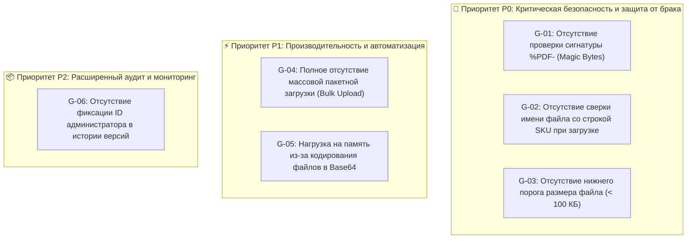
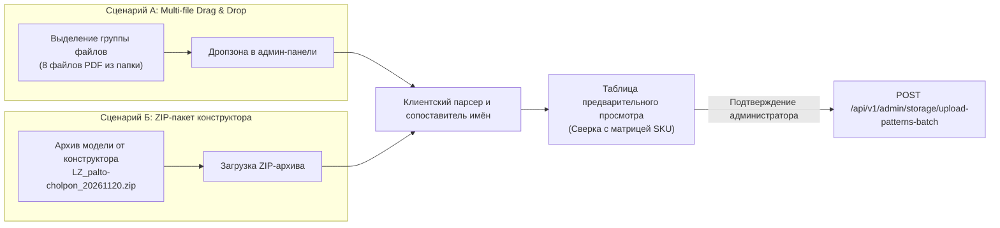
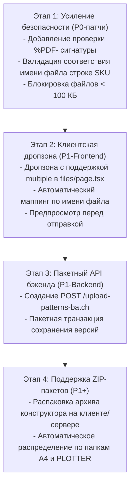

# LEKALO ZHIIDE — ПЛАН УСТРАНЕНИЯ ДЕФИЦИТОВ И ВНЕДРЕНИЯ МАССОВОЙ ЗАГРУЗКИ
## Дорожная карта технической оптимизации файловой подсистемы (Stage 5.4)

**Проект:** LEKALO ZHIIDE  
**Для кого:** Архитекторы платформы, ведущие разработчики, Адилет  
**Режим:** АНАЛИТИЧЕСКИЙ ПРОЕКТ (Без внесения изменений в код на данном этапе)  
**Версия документа:** 1.0 (Stage 5.4)  
**Дата:** 19 ноября 2026 г.

---

## 1. Реестр выявленных дефицитов и приоритизация (P0 / P1 / P2)

В ходе технического аудита кодовой базы выявлено 6 функциональных и архитектурных дефицитов, сгруппированных по степени критичности:



### Детальная спецификация дефицитов:

| ID | Приоритет | Наименование дефицита | Влияние на систему | Риск при эксплуатации | Рекомендуемое решение |
| :-: | :-: | :--- | :--- | :--- | :--- |
| **G-01** | **P0** | **Нет проверки Magic Bytes `%PDF-`** | Сервер верит заголовку `contentType` и расширению `.pdf` без проверки содержимого буфера. | **Безопасность:** возможность загрузки исполняемых скриптов, HTML с XSS или поврежденных бинарников. | Встроить проверку `fileBuffer.subarray(0, 4).toString() === "%PDF"` в контроллер перед сохранением. |
| **G-02** | **P0** | **Нет валидации соответствия имени файла варианту** | Модальное окно позволяет привязать файл с любым именем к любому SKU без предупреждения. | **Бизнес-риск:** перепутывание размеров (выкройка 48 размера по ошибке загружается покупателю 42 размера). | Проверять регулярным выражением, что имя файла совпадает с комбинацией `[slug]-[size]-[height]-[format].pdf`. |
| **G-03** | **P0** | **Нет нижнего порога размера ($< 100$ КБ)** | Сервер принимает файлы любого размера от 1 байта (как демо-заглушка 79 байт). | **Качество каталога:** случайная загрузка пустого файла или текстовой заглушки покупателю. | Блокировать сохранение файлов размером менее 100 КБ с ошибкой `FILE_TOO_SMALL_STUB`. |
| **G-04** | **P1** | **Отсутствует массовая загрузка (Bulk Upload)** | Все 183 файла требуется загружать по отдельности (183 ручные итерации). | **Операционный:** 3–4 часа монотонной работы Адилета, высокая вероятность человеческой ошибки. | Разработать компонент пакетной загрузки (Drag-and-Drop или ZIP-архив) с автосопоставлением. |
| **G-05** | **P1** | **Накладные расходы Base64** | Файлы переводятся в DataURL в браузере, увеличивая размер полезной нагрузки на 33%. | **Производительность:** повышенный расход оперативной памяти сервера при параллельной отправке файлов. | Перевести загрузку на стандартный `multipart/form-data` через `@fastify/multipart`. |
| **G-06** | **P2** | **Нет привязки администратора в `FileVersion`** | В таблице `file_versions` есть дата и чейнджлог, но нет `uploaded_by_user_id`. | **Аудит:** невозможно установить, кто именно из администраторов внес изменения или удалил файл. | Добавить поле `uploadedByUserId` в модель `FileVersion` и связать с моделью `User`. |

---

## 2. Архитектурный проект массовой загрузки (Bulk PDF Upload)

Для того чтобы Адилет мог загрузить всю размерную сетку модели (например, все 8 файлов платья или все 6 файлов пальто) в один клик, проектируется подсистема **Bulk Pattern Ingestion**.

### 2.1. Два поддерживаемых сценария пакетной загрузки:



### 2.2. Клиентский валидатор и парсер имён файлов
В интерфейсе админ-панели внедряется регулярное выражение, валидирующее имя каждого брошенного в дропзону файла:

$$\mathbf{/\text{\textasciicircum}([a-z0-9-]+)-([0-9A-Z]+)-([0-9-]+)-(A4|PLOTTER\_900)\backslash.pdf\$/i}$$

**Алгоритм сопоставления:**
1. Парсер извлекает: `slug`, `size`, `height`, `format`.
2. Сверяет `slug` с текущей открытой моделью. Если слаг чужой — выводит ошибку: *«Файл принадлежит другой модели!»*.
3. Находит в матрице товара вариант с соответствующими `size.code`, `height.code` и `format.code`.
4. Формирует интерактивную таблицу предпросмотра:
   - 🟢 **Зеленый:** Файл идеально совпал со свободным SKU. Готов к загрузке.
   - 🟡 **Желтый:** Файл совпал с SKU, у которого уже есть файл v1. Будет создана версия v2.
   - 🔴 **Красный:** Имя файла не распознано стандартом, либо размер отсутствует в матрице товара.

### 2.3. Спецификация пакетного эндпоинта Backend API

```typescript
// POST /api/v1/admin/storage/upload-patterns-batch
interface BatchUploadPatternItem {
  variantId: string;
  fileBase64: string;
  fileName: string;
  contentType: "application/pdf";
  changelog?: string;
}

interface BatchUploadPatternRequest {
  productId: string;
  files: BatchUploadPatternItem[];
}

interface BatchUploadPatternResponse {
  success: boolean;
  data: {
    totalSubmitted: number;
    totalUploaded: number;
    results: Array<{
      variantId: string;
      sku: string;
      status: "SUCCESS" | "FAILED";
      versionNumber?: number;
      error?: string;
    }>;
  };
}
```

---

## 3. Безопасная последовательность внедрения (Roadmap)

Внедрение должно происходить поэтапно, без нарушения работоспособности текущего функционала:



### Фаза 1: Усиление валидации (Не требует миграций БД)
- Внести в `StorageAdminController.uploadPattern` проверку первых 4 байт буфера (`%PDF`).
- Добавить в `UploadPatternSchema` проверку минимального размера `fileBuffer.length >= 100 * 1024`.
- В модальном окне фронтенда добавить предупреждение, если имя файла не содержит артикул выбранного варианта.

### Фаза 2: Внедрение пакетной загрузки модели
- Разработать компонент `BatchUploadDropzone.tsx`.
- Подключить пакетный эндпоинт, позволяющий за одну операцию загружать все 8 вариантов платья или 6 вариантов пальто.

### Фаза 3: Аудит и расширенное журналирование
- Добавить фиксацию автора загрузки при наличии отдельного согласования изменения схемы базы данных.
