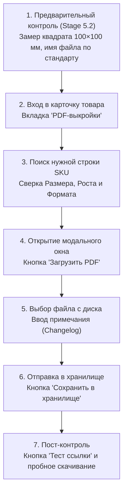

# LEKALO ZHIIDE — ИНСТРУКЦИЯ ПО ЗАГРУЗКЕ PDF-ВЫКРОЕК (UPLOAD WORKFLOW)
## Практическое руководство для Адилета по работе с файловым менеджером админ-панели

**Проект:** LEKALO ZHIIDE  
**Для кого:** Адилет (Администратор интернет-магазина)  
**Интерфейс:** Панель управления $\rightarrow$ Каталог выкроек $\rightarrow$ Файлы и варианты (`/admin/products/[id]/files`)  
**Версия документа:** 1.0 (Stage 5.4)  
**Дата:** 19 ноября 2026 г.

---

## 1. Схема процесса загрузки и контроля

---

## 2. Предварительные действия перед загрузкой (Pre-Upload Gate)

> [!IMPORTANT]
> **ПРАВИЛО НУЛЕВОГО БРАКА В ХРАНИЛИЩЕ:**  
> Никогда не загружайте файл в админ-панель сразу после получения от конструктора!  
> В хранилище должны попадать **только 100% проверенные файлы**.

Перед тем как открыть страницу загрузки, Адилет обязан:
1. Распечатать страницу №1 файла А4 со 100% масштабом и линейкой измерить тестовый квадрат ($100 \times 100$ мм $\pm 1$ мм).
2. Открыть файл на экране и увеличить до 800% (убедиться, что контуры векторные, а не размытый скан).
3. Проверить имя файла на диске: оно должно строго следовать каноническому стандарту Stage 5.1:
   `[slug]-[размер]-[рост]-[ФОРМАТ].pdf`
   *(Например: `palto-oversayz-cholpon-42-164-170-A4.pdf`)*.

---

## 3. Пошаговый процесс первичной загрузки PDF (Первая версия v1)

### Шаг 1. Переход в файловый менеджер товара
1. Авторизоваться в административной панели (`/admin/login`).
2. В боковом меню выбрать раздел **«Выкройки»** (`/admin/products`).
3. Найти нужную модель в списке (например, *Пальто оверсайз «Чолпон»*) и нажать на кнопку **«Файлы и варианты»** (или открыть ссылку вида `/admin/products/[id]/files`).

### Шаг 2. Выбор вкладки и фильтрация
1. В верхней части страницы убедиться, что активна вкладка **«PDF-выкройки»** (по умолчанию).
2. Обратить внимание на индикатор готовности комплекта:
   - Если комплект не полон, блок подсвечен янтарным цветом с надписью *«Комплект ALL не укомплектован! Часть файлов отсутствует»*.
3. Для удобства можно нажать кнопку **«Показать недостающие»** или воспользоваться фильтром форматов (`Только А4` / `Только Плоттер`).

### Шаг 3. Поиск точной строки варианта (КРИТИЧНО)
1. В таблице матрицы вариантов найти строку, точно соответствующую размеру и формату подготовленного файла:
   - Колонка **Размер** (например: `42`).
   - Колонка **Рост** (например: `164-170 см`).
   - Колонка **Формат** (например: `A4` или `PLOTTER_900`).
   - Колонка **Артикул (SKU)** (например: `LZ-PALTOOVE-42-164-170-A4`).
2. Убедиться, что в колонке **«Статус PDF в S3»** отображается плашка:
   `⚠️ Файл отсутствует`.
3. В крайней правой колонке нажать темную кнопку **«Загрузить PDF»**.

### Шаг 4. Работа в модальном окне загрузки
1. В открывшемся окне проверить заголовок:
   *«Размер [Р] • Рост [Р] см • Формат [Ф]»*.
2. Убедиться, что выбран режим **«Файл с компьютера (PDF)»**.
3. Нажать кнопку выбора файла **«Выберите файл»** и указать подготовленный PDF на диске.
4. Проверить появившуюся зеленую надпись:
   *«✓ Выбран файл: palto-oversayz-cholpon-42-164-170-A4.pdf»*.
   > [!CAUTION]
   > Внимательно сопоставьте имя выбранного файла со строкой варианта! Если вы нажимали строку размера 42, а выбрали файл 44 размера — нажмите «Отмена» и повторите выбор.
5. В поле **«Примечание к версии (Changelog)»** ввести:
   *«Первоначальный рабочий релиз лекал от конструктора»*.
6. Нажать кнопку **«Сохранить в хранилище»**.

### Шаг 5. Ожидание и подтверждение
1. Кнопка перейдет в состояние загрузки (*spinner*). Браузер выполнит кодирование файла в Base64 и передаст его на бэкенд, который сохранит его в бакет `pattern-files`.
2. После успешной загрузки появится зеленое сообщение:
   *«✓ PDF-выкройка успешно загружена в защищенное хранилище!»*.
3. Модальное окно закроется автоматически через 1.5 секунды, а таблица вариантов обновится.
4. В строке варианта появится статус:
   `✓ v1 ([Размер] КБ)` и оригинальное имя файла.

---

## 4. Пошаговый процесс замены исправленного PDF (Версия v2, v3...)

Если конструктор прислал доработанную выкройку (например, исправлена посадка воротника или скорректированы надсечки):

1. Выполнить предварительный контроль качества исправленного файла по стандарту Stage 5.2.
2. Открыть `/admin/products/[id]/files`.
3. Найти строку нужного варианта (у него уже будет статус `✓ v1`).
4. Нажать кнопку **«Заменить PDF»**.
5. В модальном окне выбрать новый файл.
6. **ОБЯЗАТЕЛЬНО заполнить поле «Примечание к версии (Changelog)»**:
   - Например: *«v2: Исправлена ширина подборта и скорректированы надсечки по окату рукава»*.
7. Нажать **«Сохранить в хранилище»**.
8. Система автоматически создаст версию `v2` в базе данных, переключит активную ссылку на нее, а старую версию `v1` сохранит в истории для архива.
9. В таблице статус изменится на `✓ v2 ([Новый вес] КБ)`.

---

## 5. Обязательная пост-проверка ссылки («Тест ссылки»)

После загрузки каждого файла Адилет обязан проверить работоспособность выдачи файла:

1. В строке загруженного варианта нажать появившуюся кнопку **«Тест ссылки»**.
2. В новой вкладке браузера откроется временная подписанная ссылка (Presigned URL) из Supabase S3.
3. Проверить, что браузер начал скачивание файла.
4. Убедиться, что имя скачанного файла понятное и читаемое (система формирует имя вида `Lekalo_Zhiide_Пальто_оверсайз_Чолпон_42_164-170_A4_v1.pdf`).
5. Открыть скачанный файл и убедиться, что он не поврежден при передаче по сети.

---

## 6. Регламент действий при возникновении ошибок

| Текст или код ошибки | Причина возникновения | Действия Адилета по устранению |
| :--- | :--- | :--- |
| **«Пожалуйста, выберите файл PDF на компьютере»** | Кнопка «Сохранить» нажата без выбора файла в поле формы. | Нажать «Выберите файл», указать PDF и повторить отправку. |
| **«Разрешены только файлы формата PDF (.pdf)»** | Выбран файл другого типа (изображение, docx, zip). | Сконвертировать или запросить у конструктора файл строго в формате `.pdf`. |
| **«Размер файла не должен превышать 30 МБ» / `FILE_TOO_LARGE`** | Файл лекала весит более 30 МБ (обычно из-за растровых картинок внутри). | Вернуть файл конструктору: лекала должны быть чистым вектором и весить до 6 МБ. |
| **«Указанный вариант выкройки не найден» / `VARIANT_NOT_FOUND`** | Вариант был удален в другой вкладке или рассинхронизирован ID. | Обновить страницу клавишей F5 и повторить выбор варианта. |
| **Ошибка сети / Timeout при загрузке** | Медленный интернет или кратковременный сбой связи с Supabase. | Проверить интернет-соединение, обновить страницу и повторить отправку. Если файл не появился в строке, загрузка не была зафиксирована. |
| **«Ошибка получения ссылки: Действие отклонено»** | Истекла авторизационная сессия администратора. | Перезайти в админ-панель через страницу `/admin/login`. |
