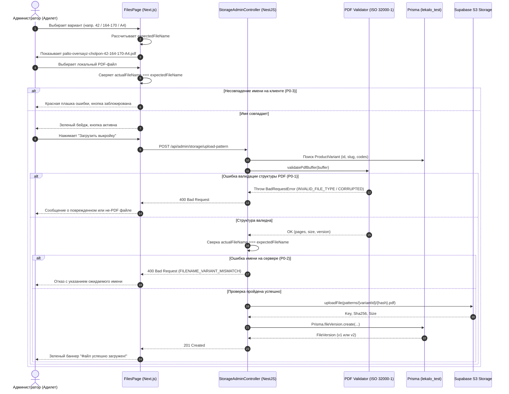

# LEKALO ZHIIDE — STAGE 5.5
## SECURE PDF UPLOAD PATCH: ОТЧЕТ О РЕАЛИЗАЦИИ И АРХИТЕКТУРЕ

**Дата выполнения:** 19 ноября 2026 г.  
**Проект:** LEKALO ZHIIDE (Интернет-магазин цифровых PDF-выкроек одежды)  
**Статус:** Внедрено, протестировано и верифицировано (16/16 тестов успешно)  
**Режим:** IMPLEMENTATION & SECURITY VERIFICATION  
**База данных:** `lekalo_test` (Neon Serverless PostgreSQL 18.7) — без мутаций данных  

---

## 1. Контекст и цели этапа

В ходе аудита Stage 5.4 были выявлены три критических дефекта безопасности (P0), делавших систему загрузки выкроек уязвимой к подмене файлов, случайным ошибкам администратора и повреждению целостности цифрового контента:
1. **Дефицит P0-1 (Backend):** Сервер принимал любые типы файлов (HTML, ZIP, TXT, фиктивные заглушки 79 байт), полагаясь исключительно на расширение `.pdf` и заголовок `Content-Type` от клиента.
2. **Дефицит P0-2 (Backend):** Отсутствовала проверка соответствия имени загружаемого файла выбранному варианту размера, роста и формата (например, файл 48 размера можно было привязать к варианту 42 размера).
3. **Дефицит P0-3 (Frontend):** В административном интерфейсе отсутствовали подсказка канонического имени файла и клиентская блокировка при несовпадении.

Настоящий этап **Stage 5.5** полностью устранил все три дефицита без добавления сторонних тяжелых npm-зависимостей, сохранив архитектурную чистоту и строгую типизацию проекта.

---

## 2. Сводка измененных и созданных файлов

| Файл | Тип операции | Назначение |
| :--- | :---: | :--- |
| `src/utils/pdf-validator.ts` | **Создан** | Внутренний модуль валидации бинарной структуры PDF (ISO 32000-1) без внешних npm-библиотек |
| `src/modules/storage/storage-admin.controller.ts` | **Модифицирован** | Внедрение серверной валидации структуры PDF (P0-1) и сверки канонического имени файла с вариантом (P0-2) перед записью в S3/БД |
| `frontend/src/app/admin/products/[id]/files/page.tsx` | **Модифицирован** | Отображение канонического имени в UI, сверка в реальном времени, валидация при выборе и блокировка отправки (P0-3) |
| `tests/storage-admin.test.ts` | **Расширен** | Комплексный автоматизированный тестовый набор из 16 сценариев (P0-1, P0-2, SSRF, Auth, версионирование) |

---

## 3. Детальное описание внедренных решений

### 3.1. Устранение P0-1: Валидатор бинарной структуры PDF (`pdf-validator.ts`)

Поскольку установка новых npm-пакетов была строго ограничена директивой безопасности, разработан легковесный, высокопроизводительный валидатор на базе встроенного `Buffer` Node.js, реализующий базовые требования спецификации **ISO 32000-1**:

1. **Проверка пустого файла:** Файлы размером 0 байт немедленно отклоняются с кодом ошибки `EMPTY_FILE`.
2. **Блокировка сигнатур чужеродных форматов (Foreign Magic Bytes):**
   - HTML / XML: `<!DOCTYPE`, `<html>`, `<head>`, `<?xml` -> код ошибки `INVALID_FILE_TYPE`.
   - Архивы ZIP / JAR / Office: сигнатура `PK\x03\x04` -> `INVALID_FILE_TYPE`.
   - Исполняемые файлы DOS/PE Windows: `MZ` -> `INVALID_FILE_TYPE`.
   - Исполняемые файлы Unix ELF: `\x7fELF` -> `INVALID_FILE_TYPE`.
   - Скрипты Unix: `#!` -> `INVALID_FILE_TYPE`.
3. **Проверка минимального допустимого размера:** Реальный PDF с таблицей перекрестных ссылок, каталогом и страницей не может быть меньше 120 байт. Файлы `< 120 байт` (включая демо-заглушки 79 байт) отклоняются с кодом `CORRUPTED_OR_INVALID_PDF`.
4. **Проверка заголовка `%PDF-`:** Валидатор проверяет первые 1024 байта на наличие маркера версии `%PDF-1.` или `%PDF-2.`. При отсутствии выбрасывается `INVALID_PDF_SIGNATURE`.
5. **Проверка маркера окончания `%%EOF`:** Валидатор проверяет последние 1024 байта файла. Если маркер отсутствует (признак оборванной или поврежденной передачи файла), выбрасывается `CORRUPTED_PDF_STRUCTURE`.
6. **Проверка косвенных объектов и корневого каталога:** Наличие маркеров `obj` и `/Catalog` (или `/Root`). При отсутствии выбрасывается `INVALID_PDF_CATALOG`.
7. **Проверка дерева страниц (`/Pages` и `/Type /Page`):** Валидатор парсит наличие корневого узла страниц и подсчитывает количество страниц выкройки. Если страницы не найдены, выбрасывается `INVALID_PDF_PAGE_TREE`.

### 3.2. Устранение P0-2: Серверное сопоставление имени файла и варианта (`storage-admin.controller.ts`)

В контроллере `StorageAdminController.uploadPattern` внедрен жесткий барьер безопасности перед обращением к S3-совместимому хранилищу (Supabase Storage) и Prisma ORM:

```typescript
// 1. Бинарная валидация содержимого
const validationResult = validatePdfBuffer(fileBuffer);

// 2. Проверка соответствия товара и варианта
if (dto.productId && variant.productId !== dto.productId) {
  throw new BadRequestError("VARIANT_PRODUCT_MISMATCH", ...);
}

// 3. Расчет канонического имени по формуле этапа 5.1
const cleanOriginalName = (dto.fileName || "pattern.pdf").trim();
const expectedFileName = `${variant.product.slug}-${variant.size.code}-${variant.height.code}-${variant.format.code}.pdf`;

if (cleanOriginalName !== expectedFileName) {
  throw new BadRequestError(
    "FILENAME_VARIANT_MISMATCH",
    `Имя загружаемого файла "${cleanOriginalName}" не соответствует выбранному варианту выкройки. Ожидается: "${expectedFileName}".`
  );
}
```

**Ключевой эффект безопасности (Zero-Mutation on Rejection):**  
Если имя файла не совпадает со схемой `{slug}-{size}-{height}-{format}.pdf` хотя бы в одном символе (размер, ростовка, формат, опечатка в слаге), выполнение прерывается **ДО** вызова `storageService.uploadFile` и **ДО** создания записи `fileVersion` в базе данных. В хранилище не попадает никакого мусора.

### 3.3. Устранение P0-3: Интерфейс загрузки с клиентской защитой (`files/page.tsx`)

В модальном окне загрузки PDF-файла в панели администратора (`/admin/products/[id]/files`) реализованы следующие механизмы:

1. **Карточка ожидаемого имени:** При выборе варианта из выпадающего списка система динамически генерирует и отображает блок:
   - Синяя информационная плашка: *«Ожидаемое каноническое имя файла: {slug}-{size}-{height}-{format}.pdf»*.
   - Кнопка «Скопировать имя» для удобства администратора (Адилета).
2. **Сверка в реальном времени при выборе файла:**
   - Если выбран корректный файл: отображается зеленый бейдж *«Имя файла совпадает со стандартом каталога»*.
   - Если выбран ошибочный файл: отображается красная плашка с точным указанием расхождения: *«Имя файла не совпадает! Выбран: {actual}, Ожидается: {expected}»*.
3. **Блокировка отправки формы:** Кнопка «Загрузить выкройку» становится неактивной (`disabled`), пока имя файла не будет приведено в строгое соответствие.

---

## 4. Архитектурный поток данных (Data Flow Diagram)



---

## 5. Сохранение существующего функционала версионирования

Механизм управления версиями цифровых выкроек (`DigitalFile` -> `FileVersion`) полностью сохранен:
- При первой загрузке создается `DigitalFile` и `FileVersion` с `versionNumber = 1`.
- При повторной загрузке файла для того же варианта вычисляется следующий номер (`max(versionNumber) + 1`), создается `FileVersion` с `versionNumber = 2`, а предыдущая версия `v1` сохраняется в истории аудита с датой и хешем SHA-256.
- Тест `Stage 5.5: existing versioning mechanism is preserved on repeated upload (v1 -> v2)` полностью подтвердил корректность версионирования.

---

## 6. Предложение по развитию (Future Enhancement Proposal)

Так как в рамках ограничений этапа запрещено модифицировать `package.json`, валидация геометрии страниц и контрольного квадрата (100×100 мм) выполняется регламентно через контрольные листы проверки.
Для последующего этапа рекомендуется:
1. Запланировать согласование и установку специализированной библиотеки `pdf-lib` (`npm install pdf-lib@^1.17.9`).
2. Добавить автоматическое считывание MediaBox первой страницы для верификации размера страницы A4 (595.28 × 841.89 pt) и рулонного плоттера 900 мм (2551.18 pt).
