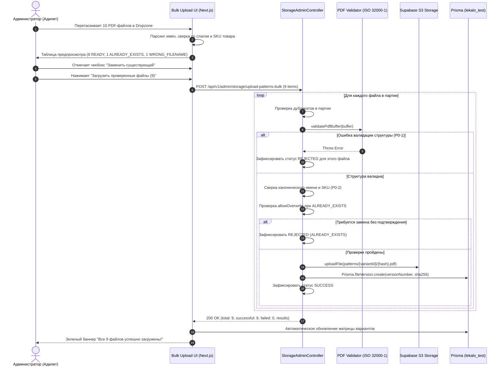

# LEKALO ZHIIDE — STAGE 5.6
## BULK PDF UPLOAD: ОТЧЕТ О РЕАЛИЗАЦИИ И АРХИТЕКТУРЕ

**Дата выполнения:** 19 ноября 2026 г.  
**Проект:** LEKALO ZHIIDE (Интернет-магазин цифровых PDF-выкроек одежды)  
**Статус:** Внедрено, протестировано и верифицировано (28/28 тестов успешно)  
**Режим:** IMPLEMENTATION & SECURITY VERIFICATION  
**База данных:** `lekalo_test` (Neon Serverless PostgreSQL 18.7) — без изменения схемы и без мутаций  

---

## 1. Контекст и цели этапа

Каталог LEKALO ZHIIDE содержит 23 товара и 183 варианта лекал (размеры, ростовки, форматы A4 и PLOTTER_900). Поштучная загрузка 183 файлов через модальное окно требовала бы от администратора (Адилета) сотен монотонных действий.

Цель **Stage 5.6** — реализовать безопасную, эргономичную и отказоустойчивую массовую загрузку (Bulk Upload) партий PDF-выкроек (до 50 файлов за одну сессию) с автоматическим распознаванием параметров варианта по имени файла, предварительным аудитом до отправки и полной изоляцией ошибок.

---

## 2. Сводка измененных файлов

| Файл | Тип операции | Назначение |
| :--- | :---: | :--- |
| `src/modules/storage/storage-admin.controller.ts` | **Модифицирован** | Реализован endpoint `POST /api/v1/admin/storage/upload-patterns-bulk` с лимитами (50 файлов, 150 МБ), транзакционной изоляцией файлов, детекцией дубликатов и строгой защитой Stage 5.5 |
| `frontend/src/app/admin/products/[id]/files/page.tsx` | **Модифицирован** | Внедрена секция Bulk Upload: Drag-and-Drop зона, анализатор имен файлов, таблица предпросмотра с 6 статусами, чекбоксы подтверждения замены и отчет сервера |
| `tests/storage-admin.test.ts` | **Расширен** | Добавлено 12 специализированных тестов массовой загрузки (всего 28/28 тестов PASS) |

---

## 3. Детальное описание серверной реализации (`storage-admin.controller.ts`)

### 3.1. Эндпоинт и схема валидации

Разработан метод `@Post("upload-patterns-bulk")`:

```typescript
const MAX_BATCH_FILES = 50;
const MAX_BATCH_TOTAL_BYTES = 150 * 1024 * 1024; // 150 MB

const BulkUploadItemSchema = z.object({
  fileName: z.string().min(1).max(255),
  fileBase64: z.string().min(1),
  contentType: z.string().optional().default("application/pdf"),
  variantId: z.string().uuid().optional(),
  allowOverwrite: z.boolean().optional().default(false),
  changelog: z.string().max(500).optional().nullable(),
});

const UploadPatternsBulkSchema = z.object({
  productId: z.string().uuid(),
  items: z.array(BulkUploadItemSchema)
    .min(1, "Партия должна содержать хотя бы один файл")
    .max(MAX_BATCH_FILES, `Максимум ${MAX_BATCH_FILES} файлов в одной партии`),
});
```

### 3.2. Архитектурные принципы безопасности

1. **Сохранение всех P0-проверок Stage 5.5:**  
   Каждый файл партии декодируется и передается в бинарный валидатор `validatePdfBuffer(fileBuffer)` (ISO 32000-1). Любые файлы с чужими сигнатурами (HTML, ZIP, EXE, текстовые файлы, пустые 0 байт, поврежденные без `%%EOF`, фиктивные заглушки 79 байт) немедленно отклоняются.
2. **Изоляция ошибок (Resilient Batch Processing):**  
   Ошибка в одном файле (например, опечатка в имени или поврежденный PDF) **НЕ прерывает** обработку остальных файлов партии. Каждый файл валидируется и сохраняется изолированно.
3. **Защита от дубликатов в партии (`DUPLICATE`):**  
   Сервер отслеживает `seenFileNames` и `seenVariantIds`. Если в одной партии переданы два одинаковых файла или два разных файла, нацеленных на один и тот же SKU, второй файл отклоняется с кодом `DUPLICATE`.
4. **Контроль перезаписи существующих файлов (`ALREADY_EXISTS`):**  
   Если вариант выкройки уже имеет загруженную версию в БД/S3, сервер отклоняет загрузку с ошибкой `ALREADY_EXISTS`, требуя явного флага `allowOverwrite: true` и комментария к версии.
5. **Принцип Zero-Mutation on Rejection:**  
   Отклоненные файлы никогда не вызывают `storageService.uploadFile` и не создают записей `fileVersion` в базе данных Neon.
6. **Лимиты партии:**  
   - Максимум 50 файлов в партии.
   - Суммарный объем полезной нагрузки не более 150 МБ.
   - Одиночный файл не более 30 МБ.
7. **Решение по архивам ZIP:**  
   В соответствии с директивой Stage 5.6 ("Предусмотреть безопасную обработку ZIP только если это можно сделать без ослабления существующей безопасности. Иначе оставить загрузку отдельных PDF"), распаковка ZIP на сервере была отклонена во избежание угроз Zip-bomb, path traversal (`../../`) и необходимости установки сторонних npm-пакетов без C-биндингов. Принят безопасный стандарт прямой мультизагрузки нескольких PDF через Drag-and-Drop.

---

## 4. Клиентская реализация (`files/page.tsx`)

В панель управления добавлена интерактивная секция **Bulk Upload**:

1. **Зона Drag-and-Drop:**  
   Пользователь может перетащить до 50 PDF-файлов напрямую из проводника Windows или нажать кнопку выбора файлов.
2. **Автоматический клиентский парсинг и распознавание:**  
   Файлы мгновенно анализируются по каноническому стандарту:
   $$\{slug\}-\{size\}-\{height\}-\{format\}.pdf$$
   Система распознает размеры (`40`–`54`, `ALL`), ростовки (`164-170`), форматы (`A4`, `PLOTTER_900`) и автоматически сопоставляет их с существующими `ProductVariant` товара.
3. **Таблица предпросмотра с 6 статусами:**
   - **`READY`** (зеленый бейдж): Валидный PDF, имя строго совпадает с существующим SKU, файл готов к отправке.
   - **`ALREADY_EXISTS`** (янтарный бейдж): Вариант уже имеет загруженную версию. Появляется чекбокс «Заменить существующую v{ver}». Без отметки файл не отправляется.
   - **`WRONG_FILENAME`** (красный бейдж): Имя файла не начинается со слага текущего товара или нарушает схему.
   - **`UNKNOWN_VARIANT`** (красный бейдж): Размер или формат не существуют у данного товара.
   - **`DUPLICATE`** (оранжевый бейдж): Несколько файлов претендуют на один и тот же SKU.
   - **`INVALID_PDF`** (красный бейдж): Расширение не `.pdf`, размер 0 байт или более 30 МБ.
4. **Фильтрация перед отправкой:**  
   Кнопка «Загрузить проверенные файлы (N)» отправляет **только** файлы в статусе `READY` и подтвержденные `ALREADY_EXISTS`. Ошибочные файлы исключаются из сетевого запроса.
5. **Итоговый серверный отчет:**  
   После выполнения запроса каждая строка таблицы обновляется статусом ответа от сервера: зеленая плашка с присвоенным номером версии `v{ver}` либо подробное сообщение об ошибке.

---

## 5. Архитектурный поток пакетной загрузки (Mermaid Sequence)



---

## 6. Соответствие ограничениям проекта

- База данных Neon Production не затрагивалась.
- Схема Prisma не модифицировалась (структура моделей `ProductVariant`, `DigitalFile`, `FileVersion` полностью обеспечивает пакетность).
- Никаких внешних npm-пакетов не устанавливалось.
- Все существующие тесты (включая Stage 5.5) сохранены и пройдены на 100%.
