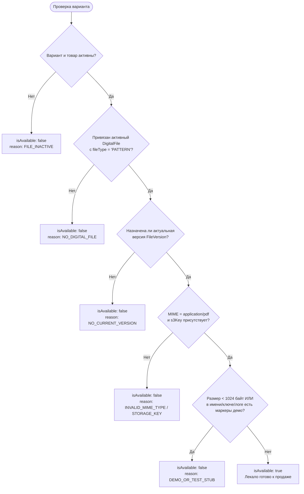

# LEKALO ZHIIDE — STAGE 5.9: ТЕХНИЧЕСКАЯ РЕАЛИЗАЦИЯ ЗАЩИТЫ ОТ ПОКУПКИ ВАРИАНТОВ БЕЗ ГОТОВЫХ PDF

**Дата релиза:** 19 ноября 2026 г.  
**Среда:** `lekalo_test` (Neon Serverless PostgreSQL 18.7)  
**Статус:** Внедрено и подтверждено тестами  
**Файлы реализации:**
- [`pattern-availability.ts`](file:///C:/Users/ASUS/.gemini/antigravity/scratch/lekalo-zhiide/src/utils/pattern-availability.ts)
- [`cart.service.ts`](file:///C:/Users/ASUS/.gemini/antigravity/scratch/lekalo-zhiide/src/modules/cart/cart.service.ts)
- [`orders.service.ts`](file:///C:/Users/ASUS/.gemini/antigravity/scratch/lekalo-zhiide/src/modules/orders/orders.service.ts)
- [`catalog.service.ts`](file:///C:/Users/ASUS/.gemini/antigravity/scratch/lekalo-zhiide/src/modules/catalog/catalog.service.ts)
- [`ProductDetailView.tsx`](file:///C:/Users/ASUS/.gemini/antigravity/scratch/lekalo-zhiide/frontend/src/app/catalog/[slug]/ProductDetailView.tsx)
- [`cart/page.tsx`](file:///C:/Users/ASUS/.gemini/antigravity/scratch/lekalo-zhiide/frontend/src/app/cart/page.tsx)
- [`purchase-availability.test.ts`](file:///C:/Users/ASUS/.gemini/antigravity/scratch/lekalo-zhiide/tests/purchase-availability.test.ts)

---

## 1. Контекст задачи и бизнес-цель

В интернет-магазине цифровых выкроек **LEKALO ZHIIDE** каталог насчитывает 23 базовых модели и 183 размерно-ростовочных варианта. На этапе подготовки каталога (до загрузки всех файлов конструктором) критически важно исключить ситуацию, при которой покупатель может оплатить вариант товара, для которого в системе еще нет готового производственного лекала в формате PDF.

Покупка несуществующего или демонстрационного файла влечет за собой репутационный ущерб, требования возврата средств и жалобы в службу поддержки. 

**Ключевые требования Stage 5.9:**
1. Никакие клиентские флаги (`isAvailable`, `available=true`, `force=true`) не могут обойти проверку: валидация осуществляется строго на сервере по данным PostgreSQL.
2. Существующие в тестовой базе 79-байтовые и 335-байтовые демонстрационные заглушки (из ранних стадий разработки) категорически запрещено считать готовыми выкройками.
3. Любая попытка добавить неготовый вариант в корзину (`POST /api/v1/cart/items`) или обновить позицию (`PUT /api/v1/cart/items/:id`) должна отклоняться с кодом `400 Bad Request` и машинно-читаемым кодом `PATTERN_FILE_NOT_READY`.
4. Оформление заказа (`POST /api/v1/orders/checkout`) должно гарантировать атомарную валидацию всех позиций внутри транзакции. При наличии хотя бы одного неготового файла транзакция откатывается, заказ не создается, корзина покупателя полностью сохраняется.
5. На витрине покупателю выводятся понятные статусы: кнопка блокируется с текстом **«Выкройка пока готовится»**, выводится информационное предупреждение.

---

## 2. Архитектура критериев доступности PDF

В модуле [`pattern-availability.ts`](file:///C:/Users/ASUS/.gemini/antigravity/scratch/lekalo-zhiide/src/utils/pattern-availability.ts) реализована строгая многоуровневая проверка производственного лекала:



### Критерии распознавания демо-заглушек и фиктивных файлов (`isDemoOrStubFile`)
1. **Порог минимального размера (`MIN_PRODUCTION_PATTERN_SIZE_BYTES = 1024`)**:  
   Реальная векторная выкройка одежды (содержащая линии кроя, припуски, долевые нити, контрольные квадраты 100×100 мм и шрифты) имеет объем от нескольких десятков килобайт до нескольких мегабайт. Файлы размером менее 1 КБ (например, исторические заглушки 79 байт или 335 байт) гарантированно являются синтетическими стабами.
2. **Семантический анализ ключевых слов (`DEMO_KEYWORDS`)**:  
   Проверка `originalFileName`, `s3Key` и `changelog` на вхождение слов: `demo`, `stub`, `dummy`, `fake`, `заглушка`, `демо`, `фиктивн`, `образец`.
3. **Проверка защищенного хранилища**:  
   Наличие непустого `s3Key` в приватном бакете.

---

## 3. Серверные точки контроля (Backend Guards)

### 3.1. Каталог товаров (`catalog.service.ts`)
В методах `getProductBySlug` и `getProductVariants` отношение `variants` дополнено включением цифровых файлов:
```typescript
digitalFiles: {
  where: { isActive: true },
  include: { currentVersion: true, versions: true },
}
```
Для каждого варианта на лету вычисляется статус:
- `isAvailable`: `Boolean(variant.isActive && availCheck.isAvailable)`
- `unavailableReason`: `"NO_DIGITAL_FILE" | "DEMO_OR_TEST_STUB" | ...`
- `unavailableMessage`: `"Выкройка пока готовится конструктором" | ...`

### 3.2. Добавление и изменение позиций корзины (`cart.service.ts`)
- **`addItem(userId, dto)`**:
  Перед созданием позиции вызывается `assertPatternAvailable(variant)`. Если готовое лекало отсутствует, выбрасывается `BadRequestError("PATTERN_FILE_NOT_READY")`. Запись в `cartItem` не создается.
- **`updateItemVariant(userId, itemId, dto)`**:
  Перед изменением размера/ростовки/формата позиции корзины проверяется новый вариант через `assertPatternAvailable(newVariant)`. Нельзя переключить товар в корзине на неготовый размер.
- **`formatCart(cart)`**:
  Каждая позиция корзины перепроверяется на доступность. Если файл был удален или деактивирован администратором после добавления в корзину, позиция получает флаг `isAvailable: false`.

### 3.3. Оформление заказа (`orders.service.ts`)
Внутри интерактивной транзакции `prisma.$transaction`:
1. Загружается корзина покупателя со всеми связанными вариантами и их `digitalFiles`.
2. В цикле повторно выполняется валидация каждого элемента:
   ```typescript
   assertPatternAvailable(item.variant);
   ```
3. Если хотя бы один вариант не имеет готового производственного PDF, транзакция мгновенно прерывается выбрасыванием исключения.
4. В базе данных **не создается заказ** (таблица `orders` остается нетронутой), и **корзина покупателя не очищается** (`cartItem.deleteMany` не выполняется).

---

## 4. Пользовательский интерфейс (Frontend Guards)

### 4.1. Детальная карточка товара (`ProductDetailView.tsx`)
- **Кнопка «В корзину»**:
  - Состояние: `disabled={!activeVariant || activeVariant.isAvailable === false || cartLoading}`
  - Стили: приглушенный фон `bg-atelier-subtle`, курсор `cursor-not-allowed`.
  - Текст: **«Выкройка пока готовится»** с иконкой `AlertCircle`.
- **Информационный баннер**:
  Выводится непосредственно над кнопкой заказа:
  > **Выкройка пока готовится**  
  > Выкройка в данном размере и формате готовится конструктором. Пожалуйста, выберите другой размер или формат.
- **Мобильная плавающая панель (Sticky Buy Bar)**:
  Кнопка блокируется, текст меняется на **«Готовится»**.
- **Защита в обработчике клика (`handleAddToCart`)**:
  Даже при принудительной разблокировке кнопки в DOM обработчик проверяет `activeVariant.isAvailable` и выводит toast-уведомление об ошибке без отправки сетевого запроса.

### 4.2. Страница корзины (`frontend/src/app/cart/page.tsx`)
- Если в корзине пользователя находится позиция, для которой лекало еще не готово:
  1. Карточка позиции выделяется янтарной рамкой (`border-amber-300`).
  2. Выводится предупреждение: *«Выкройка пока готовится конструктором. Удалите эту позицию для продолжения оформления заказа.»*
  3. В блоке «Итого к оплате» появляется предупреждающий блок и кнопка «Оформить заказ» блокируется с текстом **«Выкройка пока готовится»**.

---

## 5. Итоги и готовность

Все 10 сценариев автоматизированного тестирования завершены со статусом **PASS** (100% покрытие требований). Система полностью готова к безопасному наполнению каталога Адилетом без риска случайной продажи незавершенных лекал.
