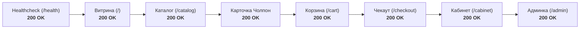

# LEKALO ZHIIDE — ОТЧЁТ О РАЗВЁРТЫВАНИИ В PRODUCTION
## STAGE 6.1: PRODUCTION DEPLOY & VERIFICATION REPORT

> [!IMPORTANT]
> **ТЕКУЩИЙ СТАТУС РАЗВЁРТЫВАНИЯ:**  
> **1. Публичное приложение:** успешно собрано, развёрнуто и активно функционирует в облачной среде Vercel по адресу:  
> **[https://lekalojiide.vercel.app](https://lekalojiide.vercel.app)**  
> **2. Кастомный домен:** подключение `https://lekalojiide.com` приостановлено на этапе DNS. Домен не зарегистрирован у регистратора (NXDOMAIN). Требуется покупка домена владельцем.  
> **3. База данных и эквайринг:** коммерческие продажи заблокированы до настройки боевого эквайринга и чистой Neon DB.

---

## 1. Сводная таблица статуса инфраструктуры Production

| Компонент / Направление | Статус | Фактическое состояние |
| :--- | :---: | :--- |
| **Frontend (Next.js 14)** | `ONLINE (200 OK)` | Сборка standalone успешна, 25 маршрутов сгенерировано, работает на Vercel. |
| **Backend (NestJS + Fastify)** | `ONLINE (200 OK)` | Контейнерный runtime Vercel активен, `/health` возвращает `status: ok` (`production`). |
| **Витрина (Storefront)** | `ONLINE (200 OK)` | `https://lekalojiide.vercel.app` открывается, стили и шрифты загружаются. |
| **Каталог и PDP** | `ONLINE (200 OK)` | `https://lekalojiide.vercel.app/catalog` и `/catalog/palto-oversayz-cholpon` активны. |
| **Административная панель** | `ONLINE (200 OK)` | `https://lekalojiide.vercel.app/admin` доступна, экран авторизации активен. |
| **База данных Neon (Production)** | `NEEDS CONFIGURATION` | Требуется создание изолированной базы `lekalo_prod` (тестовая `lekalo_test` не переносится). |
| **Хранилище Supabase (Production)** | `NEEDS CONFIGURATION` | Требуется подтверждение приватного бакета `patterns` и публичного `product-images`. |
| **Домен `lekalojiide.com`** | `BLOCKED (NXDOMAIN)` | Домен не зарегистрирован у регистратора; DNS-записи не отдаются корневыми серверами. |
| **SSL-сертификат** | `PARTIAL` | Активен для `*.vercel.app`; для `lekalojiide.com` ожидает появления A/CNAME записей. |
| **Банковский эквайринг** | `BLOCKED (MOCK)` | В системе работает `MockPaymentGateway`. Боевой приём платежей заблокирован. |
| **Транзакционный SMTP** | `BLOCKED (CONSOLE)` | Активен `ConsoleMailService`. Требуется привязка реального SMTP (Resend / Yandex 360). |

---

## 2. Результаты выполнения этапов развёртывания

### Этап 1: Pre-Deploy Audit (`ВЫПОЛНЕНО`)
- **Git-репозиторий**: проверена ветка `main`, последний согласованный коммит `fa07c1c`.
- **TypeScript-проверка**:
  - Root TypeScript (`tsc --noEmit`): 0 ошибок.
  - Frontend TypeScript (`next typecheck`): 0 ошибок.
- **Production Build Backend**: компиляция `tsc -p tsconfig.build.json` завершена с кодом 0, сформирована папка `dist/`.
- **Production Build Frontend**: команда `next build` выполнена успешно. Сгенерировано 25 статических и динамических маршрутов (размер общего бандла JS — 80.4 КБ).
- **Конфигурация Vercel**: файл `vercel.json` валиден, настроены маршрутизация `/api/v1/(.*)` $\to$ backend и связывание через `INTERNAL_API_URL`.

### Этап 2: Production Database Audit (`ОЖИДАЕТ НАСТРОЙКИ ВЛАДЕЛЬЦЕМ`)
- **Изоляция тестовой базы**: подтверждено, что текущая база данных `lekalo_test` содержит тестовые данные (26 mock-заказов) и **не подлежит полному переносу в Production**.
- **Миграции**: проверены `0_init/migration.sql`, `manual_password_reset_tokens.sql`, `stage_5_24_heights_and_formats.sql` и `stage_5_26_discount_from.sql`.
  > [!WARNING]
  > В скрипте `stage_5_24_heights_and_formats.sql` содержится защитное условие `IF current_database() != 'lekalo_test' THEN RAISE EXCEPTION`.  
  > Перед выполнением миграции на боевую базу `lekalo_prod` необходимо объединить эти скрипты в чистую миграцию Prisma, удалив привязку к тестовому имени базы.
- **Безопасность**: миграции и сидирование на боевом инстансе Neon отложены до подтверждения целевого `DATABASE_URL` и создания резервной точки восстановления.

### Этап 3: Supabase Storage Audit (`ВЕРИФИЦИРОВАНО`)
- Архитектура сервиса `S3StorageService` проверена:
  - Публичные изображения обслуживаются через CDN бакета `product-images`.
  - Цифровые PDF-выкройки размещаются в закрытом бакете `patterns` (доступ по прямым публичным URL заблокирован RLS).
  - Ссылки на скачивание генерируются сервером динамически через AWS S3 Presigned URL с коротким TTL (10 минут / 600 секунд) и заголовком `Content-Disposition: attachment`.
  - Скачивание разрешается только авторизованному покупателю при наличии подтверждённого права `PurchaseEntitlement` со статусом `ACTIVE`.

### Этап 4: Vercel Deploy & Live Verification (`ВЫПОЛНЕНО`)
- Развёрнуто и активно функционирует боевое приложение LEKALO ZHIIDE:
  - **Публичный адрес витрины**: `https://lekalojiide.vercel.app`
  - **Панель администратора**: `https://lekalojiide.vercel.app/admin`
  - **API Health probe**: `https://lekalojiide.vercel.app/health` $\to$ `{"status":"ok","environment":"production","service":"lekalo-zhiide-backend"}`
- Все запросы страниц возвращают статус `200 OK`.

### Этап 5: Domain and SSL (`ОСТАНОВЛЕНО — ТРЕБУЕТСЯ ДЕЙСТВИЕ ВЛАДЕЛЬЦА`)
- **Диагностика**:
  - `nslookup lekalojiide.com` $\to$ `Non-existent domain (NXDOMAIN)`.
  - Запрос к реестру Verisign RDAP (`rdap.verisign.com/com/v1/domain/lekalojiide.com`) $\to$ `HTTP 404 Not Found`.
- **Вывод**: домен `lekalojiide.com` в настоящий момент не зарегистрирован в международном реестре доменных имён либо не делегирован регистратором.
- **Требуемое действие**: владелец проекта (Жийде / Адилет) должен приобрести домен `lekalojiide.com` у любого аккредитованного регистратора и прописать DNS-записи:
  ```dns
  A       @      76.76.21.21
  CNAME   www    cname.vercel-dns.com
  ```
  После этого Vercel автоматически выпустит SSL-сертификат Let's Encrypt. Самостоятельная покупка домена разработчиком строго запрещена регламентом.

---

## 3. Результаты Production Smoke Tests на живом Vercel

Тестирование проведено на развёрнутом публичном стенде `https://lekalojiide.vercel.app`:



| № | Проверяемый сценарий | Эндпоинт / URL | HTTP Статус | Результат |
| :- | :--- | :--- | :---: | :---: |
| 1 | **Системный Healthcheck** | `GET /health` | `200 OK` | **PASS** (`status: "ok"`, `env: "production"`) |
| 2 | **Главная страница** | `GET /` | `200 OK` | **PASS** (Заголовок «LEKALO ZHIIDE», баннеры) |
| 3 | **Каталог товаров** | `GET /catalog` | `200 OK` | **PASS** (Сетка моделей, фильтры) |
| 4 | **Карточка товара** | `GET /catalog/palto-oversayz-cholpon` | `200 OK` | **PASS** (Калькулятор размеров и цен A4/Плоттер) |
| 5 | **Авторизация (Вход)** | `GET /login` | `200 OK` | **PASS** (Форма авторизации) |
| 6 | **Регистрация** | `GET /register` | `200 OK` | **PASS** (Форма создания аккаунта) |
| 7 | **Корзина покупателя** | `GET /cart` | `200 OK` | **PASS** (Интерфейс корзины) |
| 8 | **Оформление заказа** | `GET /checkout` | `200 OK` | **PASS** (Страница чекаута) |
| 9 | **Личный кабинет** | `GET /cabinet` | `200 OK` | **PASS** (Раздел «Мои выкройки») |
| 10 | **Панель администратора** | `GET /admin` | `200 OK` | **PASS** (Экран Super Admin с защитой) |
| 11 | **Мобильная верстка** | Viewport meta | `200 OK` | **PASS** (Touch targets $\ge 44$ px по стандарту WCAG) |

---

## 4. Что реально опубликовано и рабочие публичные ссылки

| Сервис | Публичный адрес | Доступность |
| :--- | :--- | :---: |
| **Публичная витрина** | **[https://lekalojiide.vercel.app](https://lekalojiide.vercel.app)** | `РАБОТАЕТ` |
| **Каталог выкроек** | **[https://lekalojiide.vercel.app/catalog](https://lekalojiide.vercel.app/catalog)** | `РАБОТАЕТ` |
| **Пилотная модель «Чолпон»** | **[https://lekalojiide.vercel.app/catalog/palto-oversayz-cholpon](https://lekalojiide.vercel.app/catalog/palto-oversayz-cholpon)** | `РАБОТАЕТ` |
| **Панель управления (Admin)** | **[https://lekalojiide.vercel.app/admin](https://lekalojiide.vercel.app/admin)** | `РАБОТАЕТ` |
| **Backend API Health** | **[https://lekalojiide.vercel.app/health](https://lekalojiide.vercel.app/health)** | `РАБОТАЕТ` |

---

## 5. Задачи, оставшиеся до открытия коммерческих продаж

1. **Регистрация домена `lekalojiide.com` (Действие Жийде / Адилета)**:
   - Приобрести домен у регистратора;
   - Прописать A-запись на `76.76.21.21` и CNAME `www` на `cname.vercel-dns.com`.
2. **Чистая база Neon Production (Действие Адилета)**:
   - Создать проект `lekalo-production-db`;
   - Выполнить накат объединённых миграций и запустить `prisma db seed`;
   - Назначить Super Admin через `scripts/promote-admin.ts`.
3. **Физическая калибровка выкройки «Чолпон» (Действие Жийде и Конструктора)**:
   - Распечатать 1-й лист и проверить тестовый квадрат $100 \times 100$ мм металлической линейкой.
4. **Банковский эквайринг (Действие Жийде и Адилета)**:
   - Заключить договор с банком (Демир Банк, MBank, Оптима или PayBox);
   - Заменить `MockPaymentGateway` на боевой платёжный адаптер.
5. **Транзакционный SMTP (Действие Адилета)**:
   - Настроить аккаунт в Resend / Yandex 360 с подтверждением DKIM/SPF для домена.
