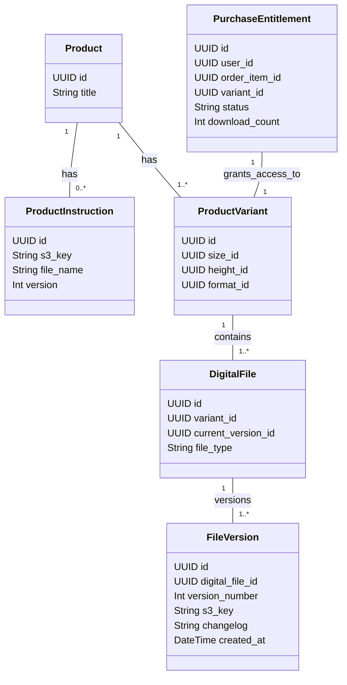

# LEKALO ZHIIDE — СИСТЕМНАЯ АРХИТЕКТУРА (ARCHITECTURE)

**Версия документа:** 1.2 (Финализирована по итогам аудита TASK-001.3)  
**Статус:** Черновик для согласования с владельцем проекта (Адилет)  
**Дата обновления:** 13 ноября 2026 г.  
**Целевой рынок:** Кыргызская Республика (Кыргызстан)  
**Базовая валюта:** KGS (кыргызский сом)  

---

## 1. Общая архитектурная схема системы

Архитектура платформы **LEKALO ZHIIDE** построена по принципу модульного сервисно-ориентированного монолита с четким разграничением публичного контура, защищенного контура API, хранилища данных и внешних интеграций.

```mermaid
flowchart TD
    subgraph Clients["Клиентский уровень (Clients)"]
        Browser["Покупатель (Desktop/Mobile Web)<br>Next.js App Router"]
        AdminBrowser["Администратор / Редактор<br>Admin Web Panel"]
    end

    subgraph Edge["Граничный уровень (Edge / Reverse Proxy)"]
        Nginx["Nginx Reverse Proxy<br>• SSL Termination (TLS 1.3)<br>• Rate Limiting<br>• Gzip / Brotli"]
    end

    subgraph AppLayer["Уровень бизнес-логики (Application Layer)"]
        subgraph Backend["NestJS Core API"]
            AuthMod["Auth & Session Module<br>(JWT, Argon2id, RBAC, SameSite=Lax)"]
            CatalogMod["Catalog & Variants Module<br>(Products, Sizes, Heights, Formats)"]
            CartMod["Cart Module<br>(Guest Session, Pricing KGS)"]
            OrderMod["Order Module<br>(Checkout, Snapshots, OrderItems)"]
            PayMod["Payment Adapter Module<br>(Gateways, Webhooks, Reconcile, Refunds)"]
            EntitleMod["Entitlements & Delivery Module<br>(Presigned URLs, DownloadLogs)"]
            AuditMod["Audit & Log Module<br>(AuditLogs, WebhookEvents)"]
        end

        subgraph Workers["Фоновые обработчики (Background Workers)"]
            BullQueue["BullMQ Worker (Redis)<br>• Email уведомления с квитанциями<br>• Cron сверки зависших платежей<br>• Очистка устаревших корзин<br>• Опциональное наложение водяных знаков"]
        end
    end

    subgraph DataLayer["Слой данных и состояния (Persistence)"]
        Postgres[(PostgreSQL 16+<br>Реляционные данные, NUMERIC 12,2, транзакции)]
        RedisCache[(Redis 7+<br>Очереди BullMQ, сессии, кэш)]
    end

    subgraph Storage["Объектное хранилище (S3 Storage)"]
        S3Public[("S3 Public Bucket<br>• Фото моделей и лукбуков<br>• Эскизы и превью<br>• CDN кэширование")]
        S3Private[("S3 Secure Private Bucket<br>• Исходные PDF выкроек<br>• Инструкции по пошиву<br>• Полный запрет Public Access")]
    end

    subgraph External["Внешние провайдеры (Кыргызстан)"]
        PaymentGateway["Платежный шлюз КР<br>(Freedom Pay KG / MBANK / DemirBank / Pay24)"]
        EmailService["Транзакционная почта<br>(Resend / SendGrid / SMTP)"]
    end

    Browser -->|HTTPS| Nginx
    AdminBrowser -->|HTTPS| Nginx

    Nginx -->|/api/*| Backend
    Nginx -->|/*| Browser

    Backend <--> Postgres
    Backend <--> RedisCache
    Workers <--> RedisCache
    Workers <--> Postgres
    Workers --> EmailService

    Backend -->|Генерация Presigned PUT/GET| S3Private
    Backend -->|Загрузка промо-фото| S3Public

    PayMod <-->|Инициализация / Polling статуса| PaymentGateway
    PaymentGateway -->|Серверный Webhook| PayMod

    Browser -.->|Прямое скачивание по Presigned URL (10 мин)| S3Private
    AdminBrowser -.->|Прямая загрузка PDF по Presigned PUT| S3Private
    Browser -->|Загрузка фото моделей через CDN| S3Public
```

---

## 2. Модульная структура бэкенда

Бэкенд организован в виде независимых предметных модулей (Domain Modules), изолированных через строгие интерфейсы и DTO:

1. **Auth & Sessions Module**:
   - Регистрация, авторизация, сброс паролей.
   - Управление сессиями устройств (`UserSessions`), ротация Refresh-токенов в `HttpOnly, SameSite=Lax` cookies.
   - Механизм Guards и Interceptors для проверки ролей (RBAC: `CUSTOMER`, `CONTENT_MANAGER`, `ADMIN`).
2. **Catalog & Attributes Module**:
   - Дерево категорий, карточки моделей (`Products`), промо-фото (`ProductImages`).
   - Справочники атрибутов: Размеры (`Sizes`), Ростовки (`Heights`), Форматы печати (`Formats`).
   - Конструктор матрицы вариантов (`ProductVariants`).
3. **Instructions & Digital Files Module**:
   - Управление общими инструкциями по пошиву модели (`ProductInstructions`).
   - Управление цифровыми файлами выкроек (`DigitalFiles`) и версиями (`FileVersions`).
   - Выдача временных ссылок на загрузку (Presigned PUT) и скачивание (Presigned GET).
4. **Cart & Pricing Module**:
   - Поддержка гостевых корзин (идентификация через `X-Guest-Token` / Cookie) и корзин авторизованных пользователей.
   - Автоматическое объединение (merge) гостевой корзины при авторизации.
   - Калькуляция сумм строго в типе `NUMERIC(12,2)` в сомах (KGS).
5. **Orders & Checkout Module**:
   - Создание заказа со статусом `PENDING`.
   - Неизменяемая фиксация слепка товара (`product_snapshot` в `OrderItems`).
   - Механика повторной попытки оплаты существующего заказа без его дублирования.
6. **Payment Module (Адаптерный слой)**:
   - Единый интерфейс взаимодействия с платежными системами (`IPaymentGateway`).
   - Протоколирование всех входящих событий в `PaymentWebhookEvents`.
   - Идемпотентная обработка событий подтверждения оплаты.
   - Обработка полных и частичных возвратов средств (`Refunds` и `RefundItems`).
   - Планировщик периодической сверки зависших платежей (Reconciliation Cron).
7. **Entitlements & Delivery Module**:
   - Учет прав доступа покупателей (`PurchaseEntitlements`).
   - Проверка легитимности запроса на скачивание, учет счетчика загрузок и аудит в `DownloadLogs`.
8. **Audit & Logging Module**:
   - Протоколирование действий персонала в `AuditLogs`.
   - Структурированное логирование (Pino) с маскированием конфиденциальных данных.

---

## 3. Детальная архитектура платежей

> [!IMPORTANT]
> **Принцип независимости от провайдера**: конкретный банк/эквайринг выбирается владельцем проекта (Адилетом). 
> Для рынка Кыргызстана актуальны следующие провайдеры интернет-эквайринга:
> - **Freedom Pay (Paybox.money)** — принимает карты Элкарт, Visa, Mastercard, кошельки, стабильный API для юрлиц КР.
> - **MBANK (ОАО «Коммерческий банк КЫРГЫЗСТАН»)** — популярный мобильный банкинг, эквайринг и MBANK QR.
> - **DemirBank / Optima Bank** — классический интернет-эквайринг для юридических лиц / ИП в Кыргызстане.
> - **О!Деньги / Megapay / Pay24** — агрегаторы электронных кошельков.
> Архитектура не зависит от конкретного протокола благодаря реализации паттерна **«Адаптер» (Payment Gateway Adapter Pattern)**.

### 3.1. Интерфейс платежного адаптера
```typescript
interface IPaymentGateway {
  // Инициализация платежа в шлюзе
  initiatePayment(order: Order, paymentAttempt: Payment): Promise<{
    paymentUrl: string;
    externalTransactionId: string;
  }>;

  // Проверка подлинности вебхука по правилам конкретного шлюза
  verifyWebhook(headers: Record<string, string>, rawBody: Buffer | string): Promise<{
    isValid: boolean;
    eventType: string;
    externalTransactionId: string;
    amount: number;
    currency: string;
    status: PaymentStatus;
  }>;

  // Активная проверка статуса через API провайдера (для сверки)
  fetchPaymentStatus(externalTransactionId: string): Promise<{
    status: PaymentStatus;
    amount: number;
    currency: string;
    paidAt?: Date;
  }>;

  // Инициализация возврата средств (полного или частичного)
  createRefund(refund: Refund, items: RefundItem[]): Promise<{
    externalRefundId: string;
    status: RefundStatus;
  }>;
}
```

### 3.2. Специфика верификации Webhook различных эквайрингов
Отказываемся от предположения, что все эквайринги используют HMAC-SHA256:
- **Freedom Pay (Paybox)**:
  - Формирует цифровую подпись (MD5 или SHA-256) строки параметров запроса, отсортированных по алфавиту и объединенных с секретным ключом торговца (`merchant_secret`).
- **Банковский эквайринг (DemirBank, Optima Bank, 3D-Secure)**:
  - Часто использует сертификаты открытого ключа (RSA/PKCS#7) или цифровую подпись ответов шлюза.
- **MBANK API / QR**:
  - Использует Bearer-токены, сигнатуры на базе HMAC или валидацию по доверенным статическим IP-адресам серверов банка.

**Архитектурное решение**: Каждый адаптер (`FreedomPayAdapter`, `MbankAdapter`, `DemirBankAdapter`) инкапсулирует собственный алгоритм валидации подписи.

### 3.3. Журнал событий вебхуков (`PaymentWebhookEvents`)
Каждый входящий HTTP-запрос от платежного сервиса немедленно сохраняется в таблицу `PaymentWebhookEvents`:
- Поля: `id`, `payment_gateway`, `event_type`, `external_id`, `headers` (JSON), `raw_payload` (JSON/Text), `status` (`RECEIVED`, `PROCESSING`, `PROCESSED`, `FAILED`, `IGNORED`), `error_message`, `retry_count`.
- Преимущества: если во время обработки произойдет сбой БД или сети, сырое событие не теряется; администратор может повторно запустить обработку любого вебхука из панели управления.

### 3.4. Идемпотентность и предотвращение повторных начислений
1. Платежный шлюз при сбоях связи может прислать один и тот же вебхук несколько раз.
2. Обработка выполняется внутри транзакции PostgreSQL с блокировкой строки платежа (`SELECT ... FOR UPDATE`):
   - Если статус платежа уже `SUCCEEDED`, повторный вебхук помечается как `IGNORED (ALREADY_PROCESSED)` и возвращается `200 OK`.
   - Если статус `PENDING`, статус переводится в `SUCCEEDED`, создаются записи `PurchaseEntitlements`, ставится задача в очередь BullMQ на отправку email.
3. В таблице `Payments` поле `external_id` (номер транзакции в банке) имеет индекс `UNIQUE`.

### 3.5. Повторные попытки оплаты (Payment Retries)
- Если у покупателя отклонена карта (недостаточно средств, сбой 3D-Secure), заказ (`Order`) **не удаляется и не дублируется**.
- Предыдущая попытка оплаты (`Payment`) переходит в статус `FAILED`.
- В заказе сохраняется ссылка на оформленный перечень товаров.
- Покупатель может нажать кнопку «Попробовать снова»: генерируется новая запись `Payment` с новым `idempotency_key`, и покупатель получает свежую ссылку на оплату.

### 3.6. Возвраты средств (Refunds) и точечный отзыв прав
- Администратор может оформить как **полный**, так и **частичный возврат средств**:
  - **Полный возврат**: возвращается вся сумма заказа; все связанные `PurchaseEntitlements` по всем позициям переходят в статус `REVOKED`; статус заказа меняется на `REFUNDED`.
  - **Частичный возврат**: администратор выбирает конкретные позиции заказа (`OrderItems`), подлежащие возврату (например, покупатель ошибся с размером одного из трех купленных платьев). Создается запись `Refunds` со строками `RefundItems`.
  - **Точечный отзыв прав**: система отзывает `PurchaseEntitlements` **строго для тех позиций, за которые возвращены деньги**. Права на остальные товары заказа остаются в статусе `ACTIVE`!
  - Статус заказа при частичном возврате меняется на `PARTIALLY_REFUNDED`.

### 3.7. Механизм сверки зависших платежей (Reconciliation)
1. **Синхронная сверка (User-triggered)**: При возврате покупателя со страницы банка на страницу `/order/success?order_id=...`, фронтенд опрашивает API. Если вебхук еще не дошел, бэкенд сам выполняет активный запрос `fetchPaymentStatus` к API банка и финализирует заказ за доли секунды.
2. **Асинхронный планировщик (Cron Reconciliation)**:
   - Фоновый воркер каждые 10 минут находит все транзакции `Payments` со статусом `PENDING`, созданные от 15 до 120 минут назад.
   - Для каждого платежа запрашивается статус через API эквайринга.
   - Если платеж успешен в банке, а вебхук потерялся — выполняется финализация заказа и выдача прав.
   - Если платеж просрочен/отменен банком — заказ переводится в статус `CANCELLED`.

---

## 4. Архитектура хранения, версионирования и выдачи PDF-файлов

### 4.1. Разделение сущностей
В системе строго разграничены следующие понятия:
1. **Товар (`Product`)**: абстрактная модель одежды (например, «Платье Zhiide Silk»).
2. **Общая инструкция (`ProductInstruction`)**: руководство по пошиву в формате PDF, единое для всей модели. Доступно бесплатно каждому, кто купил хотя бы один вариант этой модели.
3. **Вариант товара (`ProductVariant`)**: уникальная комбинация *Размер + Ростовка + Формат*.
4. **Цифровой файл (`DigitalFile`)**: логический объект файла выкройки, привязанный к варианту.
5. **Версия файла (`FileVersion`)**: физический PDF-файл в приватном бакете S3 (v1, v2, v3).
6. **Формат (`Format`)**: стандарт вывода (А4, Плоттер 900 мм, Letter).
7. **Право на скачивание (`PurchaseEntitlement`)**: юридическое право покупателя скачивать приобретенную модель/вариант.



### 4.2. Бизнес-правило версионирования PDF: «Актуальная версия по умолчанию с сохранением исторического архива»
Для исключения спорных ситуаций фиксируется следующее четкое правило:
1. **Неизменяемость заказа (Audit Trail)**:
   - В момент покупки в `OrderItem.product_snapshot` навсегда сохраняется номер версии файла и контрольная сумма SHA-256 на момент оплаты (`fileVersionAtPurchase: 1`).
2. **Выдача при обновлении (v2, v3)**:
   - Если конструктор находит неточность в выкройке и публикует версию v2 с описанием изменений (например: *«Скорректирована линия проймы»*), все ранее купившие покупатели получают доступ к исправленной версии v2 **автоматически и бесплатно**. Это исключает претензии покупателей, испортивших ткань по неисправленной выкройке.
3. **Доступ к архиву**:
   - В личном кабинете покупатель по умолчанию видит кнопку скачивания актуальной версии, но через выпадающий список «История версий» может скачать именно исходную версию v1, если изделие уже раскроено.
4. **Неизменяемость в S3**:
   - Физические файлы в S3 никогда не перезаписываются под тем же ключом. Каждый файл сохраняется с уникальным версионированным ключом: `/patterns/{variant_id}/v{version_number}_{hash}.pdf`.

### 4.3. Водяные знаки (Watermarking)
- Водяные знаки выделены в **опциональный фоновый конвейер**:
  - На этапе MVP выкройки отдаются в оригинальном виде напрямую из S3.
  - Архитектура предусматривает возможность включения фонового обработчика BullMQ при необходимости (впечатывание email покупателя мелким шрифтом на полях страниц).
  - По умолчанию параметр `FEATURE_WATERMARKING_ENABLED=false`.

---

## 5. Система безопасности

1. **Защита панели управления**:
   - Админ-панель доступна по выделенному маршруту с ограничением по IP (по согласованию).
   - Обязательная двухфакторная аутентификация (2FA / TOTP) для учетных записей `ADMIN` и `CONTENT_MANAGER`.
   - Полный аудит действий в таблице `AuditLogs` (кто, когда, какой объект изменил, IP-адрес, снимок изменений).
2. **Безопасность закрытого контура PDF**:
   - Бакет S3 полностью изолирован: прямое чтение (`s3:GetObject`) запрещено для публики.
   - Ссылка на скачивание генерируется только сервером API после валидации JWT-токена и проверки наличия активного `PurchaseEntitlement`.
   - Время жизни ссылки (TTL) — 10 минут.
   - Заголовок `Content-Disposition: attachment; filename="Lekalo_Zhiide_..."` форсирует скачивание файла на диск клиента.
3. **Защита от сканирования и слива базы (Rate Limiting)**:
   - Лимит на генерацию ссылок скачивания: не более 10 запросов в минуту от одного пользователя.
   - Фиксация каждого скачивания в `DownloadLogs` (IP-адрес, User-Agent, дата и время).
4. **Защита персональных данных (Законодательство Кыргызской Республики)**:
   - Пароли хэшируются алгоритмом **Argon2id**.
   - Соответствие требованиям **Закона КР «Об информации персонального характера» № 58 от 14.04.2008 г.**: получение явного согласия пользователя на обработку ПДн при чекауте, локализация хранения логов, маскирование телефонных номеров и email в логах сервера.
