# LEKALO ZHIIDE — СХЕМА БАЗЫ ДАННЫХ (DATABASE SCHEMA)

**Версия документа:** 1.2 (Финализирована по итогам аудита TASK-001.3)  
**Статус:** Черновик для согласования с владельцем проекта (Адилет)  
**Дата обновления:** 13 ноября 2026 г.  
**СУБД:** PostgreSQL 16+  
**Денежный стандарт:** `NUMERIC(12,2)` в сомах (KGS), 1 KGS = 100 тыйынов (float/double строго запрещены)  

---

## 1. Полная ER-диаграмма (Mermaid)

На диаграмме представлены 22 сущности системы (включая добавленную по результатам аудита таблицу `REFUND_ITEMS` для точечных частичных возвратов), их атрибуты и внешние ключи.

```mermaid
erDiagram
    USERS ||--o{ USER_SESSIONS : "has"
    USERS ||--o{ ORDERS : "places"
    USERS ||--o{ CARTS : "owns"
    USERS ||--o{ PURCHASE_ENTITLEMENTS : "holds"
    USERS ||--o{ DOWNLOAD_LOGS : "performs"
    USERS ||--o{ AUDIT_LOGS : "acts_as"

    CATEGORIES ||--o{ PRODUCTS : "contains"
    CATEGORIES ||--o{ CATEGORIES : "parent_of"

    PRODUCTS ||--o{ PRODUCT_IMAGES : "has"
    PRODUCTS ||--o{ PRODUCT_INSTRUCTIONS : "provides"
    PRODUCTS ||--o{ PRODUCT_VARIANTS : "defines"
    
    SIZES ||--o{ PRODUCT_VARIANTS : "size_of"
    HEIGHTS ||--o{ PRODUCT_VARIANTS : "height_of"
    FORMATS ||--o{ PRODUCT_VARIANTS : "format_of"

    PRODUCT_VARIANTS ||--o{ DIGITAL_FILES : "contains"
    DIGITAL_FILES ||--o{ FILE_VERSIONS : "has_versions"
    DIGITAL_FILES ||--o| FILE_VERSIONS : "current_version"

    PRODUCT_VARIANTS ||--o{ CART_ITEMS : "added_in"
    PRODUCT_VARIANTS ||--o{ ORDER_ITEMS : "ordered_in"
    PRODUCT_VARIANTS ||--o{ PURCHASE_ENTITLEMENTS : "entitles_to"

    CARTS ||--o{ CART_ITEMS : "contains"

    ORDERS ||--o{ ORDER_ITEMS : "consists_of"
    ORDERS ||--o{ PAYMENTS : "paid_by"
    ORDERS ||--o{ REFUNDS : "refunded_by"
    
    ORDER_ITEMS ||--o| PURCHASE_ENTITLEMENTS : "grants"
    ORDER_ITEMS ||--o{ REFUND_ITEMS : "refunded_in"

    PAYMENTS ||--o{ REFUNDS : "targets"
    PAYMENTS ||--o{ PAYMENT_WEBHOOK_EVENTS : "triggers"
    REFUNDS ||--o{ REFUND_ITEMS : "contains"
    
    PURCHASE_ENTITLEMENTS ||--o{ DOWNLOAD_LOGS : "tracked_by"

    USERS {
        uuid id PK
        varchar email UK
        varchar password_hash
        varchar role "CUSTOMER | CONTENT_MANAGER | ADMIN"
        varchar first_name
        varchar last_name
        varchar phone
        boolean is_email_verified
        boolean is_active
        timestamptz created_at
        timestamptz updated_at
    }

    USER_SESSIONS {
        uuid id PK
        uuid user_id FK "ON DELETE CASCADE"
        varchar refresh_token_hash UK
        varchar ip_address
        text user_agent
        boolean is_revoked
        timestamptz expires_at
        timestamptz last_active_at
        timestamptz created_at
    }

    CATEGORIES {
        uuid id PK
        uuid parent_id FK "ON DELETE SET NULL"
        varchar title
        varchar slug UK
        text description
        int display_order
        boolean is_active
        timestamptz created_at
        timestamptz updated_at
    }

    PRODUCTS {
        uuid id PK
        uuid category_id FK "ON DELETE RESTRICT"
        varchar title
        varchar slug UK
        text description
        text short_description
        numeric base_price "NUMERIC(12,2)"
        varchar difficulty_level "BEGINNER | INTERMEDIATE | ADVANCED"
        jsonb fabric_details
        boolean is_active
        timestamptz created_at
        timestamptz updated_at
    }

    PRODUCT_IMAGES {
        uuid id PK
        uuid product_id FK "ON DELETE CASCADE"
        varchar image_url
        varchar alt_text
        int display_order
        boolean is_cover
        timestamptz created_at
    }

    PRODUCT_INSTRUCTIONS {
        uuid id PK
        uuid product_id FK "ON DELETE CASCADE"
        varchar title
        varchar s3_bucket
        varchar s3_key
        varchar file_name
        bigint file_size_bytes
        varchar checksum_sha256
        int version
        boolean is_active
        timestamptz created_at
        timestamptz updated_at
    }

    SIZES {
        uuid id PK
        varchar code UK "40, 42, 44, S, M"
        varchar label
        int display_order
    }

    HEIGHTS {
        uuid id PK
        varchar code UK "158-164, 164-170"
        varchar label
        int display_order
    }

    FORMATS {
        uuid id PK
        varchar code UK "A4, PLOTTER_900, LETTER"
        varchar label
        text description
        int display_order
    }

    PRODUCT_VARIANTS {
        uuid id PK
        uuid product_id FK "ON DELETE RESTRICT"
        uuid size_id FK "ON DELETE RESTRICT"
        uuid height_id FK "ON DELETE RESTRICT"
        uuid format_id FK "ON DELETE RESTRICT"
        varchar sku UK
        numeric price_override "NUMERIC(12,2)"
        boolean is_active
        timestamptz created_at
        timestamptz updated_at
    }

    DIGITAL_FILES {
        uuid id PK
        uuid variant_id FK "ON DELETE RESTRICT"
        uuid current_version_id FK "ON DELETE RESTRICT"
        varchar file_type "PATTERN | TEST_SQUARE | LAYOUT"
        varchar title
        boolean is_active
        timestamptz created_at
        timestamptz updated_at
    }

    FILE_VERSIONS {
        uuid id PK
        uuid digital_file_id FK "ON DELETE RESTRICT"
        int version_number
        varchar s3_bucket
        varchar s3_key
        varchar original_file_name
        bigint file_size_bytes
        varchar mime_type
        varchar checksum_sha256
        text changelog
        timestamptz created_at
    }

    CARTS {
        uuid id PK
        uuid user_id FK "ON DELETE CASCADE"
        varchar guest_token UK
        timestamptz expires_at
        timestamptz created_at
        timestamptz updated_at
    }

    CART_ITEMS {
        uuid id PK
        uuid cart_id FK "ON DELETE CASCADE"
        uuid product_variant_id FK "ON DELETE CASCADE"
        timestamptz created_at
    }

    ORDERS {
        uuid id PK
        varchar order_number UK
        uuid user_id FK "ON DELETE RESTRICT"
        varchar customer_email
        varchar customer_name
        varchar customer_phone
        numeric total_amount "NUMERIC(12,2)"
        varchar currency "DEFAULT 'KGS'"
        varchar status "PENDING | PAID | PARTIALLY_REFUNDED | REFUNDED | CANCELLED"
        timestamptz created_at
        timestamptz updated_at
    }

    ORDER_ITEMS {
        uuid id PK
        uuid order_id FK "ON DELETE RESTRICT"
        uuid product_variant_id FK "ON DELETE RESTRICT"
        numeric price_at_purchase "NUMERIC(12,2)"
        jsonb product_snapshot
        timestamptz created_at
    }

    PAYMENTS {
        uuid id PK
        uuid order_id FK "ON DELETE RESTRICT"
        varchar payment_gateway "FREEDOM_PAY | MBANK | DEMIR | OTHER"
        varchar external_id UK
        varchar idempotency_key UK
        numeric amount "NUMERIC(12,2)"
        varchar currency "DEFAULT 'KGS'"
        varchar status "PENDING | SUCCEEDED | FAILED | CANCELED"
        jsonb gateway_payload
        timestamptz created_at
        timestamptz updated_at
    }

    PAYMENT_WEBHOOK_EVENTS {
        uuid id PK
        varchar payment_gateway
        varchar event_type
        varchar external_event_id
        uuid payment_id FK "ON DELETE SET NULL"
        jsonb headers
        jsonb raw_payload
        varchar status "RECEIVED | PROCESSING | PROCESSED | FAILED | IGNORED"
        text error_message
        int retry_count
        timestamptz created_at
        timestamptz processed_at
    }

    REFUNDS {
        uuid id PK
        uuid order_id FK "ON DELETE RESTRICT"
        uuid payment_id FK "ON DELETE RESTRICT"
        varchar external_refund_id UK
        numeric amount "NUMERIC(12,2)"
        varchar currency "DEFAULT 'KGS'"
        varchar status "PENDING | SUCCEEDED | FAILED"
        text reason
        uuid created_by_user_id FK "ON DELETE RESTRICT"
        timestamptz created_at
        timestamptz updated_at
    }

    REFUND_ITEMS {
        uuid id PK
        uuid refund_id FK "ON DELETE CASCADE"
        uuid order_item_id FK "ON DELETE RESTRICT"
        numeric amount "NUMERIC(12,2)"
        timestamptz created_at
    }

    PURCHASE_ENTITLEMENTS {
        uuid id PK
        uuid user_id FK "ON DELETE RESTRICT"
        uuid order_item_id FK,UK "ON DELETE RESTRICT"
        uuid variant_id FK "ON DELETE RESTRICT"
        varchar status "ACTIVE | REVOKED | EXPIRED"
        int download_count
        int max_downloads
        timestamptz expires_at
        timestamptz created_at
        timestamptz updated_at
    }

    DOWNLOAD_LOGS {
        uuid id PK
        uuid entitlement_id FK "ON DELETE RESTRICT"
        uuid user_id FK "ON DELETE RESTRICT"
        uuid file_version_id FK "ON DELETE RESTRICT"
        varchar ip_address
        varchar user_agent
        timestamptz downloaded_at
    }

    AUDIT_LOGS {
        uuid id PK
        uuid actor_id FK "ON DELETE RESTRICT"
        varchar actor_role
        varchar action "CREATE | UPDATE | DELETE | REFUND | DOWNLOAD"
        varchar entity_type
        uuid entity_id
        jsonb changes_diff
        varchar ip_address
        varchar user_agent
        timestamptz created_at
    }
```



---

## 2. Сквозная цепочка сущностей: от модели к файлу

$$\text{Product} \longrightarrow \text{ProductVariant} \longrightarrow \text{DigitalFiles} \longrightarrow \text{FileVersions}$$

### 2.1. Связь «Размер + Ростовка + Формат»
- Каждая модель (`Product`) имеет множество вариантов (`ProductVariant`).
- Вариант определяется пересечением внешних ключей: `size_id`, `height_id`, `format_id`.
- **Составной уникальный индекс**:
  ```sql
  CREATE UNIQUE INDEX idx_variants_matrix ON "ProductVariants" (product_id, size_id, height_id, format_id);
  ```
  Это исключает создание дублирующих вариантов на уровне базы данных.

### 2.2. Несколько файлов для одного варианта и связь с правами
- Каждый вариант (`ProductVariant`) содержит один или несколько файлов (`DigitalFiles`):
  - `file_type = 'PATTERN'` — основная выкройка;
  - `file_type = 'TEST_SQUARE'` — проверочный калибровочный квадрат 10×10 см;
  - `file_type = 'LAYOUT'` — схема раскладки на полотне ткани.
- **Архитектурное решение для `PurchaseEntitlements`**:
  - Право на скачивание (`PurchaseEntitlements`) создается строго **1 к 1 для каждой купленной позиции заказа (`order_item_id UK`)** и ссылается на `variant_id`.
  - Это право дает покупателю доступ ко **всем файлам**, относящимся к данному варианту (выкройка + проверочный квадрат), а также к общей инструкции модели (`ProductInstructions`).
  - При скачивании конкретного файла в `DownloadLogs` фиксируется точный идентификатор версии физического файла `file_version_id`.

### 2.3. Общие инструкции по пошиву (`ProductInstructions`)
- Инструкция по пошиву модели создается **один раз на весь товар** (`Product`) и не дублируется в каждом варианте.
- Ссылается напрямую на `product_id`. Доступна бесплатно покупателю любого варианта модели.

---

## 3. Версионирование файлов и неизменяемость истории заказов

### 3.1. Структура `FileVersions`
При загрузке исправленной или доработанной выкройки:
1. Физический файл загружается в приватный S3 бакет с новым уникальным ключом (`/patterns/{variant_id}/v2_abc123.pdf`).
2. В таблице `FileVersions` создается запись: `version_number = 2`, фиксируются размер, `checksum_sha256` и `changelog`.
3. В таблице `DigitalFiles` обновляется указатель `current_version_id = version_2_id`.

### 3.2. Поведение при обновлении файлов после покупки
- **Снимок заказа (`OrderItem.product_snapshot`)**:
  В момент покупки в заказ записывается неизменяемый JSON-снимок:
  ```json
  {
    "productId": "...",
    "productTitle": "Платье «Zhiide Silk»",
    "size": "44",
    "height": "164-170",
    "format": "A4",
    "fileVersionAtPurchase": 1,
    "fileChecksumAtPurchase": "e3b0c44298fc1c149afbf4c8996fb92427ae41e4649b934ca495991b7852b855",
    "purchasedPrice": 450.00,
    "currency": "KGS"
  }
  ```
- **Доступ покупателя в Личном Кабинете**:
  - Покупателю по умолчанию выдается ссылка на **актуальную версию** файла (`current_version_id`), чтобы исключить пошив по неисправленным лекалам.
  - При необходимости клиент может открыть выпадающее меню «История версий» и скачать первоначальную версию `v1`.

---

## 4. Логика возвратов: таблица `RefundItems` и точечный отзыв прав

Для устранения критического архитектурного пробела введена таблица `REFUND_ITEMS`:
```sql
CREATE TABLE "RefundItems" (
    id UUID PRIMARY KEY DEFAULT gen_random_uuid(),
    refund_id UUID NOT NULL REFERENCES "Refunds"(id) ON DELETE CASCADE,
    order_item_id UUID NOT NULL REFERENCES "OrderItems"(id) ON DELETE RESTRICT,
    amount NUMERIC(12,2) NOT NULL,
    created_at TIMESTAMPTZ DEFAULT NOW()
);
```
- **Механизм точечного отзыва**:
  - При частичном возврате администратор указывает массив `order_item_id`, за которые возвращаются деньги.
  - Сервер находит связанные `PurchaseEntitlements` по `order_item_id` и переводит их в статус `REVOKED`.
  - Права на остальные позиции заказа остаются в статусе `ACTIVE`.
  - Заказ переходит в статус `PARTIALLY_REFUNDED`.

---

## 5. Политика внешних ключей (Foreign Key Constraints)

1. **`ON DELETE RESTRICT` (Финансовая безопасность и аудит)**:
   - Запрещено удалять `Products` и `ProductVariants`, если по ним существуют `OrderItems`.
   - Запрещено удалять `Users`, у которых есть оплаченные `Orders` или `PurchaseEntitlements`.
   - Запрещено удалять `FileVersions`, если на них ссылаются `DownloadLogs`.
2. **`ON DELETE CASCADE` (Временные и зависимые данные)**:
   - При удалении `Carts` автоматически удаляются `CartItems`.
   - При удалении `UserSessions` каскадно удаляется сессия при выходе.
   - При удалении `Refunds` удаляются строки `RefundItems`.
